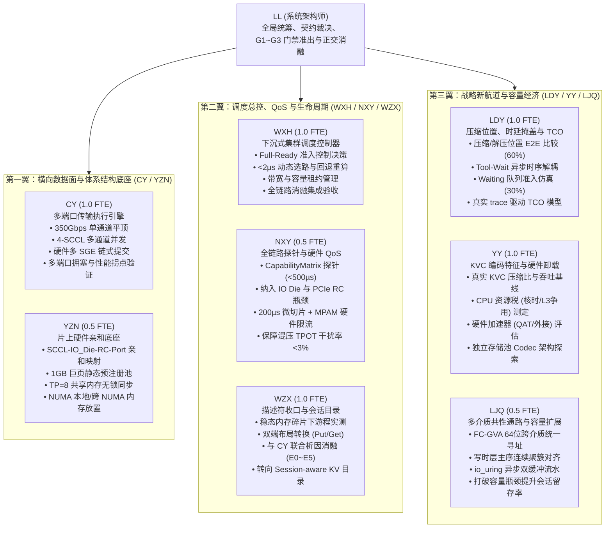
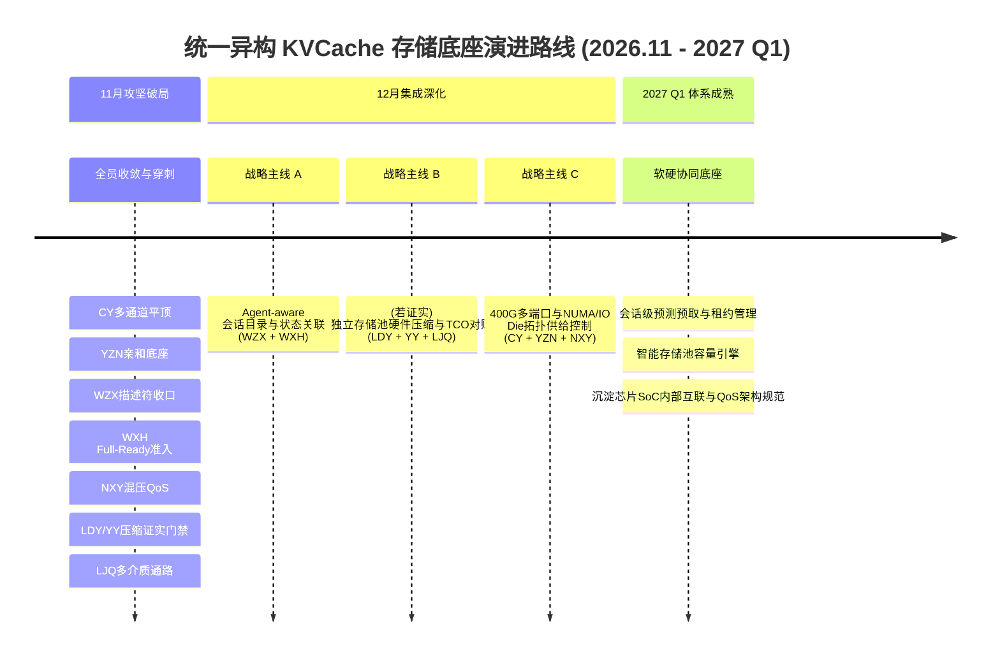
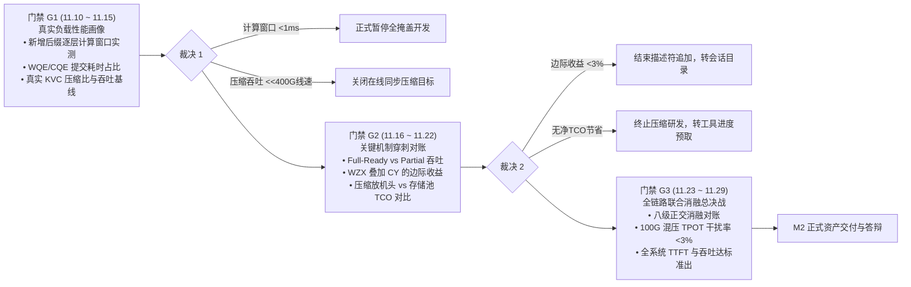

# 统一异构 KVCache 存储池 · 11月攻坚技术路线深化与任务调整复审报告

> **文档性质**：基于 2026 年 11 月 10 日 ~ 11 日《ChatGPT_评审KVC优化方向_20261111-0859.md》讨论稿成果，针对 11 月 M2 决战月全体成员任务安排、研究路线推演、短中期研究价值评估及前沿参考文献进行全面梳理与工程格式化输出的正式基准报告。  
> **适用范围**：面向研发团队全员（CY、YZN、WZX、NXY、WXH、LDY、YY、LJQ 及架构师 LL）作为 11 月（周期调整为 11月09日 ~ 12月06日）攻坚执行、技术路线决策与 12 月/2027 年技术规划的统一输入依据。

---

## 目录

- [一、总体复审结论与技术范式转变](#一总体复审结论与技术范式转变)
- [二、全员任务安排与职责边界重新锚定](#二全员任务安排与职责边界重新锚定)
  - [2.1 CY（1.0 FTE）—— 网络传输执行面满速与多通道并发](#21-cy10-fte网络传输执行面满速与多通道并发)
  - [2.2 YZN（0.5 FTE）—— 底层亲和底座、内存注册与多卡无锁同步](#22-yzn05-fte底层亲和底座内存注册与多卡无锁同步)
  - [2.3 WZX（1.0 FTE）—— 描述符工程收口与 Session-aware KV 目录转型](#23-wzx10-fte描述符工程收口与-session-aware-kv-目录转型)
  - [2.4 NXY（0.5 FTE）—— 全链路资源探针（CapabilityMatrix）与混压 QoS 保障](#24-nxy05-fte全链路资源探针capabilitymatrix与混压-qos-保障)
  - [2.5 WXH（1.0 FTE）—— 下沉式调度控制器总控、Full-Ready 准入与全局集成](#25-wxh10-fte下沉式调度控制器总控full-ready-准入与全局集成)
  - [2.6 LDY（1.0 FTE）—— 压缩部署位置决策、时延掩盖与端到端 TCO 评估](#26-ldy10-fte压缩部署位置决策时延掩盖与端到端-tco-评估)
  - [2.7 YY（1.0 FTE）—— KVC 编码特征、CPU 资源税实测与硬件加速器适配](#27-yy10-ftekvc-编码特征cpu-资源税实测与硬件加速器适配)
  - [2.8 LJQ（0.5 FTE）—— 多介质分层存储共性通路与容量扩展](#28-ljq05-fte多介质分层存储共性通路与容量扩展)
  - [2.9 LL（系统架构师）—— 全局架构正交把关、三级门禁准出与技术裁决](#29-ll系统架构师全局架构正交把关三级门禁准出与技术裁决)
- [三、六大核心技术任务的研究路线深度讨论与争议辨析](#三六大核心技术任务的研究路线深度讨论与争议辨析)
  - [3.1 按层计算通信掩盖的局限性 vs. Waiting 队列预取与 Full-Ready 准入](#31-按层计算通信掩盖的局限性-vs-waiting-队列预取与-full-ready-准入)
  - [3.2 稳态内存碎片下描述符合并瓶颈 vs. 语义执行解耦与 Session 目录演化](#32-稳态内存碎片下描述符合并瓶颈-vs-语义执行解耦与-session-目录演化)
  - [3.3 400G 在线无损压缩的时延陷阱 vs. DDR 高价下的 TCO 容量经济学与 Tool-Wait 解耦](#33-400g-在线无损压缩的时延陷阱-vs-ddr-高价下的-tco-容量经济学与-tool-wait-解耦)
  - [3.4 400G 多端口与 NUMA/DDR/IO Die 带宽错配及主机内部拥塞机制](#34-400g-多端口与-numaddrio-die-带宽错配及主机内部拥塞机制)
  - [3.5 稀疏 KVC 的算法依赖与 HOST 侧定位边界辨析](#35-稀疏-kvc-的算法依赖与-host-侧定位边界辨析)
  - [3.6 多介质 SSD 分层存储的验收目标校准与冷热隔离机制](#36-多介质-ssd-分层存储的验收目标校准与冷热隔离机制)
- [四、各任务短中期研究价值评估与 2027 年战略演进路线](#四各任务短中期研究价值评估与-2027-年战略演进路线)
  - [4.1 任务价值评估矩阵（短期工程价值 vs. 中长期研究承载力）](#41-任务价值评估矩阵短期工程价值-vs-中长期研究承载力)
  - [4.2 2026年12月至2027年Q1三大战略演进主线](#42-2026年12月至2027年q1三大战略演进主线)
- [五、前沿参考文献列表及对特定任务的参考价值](#五前沿参考文献列表及对特定任务的参考价值)
  - [5.1 重点文献/工业进展深度解构与任务映射库](#51-重点文献工业进展深度解构与任务映射库)
  - [5.2 参考文献速查与借鉴原语映射总表](#52-参考文献速查与借鉴原语映射总表)
- [六、11 月三阶段技术门禁与证实/证伪决策机制](#六11-月三阶段技术门禁与证实证伪决策机制)

---

## 一、总体复审结论与技术范式转变

经过 11 月 10 日 ~ 11 日的方案审视与实测数据推导，研发团队对原有 11 月规划中的若干核心假设建立了更为坚实的客观技术依据。复审得出的核心结论如下：

1. **破除微基准推演幻觉，立足真实端到端业务闭环**：
   原规划中将单项微基准中的峰值带宽、理论加速比或无损压缩比例直接简单相加，推导出的宏观 TTFT、TPOT 或吞吐翻倍目标，在真实长前缀、高并发、资源竞争的 Agent 推理场景下难以同时成立。研发规划必须从“纸面指标堆叠”回归到体系结构物理第一性原理，用严格的析因实验与消融测试检验边际净收益。

2. **HOST/CPU 团队核心技术定位的重大范式转变**：
   明确团队的长期价值**从“让 CPU 更快地搬运每一份 KV”，转向“通过 HOST 侧的资源组织、拓扑放置、数据表示与准入控制，让 GPU/NPU 在需要 KV 时尽可能不等待，同时以更低的基础设施 TCO 支持更大的有效工作集”**。
   - 避免过度侵入 GPU/NPU 底层 Attention 计算 kernel（如重写 HBM 双缓冲寻址）；
   - 聚焦 HOST/CPU 具有天然控制权的外围资源调度、拓扑感知放置、生命周期预测与容量成本优化。

3. **研发方向的三类收敛调整**：
   - **降级/暂停**：按层计算通信掩盖（全量流水）与通用 CPU 在线同步无损压缩，因在真实工作负载和 400G 网络下缺乏正收益依据，暂停作为 11 月核心开发指标；
   - **收口/转型**：描述符优化收敛为短期工程收口，完成稳态碎片实测后转向 Agent 会话级生命周期对象管理；
   - **升级/强化**：400G 多端口与 NUMA/DDR/IO Die 带宽错配及主机内部拥塞控制升级为系统级硬核主线；KVC 压缩转向基于 TCO、独立存储池硬件卸载（对标 Intel QAT）及 Tool-Wait 异步解耦的系统容量研究；调度控制器主攻 Full-Ready 准入与会话感知预测。

---

## 二、全员任务安排与职责边界重新锚定

为确保 6.5 FTE + 架构师 LL + 外援的整体效能最大化，避免模块间职责交叉与内耗，根据最新评审结论对 8 位成员的任务进行重新锚定：



### 2.1 CY（1.0 FTE）—— 网络传输执行面满速与多通道并发
* **核心定位**：专注于网络传输执行引擎，独占网卡提交与通信队列资源，不重复上层描述符合并工作。
* **11 月核心攻坚任务**：
  1. **单通道平顶稳态满速**：消除掉速锯齿，保持持续有效带宽 $>38\text{ GB/s}$（CV $<5\%$），完成底层 WQE 队列、Doorbell 批量下发与 PCIe RO/No-Snoop 优化；
  2. **多通道并发传输执行**：在 W2 末承接 YZN 移交的 `MemChannel` 静态亲和底座，合入 Mooncake Transfer Engine，跑通 4-SCCL 多通道条带化并发（聚合带宽目标 $70\sim 80\text{ GB/s}$）；
  3. **多端口与 NUMA/DDR 性能拐点实测**：与 YZN、NXY 协同开展 1/2/4 端口在同 NUMA、跨 NUMA 及不同背景 DDR 流量下的三维压力扫描，定位系统非线性性能恶化的真实硬件瓶颈。
* **考核与交付物**：
  - 单通道全程平顶波形测试报告（稳态 $>38\text{ GB/s}$）；
  - Mooncake 多通道条带化并发执行模块；
  - 多端口扩展效率 $\text{ScalingEfficiency}(N)$ 与聚合衰退实测数据集。

### 2.2 YZN（0.5 FTE）—— 底层亲和底座、内存注册与多卡无锁同步
* **核心定位**：构建 NUMA、内存通道、PCIe RC 与网卡物理端口之间的强亲和底座，从硬件拓扑源头杜绝跨 Die/跨 NUMA 内存放大与争抢。
* **11 月核心攻坚任务**：
  1. **静态巨页预注册池**：启动期按 SCCL 静态预注册 1GB 巨页内存池，提供 `map_buffer_dma` 硬件亲和接口，消除热路径毫秒级动态内存注册开销；
  2. **物理管道锁定**：梳理双路鲲鹏 8-SCCL 物理亲和表，锁定 `SCCL - IO_Die_RC - Port - Path` 静态拓扑管道，确保鲲鹏 `hisi_ddrc` 跨 Die 流量放大比严格 $= 1.00\times$；
  3. **张量并行多卡状态同步**：实现基于共享内存的 TP=8 多卡无锁环形同步原语，将多卡状态同步时延压入 P99 $<100\mu\text{s}$。
* **考核与交付物**：
  - `MemChannel` 静态预注册与硬件亲和库（W2 周五准时交棒 CY）；
  - TP=8 共享内存无锁同步原语；
  - 跨 Die 流量零放大（$1.00\times$）与拓扑隔离验证报告。

### 2.3 WZX（1.0 FTE）—— 描述符工程收口与 Session-aware KV 目录转型
* **核心定位**：前半周期完成描述符优化的客观科学收口，明确边际收益；后半周期转型为面向 Agent 会话生命周期的 KV 对象目录与状态一致性管理层 Owner。
* **11 月核心攻坚任务**：
  1. **描述符稳态碎片与游程实测（前 2 周）**：
     - 在真实长周期 Agent 请求 trace 下，测量连续 Block 分配在内存池稳态运行下的游程长度分布 $P(\text{RunLength}\ge 2, 4, 8, 16)$；
     - 实现硬件中立的 `TransferPlan` 编译器，完成 Put 端多 SGE Gather 写入远端连续区域、Get 端远端连续读取经本地多 SGE Scatter 写入离散 HBM 的对称布局闭环；
     - 与 CY 开展严格的 E0~E5 析因消融实验，定量测定 CY 优化之上描述符合并的真实边际收益 $\Delta_{\text{WZX|CY}}$。
  2. **Session-aware KV Object Directory 原型构建（后 2 周）**：
     - 建立会话级元数据目录：`Session ID → Prefix Range → KV Object Handles → Tier / Ready State / Lease`；
     - 维护上下文版本管理（Context Epoch）与租约生命周期，确保在 Agent 工具调用、上下文裁剪或版本演进时，底层 KV 状态的一致性与安全隔离；
     - 不修改 Attention 计算 kernel，为上层 WXH 调度控制器提供轻量、低开销的会话关联状态支撑。
* **考核与交付物**：
  - 真实稳态内存碎片与 E0~E5 析因消融实验报告（明确描述符边际收益）；
  - `TransferPlan` 双端布局映射与校验工具；
  - `Session-aware KV Object Directory` 原型代码与接口契约文档。

### 2.4 NXY（0.5 FTE）—— 全链路资源探针（CapabilityMatrix）与混压 QoS 保障
* **核心定位**：统管全链路能力矩阵采集与前后台混压 QoS 隔离，从关注微秒级探针耗时升级为指导实际调度决策与容量准入。
* **11 月核心攻坚任务**：
  1. **全链路木桶模型构建**：将鲲鹏 IO Die（`smmuv3_pmcg`、`hisi_hha`）与 PCIe RC（`hisi_pcie` 拥塞停顿计数器）纳入 64B 能力矩阵，构建覆盖网络、内存控制器、片上总线与 PCIe 的三段式木桶瓶颈模型；
  2. **极速无感知遥测**：采用 Linux `perf_event_open mmap` 用户态直读替换慢速内核文件读取，将本地指标采集耗时压缩至 $<2\mu\text{s}$，全链路指标构建上报耗时从 $3\text{ms}$ 降低至 $<500\mu\text{s}$；
  3. **双时间尺度硬件 QoS 隔离**：落地快路径 200µs 微切片（破除 PCIe RC 队头阻塞）与慢路径 20ms 鲲鹏 MPAM 内存带宽限制（`MBW_MAX`），在 100G 后台传输混压下，确保前台在线推理单字生成延迟（TPOT）干扰率严格 $<3\%$。
* **考核与交付物**：
  - 包含 IO Die 与 PCIe RC 指标的 `CapabilityMatrix` 探针库（构建上报 $<500\mu\text{s}$）；
  - 前后台混压硬件 QoS 调度器；
  - 100G 混压下 TPOT 干扰率 $<3\%$ 的实机压测报告。

### 2.5 WXH（1.0 FTE）—— 下沉式调度控制器总控、Full-Ready 准入与全局集成
* **核心定位**：统领横向通信链路选路与纵向冷热介质升降级决策，主导调度面总控与全链路端到端消融集成。
* **11 月核心攻坚任务**：
  1. **微秒级选路避险与原子预扣**：将 NXY 提供的 64B 能力矩阵内嵌至 `MountedSegment`，执行 `inflight_bytes` 原子预扣减，根除高并发突发下的“羊群踩踏”效应；在拥塞链路（如有效带宽 $<6.5\text{ GB/s}$）下，$<2\mu\text{s}$ 内自动触发主动回退至本地重算；
  2. **Full-Ready 准入控制决策（优先主攻）**：降低复杂且收益存疑的 $K^*$ 逐层混合重算优先级，重点落地基于 Waiting 队列的 **Full-Ready Admission（全量就绪准入控制）** 机制，定义 `AdmissionScore` 启发式公式，兼顾 HBM 占用量与请求等待时延；
  3. **全局端到端集成与 Testbed 验收**：统筹自动化评测基础设施（HoloTestbed），组织各模块的集成对接与八级正交消融总对账。
* **考核与交付物**：
  - 下沉式集群调度控制器（选路决策 P99 $<2\mu\text{s}$，回退决策准确率 100%）；
  - Full-Ready 准入控制模块代码与对比仿真报告；
  - 全链路八级正交消融测试数据集与 M2 准出报告。

### 2.6 LDY（1.0 FTE）—— 压缩部署位置决策、时延掩盖与端到端 TCO 评估
* **核心定位**：暂停高侵入性、低边际收益的底层 Attention kernel 双缓冲改造，全面转型为主导 KVC 压缩部署位置、时延掩盖时序与端到端 TCO 经济学评估的核心负责人。
* **人力投入与工作包拆分**：
  - **60% 投入**：压缩/解压部署位置的端到端实验框架构建与 TCO 评估（对比 P1 机头 CPU 压缩、P3 存储节点压缩、Deferred 后台压缩及 Tool-Wait 异步解耦）；
  - **30% 投入**：Waiting 队列 Full-Ready vs. Partial-Ready 准入仿真与业务边界验证（配合 WXH）；
  - **10% 投入**：已有层流水原型与框架现有能力的最小可行性保留，不开展深度 kernel 改造。
* **11 月核心攻坚任务**：
  1. **压缩点位端到端比较**：针对真实 Agent trace，搭建 P1（机头压缩）、P3（远端存储节点压缩）与 G1（机头解压）、G3（远端解压）的端到端对比平台，分析对机头 CPU、L3 缓存、PCIe 与网络带宽的复合影响；
  2. **Tool-Wait 异步时序解耦验证**：利用 Agent 工具调用等待窗口（数秒至十余秒），验证“工具启动进入后台 Deferred 压缩释放热 DDR，工具返回前提前解压预热至边界池”的完整机制，证明时延能否被有效移出在线关键路径；
  3. **真实 TCO 成本模型输出**：结合 DDR 采购成本、服务器通道填充限制、缓存命中率跃升与 GPU 重算开销，建立端到端 $\text{CostPerSLOToken}$ 模型，给出压缩方案在 11 月底的证实/证伪量化判据。
* **考核与交付物**：
  - KVC 压缩部署位置（P1/P3/G1/G3/Deferred）端到端对比实测报告；
  - Tool-Wait 异步时序解耦原型与时延甘特图；
  - 基于真实工作负载的 KVC 分层存储 TCO 成本效益评估模型。

### 2.7 YY（1.0 FTE）—— KVC 编码特征、CPU 资源税实测与硬件加速器适配
* **核心定位**：专注于 KVC 数据分布特征、低开销编解码算法实现与硬件加速器（QAT/IAA 等）卸载可行性研究，与 LDY 形成紧密的“底层算子能力 + 上层系统价值”互补闭环。
* **11 月核心攻坚任务**：
  1. **修正考核 KPI**：结束“400G 在线热路径同步无损压缩降低 TTFT”的硬指标考核，转向科学测定真实 KVC 的熵与压缩比上限；
  2. **CPU 资源税与微架构开销基线测定**：在鲲鹏 920 上，使用真实 LLM 生成的 BF16 KVCache 数据，系统测量不同算法（Bit-plane Disaggregation、LZ4、Zstd、Snappy）在不同线程数、不同缓存层级（L1/L2/L3）下的实际吞吐，精确测定 CPU 核时消耗与对前台推理任务的 L3/总线干扰；
  3. **硬件加速器卸载可行性评估（对标 Intel QAT）**：深入调研 Intel QAT/IAA 及国产平台专用硬件加速方案，评估将编解码任务从机头 CPU 卸载至专用硬件的可行性与接口协议（对标 LMCache RFC #4149），为 12 月是否推进独立存储池硬件压缩提供算法与驱动级依据。
* **考核与交付物**：
  - 真实 KVC 逐比特信息熵与多算法编解码基准测试报告；
  - 鲲鹏 CPU 压缩资源税（CPU 核时、L3 缓存污染、DDR 带宽消耗）量化分析；
  - 面向独立存储池的硬件加速器（QAT/IAA/专用加速器）技术评估与接口设计文档。

### 2.8 LJQ（0.5 FTE）—— 多介质分层存储共性通路与容量扩展
* **核心定位**：剥离调度决策职责，专注于构建传统 SSD 与直通 SSD 同源共性的多介质高速数据通路，打破 HBM/DDR 容量墙。
* **11 月核心攻坚任务**：
  1. **校准验收目标**：不将缺乏真实硬件支撑的 14~18 GB/s 纸面吞吐和模拟直通当成无条件硬性门禁；聚焦于**SSD 异步升迁不阻塞在线调度（保证 TTFT/TPOT P99）**与**打破 DDR 容量瓶颈后的有效会话留存率与每 Token 成本下降**；
  2. **四大共性技术实现**：
     - FC-GVA 64位跨介质统一寻址；
     - 写时跨卡 8KB $\rightarrow$ 2MB~16MB 层主序连续聚簇对齐；
     - 读时 Sort-Merge 聚簇合并 + `io_uring`（`O_DIRECT` + FixedBuffer）32MB Host Pinned 异步双缓冲流水；
     - FC-MAS 介质感知快慢物理隔离队列与 ARM64 非临时指令（`ldnp`/`stnp`）零 L3 污染搬运。
  3. **大容量扩展与长会话留存压测**：在 72B 模型超显存 1.5~2 倍冲击下，验证利用 SSD 扩展存储容量后，长会话缓存命中率从 36% 提升至 $>80\%$ 的能力。
* **考核与交付物**：
  - 多介质共性数据通路引擎（统一寻址 + 层主序聚簇 + `io_uring` 双缓冲流水）；
  - 快慢隔离队列与零 L3 污染迁移验证；
  - 超显存大工作集冲击下会话留存率与吞吐评估报告。

### 2.9 LL（系统架构师）—— 全局架构正交把关、三级门禁准出与技术裁决
* **核心职责**：
  1. **正交边界把关**：确保 8 人赛道严格遵循“横向传输、片上隔离、描述符、探针 QoS、调度总控、压缩时序、编码算子、介质通路”的正交划分，杜绝重复造轮子与边界模糊；
  2. **主持三阶段技术门禁**：在 11 月中下旬严密组织 G1（真实负载画像）、G2（关键机制穿刺）、G3（全链路消融）三次门禁评审，对缺乏净收益或被证伪的方向果断剪枝；
  3. **对账与成果交付**：组织编写 M2 技术主管评审答辩材料，统领“四类交付资产”（代码库、标准规范、消融报告、技术文档），确保向技术主管交付可复核的业务收益。

---

## 三、六大核心技术任务的研究路线深度讨论与争议辨析

### 3.1 按层计算通信掩盖的局限性 vs. Waiting 队列预取与 Full-Ready 准入

#### 1. 深度推演与局限性剖析
原方案将“计算第 $l$ 层 Attention 的同时拉取第 $l+1$ 层 KV”设定为核心机制，并设定了独立降低 TTFT 20%~30% 的目标。但在当前大模型技术与 Agent 实际业务场景下，这一设计面临严峻的物理制约：
- **新增计算窗口极窄（时间不对称）**：在 Agent 多轮对话中，历史前缀往往较长（如 32K token），而每轮新增输入的增量 Prefill 往往很短（数十至数百 token）。计算时间由新增 token 决定，而传输时间由历史全量 KV 决定。
  以 Qwen2-72B（80 层、BF16 GQA）为例，32K 历史前缀约为 10GB。在 40GB/s 有效带宽下，全量加载需 268ms，均匀分摊到每层约为 $3.35\text{ms}$。若新增后缀计算总耗时仅 40ms，平均每层计算仅 $0.5\text{ms}$。
  $$T_{\text{transfer,layer}} \approx 3.35\text{ms} \gg T_{\text{compute,layer}} \approx 0.5\text{ms}$$
  此时每一层的流水必定出现严重的等待气泡，计算根本无法掩盖通信传输。
- **工程侵入性极高**：若采用 HBM 双缓冲以减少显存占用，必须修改 GPU/NPU Attention kernel 内部的寻址逻辑与内存映射，涉及底层计算图重构与复杂的流同步，属于 GPU/NPU 算子团队职责，HOST 团队难以独立把控。
- **$K^*$ 混合重算的经济性问题**：原方案提出当带宽不足时重算前 $K^*$ 层。但前 $K^*$ 层的重算必须涵盖历史前缀才能生成正确的隐状态，计算开销极其高昂，难以满足 $T_{\text{hybrid}}(K) < \min(T_{\text{load}}, T_{\text{recompute}})$ 的成立条件。

#### 2. 替代升级路径：Waiting 队列预取与 Full-Ready 准入
将优化对象从“层间算子流水”升级为“请求级排队与调度重叠”：
- **重叠机制上移**：请求在 Waiting 队列中排队等待调度（如 200ms），此时 KV 加载（如 150ms）可利用该等待窗口在后台静默完成，完全由其他并发请求的计算时间掩盖，**无需对 Attention kernel 进行任何改动**！
- **准入策略对比与收敛**：
  - **策略 A（Full-Ready Admission，推荐 11 月主攻）**：候选请求必须在所需外部 KV 完全 Ready 后才调度进入 Running 队列。优点是调度逻辑清晰、无运行时气泡、与计算引擎零摩擦；缺点是可能短暂占用 HBM 缓冲。
  - **策略 B（Partial-Ready Admission，保留仿真）**：只拉取前 50% 层的 KV 便调度运行，后续层在计算中边走边拉。推演表明：若新增计算窗口极短，后半段不仅无法掩盖，反而会导致 Running 队列中的请求集体卡死在 I/O 等待上，显著恶化整体 TPOT 与长尾时延。
- **结论**：11 月全面主攻 **策略 A（Full-Ready Admission）**，策略 B 仅保留仿真测试；按层流水降级为有条件的技术储备。

---

### 3.2 稳态内存碎片下描述符合并瓶颈 vs. 语义执行解耦与 Session 目录演化

#### 1. 连续分配在长期碎片下的退化风险
在基于 PagedAttention 的服务框架中，通过固定大小 Block（如 16 token）解决外部碎片。原描述符优化方案希望通过在框架层连续分配 8~16 个 Block 组成连续 Extent，从而减少 RDMA/URMA 的 WQE 数量。
- **稳态碎片退化**：在系统长期稳态运行（高并发请求反复到达、释放、前缀共享与缓存淘汰）后，内存池中的空闲块必然高度离散。申请大 Extent 的成功率随时间显著下滑，最终不可避免地退化为以单 Block 分配为主，使得基于物理地址连续性的描述符合并收益大幅缩水。
- **WZX 与 CY 的收益重叠**：底层网卡硬件已支持多 SGE 链式提交与门铃批处理（CY 已利用 agent 完成相关修改），单纯在 CPU 侧做描述符拼接无法带来新的数量级收益。将 WQE 压降简单外推为 TTFT 降低 8%~18% 缺乏端到端因果链支持。

#### 2. SGE 的 Put/Get 对称性与地址契约闭环
针对 SGE 只能抓取离散、写入连续的疑虑，客观梳理标准 RDMA/URMA 单边语义：
- **Put 路径（HBM 离散 $\rightarrow$ DDR 连续）**：由具有离散访问能力的机头端发起 RDMA WRITE，本地多个 SGE 收集离散 HBM 块，写入远端连续 DDR 内存；
- **Get 路径（远端连续 DDR $\rightarrow$ 本地离散 HBM）**：由需要离散块的本地机头端发起 RDMA READ，远端只需提供一个连续读取起始地址，本地利用多个 SGE 列表按顺序 Scatter 写入各个离散的 HBM Block 地址。
- **需补齐的真正契约**：并非 READ 无法 Scatter，而是 `layer-first` 与 `page-first` 之间的张量布局映射字典，以及解压后非等长数据的重排规则。

#### 3. WZX 的科学收口与会话目录转型
- **11 月工程收口**：WZX 不再盲目堆叠合并算法，而是通过 E0~E5 严格析因实验测定真实边际收益。
- **中长期演进**：转向构建 **`Session-aware KV Object Directory`**，管理 Agent 多轮会话的上下文版本、租约有效性与生命周期索引，为全局调度器提供轻量元数据支撑。

---

### 3.3 400G 在线无损压缩的时延陷阱 vs. DDR 高价下的 TCO 容量经济学与 Tool-Wait 解耦

#### 1. 400G 网络在线同步无损压缩的时延陷阱
实测真实大模型生成的 KVCache 运行通用无损压缩库（如 Zstd 等），在 CPU L1/L2/L3 缓存下的测试数据暴露出严峻的性能鸿沟：
- 真实无损压缩率仅在 **$1.3\times$** 左右；
- 70MB KVCache 在 CPU L3 缓存下的压缩耗时超过 **$200\text{ms}$**；
- 在 400Gbps 高速网络下，理论线速为 $50\text{GB/s}$，传输 70MB 原始数据仅需 **$1.4\text{ms}$**；
- 经 $1.3\times$ 压缩后为 53.85MB，理论传输时间为 $1.08\text{ms}$，**网络传输仅节省 $0.32\text{ms}$，却付出了 $200\text{ms}$ 以上的 CPU 压缩耗时**！
- 盈亏平衡公式表明：在非重叠压缩下，必须满足 $B_c > \frac{R B_n}{R - 1}$。当 $R = 1.3, B_n = 50\text{ GB/s}$ 时，要求 CPU 压缩吞吐 $B_c > 216.7\text{ GB/s}$；即使在理想流式流水下，也要求 $B_c > B_n = 50\text{ GB/s}$。而当前实测 CPU 压缩吞吐仅约 $0.35\text{ GB/s}$，相差两个数量级以上！
- **结论：以降低传输时延为目的的在线同步无损压缩，在 400G 高速网络下彻底被证伪！**

#### 2. 从 TCO 与系统容量出发重构压缩价值
当前服务器 DDR 合约价格高涨，KVC 压缩绝不能仅看作网络传输节省，而应作为**系统容量扩展与 TCO 优化工具**：
- **容量放大与重算消除**：在单存储节点 512GB DDR 中，若 80% 工作集实现 $1.3\times$ 压缩，有效逻辑容量可提升至约 628GB（增幅 22.6%）。当业务工作集超过物理 DDR 上限时，该扩容能力可将原本将被驱逐的热点 KV 稳定保留在内存中，避免后续昂贵的 GPU Prefill 重算，从而提升整体系统 Goodput！
- **时序解耦（Tool-Wait 异步压缩与预热）**：
  在 Agent 业务中，模型执行工具调用（Tool Call）通常需要数秒至数十秒。此时 GPU 处于空闲或处理其他请求状态：
  ```
  t=0s: 推理结束，进入 Tool Call (预计耗时 8s)
  t=1s: HBM 紧张，KV 卸载至机头/存储节点 DDR (Raw 态)
  t=2s: 判断为长等待，后台异步触发 Codec 压缩为 1.3x 压缩态，释放 23% 物理 DDR 容量
  t=7s: 监测到工具接近执行完毕，在后台将压缩态数据提前异步解压预热至边界池
  t=8s: 工具返回，新请求到达，KV 已处于 Raw Ready 态，零时延开销直接恢复计算！
  ```
  通过时序解耦，**$200\text{ms}$ 的压缩/解压耗时被完全移出在线请求的关键路径**！

#### 3. 借鉴 Intel QAT 独立存储池硬件压缩范式
Intel 官方开源项目 `intel-accel-for-llm`（IAXL / KVShrink）给出了关键架构参考：
- **算力剥离**：将 QAT/IAA 专用硬件压缩加速器部署在**远端独立 KV 存储池节点**，而非推理机头；
- **资源保护**：推理机头仅通过 RDMA 将原始数据送至存储池，由存储池负责异步硬件压缩与落盘，彻底消除对推理机头 CPU、L3 缓存与内存带宽的侵占，保护前台在线推理的 P99 稳定性。

---

### 3.4 400G 多端口与 NUMA/DDR/IO Die 带宽错配及主机内部拥塞机制

#### 1. 带宽预算与微架构瓶颈
- 400Gbps 网卡线速达 $50\text{GB/s}$，已逼近 DDR5-5600 单通道理论峰值（$44.8\text{GB/s}$）。
- 当节点配备 2~4 个 400G 端口并发工作，且存在 `HBM -> DDR -> RNIC` 这类分级搬运路径时，同一份数据在 DDR 中经历一次写入和一次读取，**有效内存访问放大系数 $A_{\text{mem}} \approx 2\times$**。
- 两个 400G 端口外发 $100\text{GB/s}$ 流量，将对本地 NUMA 产生接近 $200\text{GB/s}$ 的 DDR 读写压力，极易导致 DDR 控制器（DDRC）饱和、片上总线及 PCIe Root Complex（RC）出现反压与拥塞。

#### 2. 学术界与工业界硬核证据
- **IEEE ToN 2025《RHCC》**：证实当高速 RDMA NIC DMA 与 CPU 内存访问并发竞争时，主机内部内存子系统会形成严重拥塞，导致网络吞吐大幅下降与延迟暴增；
- **USENIX NSDI 2023**：指出网卡内部微架构资源（QP 缓存、地址转换表等）在多流高并发下的争用，同样会导致严重的非线性性能劣化；
- **Red Hat 2026.10 实验**：在真实 PD 分离推理负载下，仅优化 GPU-NIC-NUMA 物理拓扑对齐，就使 KV 传输吞吐提升至跨 NUMA 配置的 **$2.15\times$**（平均时延降低 53.6%）；
- **Mooncake 2026.08 RFC #3653**：正式提出在存储调度 Master 层必须支持 NUMA-aware DRAM Placement，承认底层亲和不足会导致严重的内存访问错配。

#### 3. 研究路线收敛
将多通道研究从简单的“多网卡拼带宽”提升为**“面向 KVC 的 HOST 内部带宽供给、拓扑放置与拥塞控制”**，通过三维压力扫描精准定位真实物理拐点，指导未来软件调度与芯片 SoC 架构协同。

---

### 3.5 稀疏 KVC 的算法依赖与 HOST 侧定位边界辨析

- **原生稀疏 vs. 外挂稀疏**：原规划提出在 HOST 侧独立筛选 Top-K（25%~50%）重要 KV 进行聚簇拉取。但推演表明：对于标准密集注意力模型，任意删除历史 KV 会破坏 Attention 数学正确性；且当前查询向量 $Q$ 必须在执行到该层时才能生成，HOST 无法提前知晓最佳 Top-K 索引。若在 HOST 侧重新计算注意力进行预测，其额外开销将远超传输节省。
- **HOST 正确切入点**：聚焦于支持模型原生稀疏注意力（如 DeepSeek V4 混合稀疏模型）的系统底座，承担“DDR 全量 KV 与 NPU 有限热缓冲之间的按需缺失行搬运、索引传输与 QoS 隔离”，11 月不独立投入人力开发通用稀疏算法引擎。

---

### 3.6 多介质 SSD 分层存储的验收目标校准与冷热隔离机制

- **规避纸面数据幻觉**：在缺乏真实 GPU Direct Storage（GDS）/ P2P 硬件的环境下，不应将 14~18 GB/s 顺序吞吐作为无条件验收 KPI，避免将模拟器测试与硬件直达混为一谈。
- **核心验收标杆**：聚焦于 **“SSD 异步升迁不阻塞在线调度”**。借鉴 LMCache 最新论文（arXiv:2610.21249）的避坑指南，杜绝同步 `O_DIRECT` 直读导致的 3.4 倍 TTFT 劣化（93ms 陷阱）以及 Page Cache 满载引发的 683ms 刷盘雪崩；落地应用层显式管理的 **FC-MAS 双轨隔离队列（DDR 极速快队列 + SSD 异步预热慢队列）**，确保在超显存冲击下服务达标率稳定维持在 $>95\%$。

---

## 四、各任务短中期研究价值评估与 2027 年战略演进路线

### 4.1 任务价值评估矩阵（短期工程价值 vs. 中长期研究承载力）

| 技术方向 | 责任人 | 短期工程价值 (11月) | 中长期研究承载力 (3~6个月) | 评审判断与投入决策 |
| :--- | :--- | :--- | :--- | :--- |
| **多通道与内部带宽协同** | CY / YZN | 极高：突破 70~80GB/s 聚合瓶颈 | **极高**：解决 DDR/IO Die 错配，引领 SoC 架构需求 | **重点主攻**，保持核心人力投入 |
| **下沉式调度与准入控制** | WXH / NXY | 高：实现选路避险与混压 QoS | **高**：演进为 SLO-aware 与 Agent 预测式调度系统 | **重点主攻**，落地 Full-Ready 准入 |
| **KVC 压缩 TCO 与时序解耦** | LDY / YY | 中：摸清真实压缩比与资源税 | **中高**：取决于 11 月证实门禁，对标 QAT 独立存储池 | **条件性保留**，11月穿刺后门禁决策 |
| **多介质 SSD 共性通路** | LJQ | 中高：打通大容量持久层通路 | **中**：冷热分层与成本优化，对标行业 Context Storage | **维持独立交付**，校准真实业务目标 |
| **描述符合并与连续分配** | WZX | 中：完成编译优化与消融收口 | **偏弱**：单点优化空间见顶，受稳态碎片物理制约 | **短期收口**，11月下旬转型会话目录 |
| **逐层全掩盖与双缓冲** | (原LDY) | 低：增量计算极短导致严重气泡 | **低 (HOST侧)**：侵入 Attention kernel，属硬件团队职责 | **降级暂停**，不作为 11 月开发目标 |
| **通用稀疏 KVC 筛选引擎** | (原规划) | 低：密集模型强制抽稀导致精度崩塌 | **低 (HOST独立开发)**：强依赖模型原生注意力与计算卡算子 | **取消独立开发**，转为技术跟踪 |

---

### 4.2 2026年12月至2027年Q1三大战略演进主线

结合最新工业界演化（NVIDIA Dynamo、Intel KVShrink 等），团队在 12 月及 2027 年初应收敛为三大战略主线，避免人力闲置与碎片化：



#### 主线 A：Agent-aware KV Lifecycle（会话级生命周期与预测式供给协同）
- **核心定位**：从传统的“单次请求级被动响应”升级为“面向 Agent 会话生命周期的主动资源组织”；
- **分工协同**：**WZX（会话目录与状态一致性）+ WXH（预测式调度与准入决策）+ LJQ（冷热介质流动）**；
- **核心机制**：利用 Agent 提供的会话线索（`Session ID`、`Parent Session ID`、`Tool State`、`Tool Progress`、`Expected Resume Window`），结合论文《Ask the Tool, Don't Guess》与 NVIDIA Dynamo 机制，在工具执行中提前预热解压与预取 KV，将工具返回后的 TTFT P90 降低 20%+。

#### 主线 B：KVC Capacity & TCO Engineering（多级存储容量经济学与硬件卸载）
- **核心定位**：以最低的基础设施 TCO 持有海量有效可复用 KV，彻底打破显存容量墙；
- **分工协同**：**LDY（系统时序与 TCO 建模）+ YY（硬件加速 Codec）+ LJQ（SSD 介质落地）**；
- **演进分支**：
  - **若 11 月压缩证实具有 TCO 净收益**：12 月全面推进独立存储池节点的硬件加速器（QAT/IAA/专用芯片）卸载，构建集成压缩、分层与校验的智能 Context Storage；
  - **若 11 月证实容量收益不足以弥补成本**：果断终止压缩投入，YY 转向低开销数据校验与专用数据搬运，LDY 全面合入主线 A 主攻工具进度预热。

#### 主线 C：HOST Resource & I/O Orchestration（内部带宽供给、拓扑放置与拥塞控制）
- **核心定位**：攻坚高速网络与主机内部内存/总线子系统之间的物理错配，确立 HOST 侧的核心体系结构壁垒；
- **分工协同**：**CY（多端口执行与队列）+ YZN（物理亲和与拓扑）+ NXY（片上遥测与 QoS）+ WXH（资源路由）**；
- **核心机制**：深入解剖多端口并发对 DDRC、IO Die、PCIe RC 的非线性压力，构建包含排队、DMA、跨 NUMA 惩罚的闭式成本模型，沉淀下一代国产 AI 服务器与 SoC 芯片的片上互联及 QoS 硬件规范。

---

## 五、前沿参考文献列表及对特定任务的参考价值

针对讨论稿中深入探讨的最新学术论文与工业界权威进展，梳理并映射出其对 8 位成员核心任务的具体参考价值。

### 5.1 重点文献/工业进展深度解构与任务映射库

#### 1. Intel IAXL / KVShrink 项目（Intel 官方开源，2026）
* **涉及成员**：`LDY`、`YY`
* **核心内容**：面向 vLLM V1 实现了专门针对 KVCache 的独立存储池硬件压缩加速底座。设计了 `Remote Pool` 架构，将数据通过 RDMA 送至远端存储节点后，利用片上硬件加速器（QAT / IAA）执行异步压缩与落盘；在 Get 读取时由存储节点异步解压并通过按层流水返回原始 KV。
* **直接指导价值**：
  - 彻底解开了“在机头压缩还是在存储池压缩”的架构争议，为 LDY 提供了将算力剥离出推理机头的工业级参考范式；
  - 为 YY 提供了利用专用硬件加速器卸载 CPU 压缩税的接口契约与数据流设计。

#### 2. LMCache Hardware-Accelerated KV Compress Adapter RFC #4149（GitHub，2026.07）
* **涉及成员**：`YY`、`LDY`
* **核心内容**：主流 KV 缓存开源框架 LMCache 提出的硬件压缩适配器架构 RFC。将压缩解耦为独立的 Serde 适配层，定义了仅加速器模式（QAT/IAA）、GPU 量化+加速器模式、以及专用硬件压缩+GPU 解压引擎三种技术路径。
* **直接指导价值**：指导 YY 设计通用且硬件中立的 Codec 插件接口，避免将特定算法与传输网络硬编码绑定。

#### 3. IEEE Computer Architecture Letters 2025《Hardware-Accelerated Kernel-Space Memory Compression Using Intel QAT》
* **涉及成员**：`YY`、`LDY`
* **核心内容**：学术界通过实测严格证明：在内存压缩场景下，传统 CPU 压缩会导致共址的延迟敏感服务 P99 恶化高达 $3.2\sim 12.1\times$；而改用专用硬件加速器（QAT）后，P99 恶化仅为 $1.2\sim 1.6\times$。
* **直接指导价值**：从计算机体系结构第一性原理上，确立了专用压缩硬件的真正价值不在于“跑得比 400G 网络更快”，而在于“保护延迟敏感的核心 CPU 与 L3 缓存不被计算税污染”，为团队开展混压 QoS 提供了关键学术支撑。

#### 4. NVIDIA Dynamo: Session-aware Agentic Inference（PyTorch 官方博客，2026.10）
* **涉及成员**：`WZX`、`WXH`、`LDY`
* **核心内容**：NVIDIA 在真实 SWE-bench 场景中提出基于会话感知（Session-aware）的 Agent 推理体系，吞吐相比传统 KV-aware Routing 进一步提升 12%~16%。引入了轻量级会话标识（`session_id`、`parent_session_id`）与核心策略接口 `KvHint`（包括 `Prefetch`、`Demote`、`Pin`、`Retain`、`Share`）。
* **直接指导价值**：
  - 为 WZX 的 `Session-aware KV Object Directory` 提供了标准工业级字段规范与语义定义；
  - 明确了 Session ID 仅用于生命周期管理与预测，底层匹配依然依赖 Token Hash 与多维语义一致性校验。

#### 5. arXiv:2609.18849《Ask the Tool, Don't Guess: Agent Tool Calls Hold Their Progress, and the Serving System Should Read It》（2026.09）
* **涉及成员**：`LDY`、`WXH`
* **核心内容**：论文指出，在 Agent 推理中与其盲目猜测工具调用何时结束，不如直接从工具运行环境中读取实时进度信号（`tool_progress`），据此提前触发 KV 预热与升迁。实测在工具返回后将端到端 TTFT P90 降低了 **20.7% ~ 20.8%**。
* **直接指导价值**：直接启发了 LDY 的“Tool-Wait 异步时序解耦”机制，为将 $200\text{ms}$ 的压缩/解压耗时无缝移出在线关键路径提供了最有力的实证依据。

#### 6. arXiv:2608.14624《CacheScout: Learning Agent Execution for KV-Cache Management in Agentic Serving》（2026.08）
* **涉及成员**：`WXH`、`WZX`
* **核心内容**：通过学习多 Agent 复杂工作流的状态转移概率，在运行时主动预测下一轮复用并执行提前预取与差异化淘汰。在多 Agent 负载下，缓存命中率提升 10~18 个百分点，平均 TTFT 降低 18%~45%，峰值吞吐提升 57%。
* **直接指导价值**：为 WXH 的下沉式调度控制器由静态启发式向会话级预测调度演进提供了算法模型支撑。

#### 7. IEEE Transactions on Networking 2025《RHCC: Revisiting Intra-Host Congestion Control in RDMA Networks》
* **涉及成员**：`CY`、`YZN`、`NXY`
* **核心内容**：深入研究主机内部资源瓶颈引发的 RDMA 拥塞问题。指出当 RNIC DMA 流量与 CPU 内存访问在片上发生竞争时，传统网络层流控无法感知主机内部拥塞，导致性能雪崩。RHCC 提出了主机内部拥塞感知与主动反压机制，实测网络吞吐提升最高 2 倍，时延降低 1.4 倍。
* **直接指导价值**：为 CY/YZN 解释“多端口聚合带宽非线性下降”提供了直接的理论支撑，指导团队将多通道优化与片上 DDR/PCIe 资源监控紧密结合。

#### 8. USENIX NSDI 2023《Understanding RDMA Microarchitecture Resources for Performance Isolation》
* **涉及成员**：`CY`、`YZN`
* **核心内容**：揭示了网卡内部微架构资源（如片上缓存、连接状态上下文、页表转换表 MTT）是引发高并发下性能干扰与长尾延迟的核心根因，证明了单纯依赖物理端口带宽无法实现真正的性能隔离。
* **直接指导价值**：指导 CY 在多通道高并发测试中，排查网卡内部 WQE 队列、CQE 聚合与多流竞争瓶颈。

#### 9. Mooncake NUMA-aware DRAM Placement RFC #3653（GitHub，2026.08）
* **涉及成员**：`YZN`、`CY`、`WXH`
* **核心内容**：Mooncake 官方承认其底层 Transfer Engine 虽然知道拓扑关系，但上层 Store Master 在对象分配时缺乏 NUMA 亲和感知，导致数据被错误分配到远端 NUMA，引发跨 Die 流量与性能损失。RFC 提议在存储对象抽象中显式嵌入 NUMA 属性。
* **直接指导价值**：证实了 YZN 推进一阶段静态内存注册与物理拓扑亲和底座的先导性与必要性。

#### 10. Red Hat RDMA & DRA 物理拓扑实验报告（Red Hat 开发者博客，2026.10）
* **涉及成员**：`CY`、`YZN`
* **核心内容**：在真实的 Qwen-27B Prefill-Decode 分离集群上，对比了同 PCIe Switch、同 NUMA 不同 Root 以及跨 NUMA 三种物理拓扑对 KVCache 传输的影响。实测拓扑完全对齐配置下的有效传输吞吐达到跨 NUMA 的 **$2.15\times$**（从 9.61 GB/s 跃升至 20.71 GB/s）。
* **直接指导价值**：为团队坚持“物理亲和与硬件拓扑对齐”提供了最强有力的全链路真实业务证据。

#### 11. arXiv:2405.04437《vAttention: Dynamic Memory Management for Serving LLMs without PagedAttention》（2024）
* **涉及成员**：`WZX`
* **核心内容**：利用 GPU 虚拟内存管理技术，将逻辑连续的地址空间与物理离散页面解耦，避免了为了维持连续性而在物理内存分配器上做过度妥协。
* **直接指导价值**：启发 WZX 在面对稳态物理内存碎片时，应从“构造虚拟连续视图”角度思考，而非一味追求分配源头的绝对物理连续。

#### 12. arXiv:2610.21249《Characterizing Predictability-Latency Trade-offs of KV-Cache SSD Offloading in LMCache》（2026.10）
* **涉及成员**：`LJQ`、`WXH`
* **核心内容**：系统揭示了盲目采用同步 `O_DIRECT` 直读 SSD 会导致小请求 TTFT 恶化 3.4 倍，而依赖系统 Page Cache 又会导致 683ms 刷盘雪崩的客观事实。
* **直接指导价值**：为 LJQ 构建应用层显式管理的 **FC-MAS 双轨隔离队列（DDR 极速快路径 + SSD 异步预热慢路径）** 提供了决定性的避坑指引。

---

### 5.2 参考文献速查与借鉴原语映射总表

| 序号 | 核心文献 / 工业界权威进展 | 发表/发布时间 | 责任人 | 借鉴的核心技术机制 / 原语 | 实测标杆或指导意义 |
| :---: | :--- | :---: | :---: | :--- | :--- |
| **1** | **Intel IAXL / KVShrink** (GitHub) | 2026 | LDY, YY | 独立存储池硬件压缩架构；QAT/IAA 异步卸载；解压按层流水 | 算子剥离推理机头，保护前台 CPU |
| **2** | **LMCache Hardware Compress RFC #4149** | 2026.07 | YY, LDY | 可插拔 Serde 硬件压缩适配器规范；多模式压缩解耦 | 规范化 Codec 抽象，避免硬编码绑定 |
| **3** | **IEEE CAL 2025: QAT-zswap** | 2025 | YY, LDY | 硬件加速器消除 CPU 计算税与 L3 污染；保护延迟敏感业务 | 证明硬件压缩对消除 P99 抖动的第一性原理 |
| **4** | **NVIDIA Dynamo: Session-aware Inference** | 2026.10 | WZX, WXH | `session_id` 生命周期；`KvHint` (Prefetch, Demote, Pin 等) | SWE-bench 业务吞吐提升 12%~16% |
| **5** | **arXiv:2609.18849: Ask the Tool** | 2026.09 | LDY, WXH | 读取工具实时进度信号 `tool_progress` 指导异步预热解耦 | 工具返回后 TTFT P90 降低 20.8% |
| **6** | **arXiv:2608.14624: CacheScout** | 2026.08 | WXH, WZX | 学习 Agent 状态转移概率；主动预测式预取与差异化淘汰 | 缓存命中率升 10~18%，TTFT 降 18~45% |
| **7** | **IEEE ToN 2025: RHCC** | 2025 | CY, YZN | 主机内部内存争用感知；RDMA 内部拥塞控制与反压 | 吞吐提升最高 2x，时延改善 1.4x |
| **8** | **USENIX NSDI 2023: RDMA Microarchitecture** | 2023 | CY, YZN | 网卡微架构资源（QP/MR 缓存、转换表）性能隔离排查 | 排除网卡内部队列瓶颈的技术手段 |
| **9** | **Mooncake NUMA RFC #3653** | 2026.08 | YZN, CY | 存储 Master 层的 NUMA 亲和内存对象分配策略 | 消除底层传输与上层存储分配的拓扑错配 |
| **10** | **Red Hat: RDMA/DRA 拓扑实验** | 2026.10 | CY, YZN | GPU-NIC-NUMA 物理拓扑强亲和对齐与非对齐对比 | 拓扑对齐使 KV 传输吞吐跃升至 2.15x |
| **11** | **arXiv:2405.04437: vAttention** | 2024 | WZX | 虚拟地址连续性与物理离散解耦；动态虚拟页表映射 | 推理吞吐提升 1.23x，指明虚拟化方向 |
| **12** | **arXiv:2608.13263: vToken** | 2026.08 | WZX, LJQ | Token 级虚拟化解耦；异步重打包回收存活碎片 | 保留块数降 27~72%，SLA吞吐升 1.37x |
| **13** | **SGLang HiCache Design** | 2026 | WZX, LDY | `page-first` 聚簇；Waiting 期间预取策略 (wait/best_effort) | 跨介质多布局转换的工业界标准设计 |
| **14** | **ACM SIGCOMM 2024: CacheGen** | 2024 | YY | 针对 KV 统计分布特性的专用流式定制编码器 | 压缩 3.5~4.3x，获取延迟降低 3.2~3.7x |
| **15** | **ICML 2024: KIVI** | 2024 | YY | Key/Value 异构量化轴非对称低比特表示 (2-bit) | 减少原始表示体积，显著降低访存开销 |
| **16** | **Mooncake SSD Offloading & FlatCake** | 2026.10 | LJQ | 写时分桶聚簇；异步超前升迁；FC-MAS 介质双轨隔离 | 避免多轮淘汰断崖，命中率维持 >84% |
| **17** | **arXiv:2610.21249: LMCache SSD Trade-offs** | 2026.10 | LJQ, WXH | 揭示同步直读 3.4x 时延陷阱与 PageCache 683ms 刷盘雪崩 | 必须采用显式管理的双轨快慢队列隔离 |
| **18** | **vLLM-Ascend Layerwise & Sparse Offloading** | 2026 | LDY | 昇腾 NPU 逐层流水与基于索引的稀疏卸载官方实现 | 明确工业界现有约束，避免重复试错 |

---

## 六、11 月三阶段技术门禁与证实/证伪决策机制

为杜绝在边际收益低下或不可行的方向上进行无休止的资源消耗，11 月攻坚设立三次严格的技术门禁（Gates）：



### 6.1 门禁详细考核标准与停止研发条件

1. **门禁 G1：真实负载性能画像（11月10日 ~ 11月15日）**
   - **必须回答的客观问题**：
     - 在实际 Agent 多轮 trace 中，新增输入后缀的逐层计算时间是多少？是否具备掩盖传输的理论窗口？
     - WQE/CQE 处理到底占端到端时延的百分之几？
     - 真实 KVC 数据的无损压缩比和单核 CPU 压缩吞吐是多少？
   - **停止研发判据**：
     - 若新增后缀的理论可掩盖时延占比 $<5\%$，正式停止按层全掩盖的追加投入；
     - 若通用压缩吞吐远低于 $50\text{GB/s}$ 且时延增加数个数量级，彻底关闭“在线同步压缩降低 TTFT”的开发分支。

2. **门禁 G2：关键机制穿刺对账（11月16日 ~ 11月22日）**
   - **必须回答的客观问题**：
     - 在相同 HBM 水位下，Full-Ready 准入与 Partial-Ready 准入谁的系统达标 Goodput 更高？
     - 在 CY 优化完成之后，WZX 的描述符合并还能带来多少独立的端到端边际收益？
     - 压缩放在机头还是独立存储池？能否通过 Tool-Wait 异步时序掩盖 Codec 开销并产生可兑现的 TCO 节省？
   - **停止研发判据**：
     - 若 Partial-Ready 出现明显的运行中等待与长尾恶化，完全锁定 Full-Ready 为唯一上线策略；
     - 若 WZX 叠加 CY 后的边际收益微弱且无独立场景，WZX 全面转入 `Session-aware KV Object Directory`；
     - 若压缩无法通过容量放大形成明确的 TCO 净收益，YY 与 LDY 终止压缩算法开发，分别转向底层数据搬运优化与工具进度感知预热。

3. **门禁 G3：全链路联合消融总决战（11月23日 ~ 11月29日）**
   - **必须回答的客观问题**：
     - 各正交模块同时启用后，全系统端到端 TTFT P99、单字 TPOT 干扰率与系统总吞吐 QPS 是否满足既定目标？
     - 是否存在隐蔽的 CPU 核时争用、DDR 总线拥塞或网卡微架构反噬？
   - **准出要求**：
     - 严守 100G 混压下前台 TPOT 干扰率 $<3\%$ 的红线；
     - 端到端平均 TTFT 提升 $25\%\sim 50\%$，系统有效吞吐提升 $30\%+$；
     - 完成代码冻结、消融报告签署与“四类生产级交付资产”封包归档。

---

> **报告归档说明**：本报告为 11 月统一异构 KVCache 存储池研发攻坚任务调整与技术路线深化的基准执行文档，已同步更新配套人力架构图（`_V3.pptx`）与进展跟踪表（`_V3.xlsx`）。全员自 11 月 09 日起按本报告重新锚定的赛道与门禁指标严格执行。
