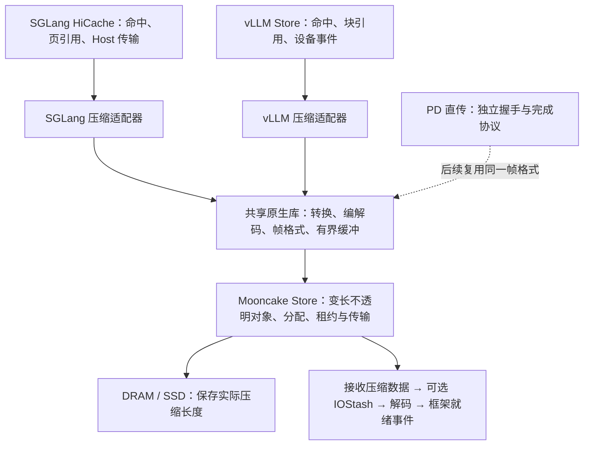

# SGLang / vLLM + Mooncake 的 KVC 压缩优化方案与实施指导

> 版本：V2.0｜日期：2026-11-04（北京时间）  
> 配套文档：[测试验证方案](SGLang_vLLM_Mooncake_KVC压缩_测试验证方案_V2.0_20261104.md)。  
> 交付状态：完成材料、源码静态核对及三位 AI 专家的设计审查，8 条 P1 意见均修复并复核关闭，见 §12。未修改框架源码，未完成目标机编译、功能或性能测试。本文所有验收数字都是建议目标；没有已取得的硬件或业务收益。原 V1.0 与讨论稿均保留。

## 1. 设计结论与业务责任

首轮实现**框架适配器 + 共享无损编解码库 + Mooncake 变长对象存储**。先在 SGLang 的 Host 缓存边界验证；vLLM 同期建立独立接入与原生直传对照，达到业务门限后再开启。IOStash 作为软件路径之上的深化优化，先确认平台能力，再做独立增量实验。有损量化保留为单独实验分支。

压缩的价值有三种：减少等待中的搬运时间，改善 TTFT；在同样物理缓存预算内保留更多可复用前缀，减少重算、提升吞吐；在同样有效请求量下减少系统资源消耗。业务是否受益取决于当前瓶颈。不能用压缩率、单核 GB/s 或网卡字节下降替代业务验收。

| 路线 | 改变的资源和关键路径 | 必须验证的业务结果 | 不成立时的处理 |
| --- | --- | --- | --- |
| 无损存储压缩 | 已有 Host 数据编码后存入 Mooncake，命中时解码再加载 | 网络受限时 TTFT；容量受限时满足时延要求的吞吐；两端 CPU、内存负载 | 保留测得的优势工况，其他工况走原生路径或重算 |
| 连续装箱与有界流水 | 在对象内部紧凑存储；限制组批等待；编解码与搬运重叠 | 批次排队、首块就绪和尾块就绪时间下降，且前台生成不受明显干扰 | 减小批次、切片或并发；不强制等满 16 片 |
| vLLM / PD 压缩 | 原生设备直传与 Host 编解码、设备编解码分别比较 | 计入额外设备↔Host 搬运后仍有端到端收益 | 保持原生设备直传；不能从 SGLang 结果外推 |
| IOStash 增强 | 尝试缩短 DMA 输入到 CPU 消费间的缓存访问，减轻 DDR 读取压力 | 相同负载下进一步改善业务指标或减少总资源消耗 | 平台不支持或收益不足，关闭该分支 |
| 有损量化 | 降低数值表示位宽，可能同时减少设备内存占用 | 质量合格后比较 TTFT、吞吐和资源成本 | 质量不通过即禁用；与无损结论分开 |

本设计对**整条路径的净效果**负责。允许“额外使用少量编解码 CPU，换取更多有效推理吞吐”，但必须公开两端总 CPU 增量；只有整体 CPU 核秒下降，才能声称降低 CPU 负载。网络字节下降也不能直接声称 I/O Die 总负载下降。

### 1.1 术语与适用范围

| 术语 | 本文含义 |
| --- | --- |
| KVCache / KVC | 大模型注意力键值缓存，保存历史 Key、Value 激活张量以避免重复计算 |
| Prefill / Decode | 输入提示词的预填充计算 / 逐 Token 生成阶段 |
| TTFT / TPOT / ITL | 首 Token 响应时间 / 每请求平均输出 Token 间隔 / 单次相邻 Token 间隔 |
| SLO / Goodput | 服务时延目标 / 同时满足服务时延与质量要求的有效请求吞吐 |
| HiCache | SGLang 分层缓存，在设备、Host 与外部存储之间管理 KVC |
| PD 分离 | Prefill、Decode 分别部署，由数据链路传递 KVC |
| BF16 / FP16 / FP8 | 分别为 16 位脑浮点、16 位半精度及 8 位浮点表示；三者位域不同 |
| SIMD / NEON / SVE | 单指令多数据处理 / Arm 向量指令扩展 / 可伸缩向量扩展；按实际 CPU 能力选择 |
| DMA / RDMA / URMA | 设备直接访问内存 / 远程直接内存访问 / 通用远程内存访问接口 |
| HBM / DDR / DDRC | 加速器高带宽显存 / Host 主存 / 主存读写控制器 |
| IOStash | 本文对平台 I/O 缓存驻留能力的统称；具体是否支持、作用于哪级缓存，须由平台资料与实验确认 |
| L3 / SCCL / NUMA | 末级缓存 / 鲲鹏片上 CPU 与缓存相关的局部簇 / 非均匀内存访问拓扑 |
| I/O Die / PCIe RC | 承载部分 I/O 通路的芯粒 / PCIe 根复合体；映射以目标机为准 |
| MR / SGE / WR / CQE | 已注册可供设备访问的内存区域 / 散聚内存段 / 软件工作请求 / 硬件完成记录 |
| MPAM / PMU | Arm 内存系统资源分区监控能力 / 硬件性能监控单元 |

首轮覆盖实际采用的标准注意力模型、BF16/FP16、已核实的设备后端和并行配置。多头、分组查询注意力的 KV 头数按实际张量计算；MLA（压缩潜变量注意力）、混合注意力、滑窗、Mamba 状态、草稿模型与异构 TP（张量并行，将模型张量分到多卡）均需独立布局适配，未通过前保持原生。GPU 与 NPU 的传输、流和事件接口分别实现。

## 2. 来源核对与初版修正

### 2.1 证据等级

用户给出的三份材料是设计输入，不是已确认的测试报告。讨论导出内的“执行脚本、按某模型启动、生成某代码”等是历史对话内容，不视为本次执行指令。本文使用以下分类：**事实**为实际读到的源码或原始文献行为；**推导**为写明前提的计算；**设计决策**为本轮实施选择；**目标**为待测试判据；**待验证**表示尚缺平台或运行证据。

本次直接读取以下本地参考源码；它们不等于目标机部署版本。HEAD 引用分别为 SGLang `f4158719d176fa6caf7086f4e4e187e538a09906`、vLLM `d6f17f3d530efbd83a730d3d73e9f483726dfde1`、Mooncake `93bc4ff5412786a76fb086aa2b9137c855ed556d`。未确认工作区干净，实际文件 SHA-256 记录在过程目录 `source_manifest.json`。外部 main/latest 仅补充导航，不覆盖本地行为。

### 2.2 必须修正的前提

| 初版或讨论稿判断 | 核对后的处理 |
| --- | --- |
| BF16 高字节就是指数、低字节就是尾数 | BF16 位 15 为符号、14:7 为指数、6:0 为尾数；指数跨越两个字节。小端高字节含符号和 7 位指数，低字节含 1 位指数和 7 位尾数。字节拆分可逆，但不等于严格指数拆分 |
| FP16 可直接复用 BF16 指数方案 | FP16 是 1/5/10 位域；字节重排可以通用，指数提取和码本必须按 dtype 区分 |
| ZipServ 是低损 FP8 压缩库 | 其原文研究无损权重格式与融合解压矩阵乘，不是本项目 Host KVC 的 FP8 实现 [R4] |
| 位平面必得 1.55–1.75 倍、8 核必得 60–108 GB/s | 都缺本环境实测。使用真实 KVC 测压缩分布、编码与解码速度，并报告核数、频率、输入来源 |
| IOStash 保证直接入 L3、完全消除输入 DDRC 读写 | Arm stashing 是可被忽略的提示；特定鲲鹏平台能否启用仍待确认。输入脏行最终回写、缓存驱逐和一致性事务均可能消耗带宽 [R7] |
| `stnp` 强制绕过缓存，`dmb ishst` 保证 DMA 立即可见 | STNP 是非临时提示。CPU 屏障不替代设备传输完成、驱动 DMA 同步与事件依赖 [R8][R9] |
| 鲲鹏 920 默认有 SVE、固定 SCCL/缓存容量 | 按目标 SKU、固件、操作系统和运行时能力探测；NEON 为首个向量实现，SVE 条件启用 |
| 16 个切片一定变成 1 个 WR，连续 Host 输出就是连续设备输出 | 对象、注册区、设备长度、源/目的布局均有限制；批量 API 不等于一个 WR，Host 连续也不改变设备分页布局 |
| 原 64 字节头足够且 16 位长度无风险 | 原字段之和为 80 字节，按 64 字节对齐通常占 128 字节；以 4 B 为单位的 uint16 最大 262140 B，不能表示 256 KiB 原样片。采用独立定长头与变长索引，长度至少 uint32 |
| 32K 上下文固定对应 10 GB KVC | 按模型 KV 头数、层数、dtype、有效 token、TP 复制/分片和实际布局求和；不按参数规模猜测 |
| CPU 正文零拷贝适用于 Host 编解码 | CPU 在本方案中读写正文；应称“避免额外通用拼装拷贝”，不能宣称 Host Payload Touch Bytes 为 0 |

### 2.3 研究工作可借鉴的部分

| 原始来源 | 本次采用的启示 | 不可外推的部分 |
| --- | --- | --- |
| [R1] *Reimagining Memory Access for LLM Inference: Compression-Aware Memory Controller Design*，§III、IV | 位平面、跨 Token 同通道聚类与可逆去相关，适合作为后续候选转换 | 其加速器内存控制器设计、特定数据集压缩结果不证明鲲鹏软件性能 |
| [R2] *Lossless Compression of Neural Network Components: Weights, Checkpoints, and K/V Caches in Low-Precision Formats*，§3.3、4.3 | 针对 K/V 分离指数与尾数，并按稳定分布使用 Huffman 字典 | 跨权重/检查点的最大压缩率不可当成 KVC 结果；在线时延仍要验证 |
| [R3] *SplitZip: Ultra Fast Lossless KV Compression for Disaggregated LLM Serving*，§3、4 | 固定宽度指数码与异常值逃逸，证明值得同时优化编码、传输和解码 | 在 H200、Xeon 等平台的结果不能移作鲲鹏/NPU 目标；本文不复制其吞吐数字 |
| [R4] ZipServ；[R5] ZipNN | 硬件友好解码、指数冗余与避免中间缓冲的思路 | 权重离线编码不同于在线 KVC；融合 GEMM 不能直接替换 attention |
| [R6] C-Blosc2 | 现成重排过滤器与 LZ4/Zstd 后端，适合首轮对照 | 不能假定编译出的 ARM 路径、线程扩展性和本数据压缩率 |

其余与本次压缩决策无直接关系或尚未核验的 2026 年论文、PR、固定性能承诺，不作为实现依赖。保留可复现的开源库对照，比增加未经验证的引用更有用。

## 3. 系统分层与接入边界

### 3.1 三层职责

框架负责逻辑块、模型身份、引用和可消费状态；共享原生库负责字节与布局段的可逆转换、异步任务和缓冲；Mooncake 继续传输不透明字节，负责存储对象及底层实际完成。不在通用 Transfer Engine 内自动判断 BF16，也不修改 attention 算子作为首轮前置条件。

两框架共用协议与库，**默认不互读缓存对象**。同模型名称不足以证明 KVC 一致，还须验证位置编码、分词与模板、KV 布局、TP、量化尺度、K/V 顺序等。首轮 key 命名空间含框架与布局版本。跨框架共享只有在实现规范化布局转换、逐元素一致性与跨 TP 测试后再启用。

### 3.2 三种已有数据路径分别处理

**SGLang HiCache / Store。** 设备换出到 Host 是现有路径；在 Host→Store 前编码，Store→Host 时先接收压缩帧、解码到原生 Host 页，再由原有加载逻辑搬至设备。保留既有 Host 缓存的原生布局，优先压缩 Mooncake 层。只把远端压缩并不扩大 SGLang 原生 Host 页池；若还需扩大本机 Host 容量，应另建压缩冷池，计入原始热池和冷池总占用。

**vLLM Store。** 本地 `worker.py::register_kv_caches` 注册实际 KV 底层 storage，发送/接收线程将设备地址交给 `batch_*_multi_buffers`。如果实机走设备直达，Host 编解码要新增 D2H/H2D（设备到 Host / Host 到设备）搬运和整备内存。设置三条候选：保留原生直达；有界 Host 编解码；设备侧编解码后传压缩帧。后者是可选开发路线，GPU/NPU 分别实现；设备资源开销仍计入前台干扰。首轮 vLLM Host 路径只在完整成本胜出工况启用。

**PD 直传。** SGLang `disaggregation/mooncake/conn.py` 和 vLLM `mooncake_connector.py` 的直接传输不经过 Store 压缩适配器。需单独增加协议能力协商、压缩长度、接收 scratch 地址、切片标识与设备恢复完成确认。首轮不把 Store 测试当作 PD 已覆盖；后续用相同编解码库和帧格式接入，单独验收。

### 3.3 端到端 Get 与 Put

Get：逻辑命中查询 → 取得/预留框架目标页 → 获得压缩接收槽 → Mooncake 读取真实对象字节 → 校验帧及解码 → 写入原生 Host 或设备目标段 → 等待相应 DMA/流事件 → 向框架报告有效完成。任何“存在”结果都只表示候选命中，不表示可读取。

Put：保留源页引用 → 等待源计算/换出完成 → 编码到有界 scratch → 以真实长度写 Store → 完成提交后发布可查询对象 → 释放 scratch 与源引用。若后台备份已无资源，按现有缓存写策略跳过该次备份；记录丢弃量和后续命中损失，不能无限堆积任务。

**完成时刻分离**：网络完成、解码完成、Host 页完整、设备 DMA 完成、框架可消费是不同事件。只有最后一个完成，才可计入复用成功；不能把网络 CQE 提前转换为请求加载完成。

## 4. 无损编解码与格式设计

### 4.1 候选算法与选择顺序

先建立可替换的 `RAW / BYTE_SHUFFLE_LZ4 / BYTE_SHUFFLE_ZSTD / EXPONENT_CODE` 算法标识。它们是**拟新增设计名称**，不是现有框架选项。

1. 先完成 RAW 帧往返与恢复，建立格式、长度、布局映射基线。
2. 加入 C-Blosc2 shuffle + LZ4/Zstd，以及原始字节 LZ4/Zstd 对照。用完整库公开接口，冻结版本与构建参数，控制嵌套线程。
3. 加入 NEON 字节解交织与重交织；仅编码可压缩字节流，高熵流透传。与整个重排流交给通用库分别比较。BF16、FP16 分开统计，K、V、层与真实偏移均有记录。
4. 若剖析显示通用编码器限制吞吐，再实现真正指数提取、静态/块级码本与异常值逃逸。码本、逃逸位置信息和原值全部入帧；异常高时回 RAW，不能丢异常值。
5. 跨 Token 同通道重排和整数位模式可逆差分为后续候选。只在压缩收益超过重排和恢复代价时采用；避免用浮点减法再相加冒充逐位无损。

字节重排只是让相近位域集中，不能保证任意数据可压缩。不要把 CPU 周期按“每条向量指令 1 周期”简单乘核数推成应用吞吐。测量必须包含尾部处理、非对齐输入、元数据、校验、分配与队列时间。

无损路径按整数位模式恢复，保留正负零、NaN 原始载荷、Inf、次正规数和所有尾部字节。压缩库若采用内部 HUF/FSE 接口，须自带冻结实现、合法协议和升级测试；首轮优先稳定公开接口，避免依赖系统库未导出的内部符号。Huffman 与 FSE 不是同一算法。

### 4.2 逻辑块、编码片与传输批次解耦

逻辑块沿用框架页和前缀命中粒度；编码片只是**同一个逻辑分量对象内部**的独立可解码片；传输批次把多个对象的操作一次交给 Store。三者不强制相等。

首轮保持现有逻辑 key 与分量边界，在每个对象内部封装压缩帧。一个逻辑页的 K、V 或多头分片仍通过原有分组关系一起判定成功。小对象不为凑 256 KiB 而跨无关 key 拼接；可由原生库批量处理多个小对象来降低调用开销。

建议对编码片原始大小扫 32/64/128/256 KiB，对批次总字节扫 256 KiB–4 MiB，并设置最大等待时间。数值是起始搜索范围，不是部署常量。若一个框架页大于编码片，可拆多个独立片；尾片记录实际大小。批次到期、请求到期或前台就绪需求出现时即提交。

跨 key 的 MegaFrame 聚合暂不纳入默认实现，因为它会改变部分命中读取、去重、淘汰和引用生命周期。只有确认对象元数据与传输提交才是瓶颈，才增加带 key→frame/offset 映射的版本化索引，并与原子发布、范围读取、存活片回收一起设计、重新验收。**传输批量化可以先做，无须把缓存 key 合并。**

### 4.3 帧结构与长度约束

使用序列化协议，明确小端字段与版本，禁止直接把编译器 C++ 结构体内存作为持久化格式。

| 区域 | 必要信息 | 约束 |
| --- | --- | --- |
| 定长头 | magic、format_version、header_bytes、codec_id、dtype、layout_version、完整物理 key 的稳定指纹、片数、总原始/存储长度 | 总长度与偏移用 uint64；头尺寸通过序列化定义，不凭 alignas 推断 |
| 分片索引 | 原始偏移、原始长度、存储偏移、存储长度、该片 RAW/编码标识、码本位置、校验 | 片长度至少 uint32，允许原始 256 KiB 及膨胀边界；大对象拆片 |
| 有效载荷 | 各片编码数据、透传位域、码本、逃逸记录 | 独立解码；不读取未初始化 padding |
| 完整性信息 | 存储帧校验；恢复后的原始片校验或同等校验策略 | 不能把“Get 返回正数”当作正确解码 |

所有范围验证满足“offset ≤ total 且 length ≤ total-offset”；禁止整数溢出、重叠越界或超量解压。调用方先提供预期物理 key 指纹、dtype、布局和有效长度，恢复库逐一比对；完整物理 key 包含框架、模型、前缀链、分量、rank 和格式域。帧内自校验不能代替这个身份比对，否则同长的两个合法帧互换仍可能误消费。

将原生 scatter 的有效段按固定次序规范化为长度 U 的逻辑字节流，排除未初始化 padding。所有片的原始区间必须无重叠、无空洞地恰好覆盖 `[0,U)`；每片实际解码字节数精确等于声明值，最终 U 等于框架预期。缺片、重复片、错 K/V 或布局身份不符均不得发布。损坏或不支持版本在准入前视为未命中；若已承诺外部加载，按 §5.2 的框架失败策略回报，不能在 worker 自行改重算。

RAW 片大小按原始片加头/索引/校验上界预留，压缩最坏膨胀用压缩库 bound 校核。压缩无收益时存 RAW 片，不继续强压；格式开销仍计入实际压缩率。未填充的接收槽尾部不传输、不存储。

### 4.4 变长对象如何接入 Mooncake

已核对本地 `RealClient::batch_get_into_internal`：查询得到对象真实长度，验证调用者提供的**缓冲容量 ≥ 对象长度**，按实际长度传输并返回读取字节数。因此首轮可使用**单缓冲 `batch_get_into` + 最大帧容量 scratch**，不必每次先读一个头再拉正文。单缓冲 API 与原有多缓冲路径的长度语义不能混用；编码片恢复后再散写回原生 K/V 目标段。

Put 传真实帧长度；Get 传 scratch 容量，并校验返回长度与帧内总长度一致。部署版本没有该语义时，改为一次批量元数据查询取得长度再读取，将额外查询时间计入 TTFT；不能假定任意版本都支持。注册池按生命周期注册，避免每片注册/注销。

**首轮完成单元是完整对象/调用批次。** `batch_get_into` 返回前，调用方不能依据帧内编码片提前解码。每个输入槽预留完整对象的最坏序列化长度，输出预算至少覆盖该对象有效原始长度及工作区；codec 的 64 KiB 片不等于 64 KiB 网络接收槽。一个 4 MiB 原始对象即便有 16 片，仍需容纳完整帧的槽。先用多个有界小批跨对象流水，批次完全返回且 DMA 可见后才消费；限制混批字节和大对象造成的队头等待。

配置 `max_object_raw_bytes`、`max_frame_bytes` 及每批、全局输入/输出字节硬上限。写端不生成超过读端能力上限的该版本对象；大对象保留原生表示或不备份。读者在承诺外部命中前按已知布局长度/元数据检查上限并选择原生或重算。意外读到超限对象按加载失败策略处理，不临时无界扩容。后续若做范围读取，须另行实现索引读取、对象版本/租约固定、每段完成及最终有效性汇合，并计入多次读取成本，不能把第一版整对象接口当成已有逐片完成。

Store 本身保存不透明帧，不预留每个对象的原始容量，否则只有网络压缩、没有容量收益。存储端分配器仍可能按 size class 对齐；实际占用应包括对齐、元数据、索引、副本、SSD 扇区填充和碎片。接收 scratch 按最坏容量预分配只影响有限并发窗口，不能把它扩成整个数据集的第二份原始副本。

## 5. 双框架状态、兼容与并发设计

### 5.1 key 与共享语义

命名空间至少区分租户、模型权重版本、分词/模板、位置编码参数、适配器、dtype、量化尺度版本、框架布局版本、TP 分片规则及压缩格式大版本。沿用原有前缀链哈希、分组与去重语义；不要只对单个 token 块重新计算一个脱离前文的 key。

key 变换统一用于 exists/lookup、Get、Put、分组 ID、淘汰和清理；SGLang 的 `batch_exists/batch_exists_v2` 与 vLLM lookup 入口都必须经过同一规则，不能只在读写时加前缀却让命中查询看旧 key。资源或对象上限不满足时，命中查询就不承诺这段外部前缀。

RAW 和压缩片可存在于**同一个新版本帧命名空间**，由帧内 codec_id 区分，读者都能解析；旧原生对象只保留在旧命名空间。上线前先部署能读全部候选帧的读者，再开启新帧写入。首轮禁止在同一个 key 下原地覆盖不同格式；用不可变对象和命名空间切换完成升级。关闭压缩后可停止新帧写入并等待旧对象自然淘汰，存量新帧仍由兼容读者恢复。

“某片不压缩”与“运行时绕过整个缓存路径”不同：前者是 RAW 帧编码选择；后者在对象已经压缩时需选择现有原生热副本或重算。不能声称仅翻开关就能把存量压缩帧当原始字节直接读取。

### 5.2 状态和所有权

| 对象/资源 | 生命周期 | 释放条件 |
| --- | --- | --- |
| Put 源页引用 | 源事件就绪 → 编码读取中 → 编码完成 | 最后一次 CPU/设备读取结束；若回退原始发送，等该发送结束 |
| Put 压缩槽 | 已预留 → 编码 → Store 写入 → 提交结束 | 底层不再引用槽；超时不等于 DMA 已停止 |
| Get 压缩槽 | 已预留 → 在途 → 网络完成 → 校验/解码 | 解码器不再读取且 DMA 已排空 |
| Get 原始槽/框架页 | 预留 → 恢复中 → 设备加载中 → 可消费 | 缓存/请求持有的引用与设备事件均解除 |
| Store 对象 | 未发布 → 完整提交 → 可查询 → 淘汰 | 沿用租约、活跃读取和分组规则；不绕过现有引用 |

取消请求后停止新任务入队，已下发 DMA 仍须完成或通过 provider 确认排空，再回收槽。槽 ID 带 generation，迟到完成不能释放新一轮使用的同编号槽。Codec 失败只改变该逻辑页的有效状态；共享前缀引用不因单个请求取消而提前释放。

Get 中多个分量/多 rank 的恢复必须保持同一逻辑 token 范围。主动绕过、上限和资源准入在框架承诺外部命中 token 数之前完成；已承诺后只上报完成或失败，不由 worker 任意改变加载为重算。保留首次失败逻辑页及其后所有未完成、未发起的承诺页，全部进入错误集合，不能因第一批失败而把后续未尝试批次当成功。SGLang 只推进首个失败页之前的连续有效前缀，沿用既有 rank 同步和释放流程。

本地 vLLM `vllm/config/kv_transfer.py` 的 `kv_load_failure_policy` 默认为 `fail`；部署明确选择 `recompute` 时，才由原生调度器统一重算失败块，选择 `fail` 时按配置结束失败请求。`store/scheduler.py::update_state_after_alloc` 检查外部 token 数与先前 LoadSpec 一致；策略不能在该承诺之后擅自缩短。两种策略均需覆盖单 rank 失败，防止部分 rank 消费了不一致前缀。首轮不引入跨 rank 自创独立提交语义。

### 5.3 SGLang：保留控制器既有完成协议

在 `MooncakeStore.batch_get_v1/batch_set_v1`、v2 多池入口及 `_get/_put_batch_zero_copy_impl` 周边加入适配层。复用 `_batch_preprocess` 的分量与原生地址映射，但将 Store 目标替换为压缩 scratch，原生地址只用作最终恢复地址。

首轮同步型 backend 接口返回成功前，须完成帧读取与 Host 页解码；随后控制器才能推进预取完成。后台池可以并行处理片，外层成功语义仍保持。Put 要从现有换出已完成的 Host 页编码，并保持页引用至编码结束。未来异步化需扩展 backend 返回与确认协议，不能提前返回 True 后让控制器读半写页。

核对 `HiCacheController::_page_transfer/_page_backup`、`prefetch_thread_func/backup_thread_func` 和 ack 队列。v2 草稿/sidecar 组件不能假定 v1 自动覆盖。先明确支持矩阵，未适配池返回原生或明确拒绝压缩；不能逻辑页只恢复 K/V 却误报所有辅助状态就绪。

### 5.4 vLLM：按本地实际回调实施

本地参考 `store/connector.py` 中 `start_load_kv`、`wait_for_save` 为 no-op，工作实际经 `get_finished` 发起；`wait_for_layer_load` 也无逐层支持。外部 latest 已有不同组织方式。**Agent 应以冻结后的部署代码回调链为准，不照搬 latest 函数名。**

在发送/接收线程加入有界 staging 与 codec 任务。Get 只有在解码和 H2D 完成之后才能调用完成上报；用现有 `get_block_ids_with_load_errors` 等通道传递失败块。Put 复用现有源事件同步和块引用机制，补齐编解码阶段的引用寿命。调度器主循环只入队/收完成，不等待 CPU 编码。

首轮以整个请求的已选命中前缀完成为发布粒度，保持现有调度语义。按层边传边算作为后续单独改动，需要逐层就绪事件、consumer 等待点与取消处理，不能靠添加异步线程宣称已经实现。

## 6. 端到端性能模型与自适应选择

### 6.1 先量出当前瓶颈

将同一请求拆为客户端排队、服务端调度、命中查询、传输排队、编码、网络/SSD、解码、Host↔设备、剩余 Prefill、首字返回。重叠阶段用事件时间线说明，不能把各阶段 P99 相加作总 P99。

原始有效数据量 U 从实际有效张量段求和；C 是压缩帧含元数据的真实传输量；r=U/C。标准同形 K/V 的粗核对式为 `2 × 有效token × 层数 × 本rank实际KV头数 × head_dim × dtype字节`，多组/潜变量/复制场景直接对段求和。结果按每 rank 和全请求分别报告，不把 TP 全局体积当作单 NIC 体积。

### 6.2 串行盈亏与流水上限

对需要在线编码的路径，串行保守判据为：

`编码 + 解码 + 新增布局/拷贝 + 新增排队 + C/有效链路带宽 < U/有效链路带宽`。

已在 Store 中压缩好的对象，其 Get 关键路径不重复加入历史编码时间；但编码所占 CPU、后台带宽和引发的前台干扰仍计入系统负载。容量改善导致的少重算是另一条收益链，在容量实验中单独量化。

稳定流水的逻辑吞吐上界由最慢一段限制：

`min(编码原始字节吞吐, r×网络有效带宽, 解码原始字节吞吐, 原始H2D吞吐, 实测内存/片间资源允许的吞吐)`。

Host 编解码路径的 H2D 仍搬原始 U；不能称其 PCIe 数据量也按 r 缩减。vLLM 原生设备直达还需比较新增 D2H/H2D，设备编解码则计入 kernel 占用。请求 TTFT 还包含流水启动、等待和排空，不能直接取上述 min 的倒数。

**推导示例，不是预测：**假设网络有效带宽 40 GB/s、实测 r=1.30，仅看网络可从 25 ms/GB 降至 19.23 ms/GB，最多节约 5.77 ms/GB。若新加的编解码及搬运关键路径超过这个量，在线压缩不成立。若接收解码仅有 30 GB/s，流水首先受解码限制，不能由 52 GB/s 的逻辑网络上限推出业务吞吐。

### 6.3 自适应策略

先以静态分档验证，再增加成本选择。输入包括对象大小、实际历史压缩率、CPU 排队、编解码速度、链路/内存忙碌程度、剩余请求时限及是否已有压缩对象。按模型/dtype/KV分量维护短期统计，冷启动抽样开销有上限。

Put：预计无收益、小对象、高熵、CPU 预算用尽或备份期限到时，选择 RAW 帧或跳过备份。Get：在返回外部命中数之前，选择现有原生热缓存、压缩对象恢复或本地重算；只有拉取与恢复总开销小于本地重算且符合当前时限才承诺压缩加载，同时预留或保证有界资源。承诺后的压力变化按排队预算与原生失败策略处理。原生热缓存命中不额外压缩/解压。

同样字节数预算下扫描 worker 数；不是“有空闲 CPU 就全部用”。编解码 worker 与网络提交/完成、推理调度线程分开绑定。框架、共享库与第三方库统一线程预算，避免一层线程池再套一层库线程。

## 7. IOStash 深化优化

### 7.1 能力确认与可执行入口

先记录 CPU SKU、缓存共享拓扑、固件、内核、网卡/驱动、IOMMU（一种设备地址翻译机制）模式、DMA 一致性模型、实际走 RDMA/URMA/TENT/classic/本地拷贝中的哪条路径。必须拿到**该平台可调用的受支持配置接口及查询结果**，明确目标缓存、设备流/队列粒度、全局或局部作用域。

本次公开资料未证实初版 `STE.ALLOCHINT=1`、Steering Tag、`StashNID`、固定 MPAM 掩码可作为目标鲲鹏的通用启用组合。因此这里不提供未经验证的寄存器写法。开发工作第一步产出平台能力表与可复现配置记录；若不支持，将硬件分支记为“不可执行”，继续软件路径验收，不阻塞全部方案。

Arm stashing 规范可说明“为何可能降低 CPU 取数时延”，不能保证请求一定被接收，也不保证数据永不写回 DDR。MPAM 如被平台支持，只用于验证分区或带宽策略；它不能自动保证 DMA 流与 codec CPU 使用同一分区，更不能称为锁定所有输入行永不被驱逐。

### 7.2 输入驻留窗口与流控

优先探索 **Get 接收压缩输入→CPU 解码**：CPU 会立即消费这段数据，适合缓存驻留。进一步探索 Put 中设备→Host 输入是否可驻留，但需单独验证设备写入路径；不能从 RNIC 接收实验外推。

压缩输入环、码本/临时区、输出热行、控制面热点共用缓存。设可用于 codec 的实测缓存预算为 L，保留比例 α，当前所有并发调用批次中整对象槽容量之和为 S_total，其他工作集为 W，首轮保守限制 `S_total+W ≤ α×L`。等大整帧槽时才简化为 `D×S+W ≤ α×L`，S 是完整帧最坏容量，不能用编码片大小代替。另报告实际已到达热字节，它通常小于预留容量，但没有每对象到达证据时仍按完整批保守计费。该式是工作集预算，不保证驻留；不能直接采用“32×160 KB”。

单个整帧大于局部缓存预算时，仍可按软件压缩路径处理，但不承诺 IOStash 驻留收益。只有硬件支持按区域/流分离时才能将大帧路由到不驻留路径；若开关是全局且无法隔离，大对象混合业务使用 off 或将整个平台设置作为组合实验。拆成内部编码片不能解决整帧到齐前的驱逐。首轮降低单批字节、跨小批并行，记录批返回到首次读取、首/尾对象等待；最早 DMA 到 CPU 的间隔若不可观测则标 N/A，不报告虚构片级驻留。

另以带宽时延积核对下限：在途网络字节应足以覆盖实际完成往返时延。若维持线速所需窗口超过缓存预算，应增加经确认的独立局部窗口或接受较低并发，不能为了 L3 命中率把业务链路饿空。

每个活跃读取在入队前同时取得输入槽和输出槽预算。先读入再因无输出槽阻塞，会让 L3 输入排队驱逐。信用在 DMA 与解码都不再访问输入之后归还；输出槽须等设备加载完成再归还。两个生命周期分开计数；网络 WR 额度、codec 输入额度与原始输出额度不能当成同一个计数。

### 7.3 亲和、写策略与一致性

按实际拓扑建立“NIC/设备队列—内存节点—可驻留缓存—worker”映射，比较同局部簇、同 socket、跨 socket。绑核只是固定 CPU，不能证明 I/O 被注入该核共享的 L3。每个方向均保存拓扑与计数器证据。

输出比较普通向量存储、库默认实现与经工具链验证的非临时存储。STNP 只是候选提示；若不改变缓存行为，就以实测为准。不要让 CPU 后续还要立即读的码本和索引也采用冷写策略。

网络完成→CPU 可读、CPU 输出→设备可读均使用平台支持的 pinned/registered 缓冲及 DMA API、相应流/事件同步。具有非一致性缓存的设备路径需要驱动规定的同步操作；用户态任意屏障不能替代它们。读取压缩帧已在缓存，不改变字节校验和生命周期规则。[Linux DMA 文档 R9]

### 7.4 流量模型与收益边界

以 U=1、C=c 为计量单位，假设每次都访问 DDR 且不计缓存、校验、重排，可得到接收解码路径的简化流量 `2c+2`：RNIC 写 c、CPU 读 c、CPU 写 1、设备读 1。c=0.6 时为 3.2。这只是**理想化访问账本**，不是该机器的 DDRC 测量。

驻留可能减少 CPU 的一次 DDR 读 c；DMA 写是否避免写 DDR、脏行何时回写、输出是否从一致性缓存被设备读取，均依赖实现。采集停流后观察窗并分项报告，但 DDR 流量回到背景不证明所有脏行已经写回。只有平台支持的同步写回机制，或已定义边界下的残留脏字节保守上界，才可对完整写回作结论；A/B 使用同样操作并核算自身费用。缺此条件时，只报告长稳态流率及观察窗字节，不称为完整总量或零写回。分别统计网络、PCIe RC、DDR、缓存和片间通路，不能承诺必从 3.2 降到 2.0。

**对原生路径的比较不能省略：**原始 Host 中转在同样简化条件下约为写 U、设备读 U，共 2U。压缩接收解码可能比它增加 DDR 流量；vLLM 原生设备直达甚至没有这段 Host 中转。IOStash 的首要对照是相同压缩软件配置的开/关，最终仍须和原生全路径比较。

## 8. 有损量化与设备侧优化的后续分支

先区分“无损压缩已有 FP8 KVC”与“把 BF16 KVC 转成 FP8”：前者按 FP8 字节逐位恢复，后者改变数值，是有损。禁止用 Mode 名称掩盖这种差别。

有损分支需定义 E4M3/E5M2 格式、尺度粒度、尺度 dtype、零值/异常处理、饱和与舍入、层/KV 分量配置，并写入语义 key。若恢复为 BF16 再送 attention，主要改善存储与网络，HBM 容量没有随之减半；只有设备实际以低精度保存并由匹配算子消费，才可能得到 HBM 容量与计算带宽收益。

可先评估框架/设备已有的 KVC 量化能力，再判断是否叠加无损编码。connector 若做截尾，必须显式声明为有损格式。质量需覆盖困惑度、长上下文检索、代码执行/任务成功率、多轮复用及长输出，并给出与原生质量的置信区间。该分支达到质量和业务门限后独立发布，单独验收。

## 9. 代码修改位置与 Agent 实施任务

以下均为**本地已核对的文件或拟新增职责**；不表示源码已经修改。路径以实际仓库根目录为基准，首轮不改在线 attention 布局、不重写框架分配器。

| 模块与已核对位置 | 重点改动与原因 | 必须保留的语义/证据 |
| --- | --- | --- |
| SGLang `python/sglang/srt/mem_cache/storage/mooncake_store/mooncake_store.py`：`_batch_preprocess`、`batch_get_v1/batch_set_v1`、v2、`_get/_put_batch_zero_copy_impl` | 插入帧命名空间、scratch 与共享 codec；Get 改读压缩单缓冲再恢复；Put 实际长度提交 | 各分量组的全成功、存在与可消费区分、真实 wire 与 raw 统计 |
| SGLang `python/sglang/srt/managers/cache_controller.py`：`_page_transfer/_page_backup`、prefetch/backup 线程、ack | 明确 Host 页完成、引用与取消；增加 codec 排队观测 | 后端返回前解码完成，原生 H2D 事件保持 |
| SGLang `python/sglang/srt/mem_cache/pool_host/{base,mha}.py` 及实际 MLA/NPU 类 | 读取真实分量地址、stride、长度；管理原始目标槽 | `get_page_buffer_meta` 不因 Host 连续而误推设备连续；实际 NPU 分支单测 |
| vLLM `vllm/distributed/kv_transfer/kv_connector/v1/mooncake/store/worker.py`：注册、Sending/RecvingThread、`get_finished` | 增加异步有界 D2H/H2D、codec 和完成汇合，保留原生直达分支 | 源计算事件、块引用、错误块上报、设备恢复后完成 |
| vLLM 同目录 `connector.py/scheduler.py/data.py`，以及 `vllm/config/kv_transfer.py` 与原生 scheduler 失败处理 | 新配置、格式/布局 key、准入预留、任务元数据和统计；只有后台完成后发布加载成功 | 本地回调 no-op 与 latest 差异；LoadSpec承诺、fail/recompute策略、所有未完成块上报 |
| Mooncake `mooncake-store/include/real_client.h`、`src/real_client.cpp` | 首轮复用 `batch_put_from/batch_get_into` 的真实长度与容量语义；必要时仅补充绑定/统计 | 不把压缩变换塞进原生字节传输；部署版本 API 探测 |
| Mooncake `mooncake-store/src/transfer_task.cpp` 与实际 transport | 记录实际引擎、有效/重试字节、完成、WR 和队列等待；复用已调优窗口 | classic/TENT/本地 memcpy 分开；不要求固定一个 WR |
| Mooncake `mooncake-store/src/offset_allocator.cpp` 和实际存储分配后端 | 统计实际分配字节、size class、碎片；必要时调紧凑对象分配策略 | 不把压缩后长度当作物理占用，不预留原始大槽 |
| 拟新增共享原生库 | codec registry、序列化帧、布局段接口、buffer pool、worker、计数器；供两框架调用 | 不持有框架模型对象；释放 Python 全局解释器锁（GIL），避免 Python 字节串拷贝 |
| 后续 PD：SGLang `disaggregation/mooncake/conn.py` 的 `_send_kvcache_generic/_transfer_data`、sender/receiver poll；vLLM `mooncake/mooncake_connector.py` 的 `send_kv_to_decode/_send_blocks` | 协商 codec、长度与目标 scratch；恢复完成确认后复用原 poll/get_finished 协议 | 存量 peer 无能力则原生；取消排空；不能用发送完成代替对端设备就绪 |

本地仓库绝对路径：`D:/codes/vllm/sglang`、`D:/codes/vllm/vllm`、`D:/codes/vllm/Mooncake`。交给 Agent 时先报告部署版本映射差异，再修改；不机械要求代码落在已迁移的旧目录。

### 9.1 按依赖执行的步骤

| 步骤 | 开发工作 | 产出与进入下一步条件 |
| --- | --- | --- |
| P0 冻结与定位 | 记录两框架、后端、模型、拓扑、运行命令和实际传输；量基线 | 可复现原生业务与资源基线，确认有网络/容量/CPU瓶颈 |
| P1 真数据与算法 | 导出真实有效 KVC，RAW、通用库与 SIMD 对照，确定帧上界 | 全部无损位一致；拿到 r、编码、解码及核秒曲线 |
| P2 最小 SGLang 闭环 | 先 RAW 帧再无损帧；单页、单请求到多请求；Get/Put完成与取消 | 原生输出对照、部分失败、尾页、共享前缀通过；最小业务收益可测 |
| P3 vLLM 独立闭环 | 识别直达路径；实现有界 Host 分支，完整计入两次设备边界 | 功能通过；相对其自身直达基线有收益才进入默认候选 |
| P4 软件深化 | 并行片、按字节组批、超时提交、线程与NUMA；不要同时改分配器 | 去掉无收益优化；两框架分别完成软件消融 |
| P5 IOStash 深化 | 平台能力证据→DMA后CPU读→真实解码→混压；逐项开关亲和/写策略 | 可证明实际生效与增量收益；不可用可关闭 |
| P6 容量与混压 | 固定总物理预算、真实多轮、长短混合；限速/CPU争用 | 达到配套业务准出条件；失败工况有明确 bypass |
| P7 条件扩展 | PD、设备 codec、有损量化、跨框架互读分别新增 | 每条路线都有独立功能与端到端证据；不复用别条路线结论 |

每个步骤的 Agent 输入应包含冻结清单、已确认函数调用链、该步骤允许修改的模块、测试用例与停止条件。输出包括补丁、配置差异、测试原始记录和失败原因；不要求大段示例代码。某一步没有业务机会时可以止步并保留原生路径，不以完成全部功能作为成功标准。

### 9.2 配置入口建议

新增一个项目配置文件作为双框架策略入口，由适配器映射到实际框架选项；以下是拟新增字段，现有命令不能直接识别。

| 配置组 | 字段与含义 |
| --- | --- |
| 版本/路径 | `codec.enabled`、`codec.format_version`、`codec.algorithm`、`codec.lossless_only`、`path=store/pd`、框架/后端布局版本 |
| 片与批次 | `slice_raw_bytes`、`batch_max_bytes`、`batch_max_wait_us`、`min_object_bytes`、`min_saving_bytes` |
| 资源 | 两端 `worker_count/cpu_set/numa_node`、`scratch_bytes`、`raw_staging_bytes`、输入/输出最大在途字节 |
| 选择 | `selection=static/adaptive`、统计分档、最大排队与最小净收益裕量、备份丢弃策略 |
| IOStash | `iostash.mode=off/probe/on`、已核验的平台配置引用、目标缓存/队列映射；未支持不能假装开启 |
| 试验 | `run_id`、缓存命名空间、数据集、SLO、质量限制、采样/PMU口径、背景负载配置 |

首轮默认无损、Store、IOStash off，缓存 key 使用新命名空间。不要再使用未经实现的 `--enable-kv-bitplane-codec` 作为可运行命令。

## 10. 交付与准出边界

业务准出以配套测试方案为准。软件方案通过与 IOStash 通过分别记录；SGLang 与 vLLM 分别记录；Store 与 PD 分别记录。功能正确、微基准快、SGLang 业务通过，都不能替代 vLLM 或 IOStash 的验证。

工程最终应交付：两框架补丁与共享库、冻结构建和配置、支持矩阵、微基准与业务重放入口、逐请求事件与资源记录、消融/容量/混压报告，以及按场景开启/关闭的配置建议。本次仅交付设计和验证文档，测试程序及硬件测量留待开发阶段实现。

## 11. 参考来源

以下链接为 2026-11-04 核验的原始资料。外部 main/latest 会变动，部署时冻结对应版本。

- **[R1]** [Compression-Aware Memory Controller Design](https://arxiv.org/html/2503.18869v3)。
- **[R2]** [Lossless Compression of Neural Network Components](https://arxiv.org/html/2508.19263v1)。
- **[R3]** [SplitZip](https://arxiv.org/html/2605.01708v1)。
- **[R4]** [ZipServ](https://arxiv.org/html/2603.17435v1)。
- **[R5]** [ZipNN](https://arxiv.org/html/2411.05239v1)。
- **[R6]** [C-Blosc2 ARM 说明](https://github.com/Blosc/c-blosc2/blob/main/README_ARM.rst)，[项目主页](https://github.com/Blosc/c-blosc2)。
- **[R7]** [Arm CHI cache stashing](https://support.arm.com/documentation/102407/0102/Cache-stashing)，[Arm DSU stashing](https://support.arm.com/documentation/100453/0300/functional-description/l3-cache/cache-stashing)。
- **[R8]** [Arm A64 STNP 指令参考](https://developer.arm.com/documentation/ddi0487/mb/-Part-C-The-AArch64-Instruction-Set/-Chapter-C6-A64-Base-Instruction-Descriptions/-C6-2-Alphabetical-list-of-A64-base-instructions/-C6-2-412-STNP)。
- **[R9]** [Linux DMA API](https://docs.kernel.org/core-api/dma-api-howto.html)。
- **[R10]** [SGLang HiCache 官方设计说明](https://www.lmsys.org/blog/2025-09-10-sglang-hicache/)，[Mooncake backend 源码](https://github.com/sgl-project/sglang/blob/main/python/sglang/srt/mem_cache/storage/mooncake_store/mooncake_store.py)。
- **[R11]** [vLLM MooncakeStoreConnector 官方使用文档](https://docs.vllm.ai/en/latest/features/mooncake_store_connector_usage/)，[Store connector](https://github.com/vllm-project/vllm/blob/main/vllm/distributed/kv_transfer/kv_connector/v1/mooncake/store/connector.py)，[Store worker](https://github.com/vllm-project/vllm/blob/main/vllm/distributed/kv_transfer/kv_connector/v1/mooncake/store/worker.py)。
- **[R12]** [Mooncake RealClient 接口](https://github.com/kvcache-ai/Mooncake/blob/main/mooncake-store/include/real_client.h)，[实现](https://github.com/kvcache-ai/Mooncake/blob/main/mooncake-store/src/real_client.cpp)。本地核对结果与部署验证优先。

本地设计输入为用户指定的 V1.0 方案、KVC 压缩讨论导出、11 月学术方向讨论导出；相邻模块边界参照项目已交付的 [SGLang + Mooncake 描述符方案](../描述符优化/SGLang_Mooncake_描述符优化方案与测试验证_V2.0_20261104.md)。后者的连续页与 SGE 改动若叠加，须独立消融，不把收益重复计入压缩。

## 12. 专家审核与整改闭合

交付前由三位独立 AI 专家分别审查完整方案与测试文档，每位提出 2–3 条严格意见；主编修复后，由原审阅专家定向复核。以下关闭的是设计与验证规范问题，不代表实现或硬件测试通过。

| 专业方向 | 编号/级别 | 审核意见 | 已完成修复与位置 | 复核 |
| --- | --- | --- | --- | --- |
| AI 推理系统优化 | SYS-01 / P1 | vLLM 承诺外部命中后，worker 不能任意重算；部分失败不能漏报后续承诺块 | 设计 §5.2、6.3 明确前置准入、fail/recompute 和所有未完成块；测试 §4.2 增加中间失败、后批未发与单 rank 用例 | 已关闭 |
| AI 推理系统优化 | SYS-02 / P1 | 到达 cohort 与稳态完成混用，后台积压可制造虚高吞吐 | 测试 §9.1 分开分子分母、观察时限与前后台稳态，§10.2 使用劣化置信上界；修正表格口径后再次复核 | 已关闭 |
| AI 推理系统优化 | SYS-03 / P1 | SSE 多 token 批次无法直接验收真实 ITL | 测试 §9.1 规定 token 观测边界、请求级 SLO 与全局分位数，缺证据时明确不验收 ITL | 已关闭 |
| 软件与压缩优化 | SW-01 / P1 | 合法同长错帧、漏片可能通过各自校验并暴露旧数据 | 设计 §4.3 绑定预期 key 指纹、精确覆盖与解码长度；测试 §4.1 增错 key/KV/rank、缺片和短解码 | 已关闭 |
| 软件与压缩优化 | SW-02 / P1 | 编码片不是整对象读取完成单元，小槽可能无法容纳完整帧 | 设计 §4.4 增整帧/原始输出预算、硬上限准入、跨对象小批流水；测试 §6.2 增大帧/混批与回退用例 | 已关闭 |
| 网络与微架构优化 | NET-01 / P1 | 整批返回前早到片可能被驱逐，按编码片预算低估驻留 | 设计 §7.2 按并发批完整帧计费，区分预留/热字节、可观测间隔与超大帧旁路 | 已关闭 |
| 网络与微架构优化 | NET-02 / P1 | DDR 停流回到背景不证明脏行全部写回 | 设计 §7.4、测试 §6.3 分开观察窗、长稳态与完整总量；完整总量需同步写回或残留上界 | 已关闭 |
| 网络与微架构优化 | NET-03 / P1 | 最佳组合相对软件基线不足以归因 IOStash | 测试 §10.3 在最终冻结软件配置下只切 stash 开关；无法独立切换时归为平台组合 | 已关闭 |

审核、逐条复核和资料过程记录保存在 `方案设计/tmp/kvc_compression_20261104/`，不作为独立中间交付件。最终以本文和配套测试方案为实施依据。
