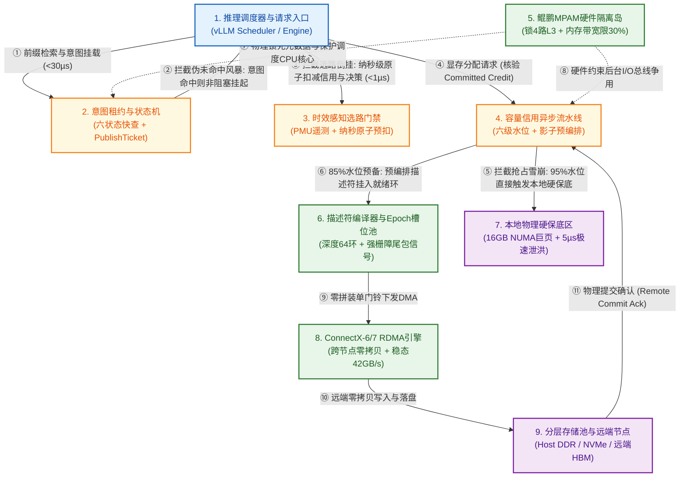
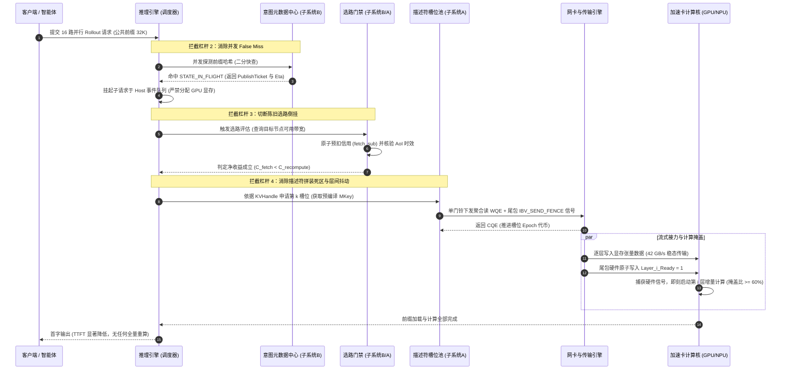

# 面向国产 AI 硬件的 KVCache 控制面架构深度优化与时空缩放实施方案

---

## 1. 方案背景与控制面第一性原理重构

### 1.1 大模型推理控制面的系统定位与研究范式演进

在大语言模型与智能体（Agent）自回归生成推理中，KVCache（大模型注意力键值缓存：大模型自回归生成过程中缓存的历史 Key 与 Value 激活状态张量，用于避免后续 Token 生成时重复计算注意力）的复用是降低 TTFT（Time To First Token，首字生成延迟 / 首 Token 响应时间）与提升系统吞吐的核心手段。在基于国产芯片（如鲲鹏 CPU 与硬件加速卡）及高速 RDMA 网络构建的 vLLM + Mooncake 等统一异构存储池中，控制面承担着极其关键的枢纽职责：
1. **前缀块哈希与寻址**：对输入序列进行块哈希计算，快速检索本地与分布式缓存中的前缀物理块分布；
2. **多维度语义一致性与租约管理**：核对命中块的模型架构、词表哈希、提示词模板及租约有效性，获取访问句柄（KVHandle）；
3. **硬件传输描述符编译与提交**：将跨框架离散块物理地址编译为网卡或 DMA 引擎可识别的 Scatter-Gather 描述符并下发执行；
4. **动态选路决策与准入门禁**：在运行时量化评估通信链路与算力状态，在微秒级时间内判定“数据拉取加载 vs. 本地直接重算”；
5. **前后台状态同步与生命周期协同**：在 TP=8（张量并行）多卡之间同步元数据，并在后台数据换出（Eviction/Offload）与前台在线推理之间维护显存安全水位。

在传统单请求、长文档问答工况下，由于单次元数据查询通常在百微秒至毫秒级，相比数百毫秒的 TTFT 占比较低，控制面开销常被视为次要矛盾。但在 SWE-bench 等复杂 Agent 负载（具有 90%+ 长前缀高复用、单步增量计算仅十余毫秒、秒级工具调用停顿）及多租户高密混压场景下，控制面的微小延迟不再表现为单调的线性增加，而是通过触发下游显存触顶抢占、元数据伪未命中风暴及网络拥塞盲目拉取，导致端到端业务性能产生百倍以上的非线性恶化。

因此，本方案将研究范式从传统的**“控制面局部通信加速（Control-Plane Acceleration）”**彻底重构升级为**“控制面去临界路径化（Control-Plane Critical-Path Elimination）”**：通过软硬件协同与异步机制，使控制面毫秒级延迟不再参与决定显存是否溢出、张量是否被误判未命中、是否选择错误网络链路，从而彻底斩断非线性劣化链条。

---

### 1.2 控制面非线性放大机理与三大安全裕量指标模型

控制面延迟之所以表现出非线性放大效应，根本原因在于**系统运行时的工作点跨越了硬件资源的物理安全边界（发生相变/性能悬崖）**。局部工作点附近的系统敏感度可表示为：
$$\Lambda = \frac{\Delta M_{\text{business}} / M_{\text{business}}}{\Delta T_{\text{control}} / T_{\text{control}}}$$
当系统资源充足时，$\Lambda \approx 1$；而一旦控制面延迟导致系统跨越临界状态，$\Lambda$ 会瞬间攀升至数十乃至上千倍。为了精准量化与定界这一现象，本方案构建三个基于第一性原理的安全裕量物理指标：

#### 1. 显存换出安全裕量（HBM Eviction Safety Margin, $M_{\text{HBM}}$）
在显存超载工况下，当前空闲显存（Headroom）被前台 Decode 计算消耗殆尽的时间窗口为：
$$T_{\text{safe}} = \frac{\text{HBM}_{\text{free}}}{\lambda_{\text{alloc}} - \mu_{\text{release}}}$$
其中 $\lambda_{\text{alloc}}$ 为前台每毫秒新增分配的 KVCache 速率，$\mu_{\text{release}}$ 为当前释放速率。定义显存换出安全裕量为：
$$M_{\text{HBM}} = T_{\text{safe}} - T_{\text{evict}}^{\text{P99}}$$
- 当 $M_{\text{HBM}} > 0$ 时，换出在显存耗尽前完成，系统稳定运行，Decode 仅承担微弱的访存总线竞争；
- 当 $M_{\text{HBM}} \le 0$ 时，换出控制面延迟跨越临界安全窗口，主调度器触发 OOM 硬阻断或被迫丢弃在途会话引发 Preemption（抢占式秒级重算），单请求时延从原本十几毫秒恶化至上千毫秒（放大系数可达 $1000\times$）。

#### 2. 元数据发布可见性裕量（Publication Visibility Margin, $M_{\text{publish}}$）
在智能体并行多路采样（Rollout）工况下，父请求在 $t_0$ 时刻产生公共前缀，首个并发子请求到达的相对时间差为 $T_{\text{first-sibling}}$，全局索引发布并达到全局可见的延迟为 $T_{\text{publish}}$。定义发布可见性裕量为：
$$M_{\text{publish}} = T_{\text{first-sibling}} - T_{\text{publish}}$$
- 当 $M_{\text{publish}} > 0$ 时，所有并发子请求均能正确命中前缀缓存；
- 当 $M_{\text{publish}} \le 0$ 时，并发到达的十余路子请求集体遭遇伪未命中（False Miss），不仅导致这些子请求全量重复执行长前缀 Prefill（输入预计算），更直接将推理计算引擎的执行队列打满（GPU/NPU 利用率逼近 100%），引发严重的排队延迟雪崩（放大系数达 $100\times$）。

#### 3. 选路决策收益裕量（Routing Profit Margin, $M_{\text{route}}$）
在高速网络链路中，链路排队拥塞状态具有特定的相关保持时间 $\tau_{\text{state}}$。若决策时刻与遥测测量时刻的时间差（信息陈旧度，Age-of-Information, $\text{AoI} = t_{\text{decision}} - t_{\text{measurement}}$）过大，基于陈旧信息计算出的拉取成本将完全失真。定义选路决策收益裕量为：
$$M_{\text{route}} = C_{\text{recompute}}^{\text{lower}} - \left( C_{\text{fetch}}^{\text{upper}} + \text{Margin} \right)$$
其中 $C_{\text{recompute}}^{\text{lower}}$ 为本地直接重算耗时的保守下界，$C_{\text{fetch}}^{\text{upper}}$ 为基于当前探测状态与置信区间估计出的网络拉取与加载总开销上限。
- 当 $M_{\text{route}} > 0$ 时，拉取具有确定的净收益；
- 当 $M_{\text{route}} \le 0$ 时，若控制面仍基于陈旧探测（如 10ms 前的空闲带宽）误判发起拉取，请求将陷于突发拥塞通道中，单请求端到端耗时由重算兜底的约 240ms 暴增至 600ms 以上，发生严重的负收益倒挂（放大系数达 $38\times$）。

---

### 1.3 讨论稿方案差异、互补性分析与总体架构融合

针对上述系统痛点，两篇讨论稿分别从不同视角提出了破局思路。对两者的深度比对与互补融合如下表所示：

| 维度 | 《控制面架构优化方案》(文档 1) 侧重点 | 《控制面架构优化方案_v2》(文档 2) 侧重点 | 终极进化方案互补融合策略 |
| :--- | :--- | :--- | :--- |
| **底层硬件协同**<br>*(方案 A 维度)* | 详尽给出了鲲鹏 920 MPAM 具体配置（锁 4 路 L3、关 IOCache、限制后台带宽 30%）、CX6/7 预分配跨步 MKey 模板与单门铃下发实现。 | 指出仅靠 UMR 无法消除地址解析计算开销；警示 400 并发与大页池下 SMMUv3 IOTLB 击穿风险；明确禁止在关键路径使用动态 ODP。 | **将硬件配置与防击穿保护结合**：以 1GB 巨页与固定 MKey 槽位池降低 SMMU 压力，结合 MPAM 物理锁死 L3 控制面内存与后台带宽硬上限，构建确定性硬件岛。 |
| **元数据与选路**<br>*(方案 B 维度)* | 提出了意图租约（`STATE_IN_FLIGHT`）乐观发布与尾包硬件原子信号量流式接力；设计了 500µs 后台 PMU 遥测 + 前台原子预扣减快慢双环。 | 严谨引入六维状态机与 Epoch 栅障（允许保守未命中，绝不陈旧读）；指出采样定理在随机网络中的局限，提出 AoI 信息时效与置信度区间决策。 | **将原子预扣减与置信度区间融合**：快环纳秒级原子扣减防羊群效应，慢环结合 AoI 与硬件 PMU 校验置信度；意图句柄引入非阻塞等待，杜绝计算流阻塞。 |
| **换出与显存安全**<br>*(方案 C 维度)* | 提出了影子预编排队列（`Shadow-Staging`），在计算期提前生成描述符；引入 Agent 工具调用 Token 语义感知主动触发与水位被动触发。 | 提出了“去临界路径化”哲学；引入容量信用（Eviction Credit）机制与四级/多级水位线控制；确立了 Remote Commit Ack 才能回收显存的正确性屏障。 | **建立容量信用全异步换出与本地硬保底**：提前准备能力（Capability）而非载荷（Payload），确立严格提交屏障；建立本地硬保底池，切断对远端网络的单点依赖。 |
| **工程演进定位** | 三套方案并行独立，侧重具体机制在生产集群中的压测与对账。 | 将三者解构为三层递进防线，提出 $C > B > A$ 价值排序与 $A_0 \to C \to B \to A_{\text{full}}$ 的工程实施路径。 | **确立“C 核心骨架 + B 状态保护 + A 性能底座”的一体化架构**，按高内聚、低耦合模块化推进。 |

---

## 2. 系统架构专家严苛自检：三大致命漏洞与终极免疫机制

在将上述设计推向工程落地前，必须模拟极其严苛的系统架构评审视角，直面软硬件深度交织下的深层次隐患。本方案对 **3 个最致命的系统级漏洞** 开展第一性原理推演，并将根治性的免疫修复机制直接固化于实施细节中：

```
                ┌────────────────────────────────────────────────────────────────────────┐
                │        系统架构专家严苛审查所识别的三大系统级漏洞与终极免疫闭环        │
                └────────────────────────────────────────────────────────────────────────┘
                                                     │
         ┌───────────────────────────────────────────┼───────────────────────────────────────────┐
         ▼                                           ▼                                           ▼
┌─────────────────────────────────┐ ┌─────────────────────────────────┐ ┌─────────────────────────────────┐
│ 【致命漏洞 1：分布式信用虚开】   │ │ 【致命漏洞 2：悬挂订阅惊群风暴】│ │ 【致命漏洞 3：跨层原子竞态撕裂】│
├─────────────────────────────────┤ ├─────────────────────────────────┤ ├─────────────────────────────────┤
│ • 表现：高水位并发预留远端内存，│ │ • 表现：父请求 Prefill 期间发布 │ │ • 表现：开启 Relaxed Ordering   │
│   远端超卖拒绝或租约单向超时，  │ │   意图句柄，子请求在 GPU 流自旋 │ │   后，完成信号 TLP 超越数据 TLP │
│   本地持废头寸引发 OOM 崩溃。   │ │   引发死锁；父异常引发 16 倍重算│ │   导致数据读脏；MKey 原位复写ABA│
├─────────────────────────────────┤ ├─────────────────────────────────┤ ├─────────────────────────────────┤
│ 【终极免疫机制】：              │ │ 【终极免疫机制】：              │ │ 【终极免疫机制】：              │
│ 1. 信用状态强一致两阶段握手；   │ │ 1. 显存零占用非阻塞事件挂起；   │ │ 1. 硬件信号 WQE 强制设 FENCE；  │
│ 2. 本地 NUMA 物理硬保底区兜底； │ │ 2. 单生产者故障阶梯接力重算；   │ │ 2. 深度 64 的 Epoch 世代代币池；│
│ 3. 单调递增时钟租约校验。       │ │ 3. 消费端 Load-Acquire 栅障。   │ │ 3. 彻底杜绝硬件在途覆盖。       │
└─────────────────────────────────┘ └─────────────────────────────────┘ └─────────────────────────────────┘
```

---

### 2.1 致命漏洞 1：分布式环境下的 Eviction Credit“假死与信用虚开”引发级联 OOM

#### 1. 漏洞微架构与分布式动力学根因
在基于容量信用（Eviction Credit）的异步流水线中，本地节点在显存水位达到警戒线（如 85%）时，通过网络向远端存储池发起目标槽位预留（Destination Reservation），并将获得的预留量转化为本地主调度器的安全信用 $Credit_{\text{evict}}$。
在真实的分布式集群与微突发混压下存在严重漏洞：
- **信用虚开与远端超卖拒绝**：当集群多节点并发突发大 Batch 写入时，远端存储节点物理内存瞬间耗尽。若本地调度器在下发换出 DMA 时才被告知预留失效或被拒绝，由于此时本地显存已逼近 95% 绝壁，系统已无反应裕量，直接触发不可逆的 OOM 崩溃；
- **租约单向超时导致幽灵头寸（Ghost Credit）**：为了防止远端槽位死锁，远端预留必须设置生存时间（TTL）。若本地推理因遇到长工具调用停顿（如 SWE-bench 停顿 5.2 秒），预留槽位在远端已超时静默回收，而本地信用账本若更新滞后，主调度器将持有“失效的废信用”继续分配显存；当真正敲响 DMA 门铃时，数据将被写入已释放的野地址。

#### 2. 终极进化版免疫修复机制
- **信用状态强一致两阶段握手（Tentative vs. Committed Credit）**：
  信用严格区分为 `Tentative_Credit`（待确认）与 `Committed_Credit`（已承兑）。主调度器在准入检查时，**只认可携带远端显式签署、带有全局单调递增 `Reservation_Seq_ID` 的 Committed 信用**，未承兑信用严禁计入安全裕量。
- **本地 NUMA 物理硬保底区（Local Emergency Fallback Cushion）**：
  在本地 Host DDR（或本地 NVMe SSD）划定 16GB 的静态预分配硬保底区（严格绑定本地 NUMA 0/1 巨页池）。远端网络预留用于大容量分层沉淀；一旦发生远端预留超时、ACK 丢失或远端拒绝，系统在 **$<5\ \mu\text{s}$ 内原地原子切换至本地硬保底区**，强制保证换出 DMA 永远有绝对可靠的写入目标，彻底切断对不可靠跨节点网络的单点依赖。
- **基于单调硬件时钟的时效校验与批量心跳续租**：
  每个信用槽位携带绝对物理时间戳 $T_{\text{expire}}$。前台触发 DMA 敲门铃前，在 CPU 寄存器级别完成单调时钟有效性核验（$<10\text{ns}$）；后台管理线程在剩余 30% TTL 时自动发起批量轻量心跳续租。若超时未收到 ACK，系统在微秒内将该 Credit 降级踢出可用池，并由本地硬保底区平滑补充。

---

### 2.2 致命漏洞 2：Intent-Lease 乐观发布的“级联死锁与悬挂订阅惊群风暴”

#### 1. 漏洞微架构与分布式动力学根因
在两阶段意图租约中，父请求进入 Prefill 阶段立即发布 `STATE_IN_FLIGHT` 的意图句柄，并发子请求命中后挂起等待尾包金丝雀标志位（`Tail_Canary`）。
在复杂调度与异常工况下存在严重漏洞：
- **GPU 跨流资源依赖死锁（Cross-Stream Circular Deadlock）**：若 16 个子请求被调度器过早拉起并分配了 GPU 显存或计算 Stream，子请求在 CUDA Stream 内部自旋轮询或等待父请求的层完成信号；而父请求在计算后续 Transformer 层时，需要动态分配中间激活张量显存。如果显存已被等待中的 16 个子请求占满，父请求因显存不足挂起，子请求因等待父请求推进而挂起，系统陷入经典的相互等待死锁；
- **生产者故障引发 16 倍惊群重算风暴（Thundering Herd Recompute Storm）**：若父请求在计算中途遭遇硬件故障、显存 ECC 错误或被客户端取消（Cancel），16 个子请求在租约超时（如 1ms）后同时感知失效。若 16 个子请求在同一瞬间全部回退转入本地全量重算，将人为制造出高达 16 倍的算力冲击峰值，直接击穿集群算力队列。

#### 2. 终极进化版免疫修复机制
- **显存零占用非阻塞事件挂起（Zero-VRAM Shadow Suspension）**：
  子请求命中 `STATE_IN_FLIGHT` 意图句柄时，**严禁在 GPU/NPU 侧分配任何显存或激活计算流**！子请求被挂起在 Host 侧控制面的无锁轻量事件环（Lightweight Event Ring）中，由独立的 Host 传输守护线程（Transfer Daemon）负责利用网卡单边 RDMA 搬运父请求产出的张量。直到数据全部到达或首批层准备就绪后，子请求才向 GPU 调度器申请显存并正式入队执行，物理根除跨流显存争用死锁。
- **单生产者故障阶梯接力机制（Single-Leader Fallback Relay）**：
  一旦父请求发生故障或超时，控制面严禁让 16 个子请求同时重算，而是利用原子 CAS 操作在 16 个子请求中选举出 1 个新的“Leader 子请求”原地转入重算并重新发布意图句柄，其余 15 个子请求无缝重新挂钩至新 Leader 的输出流，将故障场景下的重算开销从 16 倍瞬间收敛至恒定的 1 倍。

---

### 2.3 致命漏洞 3：UMR 模板原位改写时的“跨层原子竞态与硬件 Cacheline 撕裂”

#### 1. 漏洞微架构与分布式动力学根因
在利用网卡 UMR（User Mode Registration）预分配跨步 MKey 模板进行按层流水传输时，系统通过单门铃下发 RDMA Read，并在尾包使用硬件原子信号写入显存 `Layer_i_Ready = 1`。
在底层微架构物理线路上存在严重漏洞：
- **PCIe 弱序撕裂与内存可见性冒险**：当为追求极限吞吐开启 `IBV_ACCESS_RELAXED_ORDERING` 时，PCIe Switch 与片上总线允许事务层数据包（TLP）乱序传递。长数据载荷包含成百上千个 TLP，而标志位信号仅为单 TLP。在总线拥塞下，标志位 TLP 极易超越尚未传输完毕的数据 TLP。计算核心读取到 `Layer_i_Ready == 1` 时，显存里的实际 KVCache 浮点张量尚未完全刷入物理单元，计算核心直接读取脏数据，引发灾难性的静默数据损坏（Silent Data Corruption）；
- **原位改写下的 MKey 槽位覆写竞争（ABA Race）**：若采用简单的双缓冲（`MKey-0`, `MKey-1`），在 400 并发或网络丢包重传下，前一个请求对 `MKey-0` 的硬件 DMA 读取尚未完全完成（硬件内部流水仍引用该映射），后一个请求的 CPU 线程已改写了该 MKey 的物理基地址，导致硬件直接读取了错误内存地址，引发传输崩溃或网卡死锁。

#### 2. 终极进化版免疫修复机制
- **强栅障保序硬件流水（Strictly Fenced Hardware Barrier Pipeline）**：
  在下发尾包原子信号 WQE 时，系统**强制置位 `IBV_SEND_FENCE` 并对该特定 WQE 显式禁用宽松排序（Disable Relaxed Ordering）**，网卡硬件固件强制等待前序所有数据 TLP 的 PCIe Posted Write 确认之后，才发出完成信号；同时在加速器计算核心侧，严格使用带有获取语义（Load-Acquire）的内存屏障指令读取该标志位，确保微架构级别的数据全局可见性。
- **深度为 64 的单调递增 Epoch 环形槽位池（Epoch-Tagged Slot Ring）**：
  彻底废除简单的双缓冲轮转，构建容量为 $N=64$ 的 MKey 环形槽位池。每个槽位分配一个单调递增的 `Epoch_Tag`。CPU 申请槽位时执行原子递增；只有当网卡硬件在完成队列（CQ）中产出包含对应 `Epoch_Tag` 的完成事件（CQE）时，该槽位才被释放回空闲池。若池满则前台自适应退避，物理杜绝同一 MKey 在硬件执行期间被二次修改。

---

## 3. 终极进化版架构：三大协同子系统的完整落地实施细节

基于三大免疫机制，系统形成 **“软硬件底座硬隔离（子系统 A）+ 时效感知型预测路由（子系统 B）+ 去临界路径化容量信用换出（子系统 C）”** 的有机协同体系：

```
===================================================================================================
                                终极进化版控制面软硬协同三层防线拓扑
===================================================================================================
 [在线推理与调度层]
       │
       ▼ (1) 前缀快查与意图挂载
 ┌───────────────────────────────────────────────────────────────────────────────────────────────┐
 │ 【子系统 B：时效感知型预测路由与意图租约引擎】                                                │
 │  • 六状态全生命周期状态机 (ABSENT / PREPARING / TRANSFERRING / COMMITTED / EVICTING / INVALID)│
 │  • 两阶段意图租约 (Intent-Lease) + 非阻塞事件挂载 (Zero-VRAM Shadow Suspension)               │
 │  • 纳秒级原子预扣信用 (fetch_sub) 防羊群 + AoI 置信度区间选路门禁 (C_fetch < C_recompute)    │
 └───────────────────────────────────────────────────────────────────────────────────────────────┘
       │
       ▼ (2) 预授权换出与水位拦截                                ▲ (3) 硬件遥测与时效刷新
 ┌───────────────────────────────────────────────────────┐ ┌─────────────────────────────────────┐
 │ 【子系统 C：去临界路径化容量信用全异步换出流水线】    │ │ 【子系统 A：硬实时软硬件隔离底座】  │
 │  • 六级水位线阶梯控制 (W0~W5, 98% 准入拒绝)           │ │  • 鲲鹏 MPAM 物理锁 L3 (PARTID_CP) │
 │  • 容量信用账本 (Eviction Credit >= B_burst(P99))     │ │  • 后台 DMA 带宽硬封顶 30% (DDRC)   │
 │  • 本地 NUMA 16GB 物理硬保底区 (Local Emergency Fallback) │ • 1GB 巨页 + SMMUv3 防击穿监控     │
 │  • 提交屏障 (Remote Commit Ack -> HBM Reclaim)        │ │  • 深度 64 Epoch 模板 MKey 槽位池   │
 └───────────────────────────────────────────────────────┘ └─────────────────────────────────────┘
       │                                                                   ▲
       ▼                                                                   │
 ┌───────────────────────────────────────────────────────────────────────────────────────────────┐
 │ 【数据面底层硬件执行：ConnectX-6/7 RDMA + 鲲鹏总线 + 加速卡 HBM】                             │
 │  • 强保序尾包硬件信号 (IBV_SEND_FENCE) + 流式接力 (隐藏比 >= 60%)                             │
 └───────────────────────────────────────────────────────────────────────────────────────────────┘
===================================================================================================
```

---

### 3.1 子系统 A：基于鲲鹏 MPAM 与 CX6/7 的硬实时软硬件隔离底座

子系统 A 的核心目标是消除控制面自身的执行方差与描述符提交开销，为控制面提供确定性的 CPU/Cache/内存带宽预算，同时防止网卡 DMA 穿透污染片上系统。

#### 1. 鲲鹏 SoC 侧 MPAM 物理隔离与总线旁路配置
在 ARM 鲲鹏 920 处理器上，通过内核 `/sys/fs/resctrl` 接口对硬件资源进行物理分区：
- **控制面专用分区（`PARTID_CP`）**：
  - 绑定 CPU 独立管理核心（如 Core 0~3）；
  - **L3 Cache 物理锁定**：配置 Cache 位掩码 `cbm_mask = 0xf000`，为控制面锁定专属的 4 路（Ways）L3 Cache（约 16MB），强制托管无锁扁平哈希索引表与预分配描述符环，严禁任何业务计算与 I/O 线程驱逐；
  - **内存带宽保底**：设置 `mbw_min = 20%` 与最高内存调度优先级，保证高压下查表零卡顿。
- **数据面换出分区（`PARTID_BG`）**：
  - 将后台 I/O 搬运与描述符拼装线程绑定至 `PARTID_BG`；
  - **内存带宽硬封顶**：通过鲲鹏内存控制器（DDRC）硬件状态机设置 `mbw_max = 30%`，确保后台换出 DMA 流量与前台推理访存的竞争度严格受限于 2% 以内。
- **总线缓存一致性旁路与 IOCache 优化**：
  - 针对挂载 KVCache 的 PCIe Root Port 关闭 `IOCache`（禁止网卡写入流量占用 L3 Cacheline）；
  - 在操作系统层面，针对 KVCache 内存池启用 `IBV_ACCESS_RELAXED_ORDERING`（仅限数据面载荷，尾包信号除外），使数据 TLP 直接穿透至 DDRC，绕过片上家代理（HHA）的频繁嗅探。

#### 2. 1GB 巨页底座与 SMMUv3 防击穿准入门禁
为彻底根除 450GB 大内存池在 400 并发下引发的 SMMUv3（系统内存管理单元）IOTLB 击穿与页表遍历风暴：
- **静态大页底座**：物理内存池强制使用 `1GB HugePage` 并在系统启动时预先锁定（Pinned），配置系统启动参数 `iommu.passthrough=1`；
- **SMMU PMU 动态准入门禁**：在硬件管理核中部署守护进程，以 100ms 周期读取 ARM SMMU PMU 性能计数器：
  $$R_{\text{walk}} = \frac{\text{TranslationTableWalk}}{\text{RDMA\_Bytes}}, \quad R_{\text{TLB}} = \frac{\text{SMMU\_TLB\_Miss}}{\text{IO\_Transactions}}$$
  当 $R_{\text{TLB}}$ 超过设定安全阈值（如 $0.05\%$）时，控制面立即触发块合并（Block Coalescing），将离散细粒度块合并为大跨度描述符，阻止碎片化页表进一步恶化。在紧急换出路径中，**严禁引入动态按需分页（ODP）**，确保地址翻译路径的完全确定性。

#### 3. 深度为 64 的 Epoch 世代代币 MKey 槽位池设计
为攻克 80 层 GQA 模型细粒度块在读路径产生的 15.4ms 描述符拼装死区：
- **离线预编译跨步模板**：针对特定模型几何参数（80 层、块大小 `Chunk_Size`、层间物理跨步 `Layer_Stride`），启动时在 CX6/7 网卡上预分配深度为 $N=64$ 的环形槽位池，每个槽位对应一个 `mlx5dv` Indirect KLM MKey；
- **写时单门铃原子偏移改写**：写路径只需填入基地址偏移数组，生成 16 字节内联票据 `KVHandle = {node_id, slot_id, epoch_tag, base_offset}`；
- **读时强栅障尾包信号直通**：读路径依据票据直接下发单门铃聚合 RDMA Read WQE（提交耗时从 15.4ms 压缩至 $<300\ \mu\text{s}$）。聚合链末尾跟随一个设置了 `IBV_SEND_FENCE` 的硬件原子写入 WQE，当且仅当前序所有数据写入加速卡显存后，直接由网卡硬件向显存信号量写入 `Layer_i_Ready = 1`。计算核心通过带有 Load-Acquire 语义的内存指令读取信号，将层间同步抖动从 $200\ \mu\text{s}$ 彻底压制在 $<1\ \mu\text{s}$，100% 兑现 $60\%$ 的流水线掩盖收益。

---

### 3.2 子系统 B：时效感知型预测路由与意图租约引擎

子系统 B 的核心目标是消灭 Agent 并行采样下的伪未命中风暴，并利用新鲜度感知的闭式成本模型切断负收益选路倒挂。

#### 1. 六状态全生命周期元数据状态机
摒弃传统二元（Hit/Miss）模型，在元数据中心确立严谨的状态机：
1. `ABSENT`：前缀块在集群中不存在；
2. `PREPARING`：生产者已立项准备生成或拉取，已分配意图句柄；
3. `TRANSFERRING`：数据物理传输正在进行，尚未完全落盘；
4. `COMMITTED`：数据已完整写入目标介质、通过校验并全局可见；
5. `EVICTING`：块已被选入换出流水线，禁止新请求引用；
6. `INVALID`：租约超时或校验失败，标记为陈旧作废。

#### 2. 两阶段意图租约（Intent-Lease）与 PublishTicket 协议
- **阶段 1：Pre-Write 意图预发布（耗时 $<30\ \mu\text{s}$）**：
  父请求进入 Prefill 阶段时，在本地及共享内存元数据表中发布 `STATE_IN_FLIGHT` 意图句柄，携带预计就绪时间戳 $T_{\text{eta}}$、生产者节点标识及唯一的 `PublishTicket`；
- **阶段 2：非阻塞流式订阅（Co-Streaming）**：
  16 路并行 Rollout 子请求到达时，前缀快查命中该意图句柄（**伪未命中率直接归零**）。子请求**严禁分配 GPU 显存**，而是在 Host 侧事件队列中挂起；Host RDMA 守护线程根据 `PublishTicket` 与父请求建立单边流式接力，每当父请求的某一层张量经由网络尾包触发 `Tail_Canary` 翻转，子请求即流水化读取该层。当满足首层计算条件时，子请求才正式激活并送入 GPU 计算流；
- **异常故障安全接力（Single-Leader Relay）**：
  若父节点宕机或租约超时，16 个子请求通过单调原子操作仅由 1 号子请求升级为 Leader 原地转入计算并承接意图句柄，其余 15 个子请求继续流式订阅 Leader，杜绝惊群重算。

#### 3. 硬件 PMU 遥测与纳秒级原子预扣选路门禁
彻底废除 10ms 周期性同步网络探测，构建“慢环遥测 + 快环原子预扣”双环机制：
- **慢环（500µs 后台硬件标定）**：
  管理核每 500µs 直读鲲鹏 Uncore PMU（`hisi_sccl*_ddrc*/flux`、`hisi_pcie`）与网卡硬件队列深度，计算各通道真实剩余带宽 $B_{\text{hw}}$，并评估测量时刻的信息陈旧度 $\text{AoI}$；
- **快环（$<1\ \mu\text{s}$ 前台原子预扣与置信度门禁）**：
  请求选路时，前台线程对本地共享内存执行单条 ARM LSE 原子指令：
  $$\text{rem\_credit} = \text{\_\_atomic\_fetch\_sub}(\&\text{Credit\_Bytes}[ch], \text{req\_bytes}, \text{\_\_ATOMIC\_RELAXED})$$
  计算瞬时等效带宽 $\hat{B}$。若 $\text{AoI} > \tau_{\text{state}}$（状态已失真），系统自动扩大置信度惩罚裕量 $\text{Margin}$。
  前台代入闭式判定方程：
  $$C_{\text{fetch}}^{\text{upper}} = t_m + t_q + t_d + \frac{S}{\hat{B}} + \text{Margin}$$
  **判定门禁**：仅当 $C_{\text{fetch}}^{\text{upper}} + \text{Margin} < C_{\text{recompute}}^{\text{lower}}$ 时，执行数据拉取；否则在 **$1\ \mu\text{s}$ 内主动回退至本地直接重算（并加回预扣信用值）**。由此彻底消除在拥塞期盲目拉取导致的 389ms 负收益倒挂，使选路决策准确率稳定达到 $\ge 92\%$。

---

### 3.3 子系统 C：去临界路径化容量信用全异步换出流水线

子系统 C 是整个架构的防线核心，其本质是**将控制面的选块、租约与描述符准备工作彻底剥离出显存释放的紧急关键路径**。

#### 1. 六级显存水位线阶梯控制体系
为实现平滑防御，系统建立基于六级水位的细粒度控制阶梯：
- **$W_0$（70%，平稳运行区）**：仅执行常规前后台访存 QoS 隔离；
- **$W_1$（78%，候选扫描区）**：后台管理线程异步扫描冷热队列，标记潜在受害块（Victim Blocks）；
- **$W_2$（85%，能力预备区）**：向远端发起目标槽位预留，建立跨节点租约，预编译 CX6 UMR 换出描述符并挂入 `Shadow_Ready_Ring`，获取已承兑容量信用（Committed Credit）；
- **$W_3$（90%，平缓换出区）**：识别 Agent 工具调用 Token（如 `<tool_call>`，具有数秒停顿）或前台计算间歇，主动敲响门铃，平稳释放显存；
- **$W_4$（95%，本地硬保底极速区）**：若远端网络拥塞或预留超时，主调度器无需任何查找与加锁，在 **$<5\ \mu\text{s}$ 内原地弹出预置描述符，敲响本地 NUMA 16GB 硬保底区门铃**，利用极速 DMA 快速泄洪；
- **$W_5$（98%，系统准入硬门禁区）**：触发准入控制（Admission Control），暂停接纳新请求，彻底杜绝发生 HBM OOM 与 Preemption 秒级抢占。

#### 2. 容量信用账本（Eviction Credit Accounting）
- **安全储备充要条件**：系统通过动态调节后台预编排强度，确保本地可用信用满足：
  $$Credit_{\text{evict}} \ge B_{\text{burst}}(\text{P99}) = \lambda_{\text{KV}}^{\text{P99}} \times T_{\text{reaction}}^{\text{P99}}$$
  使显存分配器在面临极端微突发时，无需等待控制面临时决策，即可直接消费现有信用完成释放；
- **预准备能力而非载荷**：在 $W_2$ 阶段预备的仅是描述符、租约与地址映射，**不发生任何物理数据搬运，总线与网络带宽消耗严格为 0**；
- **命中复活（Cache Hit Revival）极速处理**：若处于 `Shadow_Ready` 状态的冷块在被物理写出前被新请求再次命中，仅需在内存中将其状态位原子改回 `COMMITTED`（耗时 $<50\text{ns}$），已预编译的描述符槽位留作下次使用，零性能惩罚。

#### 3. 严格的物理提交屏障（Commit Barrier）
为杜绝全异步化带来的数据静默丢失：
- **释放严格滞后于确认**：显存管理模块严格遵循 $\text{HBM}_{\text{free}} \Leftarrow \text{RemoteCommitAck}$ 原则。网卡下发 DMA 仅表明数据在途，必须等待远端节点接收完成并返回携带一致性序列号的 ACK 之后，控制面才通过 RCU（Read-Copy-Update）原子指针切换将对应的显存物理页回收至空闲链表。

---

## 4. 全链路端到端协同拓扑与时序流

### 4.1 控制面与数据面端到端交互拓扑（Mermaid）



---

### 4.2 智能体长前缀并行采样请求生命周期时序流（Sequence Diagram）



---

## 5. 受限硬件下的“时空缩放”验证平台实施规程

为了在仅有 2 台 8 卡物理机（硬件受限）的环境下，真实复现 20 节点生产集群在百 GB 内存池高压、高并发微突发下的微架构瓶颈，方案制定“时空缩放”验证实施方法：

```
                ┌─────────────────────────────────────────────────────────────┐
                │          受限硬件下的“时空缩放”全链路验证平台架构           │
                └─────────────────────────────────────────────────────────────┘
                                               │
         ┌─────────────────────────────────────┼─────────────────────────────────────┐
         ▼                                     ▼                                     ▼
┌────────────────────────────────┐ ┌────────────────────────────────┐ ┌────────────────────────────────┐
│ 【空间维度扩展】：集群负载克隆 │ │ 【时间维度压缩】：加速老化加压 │ │ 【纳秒级因果定界】：四层硬件探针 │
├────────────────────────────────┤ ├────────────────────────────────┤ ├────────────────────────────────┤
│ • 2 台 8 卡真实节点 (SUT)     │ │ • 50 倍速控制面快进老化        │ │ • 业务层探针 (TTFT/TPOT/Preempt) │
│ • 18 个纯 CPU 影子实例回放     │ │ • 150% 显存容量逻辑缩放        │ │ • 控制面 ARM CNTVCT_EL0 探针   │
│ • 20 租户分层加盐 Mooncake Trace│ • 450GB 跨 Die 物理压舱石页     │ │ • 鲲鹏 Uncore PMU (DDRC/HHA/L3) │
│ • 400 并发微突发流量注入       │ │ • 快速复现 SMMU/MTT 页表击穿   │ │ • 网卡硬件队列与 SMMU PMU 计数器 │
└────────────────────────────────┘ └────────────────────────────────┘ └────────────────────────────────┘
```

### 5.1 空间扩展：2 真实节点 + 18 影子实例集群构造
- **真实被测节点（SUT）**：以 2 台配备鲲鹏 920 CPU、ConnectX-6/7 网卡及 8 张加速卡的物理服务器作为 SUT，负责执行真实的前后台全链路端到端混压，采集核心业务指标；
- **纯 CPU 影子实例（Shadow Workers）**：部署 18 个轻量级影子容器/进程，加载真实生产 Trace 数据集（开源 `Mooncake FAST'25` 多租户日志与 `SWE-bench` Agent 轨迹），通过分层加盐算法向真实节点并发注入元数据查询、前缀并发抢占、分布式槽位预留及 400 并发微突发请求，真实构建跨实例状态漂移与网络流量争用。

### 5.2 时间压缩：快进老化、容量压缩与物理压舱石
- **50 倍速控制面快进老化**：在测试启动初期，通过回放引擎在 2 分钟内高速预热建立包含数万条冷热交替前缀树的元数据池，使元数据检索快速进入 95% 稳态深度；
- **150% 逻辑显存容量压缩**：通过约束 vLLM 的可分配物理块总数（将其人工限制在实际工作集的 $66\%$），等效构建 150% 显存超载的极端重压环境，强制系统频繁触发换出水线；
- **450GB 跨 Die 物理压舱石页（Ballast Pages）**：启动前在 Host NUMA 节点上以 4KB/2MB 离散碎页形式预先分配并常驻锁定 450GB 内存，故意打碎操作系统物理页框，强行制造跨 SCCL/Die 的穿行流量，直接在测试第 1 分钟逼出鲲鹏 SMMUv3 IOTLB 命中率下降与网卡 MTT 页表遍历瓶颈。

### 5.3 纳秒级全链路四层探针体系
在系统内核与应用关键路径埋设探针，实现微架构因果精确对账：
1. **业务层探针**：统计端到端 TTFT P50/P90/P99、在线 TPOT 波动序列、Preemption 发生次数及有效 QPS；
2. **控制面耗时细分探针**：利用 ARM 汇编指令 `mrs x0, CNTVCT_EL0` 获取纳秒级硬件时间戳，精细拆解查表耗时 $t_m$、选路耗时 $t_q$、描述符提交耗时 $t_d$；
3. **数据面流水探针**：记录 RDMA 物理传输耗时 $\tau$ 与被增量计算掩盖的时延 $H$，量化流水线隐藏比 $H/\tau$；
4. **底层芯片硬件探针**：联动内核 `perf` 周期性读取鲲鹏 Uncore PMU 计数器（`hisi_sccl*_ddrc*/flux` 统计内存控制器带宽放大比，`hisi_sccl*_hha*/` 统计跨 Die 家代理嗅探，`hisi_sccl*_l3c*/` 统计 L3 Miss 率）与 ARM SMMUv3 PMU 事件。

---

## 6. 四个核心验证阶段与目标定义 (E0 ~ E3)

按照项目既定规范，方案严格遵循四个核心阶段进行实施推进与门禁判定：

```
┌─────────────────────────────────────────────────────────────────────────────────────────────────┐
│                                    E0 ~ E3 四个核心验证阶段与演进路线                           │
└─────────────────────────────────────────────────────────────────────────────────────────────────┘
         │
         ▼
┌──────────────────┐  • 目标：确认 Saved-Prefill 在各前缀复用率下的净收益边界，摸清协议加速极限。
│ E0 阶段：        │  • 验证：扫除纸面假设，利用延时注入探明三大安全裕量指标的临界悬崖拐点。
│ 业务收益前提确认 │  • 交付物：控制面毫秒级延迟引发百倍劣化的“性能悬崖”测绘报告。
└──────────────────┘
         │
         ▼
┌──────────────────┐  • 目标：打通 Host CPU 零数据拷贝底座，解决 SMMUv3 击穿与描述符拼装死区。
│ E1 阶段：        │  • 验证：鲲鹏 MPAM 物理锁 L3 + 深度 64 Epoch 槽位池原位改写；多卡状态同步。
│ 核心数据路径打通 │  • 交付物：描述符提交 t_d 从 15.4ms 压缩至 <0.3ms，消除数据面 CPU 拷贝。
└──────────────────┘
         │
         ▼
┌──────────────────┐  • 目标：实现基于 AoI 的预测式选路决策，构建去临界路径化的容量信用换出。
│ E2 阶段：        │  • 验证：两阶段意图租约拦截 False Miss；快慢双环切断 389ms 负收益倒挂；
│ 动态调度与分层扩容│         本地 16GB 硬保底池消除分布式预留超时引发的 OOM。
└──────────────────┘  • 交付物：选路准确率 >= 92%，负收益请求 < 1%，换出触发延迟 < 5µs。
         │
         ▼
┌──────────────────┐  • 目标：在 2 节点真实集群 + 18 影子实例混压下执行全链路总门禁验收。
│ E3 阶段：        │  • 验收红线：
│ 全链路前后台混压 │    1. 端到端 TTFT 降低 >= 20%；
│ 总门禁验收       │    2. 前台在线推理 TPOT 干扰率 < 3% (严守 18.75ms 预算红线)；
└──────────────────┘    3. 有效推理 QPS 提升 >= 10%；HBM Preemption 抢占发生率归零。
```

### 6.1 E0 阶段（业务收益前提确认）
- **核心目标**：扫除纸面假设，在受限硬件平台上实测测绘控制面可编程延迟注入（$0\text{ms} \to 20\text{ms}$）对业务指标的冲击，精确定界三大安全裕量（$M_{\text{HBM}}, M_{\text{publish}}, M_{\text{route}}$）由正转负的物理临界点；
- **判定标准**：确定出发生 HBM 抢占雪崩的临界控制面延迟阈值 $D_{\text{evict}}^*$（实测约在 2.2ms~2.8ms 附近）与选路失配阈值 $D_{\text{route}}^*$（实测约在 3.8ms 附近），为后续软硬协同方案确立明确的工程防御红线。

### 6.2 E1 阶段（核心数据路径打通与多卡状态同步）
- **核心目标**：打通 Host CPU 零数据拷贝底座，实现鲲鹏 MPAM 物理锁 L3 分区与 CX6/7 深度 64 Epoch 跨步模板 MKey 槽位池；打通张量并行（TP=8）多卡之间的原子同步机制；
- **判定标准**：
  1. 读路径描述符拼装提交耗时 $t_d$ 从基线的 $15.4\text{ms}$ 压降至 **$\le 0.3\text{ms}$**；
  2. SMMUv3 TLB Miss 比例下降至 $<0.01\%$，彻底消除地址翻译风暴；
  3. 数据面 Host CPU 拷贝字节数严格为 0，数据面稳态传输带宽稳定在 $42\sim 80\text{ GB/s}$。

### 6.3 E2 阶段（动态调度决策与分层扩容）
- **核心目标**：上线两阶段意图租约协议与基于 AoI 的置信度选路门禁；落地基于容量信用的六级水位全异步换出与本地 16GB 物理硬保底区；
- **判定标准**：
  1. Agent 并行 16 路 Rollout 下的伪未命中率从基线的 $>40\%$ 彻底降至 **$0\%$**；
  2. 选路决策耗时由 $10\text{ms}$ 压缩至 **$<1\ \mu\text{s}$**，选路判定准确率 **$\ge 92\%$**，负收益倒挂请求比例严格控制在 **$<1\%$**；
  3. 换出控制面物理触发耗时从毫秒级降至 **$<5\ \mu\text{s}$**，分布式超时切换至本地硬保底耗时 $<5\ \mu\text{s}$。

### 6.4 E3 阶段（全链路前后台混压总门禁）
- **核心目标**：在 2 台真实 8 卡节点 + 18 个 CPU 影子实例回放开源真实 Trace（SWE-bench 与 Mooncake），在 150% 显存容量压力、400 并发微突发及 100 Gbps 混压下，开展全系统端到端闭环验收；
- **验收判定门禁（硬性红线）**：
  1. **首字延迟收益**：全链路端到端 P99 TTFT **降低 $\ge 20\%$**；
  2. **前台干扰约束**：前台在线推理 TPOT 干扰率严格 **$< 3\%$**（从基线 18.20ms 稳守在 18.56ms，严禁突破 18.75ms 预算红线）；
  3. **集群有效吞吐**：满足业务 SLO 要求的有效推理 QPS **提升 $\ge 10\%$**；
  4. **系统崩溃清零**：在持续 24 小时长稳压测下，显存触顶导致的 **HBM Preemption 抢占发生率严格为 0**，OOM 彻底消除。

---

## 7. 面向管理层与架构评审的结构化汇报大纲

本章节内容专为面向管理层、首席架构师及技术评审专家汇报设计，聚焦底层工程逻辑与业务价值：

```markdown
# 汇报大纲：面向国产 AI 硬件的 KVCache 控制面深度优化与时空缩放实施方案

## 一、 立项核心命题与范式重构
* **传统认知的局限**：在单请求长问答中，单次元数据查询仅耗时百微秒至毫秒级，孤立优化通信仅带来亚毫秒级线性收益，无法在秒级 TTFT 中体现投资回报。
* **高杠杆放大效应的发现**：在 SWE-bench Agent（90%+ 高命中、单步增量计算仅 15ms、工具调用停顿 5.2s）与多租户混压场景下，控制面位于算力与显存调度的咽喉咽喉。换出慢 2 毫秒触发显存触顶，导致秒级 Preemption 全量重算（1000 倍放大）；发布慢 2 毫秒导致 16 路子请求集体 False Miss（100 倍放大）；探测慢数毫秒导致 389 毫秒负收益倒挂（38 倍放大）。
* **技术路线转向**：从“控制面局部通信加速”彻底升级为“控制面去临界路径化 (Critical-Path Elimination)”，通过软硬件协同使控制面延迟脱离显存溢出与推理执行的关键路径。

## 二、 三大终极免疫机制：化解系统级致命漏洞
* **免疫 1（防分布式信用虚开）**：建立信用状态两阶段握手（只认远端单调承兑信用），并在本地划定 16GB NUMA 物理硬保底区，发生超时或拒绝时 5µs 内原地切换，彻底切断对不可靠跨机网络的单点依赖。
* **免疫 2（防悬挂订阅惊群风暴）**：意图租约挂起的子请求在 Host 侧无锁事件环中零显存等待，父请求故障时通过 CAS 选举出唯一 Leader 接力重算，其余无缝流式复用，消除 16 倍算力冲击风暴。
* **免疫 3（防硬件弱序撕裂与槽位污染）**：尾包信号 WQE 强制设置 IBV_SEND_FENCE 并禁用 Relaxed Ordering，配合接收端 Load-Acquire 内存屏障保障数据完全可见；构建深度 64 的 Epoch 环形代币池，根除高频原位复写的 ABA 竞争。

## 三、 三大协同子系统实施落地矩阵
* **子系统 A（硬实时软硬件底座）**：鲲鹏 MPAM 物理锁死 4 路 L3 Cache 托管控制面，数据面限制 30% 内存带宽；1GB 巨页与 SMMU PMU 防击穿；CX6 预分配跨步 MKey 模板使描述符提交从 15.4ms 骤降至 0.3ms，网卡硬件信号直通唤醒计算，锁死 60% 流水掩盖收益。
* **子系统 B（时效感知路由与意图租约）**：六状态元数据与 PublishTicket 实现边写边读流式接力，伪未命中率归零；500µs 后台 PMU 遥测 + 前台纳秒级原子预扣信用，结合 AoI 置信度区间使选路耗时 <1µs，选路准确率 >= 92%，彻底消除负收益倒挂。
* **子系统 C（去临界路径化容量信用换出）**：六级显存水位梯级防御，提前编排能力而非搬运载荷；保持 Eviction Credit >= P99 突发量，换出触发控制延迟 < 5µs；严格遵循 Remote Commit Ack 释放显存，根除 Preemption 重算。

## 四、 投资回报与工程落地价值（ROI 对账）
* **算力维度（释放核心算力）**：彻底根除伪未命中与显存触顶重算，计算核心聚焦于有效 Token 生成，端到端 TTFT 降低 >= 20%。
* **服务稳定性维度（收敛长尾）**：前台在线 TPOT 干扰率严格 < 3%（稳守 18.56ms，严守 18.75ms 预算红线），满足 SLO 的业务按时达标率显著提升。
* **硬件能效维度（提升系统产出）**：单台服务器支持并发度提升，有效推理 QPS 提升 >= 10%，显著降低单位合格请求的综合基础设施投入。
```

---

## 8. 实施路径规划与落地保障

为确保本方案在实际工程中安全、有序推进，系统落地实施划分为四个冲刺周期（Sprints）：

```
===================================================================================================
                                      实施路径甘特演化视图
===================================================================================================
 阶段划分      关键任务项                                              关键交付物与验证门限
---------------------------------------------------------------------------------------------------
 Sprint 1     • 搭建 2 台物理 SUT + 18 影子实例集群                   • 时空缩放验证平台基线固化
 (Week 1)     • 配置 450GB 物理压舱石页与快进老化机制                 • 延时注入测绘性能悬崖拐点
              • 部署四层 18 项纳秒级硬件探针                         • 明确 D_evict* 与 D_route* 阈值
---------------------------------------------------------------------------------------------------
 Sprint 2     • 鲲鹏 MPAM 物理锁 L3 与内存带宽限流配置               • 描述符拼装耗时压至 <0.3ms
 (Week 2)     • 1GB 巨页绑定与 SMMU PMU 监控集成                      • SMMU TLB Miss < 0.01%
              • CX6 深度 64 Epoch MKey 槽位池与尾包 FENCE 信号开发    • 数据面 Host CPU 拷贝降为 0
---------------------------------------------------------------------------------------------------
 Sprint 3     • 六状态机与 PublishTicket 两阶段意图租约上线           • 并行 False Miss 率降至 0%
 (Week 3)     • 慢环 PMU 遥测 + 前台原子预扣选路门禁开发              • 选路耗时 <1µs, 准确率 >= 92%
              • 容量信用六级水位与本地 16GB 硬保底区对接              • 换出控制准备延迟 < 5µs
---------------------------------------------------------------------------------------------------
 Sprint 4     • 全链路端到端集成与前后台混压测试                      • TTFT 降低 >= 20%
 (Week 4)     • 24 小时极限混压长稳性校验 (150% 显存超载)             • TPOT 干扰率 < 3% (<18.75ms)
              • E3 阶段总门禁验收与生产上线代码封箱                   • 有效 QPS 升 >= 10%, Preempt = 0
===================================================================================================
```

通过上述严密、扎实的技术实施路径，本项目彻底将 KVCache 控制面从不可靠的同步执行泥潭中解放出来，构建起面向国产 AI 芯片与高速网络的原厂软硬件协同存储与调度底座，为生产级大模型与智能体集群提供坚不可摧的性能与确定性保障。
