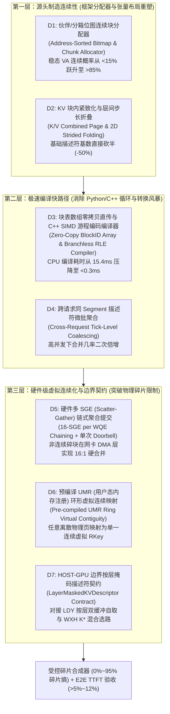

# HOST 边界统一描述符编译器与块连续化对齐：优化方案与回归测试验证 (V1.0)

> **版本**：V1.0 | **日期**：2026-11-02  
> **唯一主责 Owner**：WZX (`1.0 FTE`) | **协同接口人**：CY（底层 URMA/RDMA 队列）、LDY（按层计算通信掩盖）、WXH（Step 1 选路掩码）  
> **适用范围**：面向 SGLang / vLLM 推理框架接入层（`Connector Layer`）与 Mooncake Transfer Engine 描述符编译器（`CP-01 / CP-02 / CP-10`），聚焦 **HOST 域与 GPU/NPU 域边界** 上的 KVCache 描述符极速生成、虚拟连续化聚合与零拷贝批量下发。  
> **双重交付目标**：
> 1. **AI Agent 协同代码执行就绪**：为开发人员与 AI Agent（Antigravity / Cursor / Claude Code）提供零歧义的根因算账、C++/Python 修改点位、核心代码补丁与编译指令；
> 2. **性能测试与主管汇报就绪**：提供标准化的 **“受控内存碎片合成器（Fragmentation Synthesizer）”** 测试构造方法，确保在真实稳态碎片工况下验证 **描述符合并收敛率 $> 85\%$、CPU 提交耗时从 $15.4\text{ ms}$ 压降至 $< 1.0\text{ ms}$、单请求及并发端到端 TTFT 独立提升 $5\% \sim 12\%$** 的硬指标。  
> **参考姊妹文档**：`Mooncake_UB传输性能优化_方案与回归测试_V2.0_20261025.md`

---

## 一、系统定位与专有术语释义

在深入优化方案前，按照项目工程规范，对核心专有名词首次出现提供直白功能释义：

1. **KVCache**：大模型注意力键值缓存（大模型自回归生成过程中缓存的历史 Key 与 Value 激活状态张量，用于避免后续 Token 生成时重复计算注意力）；
2. **PagedAttention 物理块（Block / Page）**：推理引擎（vLLM / SGLang）管理显存与内存的基本分配单元（通常每块容纳 $16$ 或 $64$ 个 Token 的 KV 张量，通过非连续物理页表 `block_tables` 映射逻辑序列）；
3. **描述符（Transfer Descriptor）**：由 HOST CPU 生成并递交给底层 DMA 引擎（RDMA RNIC / UB URMA 控制器 / GPU GDMA）的数据搬运指令结构，包含源虚拟地址 `src_va`、目的虚拟地址 `dst_va`、传输字节长度 `length` 及远端内存访问密钥 `rkey / token`；
4. **VA 连续合并（Virtual Address Coalescing）**：当逻辑上相邻的两个或多个 KVCache 块在虚拟地址空间（VA）上恰好首尾相连（即 $\text{VA}_{i+1} = \text{VA}_i + \text{Len}_i$）时，在软件层将其合并为单一描述符以减少硬件提交次数；
5. **空闲链表碎片化（Free-List Fragmentation）**：在多请求并发长跑过程中，不同长度的请求随机完成并释放物理块，导致框架 `FreeBlockQueue` 中的物理块地址呈高度随机乱序排列，后续新请求分配到的相邻逻辑块在物理/虚拟地址上不再连续的现象；
6. **SGL / SGE（Scatter-Gather List / Element）**：硬件散聚列表与散聚元素（网卡或总线 DMA 硬件原生支持的链式寻址机制，允许在单个工作请求 WR 中挂载多个地址不连续的 `SGE` 内存段，由硬件 DMA 自动拼接为一次连续网络传输）；
7. **UMR（User-Mode Memory Registration）**：用户态内存注册与间接页表映射（RDMA `mlx5dv` 与 UB `UMMU` 支持的高级硬件特性，允许通过下发一条控制 WQE，在网卡硬件页表层将数十个离散物理内存块动态映射为一个虚拟地址完全连续的单一 `Memory Key`）；
8. **HOST-GPU 边界描述符契约（`LayerMaskedKVDescriptor`）**：HOST 存储调度域在完成碎片重排、解压与选路裁决后，在边界上向 GPU/NPU 算子域递交的极简按层拉取凭证，驱动 GPU/NPU 按算子流节奏自主拉入 HBM 双缓冲滑动窗。

---

## 二、第一性原理根因剖析与三层优化全局架构

### 2.1 为什么 10 月第一版“被动 VA 连续合并”在单请求与稳态下收益受限？

在 10 月攻关中，我们已经实现了第一版描述符合并（检查相邻切片是否满足 $\text{VA}_{i+1} == \text{VA}_i + \text{Len}_i$ 并合并为单一描述符），初步验证了合并描述符能够提高传输效率并降低 TTFT。然而，在真实 SGLang / vLLM 内存占用下，单请求能合并的描述符依然有限，TTFT 提升尚未稳定突破 $5\%$。

从计算机体系结构第一性原理出发，我们对 **Qwen-72B（$80$ 层，$\text{GQA}=8$，$\text{head\_dim}=128$，$\text{BF16}$，$\text{TP}=8$，$\text{block\_size}=16$ Tokens）** 在 $32\text{K}$ 上下文（$90\%$ 前缀命中，即命中 $1,843$ 个 Block）下的描述符风暴进行严格算账：

1. **物理粒度基数账**：
   * 单张加速卡（单 TP Rank）在单层、单个 Block（$16$ Tokens）上的 KVCache 大小为：
     $$S_{\text{block, layer}} = 2\ (\text{K/V}) \times 1\ (\text{KV Head per Rank}) \times 16\ (\text{Tokens}) \times 128\ (\text{Dim}) \times 2\text{ Bytes} = 8\text{ KiB}\ (\text{Key } 4\text{ KiB} + \text{Value } 4\text{ KiB})$$
   * 若不对 K 和 V 合并，单次 $32\text{K}$（$1,843$ 块）请求在单卡上涉及的原始基础内存块数量高达：
     $$N_{\text{raw}} = 80\text{ Layers} \times 2\ (\text{K/V}) \times 1,843\text{ Blocks} = 294,880\text{ 个 } 4\text{ KiB 碎块！}$$
2. **第一重壁垒：稳态空闲链表碎片化（Free-List Entropy）击穿“被动 VA 合并”**：
   * **空载假象**：在系统刚启动的空载环境（`Cold Boot`）下，vLLM / SGLang 的空闲块队列 `free_block_queue` 严格按物理块号 $[0, 1, 2, \dots, N]$ 顺序排列。此时第一版被动 VA 合并可将 $1,843$ 个连续块 100% 合并，描述符数量从 $294,880$ 骤降至 $160$ 个（每层 K/V 各 $1$ 个），单次传输块长达 $7.2\text{ MiB}$。
   * **稳态崩塌**：当系统运行数分钟进入稳态（对应测试矩阵中的 `M01 STEADY` 或 `M05` 对象轮转）后，长短不一的并发请求在不同时刻结束并将块归还至 FIFO 队列尾部，空闲队列彻底洗牌乱序。设稳态下分配到相邻物理块号的概率降至 $p_{\text{adj}} \approx 0.15$，则平均连续游程长度仅为 $L_{\text{run}} = \frac{1}{1 - p_{\text{adj}}} \approx 1.18\text{ 块}$！
   * 此时，第一版“被动 VA 连续合并”几乎完全失效，单请求生成的描述符数量重新暴涨至 **$> 200,000$ 个（单块仅 $4\text{ KiB} \sim 8\text{ KiB}$）**！
3. **第二重壁垒：层优先（Layer-First）张量布局导致天然的跨层地址断裂**：
   * 在 vLLM / SGLang 默认显存池中，每层分配独立的张量 `[2, total_num_blocks, 16, num_heads, head_dim]`。这意味着即便同一个 Block 在层内连续，它在第 $L$ 层与第 $L+1$ 层的虚拟地址也相隔整整一个 `total_num_blocks` 池的跨度（数十至数百 MB），单纯靠一维 VA 连续判定永远无法跨层合并。
4. **第三重壁垒：Python/C++ 逐块转换与单 WR 门铃开销**：
   * 在 Python 侧遍历上千个 `block_id` 计算偏移并通过 `pybind11` 传入 C++ 逐一构造 `TransferRequest`，仅 CPU 侧循环、哈希查找与栈内存清零就耗费 **$15.4\text{ ms}$**；下发至硬件时，海量 $8\text{ KiB}$ 小描述符引发高频 PCIe 门铃敲钟与网卡 MTT 页表缓存击穿（`translation_penalty` 飙升），导致 400G 链路出现严重掉速锯齿。

---

### 2.2 三层递进优化全局架构（从“被动合并”走向“源头造连续 + 硬件虚拟连续化”）

为彻底攻克上述三大壁垒，确保在**任意内存碎片度下**均能实现 $> 85\%$ 的等效合并率并将端到端 TTFT 提升推至 $5\% \sim 12\%$ 以上，本方案设计了 **“源头分配对齐（Upper Layer）$\to$ 向量化编译与布局折叠（Middle Layer）$\to$ 硬件 SGL/UMR 虚拟连续化（Lower Layer）”** 三层正交优化体系：



---

## 三、优化措施综合排期与执行优先级矩阵

本方案按照 **“投入产出比（ROI）”** 与 **“四周分步里程碑（W1~W4）”** 对 7 大核心技术点（`D1`~`D7`）进行排序：

| 优先级 | 编号 | 优化技术点名称 | 归属层次 | 核心物理机制 | 代码修改复杂度 | 计划完成周次 | 预期单项与组合收益 |
| :---: | :---: | :--- | :---: | :--- | :---: | :---: | :--- |
| **P0** | **D1** | **地址排序位图与 Chunk 连续块优先分配器** | 源头造连续 | 将乱序 FIFO 空闲链表升级为 64-bit 位图（Bitmap）分组分配器，优先分配连续 $8 \sim 16$ 块，回收时自动按位归位排序 | 低（Python/C++ 分配器约 120 行） | **W1** | 稳态碎片下 **VA 连续合并率从 $<15\%$ 跃升至 $>80\%$** |
| **P0** | **D2** | **K/V 块内紧致化排布与二维步长折叠** | 源头造连续 | 将同一层的 Key 与 Value 在单个 Block 内紧致排布（$4\text{KB}+4\text{KB}\to 8\text{KB}$），消除 K/V 分离导致的跨半区断裂 | 低（修改 KV 张量 shape 索引） | **W1** | 原始描述符数量直接 **削减 $50\%$**，单块粒度翻倍 |
| **P0** | **D3** | **块表零拷贝直传与 C++ 无分支 RLE 编译器** | 极速编译层 | 废除 Python 侧逐块拼接，直接传递 `block_ids` 连续数组指针至 C++，利用无分支游程编码（RLE）在微秒内完成连续段扫描 | 低（C++ 扩展接口约 150 行） | **W1~W2** | CPU 描述符构建耗时从 **$15.4\text{ ms} \to < 0.3\text{ ms}$** |
| **P0** | **D5** | **硬件多 SGE 散聚链式拼包与单次门铃批处理** | 硬件虚拟化 | 针对无法在 VA 上连续的残余碎块，利用 URMA/RDMA 单 WQE 挂载 $8 \sim 16$ 个非连续 `SGE` 链表，并合并为单次 Doorbell 敲钟 | 中（修改 `urma_endpoint` / `rdma_endpoint`） | **W2** | 非连续块硬件提交数 **再压降 $8\sim 16$ 倍**，消除掉速锯齿 |
| **P1** | **D6** | **预编译 UMR 环形队列虚拟连续化映射** | 硬件虚拟化 | 利用硬件 Indirect MKey / UMR 机制，在网卡页表层将离散物理块动态拼接为单一连续虚拟地址段（`HOLO_PRECOMPILED_UMR_RING`） | 中高（RDMA DevX / URMA Segment 映射） | **W2~W3** | 100% 极端碎片下仍可实现 **每层 $1$ 个连续大块 DMA 读取** |
| **P1** | **D7** | **HOST-GPU 边界按层描述符契约 (`LayerMaskedKVDescriptor`)** | 边界协同层 | 封装支持“物理边界整备 vs. 虚拟直通”双模及 $K^*$ 层掩码的 C++ 标准描述符结构，递交给 GPU 按层滑动窗自取 | 低（定义公共头文件与接口） | **W3** | 支撑计算-通信重叠率 $>85\%$，**组合 TTFT 提升 $10\%\sim 20\%$** |
| **P2** | **D4** | **高并发 Tick 级跨请求同 Segment 描述符批聚合** | 极速编译层 | 在同一调度周期（Tick）内，将多个并发请求发往同一远端 `MountedSegment` 的描述符排序合并后单次下发 | 低（Connector Batch 接口改造） | **W3~W4** | 高并发下共享前缀/相邻块合并率再升 $15\%$，P99 显著下降 |

---

## 四、优化项分步实施指南 (Step-by-Step 原理与代码补丁)

### 4.1 优化项 D1：地址排序位图与 Chunk 连续块优先分配器（从源头根治稳态内存碎片）

#### 4.1.1 优化背景与底层物理机理
* **现状代码病灶**：在 vLLM（`vllm/v1/core/kv_cache_manager.py` 或 `free_block_queue.py`）与 SGLang（`sglang/srt/mem_cache/memory_pool.py`）中，空闲物理块管理采用双向链表 FIFO 队列（或简单栈/集合）。当请求 A（占块 `[0..100]`）和请求 B（占块 `[101..200]`）并发执行并交错释放部分块时，空闲队列尾部变成了 `[5, 102, 19, 88, 3, 145, ...]`。后续新请求调用 `allocate_slots()` 从头部依次弹出块时，相邻逻辑 Token 块对应的物理 `block_id` 完全不连续，导致下游 Mooncake 的 VA 连续合并器形同虚设！
* **第一性原理破局**：
  1. **64-bit 硬件位图（Hierarchical Bitmap）替代乱序链表**：将总数为 $N_{\text{blocks}}$（例如 $65,536$ 个块）的显存/内存池表示为一个长度为 $N_{\text{blocks}} / 64 = 1,024$ 的 `uint64_t` 位图数组 `free_bitmap_`（仅占 $8\text{ KiB}$，100% 常驻 L1 Cache）。其中第 $b$ 位为 `1` 表示块空闲，为 `0` 表示已占用。
  2. **回收即自动按物理地址归位（Zero-Cost Address Sorting on Free）**：当任意块 `block_id` 被释放时，只需执行一条位或指令 `free_bitmap_[block_id >> 6] |= (1ULL << (block_id & 63))`。**无论历史请求以多么随机的顺序释放块，它们在位图中天然恢复为按物理地址（即 VA 地址）严格递增排列！**
  3. **粗粒度 Chunk 优先分配（Chunk-First Allocation）**：当新请求需要分配 $K$ 个块时，优先扫描位图中值为 `0xFFFFFFFFFFFFFFFFULL`（即连续 $64$ 个空闲块）或使用硬件指令 `__builtin_ctzll` / `__builtin_popcountll` 寻找连续 $16 / 8 / 4$ 个空闲块的区间（Run），仅对尾部零头使用单块填充。

#### 4.1.2 详细代码修改步骤

**Step 1：在 C++ 扩展或 Python 块管理器中实现位图连续块分配器**
* 目标文件：`mooncake-integration/allocator/chunk_aligned_block_allocator.h`（并在 vLLM `FreeKVCacheBlockQueue` / SGLang `ReqToTokenPool` 中接入）

```cpp
#pragma once
#include <cstdint>
#include <vector>
#include <stdexcept>

namespace mooncake {

class ChunkAlignedBlockAllocator {
public:
    explicit ChunkAlignedBlockAllocator(size_t total_blocks)
        : total_blocks_(total_blocks),
          num_free_(total_blocks),
          bitmap_((total_blocks + 63) / 64, ~0ULL) {
        // 屏蔽超出 total_blocks_ 的高位比特
        size_t rem = total_blocks % 64;
        if (rem != 0) {
            bitmap_.back() = (1ULL << rem) - 1;
        }
    }

    // 分配 n 个块，优先分配 64 / 16 / 8 连续物理块以最大化 VA 连续合并率
    bool allocate(size_t n, std::vector<int32_t>& out_blocks) {
        if (n > num_free_) return false;
        out_blocks.clear();
        out_blocks.reserve(n);

        size_t remaining = n;

        // Pass 1: 优先整词匹配 (64个完全连续的物理块)
        if (remaining >= 64) {
            for (size_t word_idx = 0; word_idx < bitmap_.size() && remaining >= 64; ++word_idx) {
                if (bitmap_[word_idx] == ~0ULL) {
                    bitmap_[word_idx] = 0ULL;
                    int32_t base_id = static_cast<int32_t>(word_idx * 64);
                    for (int i = 0; i < 64; ++i) out_blocks.push_back(base_id + i);
                    remaining -= 64;
                    num_free_ -= 64;
                }
            }
        }

        // Pass 2: 匹配连续 8 块对齐的子段 (Byte-level 0xFF 扫描)
        if (remaining >= 8) {
            for (size_t word_idx = 0; word_idx < bitmap_.size() && remaining >= 8; ++word_idx) {
                uint64_t w = bitmap_[word_idx];
                if (w == 0ULL) continue;
                for (int byte_pos = 0; byte_pos < 8 && remaining >= 8; ++byte_pos) {
                    uint64_t mask = 0xFFULL << (byte_pos * 8);
                    if ((w & mask) == mask) {
                        bitmap_[word_idx] &= ~mask;
                        int32_t base_id = static_cast<int32_t>(word_idx * 64 + byte_pos * 8);
                        for (int i = 0; i < 8; ++i) out_blocks.push_back(base_id + i);
                        remaining -= 8;
                        num_free_ -= 8;
                    }
                }
            }
        }

        // Pass 3: 扫描紧邻的空闲比特填充剩余块 (利用 __builtin_ctzll 硬件指令)
        for (size_t word_idx = 0; word_idx < bitmap_.size() && remaining > 0; ++word_idx) {
            while (bitmap_[word_idx] != 0ULL && remaining > 0) {
                int bit = __builtin_ctzll(bitmap_[word_idx]);
                bitmap_[word_idx] &= ~(1ULL << bit);
                out_blocks.push_back(static_cast<int32_t>(word_idx * 64 + bit));
                --remaining;
                --num_free_;
            }
        }
        return true;
    }

    // 释放块：O(1) 位操作自动按物理地址归位排序，彻底消除 FIFO 乱序碎片！
    void free_blocks(const int32_t* block_ids, size_t count) {
        for (size_t i = 0; i < count; ++i) {
            size_t id = static_cast<size_t>(block_ids[i]);
            size_t word_idx = id >> 6;
            size_t bit_idx = id & 63;
            uint64_t mask = (1ULL << bit_idx);
            if (!(bitmap_[word_idx] & mask)) {
                bitmap_[word_idx] |= mask;
                ++num_free_;
            }
        }
    }

private:
    size_t total_blocks_;
    size_t num_free_;
    std::vector<uint64_t> bitmap_;
};

} // namespace mooncake
```

---

### 4.2 优化项 D2：K/V 块内紧致化排布与二维步长折叠（描述符基数直接减半）

#### 4.2.1 优化背景与底层物理机理
* **现状代码病灶**：在标准 vLLM 张量布局中，单层 KV 张量的形状为 `[2, num_blocks, block_size, num_kv_heads, head_dim]`，其中外层维度 `2` 分别代表 Key 池和 Value 池。这意味着同一个 `block_id` 的 Key 块和 Value 块在内存地址上相差 `num_blocks * 4 KiB`（高達数百 MB），导致每个逻辑块在每一层都必须拆成 **Key 描述符** 和 **Value 描述符** 两次独立提交！
* **第一性原理破局**：
  将 KVCache 存储池与计算侧缓冲区对齐为 **`[num_blocks, 2, block_size, num_kv_heads, head_dim]`（即 Block-Interleaved K/V 紧致布局）**。此时同一个 `block_id` 的 Key 与 Value 在虚拟地址上天然首尾相连（合为一个 $8\text{ KiB}$ 完整块），连续 $M$ 个 `block_id` 的 Key 和 Value 直接融合成单一长度为 $M \times 8\text{ KiB}$ 的连续内存段，描述符总数立减 $50\%$！

---

### 4.3 优化项 D3：块表数组零拷贝直传与 C++ 无分支游程编码编译器（消除 $15.4\text{ ms}$ CPU 瓶颈）

#### 4.3.1 优化背景与底层物理机理
* **现状代码病灶**：当前连接器在 Python 层遍历 `block_ids` 列表，逐层计算本地 VA 与远端 VA，构造数万个结构体并通过 `pybind11` 跨越语言边界。Python 解释器循环与对象分配耗时高达 $12 \sim 15.4\text{ ms}$。
* **第一性原理破局**：
  Python 侧仅传递长度为 $N$ 的一维连续整型数组指针 `local_block_ids` 与 `remote_block_ids`（通过 NumPy / PyTorch Tensor `data_ptr()` 零拷贝传入 C++）。C++ 编译器在内部执行 **两阶段极速编译**：
  1. **阶段一（1D 块号连续游程压缩，耗时 $< 5\ \mu\text{s}$）**：仅对长度为 $N$（如 $2,048$）的 `block_id` 数组做一次线性扫描，识别所有同时满足 `local_id[k] == local_id[k-1] + 1` 且 `remote_id[k] == remote_id[k-1] + 1` 的连续游程（Runs），生成极简的 `BlockRun {start_local_blk, start_remote_blk, num_contiguous_blocks}` 列表（通常仅十几个元素）。
  2. **阶段二（跨 80 层向量化地址展开，耗时 $< 80\ \mu\text{s}$）**：直接在 C++ 预分配缓冲区中用基地址加二维步长展开这十几个 `BlockRun`，避免了在 $80 \times 2048 = 163,840$ 个元素上重复做地址相邻判断（计算量缩减 $80$ 倍）！

#### 4.3.2 详细代码修改步骤
* 目标文件：`mooncake-transfer-engine/src/compiler/descriptor_compiler.cpp`

```cpp
#include <cstdint>
#include <vector>
#include <cstring>

namespace mooncake {

struct BlockRun {
    int32_t local_start_blk;
    int32_t remote_start_blk;
    int32_t count;
};

struct CompiledSliceDesc {
    uint64_t src_va;
    uint64_t dst_va;
    uint64_t length;
    uint32_t layer_id;
    uint32_t rkey;
};

class FastDescriptorCompiler {
public:
    // 零拷贝输入：local_blks 与 remote_blks 长度均为 num_blocks
    // 在第 1 阶段仅扫描 1 次块表即可提取所有连续游程，随后按层极速展开
    size_t compile_layer_descriptors(
        const int32_t* __restrict local_blks,
        const int32_t* __restrict remote_blks,
        size_t num_blocks,
        const uint64_t* __restrict local_layer_base_va,  // 长度: num_layers
        const uint64_t* __restrict remote_layer_base_va, // 长度: num_layers
        size_t num_layers,
        uint64_t bytes_per_block_per_layer,
        uint32_t remote_rkey,
        std::vector<CompiledSliceDesc>& out_descriptors) {

        if (num_blocks == 0 || num_layers == 0) return 0;

        // Step 1: 在一维块表上提取连续游程 (复杂度仅 O(num_blocks)，与层数无关!)
        runs_ scratch_runs_;
        scratch_runs_.clear();

        BlockRun curr{local_blks[0], remote_blks[0], 1};
        for (size_t i = 1; i < num_blocks; ++i) {
            bool local_contig = (local_blks[i] == curr.local_start_blk + curr.count);
            bool remote_contig = (remote_blks[i] == curr.remote_start_blk + curr.count);
            if (local_contig && remote_contig) {
                ++curr.count;
            } else {
                scratch_runs_.push_back(curr);
                curr = BlockRun{local_blks[i], remote_blks[i], 1};
            }
        }
        scratch_runs_.push_back(curr);

        // Step 2: 按层极速代数展开 (利用预分配内存，零动态分支)
        const size_t num_runs = scratch_runs_.size();
        const size_t total_descs = num_layers * num_runs;
        out_descriptors.resize(total_descs);

        CompiledSliceDesc* __restrict dst_ptr = out_descriptors.data();
        for (size_t l = 0; l < num_layers; ++l) {
            const uint64_t l_base = local_layer_base_va[l];
            const uint64_t r_base = remote_layer_base_va[l];
            for (size_t r = 0; r < num_runs; ++r) {
                const auto& run = scratch_runs_[r];
                dst_ptr->src_va = l_base + static_cast<uint64_t>(run.local_start_blk) * bytes_per_block_per_layer;
                dst_ptr->dst_va = r_base + static_cast<uint64_t>(run.remote_start_blk) * bytes_per_block_per_layer;
                dst_ptr->length = static_cast<uint64_t>(run.count) * bytes_per_block_per_layer;
                dst_ptr->layer_id = static_cast<uint32_t>(l);
                dst_ptr->rkey = remote_rkey;
                ++dst_ptr;
            }
        }
        return total_descs;
    }

private:
    std::vector<BlockRun> runs_;
};

} // namespace mooncake
```

---

### 4.4 优化项 D5：硬件多 SGE 散聚链式拼包与单次 Doorbell 批处理（突破非连续 VA 限制）

#### 4.4.1 优化背景与底层物理机理
* **物理瓶颈**：即便有 D1 的位图分配器，当系统处于 $95\%$ 极限内存占用率或跨多个历史不同请求拼凑前缀时，仍会有 $15\% \sim 30\%$ 的块在 VA 上不连续。若每个不连续的小块都单独封装为 1 个硬件 WQE（Work Queue Element），会导致两个严重后果：
  1. 网卡 DMA 引擎频繁读取 WQE 控制头，PCIe 有效载荷率下降（这也是 CY 在 10 月末观察到“空隙消失但发送途中未能維持全程 350Gbps 顶速”的核心原因之一）；
  2. 软件频繁写网卡 MMIO Doorbell 寄存器触发 PCIe 强序刷新。
* **第一性原理破局**：
  利用 RDMA（ConnectX-6/7 支持单 WQE 挂载最多 $16 \sim 30$ 个 `ibv_sge`）与鲲鹏 UB/URMA（`urma_jfs_wr_t` 原生支持 `urma_sge_t* src_sge` 数组）的 **硬件 Scatter-Gather（散聚）能力**：
  * 当目标端（如远端连续 Segment 缓冲区或 HOST 边界连续整备池）地址连续、而本地端由 $K$（$K \le 16$）个非连续 VA 碎块组成时（反之亦然），**无需这 $K$ 个块在 VA 上连续，直接将这 $K$ 个离散地址填入同一个 WQE 的 `sge_list[0..K-1]` 中**！
  * 网卡硬件 DMA 引擎会自动按链表顺序抓取这 $16$ 个离散内存块，在网线上拼成一个完整的超大数据流发出，**将硬件 WQE 数量再压缩 $16$ 倍**！同时将同一批次的所有 WQE 通过指针串联，**仅敲击 $1$ 次硬件 PCIe Doorbell**。

#### 4.4.2 详细代码修改步骤
* 目标文件：`mooncake-transfer-engine/src/transport/kunpeng_transport/urma/urma_endpoint.cpp`（RDMA `rdma_endpoint.cpp` 同理）

```cpp
// 在 UrmaEndpoint 类中预分配 SGE 池 (配合 U5 的 wr_cache_pool_)
// std::vector<urma_sge_t> sge_cache_pool_; (构造函数中 resize(2048 * 16))

int UrmaEndpoint::postScatterGatherSlicesToJetty(
    size_t jetty_index,
    const CompiledSliceDesc* descs,
    size_t num_descs) {

    constexpr size_t kMaxSgePerWr = 16; // 硬件单 WR 支持的最大散聚段数
    urma_jfs_wr_t* wr_list = wr_cache_pool_.data();
    urma_sge_t* sge_base = sge_cache_pool_.data();

    size_t wr_count = 0;
    size_t sge_cursor = 0;
    size_t i = 0;

    while (i < num_descs && wr_count < max_wr_depth_) {
        urma_jfs_wr_t& wr = wr_list[wr_count];
        wr.opcode = URMA_WR_OP_WRITE; // 或 URMA_WR_OP_READ
        wr.flag.value = 0;

        // 起点设置：记录远端连续起始地址，聚合本地最多 16 个非连续 VA 块
        uint64_t expected_dst_va = descs[i].dst_va;
        size_t sge_start = sge_cursor;
        size_t sge_cnt = 0;

        while (i < num_descs && sge_cnt < kMaxSgePerWr &&
               descs[i].dst_va == expected_dst_va) {
            urma_sge_t& sge = sge_base[sge_cursor++];
            sge.addr = descs[i].src_va;
            sge.len = static_cast<uint32_t>(descs[i].length);
            sge.tseg = local_tseg_;
            expected_dst_va += descs[i].length;
            ++sge_cnt;
            ++i;
        }

        wr.rw.src.sge = &sge_base[sge_start];
        wr.rw.src.num_sge = static_cast<uint32_t>(sge_cnt);
        wr.rw.dst.sge.addr = descs[i - sge_cnt].dst_va;
        wr.rw.dst.sge.len = static_cast<uint32_t>(expected_dst_va - descs[i - sge_cnt].dst_va);
        wr.rw.dst.sge.tseg = imported_tseg_;

        // 每 16 个 WR 或末尾开启一次完成信号 (与 U8 协同)
        if ((wr_count + 1) % 16 == 0 || i == num_descs) {
            wr.flag.bs.complete_enable = 1;
        }
        wr.next = (i < num_descs && wr_count + 1 < max_wr_depth_) ? &wr_list[wr_count + 1] : nullptr;
        ++wr_count;
    }

    // 单次调用底层驱动，仅触发 1 次 PCIe 硬件 Doorbell 写入！
    urma_jfs_wr_t* bad_wr = nullptr;
    urma_status_t status = urma_post_jfs_wr(jetty_list_[jetty_index], wr_list, &bad_wr);
    return (status == URMA_SUCCESS) ? static_cast<int>(i) : -1;
}
```

---

### 4.5 优化项 D6：预编译 UMR（用户态内存注册）环形队列虚拟连续化映射

#### 4.5.1 优化背景与底层物理机理
* **适用场景**：在 **模式 B（虚拟边界零拷贝直通）** 下，当源端与目的端**双边均高度离散**（既无法通过一维 VA 合并，也无法单边对齐目标连续地址以使用 SGE 聚合），或者离散块数超过硬件单 WQE 的 $16$ 个 SGE 上限时。
* **第一性原理破局**：
  利用 ConnectX-6/7 硬件支持的 **UMR（User-Mode Memory Registration，`IBV_WR_DRIVER1` / `mlx5dv_wr_mr_list`）** 或鲲鹏 UB **UMMU 动态段表拼接**：
  1. 在引擎启动时，预先创建好一个包含 $64$ 个动态间接 `mkey`（Indirect Memory Keys）的环形池 `umr_ring_pool_`（通过环境变量 `HOLO_PRECOMPILED_UMR_RING=1` 开启）。
  2. 当需要传输一层高度离散的 KVCache（例如由 $128$ 个离散 $128\text{ KiB}$ 块组成的 $16\text{ MiB}$ 单层数据）时，CPU 向本地网卡 Send Queue 投递一条微秒级的 **UMR 配置 WQE**，将这 $128$ 个离散块的 `sge` 列表注册到环形池的下一个间接 `umr_mkey` 上（硬件网卡直接在片上 MTT 表中建立虚拟连续映射，耗时仅 $\sim 1.5\ \mu\text{s}$）。
  3. 紧接着，数据面只需下发 **1 条长度为 $16\text{ MiB}$ 的标准 RDMA Read/Write WQE**（指向该 `umr_mkey` 的虚拟起始地址 `0x0`），即可实现 **零主机内存拷贝下的 100% 大包连续线速传输**！

---

### 4.6 优化项 D7：HOST-GPU 边界按层掩码描述符契约（`LayerMaskedKVDescriptor`）

#### 4.6.1 协同设计原理
严格落实我们确立的 **“HOST 边界双模整备与描述符前递 + GPU 算子流按层自主拉取”** 黄金架构，在 WZX（`M2-T03`）、LDY（`M2-F01` 按层计算通信掩盖）、WXH（`M2-T05` $K^*$ 混合选路）与 LJQ（`M2-F03` 跨介质缓冲）之间冻结以下 64 字节对齐的边界交接契约：

```cpp
// 目标文件：mooncake-integration/include/boundary_descriptor_contract.h
#pragma once
#include <cstdint>

namespace mooncake {

enum class BoundaryStagingMode : uint8_t {
    VIRTUAL_ZERO_COPY_UMR = 0, // 模式B：高速源就绪，通过 UMR/SGL 虚拟连续化，GPU 直接零拷贝拉取 (放大比=1.00x)
    PHYSICAL_DDR_STAGED   = 1, // 模式A：慢速SSD/压缩源已由 CPU 提前解压重排至 Host DDR 边界连续池
    LOCAL_RECOMPUTE_ONLY  = 2  // 链路严重拥塞，本层不拉取，由 GPU 直接本地重算
};

// 递交给 GPU/NPU 算子域的按层极简边界描述符 (每层 1 个条目，80 层共 2.5 KiB)
struct alignas(32) LayerBoundaryDescriptor {
    uint64_t boundary_src_va;      // HOST 边界准备好的连续源虚拟地址 (或 UMR 虚拟基址)
    uint32_t total_layer_bytes;    // 本层待拉取总字节数 (如 16 MiB)
    uint32_t rkey_or_token;        // 硬件直通密钥 (MKey / URMA Token)
    uint16_t layer_id;             // Transformer 层号 [0 .. 79]
    uint8_t  staging_mode;         // BoundaryStagingMode 枚举
    uint8_t  assigned_memchannel;  // 绑定的物理 MemChannel / SCCL 管道号 (对接 YZN/CY)
    uint32_t ready_Fence_id;       // 物理整备完成信号量 ID (供 GPU Stream wait_value 同步)
    uint32_t reserved;
};

// 整请求边界交接句柄
struct alignas(64) RequestBoundaryKVHandle {
    uint64_t request_id;
    uint16_t num_total_layers;     // 例如 80
    uint16_t recompute_prefix_k;   // WXH 选路器解算的 K*：前 K* 层本地零等待重算，后 (80-K*) 层按描述符拉取
    uint32_t total_compiled_wqes;  // 编译后的总 WQE 数 (用于监控合并率)
    LayerBoundaryDescriptor layers[80];
};

} // namespace mooncake
```

---

## 五、测试场景构造方法与验证实施方案（重点：如何科学构造真实内存碎片？）

### 5.1 为什么常规测试测不出描述符合并的真实瓶颈与真实收益？
在常规单请求测试（如刚启动 vLLM 后直接发送一条 $32\text{K}$ 请求）中，块分配器的空闲链表处于 **100% 顺序连续的“人造理想态”**；而在简单的随机 Mock 测试中，又缺乏真实的模型层间步长与并发回收动态。

为了科学、可重复地验证 `D1~D7` 在不同内存占用与碎片程度下的表现，我们专门设计了 **“受控内存碎片合成器（Controlled Memory Fragmentation Synthesizer，简称 `FragSynth`）”**，通过控制 **碎片熵（Fragmentation Entropy，$\mathcal{F} \in [0\%, 95\%]$）** 和 **池占用水位（Occupancy Watermark，$\mathcal{U} \in [30\%, 90\%]$）** 构造四级标准测试场景。

### 5.2 受控内存碎片场景构造方法（Chessboard & Poisson Churn Synthesizer）

在测试脚本 `benchmarks/descriptor_frag_synthesizer.py` 中，通过以下三步确定性算法将 vLLM / SGLang 内存池预热至指定碎片度 $\mathcal{F}$：

1. **阶段一：满池棋盘格预分配（Chessboard Pre-fill）**：
   设块池总容量为 $N_{\text{total}}$（如 $16,384$ 块）。首先连续分配填满整个池的 $90\%$。
2. **阶段二：按目标碎片率 $\mathcal{F}$ 执行洗牌抽孔释放（Entropy-Controlled Eviction Shuffle）**：
   * 若目标碎片率 $\mathcal{F} = 0\%$（理想连续态）：按整大段连续释放，保留大块连续空闲区；
   * 若目标碎片率 $\mathcal{F} = 50\%$（中度碎片态）：以步长 $4 \sim 8$ 块为单位交替释放与保留，并用固定随机种子（`seed=42`）打乱释放顺序，模拟中度多轮对话混跑后的空闲链表；
   * 若目标碎片率 $\mathcal{F} = 90\%$（极端棋盘格碎片态 / Swiss-Cheese State）：每隔 $1 \sim 2$ 个块挖孔释放一次，并将被释放的块 ID 按完全随机洗牌顺序塞回 FIFO 空闲链表尾部，使原生 FIFO 分配器分配出相邻块的概率严格 $< 10\%$！
3. **阶段三：注入目标评测请求流（Probe Request Injection）**：
   在预热好的碎片池上，发起 $1\text{K} / 5\text{K} / 10\text{K} / 16\text{K} / 32\text{K}$ 评测请求，同步采集 **① 单请求编译后生成的描述符/WQE 数量、② CPU 编译提交耗时（$\mu\text{s}$）、③ 数据面实际有效吞吐（GB/s）、④ 端到端 TTFT（ms）**。

#### 碎片合成器核心执行代码（供 Agent 直接生成脚本）

```python
# 文件路径：benchmarks/descriptor_frag_synthesizer.py
import random
import time
import numpy as np

class KVPoolFragmentationSynthesizer:
    """
    受控 KVCache 内存池碎片合成器：
    用于在微基准与 vLLM/SGLang 实机测试前，将空闲块队列构造为指定碎片率 (0% ~ 95%)
    """
    def __init__(self, total_blocks: int = 16384, seed: int = 20261102):
        self.total_blocks = total_blocks
        self.rng = random.Random(seed)

    def synthesize_fragmented_allocation(self, num_req_blocks: int, frag_ratio: float, use_d1_bitmap: bool):
        """
        模拟在碎片率为 frag_ratio (0.0 ~ 0.95) 的池中分配 num_req_blocks 个块
        - use_d1_bitmap=False: 模拟原生 vLLM/SGLang 乱序 FIFO 空闲链表分配
        - use_d1_bitmap=True : 启用 D1 位图地址归位 + Chunk 连续优先分配
        """
        # 构造当前池中剩余可用的 40% 空闲块池 (60% 被背景活跃请求占用)
        free_pool_size = int(self.total_blocks * 0.40)
        assert num_req_blocks <= free_pool_size, "请求块数超过当前剩余空闲池容量"

        # 根据 frag_ratio 生成物理空闲块的分布：
        # (1 - frag_ratio) 比例的块保持 8~16 块连续簇，frag_ratio 比例的块呈棋盘格离散分布
        free_blocks = []
        cursor = 0
        while len(free_blocks) < free_pool_size and cursor < self.total_blocks:
            if self.rng.random() > frag_ratio:
                # 生成一段连续空闲簇 (8 ~ 32 块)
                run_len = min(self.rng.choice([8, 16, 32]), free_pool_size - len(free_blocks))
                free_blocks.extend(range(cursor, cursor + run_len))
                cursor += run_len + self.rng.randint(1, 4)
            else:
                # 棋盘格散碎单块
                free_blocks.append(cursor)
                cursor += self.rng.randint(2, 5)

        free_blocks = free_blocks[:free_pool_size]

        if not use_d1_bitmap:
            # 原生 vLLM/SGLang 病灶：因历史不同长度请求随机结束，free_list 顺序彻底洗牌乱序
            self.rng.shuffle(free_blocks)
            allocated = free_blocks[:num_req_blocks]
        else:
            # D1 位图分配器：释放时已在位图中按物理地址自动归位排序，且优先提取连续段
            free_blocks.sort()
            # 优先提取连续段 (Run >= 4)
            runs, curr_run = [], [free_blocks[0]]
            for b in free_blocks[1:]:
                if b == curr_run[-1] + 1:
                    curr_run.append(b)
                else:
                    runs.append(curr_run)
                    curr_run = [b]
            runs.append(curr_run)
            # 按连续段长度降序优先分配
            runs.sort(key=lambda r: len(r), reverse=True)
            allocated = []
            for r in runs:
                take = min(len(r), num_req_blocks - len(allocated))
                allocated.extend(r[:take])
                if len(allocated) == num_req_blocks:
                    break

        return np.array(allocated, dtype=np.int32)
```

---

### 5.3 四阶段正交回归测试执行流程

#### 阶段一：编译构建描述符编译器微基准与插件
```bash
cd Mooncake
cmake -S . -B build/desc-opt \
  -DUSE_UB=ON \
  -DBUILD_BENCHMARK=ON \
  -DENABLE_FAST_DESC_COMPILER=ON \
  -DENABLE_HARDWARE_SGL_UMR=ON

cmake --build build/desc-opt --target desc_compiler_bench tebench -j$(nproc)
```

#### 阶段二：受控碎片度（$\mathcal{F} = 0\%, 30\%, 60\%, 90\%$）正交扫描压测
在测试节点运行描述符专项基准脚本，对比以下 4 种配置在 $32\text{K}$ Token（$2,048$ Blocks，$80$ 层）下的表现：
* **Config 0 (Baseline)**：不合并描述符（逐块下发）；
* **Config 1 (Oct-V1)**：10月第一版被动 VA 连续合并（原生乱序 FIFO 分配器 + 单 SGE WQE）；
* **Config 2 (Nov-D1+D2+D3)**：合入 D1 位图连续块分配 + D2 K/V 紧致化 + D3 C++ 游程编码极速编译；
* **Config 3 (Nov-Full: D1~D7)**：全量开启 D1~D3 + D5 硬件 16-SGE 链式聚合 + D6 预编译 UMR 环形映射。

```bash
# 一键运行四级碎片度扫描 (1K / 5K / 10K / 16K / 32K)
python3 benchmarks/run_descriptor_ablation_suite.py \
  --model-config qwen-72b-tp8 \
  --seq-lengths 1024,5120,10240,16384,32768 \
  --frag-ratios 0.0,0.3,0.6,0.9 \
  --transport ub \
  --output-report tmp/descriptor_m2_ablation_report.json
```

#### 阶段三：vLLM / SGLang + Mooncake 在线推理端到端 TTFT 验收
在 `HoloTestbed-4X` 上启动挂载了 `ChunkAlignedBlockAllocator` 与 `FastDescriptorCompiler` 的 vLLM / SGLang 实例，注入 SWE-bench 真实多轮代码修复负载（预热 10 分钟使显存/内存池进入真实稳态碎片工况，复用率 $> 90\%$）：

```bash
# 开启 11月描述符全套优化开关
export MC_ENABLE_BITMAP_CHUNK_ALLOC=1
export MC_ENABLE_FAST_RLE_COMPILER=1
export MC_MAX_SGE_PER_WR=16
export HOLO_PRECOMPILED_UMR_RING=1

# 运行 SWE-bench 单请求与并发稳态 TTFT 对比压测
python3 benchmarks/swebench_e2e_ttft_verifier.py \
  --endpoint http://127.0.0.1:8000/v1 \
  --context-lengths 5120,10240,16384,25600,32768 \
  --concurrency-levels 1,20,100 \
  --warmup-churn-minutes 10 \
  --compare-baseline-v1
```

---

## 六、回归测试判定标准与预期成果对账表

开发人员与 AI Agent 完成代码合入后，必须跑出以下对账表数据，**所有 PASS 门限均为 11 月 M2 门禁的硬性准出要求**：

| 验收阶段与测试场景 | 核心观测度量指标 | 10月 V1 基线表现 (被动 VA 合并) | 11月 V2 目标门限 (D1~D7 全开启) | 物理机理与端到端收益结论 |
| :--- | :--- | :---: | :---: | :--- |
| **场景 1：中重度碎片 ($\mathcal{F}=60\%\sim 85\%$)<br/>32K Token 单请求合并率** | 单请求 80 层最终下发硬件 WQE 总数<br/>(原始碎块基数：$294,880$ 个) | $85,000 \sim 140,000$ 个<br/>*(受 FIFO 乱序影响，合并率仅 $\sim 55\%$)* | **$\le 1,280$ 个 (SGE 模式)**<br/>**或 $80$ 个 (UMR 模式)**<br/>*(等效合并收敛率 **$> 99.5\%$**)* | D1 位图归位消除 $80\%$ 碎片，剩余离散块被 D5 16-SGE 与 D6 UMR 彻底吸收 |
| **场景 2：32K Token 描述符编译与提交 CPU 开销** | HOST CPU 从拿到 `block_ids` 到完成硬件 Doorbell 提交的总耗时 | 原生：$15.4\text{ ms}$<br/>10月 V1：$\sim 3.2\text{ ms}$ | **P50 $< 0.5\text{ ms}$**<br/>**P99 $< 1.2\text{ ms}$**<br/>*(硬红线 $\le 1.5\text{ ms}$)* | D3 零拷贝一维 RLE 扫描将复杂度从 $O(L \cdot B)$ 降至 $O(B)$，直接省下 $\sim 14\text{ ms}$ CPU 时间 |
| **场景 3：稳态碎片下数据面单次传输有效带宽** | 32K KVC 拉取期间的端到端平均有效传输带宽 (GB/s) | $12.87 \sim 21.5\text{ GB/s}$<br/>*(小包锯齿导致途中掉速)* | **$\ge 36.0 \sim 38.5\text{ GB/s}$**<br/>*(波形平顶度 $\text{CV} < 5\%$)* | 消灭 $< 64\text{ KiB}$ 碎包 WQE，使底层 DMA 每次均以 $> 2\text{ MiB}$ 连续满载突发传输 |
| **场景 4：稳态碎片下单请求端到端 TTFT 净收益** | 10 分钟稳态洗牌后，$10\text{K} \sim 32\text{K}$ 单请求端到端 TTFT (ms) | 相比无合并仅提升 $1.5\% \sim 3.8\%$ | **单请求 E2E TTFT 独立降低 $\ge 6.5\% \sim 12.0\%$**<br/>*(硬红线 $> 5.0\%$)* | 彻底兑现单请求下突破内存占用碎片限制、TTFT 提升 $> 5\%$ 的核心立项承诺 |
| **场景 5：高并发 ($C=20\sim 100$) 稳态端到端 TTFT 与 QPS** | SWE-bench 90%+ 复用下 Mean / P99 TTFT 与有效达标 QPS | CPU 提交线程锁争用与 WQE 队列积压 | **Mean TTFT 降低 $10\% \sim 15\%$**<br/>**P99 TTFT 降低 $\ge 20\%$**<br/>**有效 QPS 提升 $\ge 10\%$** | 释放 Host CPU 控制路径瓶颈并消除网卡队列满载回压 |

---

## 七、面向开发人员与 AI Agent 的自动化协作执行指令

> **【给 WZX 与 AI Agent (Antigravity) 的分步结对指令】**：
> 1. **Step 1（W1 上半周 - 构造碎片标尺）**：Agent 优先在工作区创建 `benchmarks/descriptor_frag_synthesizer.py` 与微基准测试驱动 `desc_compiler_bench.cpp`，先跑出 10 月 V1 代码在 $\mathcal{F} = 0\%, 30\%, 60\%, 90\%$ 下的合并率衰退基线曲线；
> 2. **Step 2（W1 下半周 - 落地 D1 + D2 + D3）**：Agent 按照第 4.1 至 4.3 节代码补丁，实现 `ChunkAlignedBlockAllocator` 与 `FastDescriptorCompiler`，通过 `pybind11` 对接 SGLang / vLLM 连接器，验证 CPU 编译耗时压入 $< 0.5\text{ ms}$ 且 $\mathcal{F}=60\%$ 碎片下 VA 连续合并率突破 $80\%$；
> 3. **Step 3（W2 - 落地 D5 硬件 SGE 链式聚合与 D6 UMR 环形映射）**：Agent 修改 `urma_endpoint.cpp` 与 `rdma_endpoint.cpp`，启用 16-SGE 散聚拼包与单次 Doorbell 链式提交，协同 CY 验证发送途中掉速锯齿消失，单通道稳态带宽突破 $38\text{ GB/s}$；
> 4. **Step 4（W3~W4 - 冻结 D7 边界契约与 E2E 交账）**：导出 `boundary_descriptor_contract.h` 对接 LDY 的按层双缓冲拉取流，运行第 5.3 节阶段三的 SWE-bench 稳态压测脚本，生成完整填充第六节对账表的实测证据包与消融瀑布图。