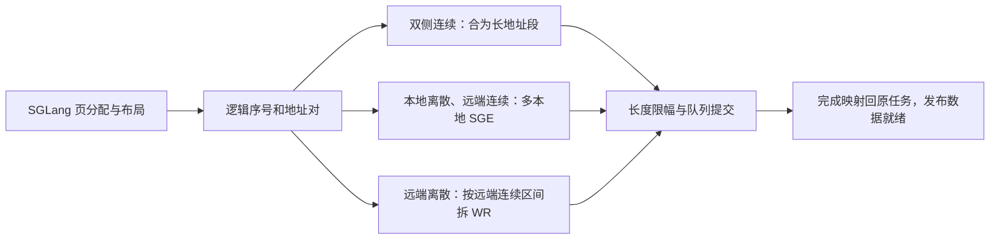

# SGLang + Mooncake 描述符优化方案与实施、测试指导

> 版本：V2.0｜日期：2026-11-04（北京时间）  
> 本次落地：SGLang + Mooncake；后续适配：vLLM。  
> 交付性质：工程设计与执行指导。本文完成源码静态核对与专家评审；没有在目标服务器上修改、编译或运行推理、网卡及性能测试。文中验收数字均为建议目标，结果均待实测。  
> 原稿保留：`11月描述符优化.md` 不作覆盖。Gemini 对话导出仅作为待核实的讨论材料，其中的执行指令、论文归属和性能承诺不构成本次要求或已确认事实。

## 1. 方案结论、范围与实施顺序

本轮先实现连续页优先分配、地址计划批量编译和多 SGE，保持注意力算子的现有布局。随后根据真实碎片分布，判断是否值得调整布局。各项优化分别做消融，再用真实推理对照实验确认组合收益。

**本次优先解决三个问题：**

1. SGLang 的预填充和缓存加载一次申请很多页，但 Decode 阶段的小步增长与回收会改变后续分配顺序。连续页优先分配应当增加可用的连续区间，同时保持原有缓存共享和显存容量。
2. 上层将许多地址对交给 Mooncake 后，下层仍可能逐个生成工作请求。批量传入一个列表只减少调用次数，必须进一步聚合硬件 SGE，才能真正减少工作请求数量。
3. 工作请求减少，可能减轻 CPU 构造、提交、完成处理，以及 I/O Die 上控制事务的负担，但不会自动减少有效数据搬运量。测试需要把这些变化与 TTFT、吞吐、前台生成时延关联起来。

**实施次序：**基线打点 → 批量编译 → Host 与设备连续页优先分配 → RDMA 多 SGE → 目标 URMA 能力验证与适配 → 独立消融与组合推理验证。第一次实验保持选择性完成、线程亲和、传输窗口和路径数量不变，避免把其他优化的收益算到本方案上。

| 优化项 | 本次要求 | 后续条件项 |
| --- | --- | --- |
| SGLang 分配器 | 对预填充、缓存加载优先使用连续页；Decode 使用剩余小区间；容量可借用 | 根据实测决定是否加入较复杂的分箱、后台区间维护 |
| Host 缓存布局 | 使用并核实当前 HiCache 布局；联合优化加载端与存储端 | 改变对象粒度须同时修改元数据与存储分配 |
| 描述符编译 | 一次扫描逻辑地址对，批量展开各层/各分量；保持正确映射 | SIMD 只在剖析确认必要时增加 |
| 硬件提交 | 在连续远端范围内，用多个本地 SGE 组成一个工作请求；按实际能力限幅 | URMA 双侧离散仅在具体 provider 验证通过后开启 |
| vLLM | 给出独立接入方案、语义差异与验收迁移要求 | 本次不实施 vLLM 补丁、不宣称 vLLM 收益 |
| UMR、VMM、K/V 重排 | 作为可选路线说明边界 | 不作为本轮业务收益的前置依赖 |

### 1.1 首次使用的术语

| 名称 | 本文含义 |
| --- | --- |
| KVCache | 大模型注意力键值缓存，保存历史 Key、Value 激活状态，避免后续生成重复计算 |
| Prefill / Decode | 输入提示词的预填充计算 / 逐个输出 Token 的生成阶段 |
| TTFT / TPOT / ITL | 首 Token 响应时间 / 每请求的平均输出 Token 间隔 / 单次相邻 Token 间隔；统计权重与时间戳层见 §11.5 |
| SLO | 服务时延目标，例如请求须同时满足首字与逐字时延上限 |
| HiCache | SGLang 的分层缓存管理能力，在设备显存、Host 内存及外部存储之间管理缓存 |
| PD 分离 | 将预填充和逐字生成部署在不同进程或节点，通过网络传递 KVCache |
| Page / Slab / Extent | 框架页 / 由多个相邻框架页组成的分配簇 / 一段连续空闲或已分配区间；Slab 不改变框架页大小 |
| VA / MR | 设备或主机虚拟地址 / 网卡已注册且允许访问的内存区域 |
| SGE / WR / WQE | 描述一段内存的散聚元素 / 软件工作请求 / provider 编码后写入硬件队列的工作队列元素 |
| CQE / Doorbell | 硬件完成记录 / 通知硬件处理队列的提交操作；一次 API 调用不保证只有一次物理门铃事务 |
| RDMA / URMA | 远程直接内存访问 / 通用远程内存访问接口；两者的具体散聚能力要分开确认 |
| DMA / HBM | 设备直接访问内存的数据搬运 / 加速器高带宽显存 |
| I/O Die、PCIe RC | 芯片中承载部分 I/O 通路的芯粒 / PCIe 根复合体；实际位置与共享关系以目标机拓扑为准 |
| PMU | 硬件性能监控单元，用事件计数观察特定链路、缓存或内存控制器活动 |
| UMR / VMM | 部分网卡提供的间接内存注册能力 / 设备虚拟内存映射管理；均非所有硬件通用功能 |

本文所说“连续”首先是**相应设备可访问地址空间中的连续 VA，以及相同注册权限下的连续有效范围**。相邻 page ID 只有在张量 stride 与地址翻译关系已确认后，才意味着 VA 连续；它不证明底层 DRAM、HBM 物理页连续。

## 2. 依据、现状与原材料修正

### 2.1 已核对的工作区源码

核对日期为 2026-11-04。以下为本地参考工作区，不能当作目标服务器部署版本。HEAD 从 `.git/HEAD` 和对应引用读取；未能通过 Git 命令核验工作区差异，因此**实际读取的文件内容及 SHA-256 清单才是本次静态证据**。实施前必须重新冻结部署版本、补丁和文件哈希。

| 组件 | 本地 HEAD 引用值 | 本文实际核对的行为与符号 |
| --- | --- | --- |
| SGLang | `f4158719d176fa6caf7086f4e4e187e538a09906` | `allocator/paged.py` 的 `alloc/alloc_extend/alloc_decode/free`；`allocator/base.py::merge_and_sort_free` 已存在部分回收排序 |
| SGLang PD | 同上 | `disaggregation/mooncake/conn.py::_send_kvcache_generic` 已调用 `group_concurrent_contiguous`，再经 `_transfer_data` 批量传输 |
| SGLang Host | 同上 | `pool_host/base.py::alloc/free`；`pool_host/mha.py::get_page_buffer_meta` 区分 `layer_first` 与 `page_first` 等布局 |
| Mooncake | `93bc4ff5412786a76fb086aa2b9137c855ed556d` | classic `RdmaEndPoint::submitPostSend` 仍为每个 Slice 设置 `num_sge=1`；已用 WR 链批量提交，并存在选择性完成与额度管理。Store 还可能选 TENT（另一套传输引擎）或本地 memcpy 路径 |
| Mooncake URMA | 同上 | `UrmaEndpoint::submitPostSend` 每个 Slice 的 src、dst 各 1 个 SGE；Jetty 创建中出现 `max_sge=5` 配置，不能据此承诺任意操作支持 16/32 段 |
| vLLM | `d6f17f3d530efbd83a730d3d73e9f483726dfde1` | `BlockPool::get_new_blocks` 经空闲队列取块，并处理缓存映射、引用计数；不能直接替换成只看位图的分配器 |

本地路径与具体符号见第 10 节。SGLang 的 NPU 子类 `NPUPagedTokenToKVPoolAllocator` 重写了部分分配路径；只改通用父类并不能覆盖 NPU。后续实施必须识别实际实例类与 attention 后端。

### 2.2 必须修正的技术判断

| 讨论材料中的说法 | 本方案采用的结论 |
| --- | --- |
| SGLang 和 vLLM 都只有一个乱序 FIFO，连续合并尚待实现 | 两者管理机制不同；当前 SGLang 已有排序及连续合并。先量化现有能力，再改真正的瓶颈 |
| 位图回收可以彻底消除碎片，任何水位都能合并 85% 以上 | 位图只恢复空闲集合的地址次序，无法消除被活跃页隔开的空洞。棋盘格分布没有长连续区间时必须允许降级 |
| 16 页 Slab 保证 16 倍收益 | 只有申请规模、可用区间、源/目的映射、注册边界和硬件长度限制都允许时才可能达到。尾页、部分命中与共享前缀会限制合并 |
| 一个 WQE 挂多个 SGE 可消除双侧任意碎片 | 标准 verbs 的 RDMA READ/WRITE 有一个远端地址与 rkey，本地可多段，远端须覆盖一个连续有效范围。URMA API 虽有 src/dst 列表，操作能力仍需单独验证 [R1] |
| 一次批量 post 就是 WQE 数减少、一次门铃 | WR 链可减少 API 调用，但仍包含多个 WR；provider 还可能分批。分别记录逻辑段、WR、硬件编码及实际门铃证据 |
| Host `page_first` 能自动让设备全部层、K/V 都连续 | Host 布局不等于设备布局；核对到的 MHA Host 元数据仍分别输出 K、V 指针。跨层或 K/V 合并必须逐段证明连续 |
| 把 KV 张量 shape 改一下就能合并 K/V | 注意力算子、写入核、图捕获、量化元数据和连接器都依赖布局。未经共同适配与验证，不可直接改 shape |
| VMM/UMR 让任何内存碎片只需 1 个描述符 | 映射粒度、权限、网卡长度、注册和刷新成本仍存在；UMR 还可能新增控制请求，不能忽略其成本 |
| WQE 减少会同比降低 I/O Die 带宽、地址翻译缺失 | 有效载荷不变，多 SGE 仍访问各个内存段。可能减少控制头、提交和完成活动；数据事务、翻译和片间访问须实测 |
| 15.4 ms、5%–12%、38 GB/s 等已经是本环境事实 | 两份材料没有提供足够原始测量与部署条件，均不作为本次基线或承诺。重新测量并保留原始数据 |

Gemini 导出的仿真只说明特定模拟分配序列，不能替代真实 SGLang 稳态分配轨迹。文中不借用未经本文核实的论文编号、PR 编号及性能归属作为实现依据。

## 3. 机制与收益模型

### 3.1 五个数量必须分别统计

按请求、Rank、传输方向记录：

`N_raw`：按照当前实际布局展开的原始有效内存段数量。  
`N_run`：源与目的同时连续、且属性兼容后的地址段数量。  
`N_wr`：经过 SGE 聚合及长度限幅后，实际成功提交的软件工作请求数量。  
`N_post`：实际 provider 提交调用次数。  
`N_cqe`：实际完成与错误完成记录数量。

同时记录 `N_sge`、WQE 编码占用字节或队列基本块数量（设备可观测时）、有效字节、重试字节。WR 通常对应一个逻辑 WQE，但可变长 WQE 会占用多个硬件队列基本块，因此不能只比较 WR 个数。

分别计算 `1-N_run/N_raw` 和 `1-N_wr/N_wr_baseline`。不能将两者混成一个“合并率”。无有效传输时比率写 N/A。

### 3.2 三类地址分布决定优化边界



例：4 个逻辑页，本地页号 `[10,30,50,70]`，远端页号 `[100,101,102,103]`，每页长度相同且权限兼容。在支持至少 4 个本地 SGE 的 RDMA 操作中可使用 1 WR；如果远端改为 `[100,120,140,160]`，则一般仍需 4 WR。对地址对整体重新排列，可以在写入互不重叠且无顺序依赖时按远端地址归组，但不能单独排序本地 ID 后继续沿用原远端 ID。

方向以**发起操作的一方**定义本地和远端。READ 是从远端连续源读入本地离散目的；WRITE 是从本地离散源写入远端连续目的。不能把 READ 的网络源误当成本地 SGE。

### 3.3 连续性需要两端配合

对于 PD WRITE，优化 Decode 接收端的连续分配，能够扩大远端连续窗口；Prefill 端仍然碎片化时，多 SGE 可负责聚合。对于 Host GET，由计算节点主动 READ 时，**远端存储对象是否连续**是关键，仅让本地 Host 缓冲连续不能消除远端碎片。

Mooncake Store 的对象、副本与注册区域会限制窗口。将多个 key 放入同一批 API，不说明这些对象地址相邻。需要先取得已存在且有效的对象地址/副本元数据；只合并地址和权限恰好兼容的范围。若本轮数据表明远端碎片主导，增加“写入时同一对象连续、相邻对象尽量邻接”的存储端实验，保持原 key 和有效期语义；它是新增优化，不能声称当前 `OffsetAllocator` 已保证跨对象连续。

### 3.4 业务收益的必要条件

TTFT 包含排队、前缀查找、分配、描述符准备、传输等待、残余预填充及首字发送。准备和传输可能与计算重叠；只有关键路径上暴露出来的部分被缩短，TTFT 才会相应下降。

例如，若可优化部分仅占基线 TTFT 的 3%，即使这一部分完全消除，单请求收益上限也约为 3%，不能承诺 5%–12%。这只是串行近似上限；并发下减少 CPU 排队可能带来额外收益，需由开放式到达负载验证。

CPU 压力可能随 Python 对象、跨语言调用、WR 构造、锁和 CQE 处理减少而下降。I/O Die 的潜在变化来自控制活动减少及共享通路排队改善。**多 SGE 不改变 KVCache 正文字节，也不保证减少数据 DMA 事务和页表访问。**工作请求过大会增加队头等待和非抢占时间，因此必须设置字节上限，并监测前台 TPOT。

PD 路径还须确认首 Token 在哪里产生、在哪里发送。若 Prefill 端在 KV 交接之前已经发出客户端首 Token，减少交接耗时直接影响的是首到次 Token 停顿与后续排队，不能直接归因于 TTFT。步骤 0 必须用时间线判定这一顺序，并预先选择业务主指标，详见 §11.2、§11.11。

## 4. 上层连续内存分配方案

### 4.1 SGLang：保留框架页，新增连续区间选择策略

固定现有 page_size 与张量布局，以 4/8/16 个框架页作为连续区间偏好，最小分配单元仍为原框架页。这样可以单独检验连续分配的传输收益，避免页大小改变和过量预留影响结果。

使用两类分配意图：`bulk`（预填充、缓存加载、大批申请）和 `growth`（Decode 新增页）。它们共用同一空闲集合。`bulk` 优先使用长度接近 Slab 或更长的连续区间；`growth` 优先消耗已有短区间，减少切碎长区间。所谓双池是可借用的策略分类，不是永不共享的容量隔离。

分配器只管理已确认空闲的页。被 Radix Cache（按前缀组织与共享缓存的树）持有、被请求引用或仍有 DMA 使用的页，不能进入空闲集合。整段分配不改变逐页释放与共享语义；已分配 Slab 的部分页释放后，只把实际可回收的页归还，不能整 Slab 回收。

没有足够连续区间时，用短区间或单页补足。可用总页数足够，就不能仅因连续要求拒绝请求。申请多少页就提交多少页；尾部按实际页数分配，避免常驻预留整 Slab。临时计划中尚未提交的页也要计入容量核算。

### 4.2 数据结构与选择算法

Host 侧可用“按起点索引的空闲区间 + 长度分箱”管理连续页，区间释放时与相邻空闲区间合并。查找和修改不是无成本，也不承诺所有操作 O(1)。按 `page_id` 恢复的连续区间只是当前空闲集合的真实形态。

设备侧优先复用已有 `free_pages/release_pages`。新增的区间目录是其派生索引，不能成为第二份独立的权威空闲集合。第一次实施可在批量回收/大批申请边界合并排序，再识别连续区间；之后根据剖析决定是否改成位图、设备端增量区间管理。

```text
plan_allocate(每请求新页数, 分配意图):
  确认已有尾页可复用部分，只为跨页新增量申请新页
  在同一分配流上合并已经可见的回收页，按 page_id 建区间目录
  bulk 请求先从长区间取页，最多取其所需页数
  growth 请求先从短区间取页；不足时允许从长区间借用
  所有选中页按请求和逻辑页顺序写入 planned_pages
  连续区间不足时按原有单页策略补足
  总空闲页不足：不发布任何部分计划，返回原有分配失败路径
  成功：一次性提交新空闲集合；输出各请求页号与 offsets
```

设备分页池每次释放要去重并排除 dummy page 0；本地通用设备分页池从 1 开始分配。**Host 的页/槽 0 是合法容量，不能排除。**两种地址空间使用不同类型和校验范围。`clear/resize/available_size/free_group` 和异常中断都要覆盖。一次分配计划与同流回收之间严格排序；跨流则依赖明确的设备事件。

### 4.3 设备执行路径，避免优化引入额外同步

1. 根据已有 `prefix_lens_cpu/seq_lens_cpu` 算出每请求新增页数，延续原分配器的尾页规则。CPU 不为此重新拉取整张设备页表。
2. 在调度器原有分配流上整理候选页。使用固定容量输出缓冲与计数，避免为求动态输出长度增加每请求 `.cpu()`、`.item()` 或设备全局同步。
3. **首版固定采用完整向量重排、原方法单次消费。**设备选择核输出 `[planned_pages, remaining_pages]`，替换本次原方法要读取的 `free_pages`，长度仍是原空闲页数。原核继续从前缀读取，原 `alloc/alloc_extend/alloc_decode` 中的 `free_pages=free_pages[n:]` 是唯一移除页的提交点。规划函数不得提前 slice、清除权威位图或另行赋值 `remaining_pages`。`alloc` 直接读取前缀的路径同样只移除一次。
4. 总页数检查在重排与分配核启动前完成；总数不足保留原集合不动。调度器在同一流串行执行重排、分配和后续使用；跨流等待明确事件。每次提交断言 `F_before = selected ∪ F_after` 且两者不交、`|F_before|-|F_after|=n`。设备核执行错误沿用进程/请求失败处理，不继续发布半成品索引。
5. 若整理成本超过节省的编译与传输时间，缩小触发范围为长前缀加载；Decode 保留原路径。用 `allocator_cpu_ns`、设备整理耗时和整个 TTFT 评估，不能只测分配函数 CPU 时间。

设备侧需要新增选择核或适配现有核，工作量包括 Python、设备核及两者的索引契约。首轮限定固定页大小、固定模型池的 MHA（多头注意力）或已核实 MLA（潜在注意力压缩表示）之一；不同池分别验证，不跨池复用页号。

NPU 的 `free()` 在当前参考源码中会独立执行 `free_index.cpu()`、去重并写回 `release_pages/free_pages`，绕过父类释放辅助函数。首版在每次触发连续策略前从两个权威容器重建派生区间；如以后保留缓存，则所有 NPU/父类 free、group free、clear、resize、回滚都须使其失效。既有 D2H 及新增整理成本分别计量，不能把父类改动当成 NPU 已覆盖。

**Host 页区间的具体转换：**在原同步锁内先合并 `free_slots/release_slots`，以 `logical_page_size` 将槽位分成完整、对齐的逻辑页；只把全部槽均空闲的页纳入 extent。选中页后按原 Token 顺序展开为槽位，更新同一份 `free_slots` 与 `slot_used`，不得维护一份独立“可用页数”。DCP（Decode 上下文并行，多个 Rank 分担上下文）会改变 logical/physical 索引关系，首版仅支持 `dcp_size=1`；`dcp_size>1` 明确回退原 Host 分配器，不做一半支持。测试须包含合法 Host 页 0、部分槽回收和 DCP 回退容量守恒。

### 4.4 SGLang 修改点

| 文件/符号 | 修改动作 | 必须保持的行为 |
| --- | --- | --- |
| `mem_cache/allocator/base.py` | 新增策略配置与派生区间索引接口；统计排序和回收成本 | `available_size`、批量回收、延迟回收所有权 |
| `mem_cache/allocator/paged.py` | 在 `alloc` 与 `alloc_extend` 批量申请前调用选择策略，Decode 走短区间优先 | 尾页复用、page 0、返回 dtype/device、失败语义 |
| `hardware_backend/npu/allocator_npu.py` | 独立覆盖重写方法，提供设备核或兼容实现 | NPU 小批/大批路径与索引宽度；不能默认 CUDA 核可用 |
| `mem_cache/pool_host/base.py` | Host 完整逻辑页按区间选择，保留原同步锁和 `slot_used` 对账 | Host 页 0 合法；首版 DCP>1 回退；logical/physical 翻译、组回收 |
| `disaggregation/mooncake/conn.py` | 传递实际分配后的成对索引；对虚拟页先做传输地址翻译 | 层映射、PP/TP 分片、额外状态原行为 |

ReqToTokenPool（请求到 Token 槽位的索引池）不等于 KV 数据页分配器，不在该池中自行改物理页分配。异构池、滑窗、混合状态模型先保持旧路径，待独立地址契约测试后接入。

### 4.5 Host 与 Mooncake Store 联合优化

优先选择现有且目标设备支持的 Host `page_first` 或 `page_first_direct` 布局，核对 `get_page_buffer_meta` 的实际指针、长度与注册区域。每个 key 对应哪些 K/V 分量、层集合和布局版本，必须保持双方一致。

**当前 MHA 默认路径的关键边界：**`MooncakeStore::_get_mha_buffer_meta` 通常把每页展开成 K、V 两个独立 key，每个 key 只有一个本地 buffer；Host `page_first` 已把该分量的多个层装入一段。默认保留 key 边界时，这条路径没有“同 key 多个离散 buffer 合成多 SGE”的机会。此时 SGE 项记为 N/A/零机会，先验证批量编译、分配与现有传输切片的开销；不能把每层×每页的理论段数套给该路径。

将实际路径分成三类：单 key 单 buffer（不额外承诺 SGE 收益）；同 key 多 buffer（例如已核实的 MLA 层布局，由对象内偏移构成连续远端范围，可聚合）；跨 key 相邻（本轮默认不聚合，后续须先共同 pin 副本与版本并建立逐 key 状态映射）。基线必须保存 `布局→key 数→每 key buffer 数→所选引擎→实际 provider`，再确定哪类优化有空间。

Host 页连续可以降低 Host 缓冲自身的碎片，但同一批次的远端对象仍可能各在不同地址、不同副本或注册区域。先按实际返回地址建立远端游程直方图。如果同一远端对象内部可以扩大连续范围，则在不改变内容哈希、原子可见性、逐 key 成功状态的条件下增加连续 extent 分配偏好。本轮统计跨 key 相邻机会，保持各 key 分别提交；必要时后续另测相邻放置与具备独立生命周期保证的聚合。

不要为满足连续性，每次 GET 都同步复制到一个临时大缓冲。必须实验 staging（中转缓冲）时，将额外的 Host/设备拷贝时间、内存带宽和 I/O 字节列入单独消融，其收益不得计作本轮“无额外正文拷贝”的方案。

### 4.6 后续 vLLM 适配方案

vLLM 后续复用“连续区间偏好与成对地址编译”原则，独立适配 `vllm/v1/core/block_pool.py`、`kv_cache_manager.py`、`kv_cache_utils.py::FreeKVCacheBlockQueue` 及实际 Mooncake 连接器。

1. `ref_cnt>0`、null block 和在途传输块不可选择。`ref_cnt=0` 的块可能仍含有效缓存，不能直接等同于无内容空闲页。
2. 在原有淘汰优先级许可的候选集合内优先选连续块；从队列移除、清理 hash、更新引用计数和事件必须调用原语义入口，不能绕过 `BlockPool` 直接改位图。
3. Prefill/外部缓存加载批量申请采用连续偏好，Decode 按单页增量申请。共享前缀保留原块引用，发生写入时按原 Copy-on-Write（写时复制）规则处理，不为了连续性移动活跃共享块。
4. 混合注意力、不同 KV group、TP/PP 布局分别提供 `LayoutView`；如果页间 stride 不同，不共用统一“每块字节数”。
5. 后续重跑本方案的正确性、容量、真实命中、CPU/I/O 和端到端矩阵；不能把 SGLang 的连续率、SGE 命中率和收益复制成 vLLM 结果。

## 5. 中间层：地址计划与批量编译

### 5.1 输入输出契约

新增以下逻辑接口；名称均为**拟新增接口**，不是现有公开 API。

```text
compile_transfer_plan(
  paired_indices, layout_views, remote_metadata, request_completion_groups
) -> LinearSpan[]

LinearSpan = {
  request_id, task_id, logical_offset, local_addr, remote_addr, bytes,
  local_registration_id, lkey, remote_registration_id, rkey,
  endpoint_id, opcode, layer_or_component, readiness_group,
  layout_version, registration_epoch, completion_domain
}
```

`LayoutView` 给出每个实际数据分量的基址、页 stride、页有效长度、设备类型和分片范围。K/V、量化 scale、索引和额外状态按真实分量独立生成；只在布局相同且注册边界允许时共用一次页号游程扫描。

输入必须来自已完成的地址翻译与元数据查询。设备 Tensor 的 `data_ptr()` 不能交给 CPU C++ 直接解引用；本来就在 CPU 的 NumPy/Host 索引可用 buffer protocol（连续数组接口）借用。设备生成的索引使用已有 CPU 元数据、设备端编译，或显式异步复制后等待对应事件；复制、同步成本计入统计。

`completion_domain` 是带进程/连接代次的不可混淆操作标识，并带有本次操作覆盖的就绪边界。PD 由一次请求的传输与接收就绪边界创建；Store 由同一 key、内容版本、已选择并持有引用的副本与操作创建。域内允许多个原始 task，每个 task 保留自己的字节覆盖和终态。不能只要求 task_id 相同，否则不同地址对生成的任务永远无法聚合；也不能把一次 batch 的全部 key 当作同域。

拟新增 `submitTransferWithDomains(requests, domain_sidecar)` 内部入口：sidecar 与输入 request 一一对应，从 SGLang PD 或 Store 地址解析处传入，经 TransferRequest、TransferTask、Slice 携带到 Group。采用扩展内部接口或显式版本化绑定，旧 API 保持兼容；缺少域信息时每个原 task 建独立域，仅允许其内部可证明相容的 Slice 聚合。当前 `task_group_id` 字段主要用于 TENT 调度，不自动视作 classic 完成域；必须实现并测试实际传递链。

### 5.2 两阶段编译

**第一阶段：**按逻辑页顺序扫描成对页号，识别两端同时连续的 run。若源或目的页号不能用固定 stride 推导，直接使用已翻译地址做相邻判断。只要 opcode、endpoint、注册区域/代次、层分量、就绪批次不同，就结束当前 run。

**第二阶段：**按各 `LayoutView` 展开地址，并在 MR/segment 边界、有效尾字节、最大 WR 长度和调度字节上限处分裂。复杂度是 `O(页数 + 分量数 × 游程数)`；最坏游程数等于页数，不能统一说降到了 `O(页数)`。

C++ 侧使用线程本地、预分配输出缓冲，批量跨语言调用；首轮实现普通线性扫描即可。禁用每段日志，统计按批次汇总。空输入要清空输出计数，不能遗留上次计划。

### 5.3 对现有 SGLang 路径的接入

PD 路径保留 `_send_kvcache_generic` 的层、分片和额外状态判断，将 `group_concurrent_contiguous` 后反复构造 Python tuple/list 的热点改成一次数组输入。先以相同输入比对新旧地址对展开结果，再连接到拟新增批量计划 API。

HiCache Store 路径保留 `_get_batch_zero_copy_impl/_put_batch_zero_copy_impl` 的 key 状态和返回语义。不能把 PD `batch_transfer_sync` 直接替代 Store GET/PUT，否则会丢失对象元数据、副本与生命周期语义。优先在 Store 已解析地址的传输计划层接入。

具体接入 `mooncake-store/src/transfer_task.cpp::TransferSubmitter::submit_batch` 与 `submitTransferEngineOperation`：此处已有 replica handle、按本地 slices 长度累加的对象内 offset，可在对象及注册引用已锁定后附加完成域。随后 `submitTransfer` 还可能选择 TENT 或 classic，也可能有本地 memcpy 路径。首轮明确使用并记录 classic RDMA/URMA；若实际走 TENT，不能认为修改 classic endpoint 已生效，须单独适配相应引擎后再验收。经过本地 memcpy 的数据不计入网络 SGE 实验。

**计划等价判据：**新旧计划覆盖完全相同的逻辑字节、映射到相同地址与权限，不新增正文复制；相互重叠写入、有序状态更新及跨请求共享写入不参与重排。跨请求只共用提交调用，第一轮不跨请求合并成单个 WR。

## 6. 下层：用硬件 SGE 减少工作请求

### 6.1 RDMA 聚合规则

一个聚合组须满足：同 endpoint、同 QP（队列对）、同 opcode、相同远端注册区域/密钥/代次、同 `completion_domain`；各段远端地址严格首尾相接、逻辑内容顺序匹配。每段本地地址与 lkey 均有效。本轮不跨业务请求或 Store key 合并，但同域内可以覆盖多个原 task；不同本地 MR 可保留各自 lkey，并分别持有有效注册引用。

先把本地也连续的相邻段合成一个 SGE，再把本地不连续、远端连续的段附加进同一个 WR。对两个方向都执行同样的地址合法性检查。

`S_eff = min(配置上限, 已创建 QP 允许的 SGE 数, 具体 opcode 限制)`。READ 还要核对设备的 RDMA READ SGE 限制及有效 read credits；不能把 SEND/WRITE 支持上限直接用于 READ。`B_eff` 同时受 provider 消息上限、字段宽度、MR 剩余范围及调度字节上限限制。查询不到或验证不通过的模式，降级为单 SGE。

设备 `max_sge` 与 `max_sge_rd` 含义不同，见 [ibv_query_device 手册](https://man7.org/linux/man-pages/man3/ibv_query_device.3.html)。配置、设备报告、QP 实际创建值、操作自测结果都写入能力清单。

### 6.2 编码与提交伪代码

下列描述算法与集成边界，不是可以直接粘贴进现有 Mooncake 的完整补丁。真实实现必须同时修改 completion、credits 和 Slice 映射。

```cpp
// 输入 span 已经按 endpoint/opcode/注册范围/就绪组分桶，保持字节映射。
for (const Span& span : spans) {
    // split_at_limits 同时考虑长度、注册边界和单个 SGE 字段宽度。
    for (const Span& part : split_at_limits(span, caps, byte_budget)) {
        if (!group.empty() &&
            (!same_semantics(group, part) ||
             part.remote_addr != group.remote_end ||
             group.bytes + part.bytes > caps.effective_max_bytes ||
             (!can_extend_last_local_sge(group, part) &&
              group.sges.size() == caps.effective_max_sge))) {
            seal_group(group);  // 保存该组覆盖哪些原始任务和字节
            group.reset();
        }
        append_or_extend_local_sge(group, part);
        group.remote_end = part.remote_addr + part.bytes;
        group.bytes += part.bytes;
        group.members.push_back(part.task_and_byte_range);
    }
}
if (!group.empty()) seal_group(group);

// 每个 Group 编成一个 RDMA READ 或 WRITE WR：
// 本地 SGE 列表 = group.sges；远端起点与 rkey = 本组连续范围。
// wr_id 指向有稳定地址、持有引用的 GroupContext。
// 同一 QP 内的多个 WR 可链接后一次 post；仍分别计 WR。
```

`GroupContext`、SGE 和成员映射按批次从有界预分配 arena（可复用内存区）取得，减少额外分配与遍历。post 返回后，provider 所需软件数组按其接口生命周期释放；GroupContext、正文缓冲、注册引用和结果映射保留至完成或确认硬件排空。

### 6.3 完成、部分提交和额度必须一起改

现有 `wr_id=(Slice*)` 不足以代表多个 Slice。新增 `GroupContext` 包含 `members[]`、总字节、队列位置、连接代次与完成状态。一个成功组完成后，按成员覆盖字节更新各任务，任务所有字节完成才通知上层。

额度分别核算：SQ/Jetty 工作槽按组数，实际 WQE 基本块按 provider 能力，READ credits 按已接受 READ 数，网络/调度窗口按字节数，以及共享 CQ/JFC 最坏完成容量。最后一项不能按成功路径选择性完成比例折减：错误/flush 时未 signaled 的已接收 WR 也可能产生完成记录。多个 endpoint 共用一个 CQ/JFC 时必须共享原子额度，不能各自计算一份可用空间。

所有数据 WR，包括单 SGE 回退，都使用同一种完成上下文；单段构造为单成员 Group。同步修改 RDMA `worker_pool.cpp` 目前把 `wr_id` 强转 `Slice*` 的正常、错误与 FIFO 展开路径；URMA 同步修改 `user_ctx` 解码。维护操作、握手若仍使用其他上下文，需以显式标签区分，禁止从指针形状猜类型。

生命周期按“预留所有额度与注册引用 → 登记 PENDING_POST 组 → post → 确认成功前缀/未接收后缀 → 完成退休”执行。post 与 poll 必须协调：一个可执行的首版是 endpoint 级 posting 锁/登记屏障，poll 只缓存该 endpoint 的过早完成，待 post 返回提交归属确定后再处理，不阻塞同 CQ 其他 endpoint 的完成。不能让即时 CQE 先释放 Group，而 post 返回路径还在访问它。成功前缀即使立即完成也只退休一次；确定未接收后缀才撤销其预留；若 provider 返回不确定状态，排空连接后再处理，不能自行重投。

首次 SGE 微基准对照固定每组 signaled（请求完成通知），微基准基线也采用相同策略。业务 B0–B4 保留部署中已经启用的信号策略；若该策略为选择性完成，先通过 Group 适配的正确性测试再进入业务实验。移植时 FIFO 中保存 Group 而非原 Slice，每条 QP 单独管理，不能用一个 QP 的完成退休其他 QP 的组。临时关闭选择性完成的业务数据另列“受控对照”，不能取代当前部署现实基线。

对于 `bad_wr`：成功提交前缀保留在途引用与额度；失败点及未提交后缀不算已提交，撤销其预扣额度并交回调度。禁止重新提交成功前缀。出现执行错误或 flush 时，逐组失败、逐成员通知，确保每个组只释放一次。无法确定完成范围时使对应目标缓存无效并沿用原连接重建/重算路径，不能把部分写入发布为可用缓存。

超时只表示业务不再等待，不表示 DMA 已停止；目标页与源注册缓冲必须等硬件完成或连接排空后才能回收。WRITE 的发起端完成也不直接等于远端推理已安全消费，仍按原框架的数据可见性和接收方就绪协议发布。READ 后的设备消费者需满足既有设备流同步规则。

### 6.4 Mooncake 修改点与防止收益被二次切片抵消

| 点位 | 必须修改 |
| --- | --- |
| TransferRequest → Slice 的计划层 | 在地址与注册信息有效后形成分组；记录 split 原因；避免刚合成大段又按固定小 Slice 拆回去 |
| Store `transfer_task.cpp` 与域 sidecar | 在对象副本与 offset 解析点创建域；贯穿实际 classic/TENT 分支；逐 task/逐 key 保留完成 |
| `rdma_endpoint.cpp::submitPostSend` | `num_sge=1` 改为组内实际数量；WR 链保存组上下文；实际创建能力限幅 |
| RDMA QP 创建/能力查询 | 同步请求和保存实际 SGE/WR/READ 能力，保证配置值不超过实际值 |
| RDMA worker/completion/posted FIFO | 统一单段/多段上下文，post 前登记，按 Group 退休共享 CQ 与硬件额度，再分发各任务完成 |
| `urma_endpoint.cpp::submitPostSend` | 经能力验证后编码实际 src/dst SGE；按相应 Jetty/JFC（URMA 队列/完成队列）语义统计 |
| Python/Store 批量 API | 输入数组与计划有效期；逐 key/逐任务结果、取消和注册释放语义不变 |

在途窗口固定字节数做第一轮比较，不能只固定 WR 深度：聚合后每 WR 变大，若仍保留相同 WR 深度，会同时扩大在途字节，掩盖真实机制。后续另做“各自最佳配置”容量实验并标明额外调整。

### 6.5 URMA：先证实能力，再编码

本地 API 结构中 src/dst 都是列表，这不证明任意 Jetty、操作模式、设备内存和注册类型都支持双侧离散。实施前保存 SDK 头文件/文档版本和 provider 返回能力，完成以下真机矩阵：

| 发起端操作 | 本地分布 | 远端分布 | 初始处理 |
| --- | --- | --- | --- |
| READ / WRITE | 连续 | 连续 | 单段基线 |
| READ / WRITE | 2/4/能力允许的更多离散段 | 连续 | 优先实现；逐字节核验数据与边界哨兵 |
| READ / WRITE | 连续 | 离散 | 未证实前分多 WR |
| READ / WRITE | 离散 | 离散 | 只有 provider 文档与真机均证明字节流配对规则后才开启 |

本地配置出现 `max_sge=5`，因此首轮取 1/2/4 三档，实际仍以每操作允许值为限。READ、WRITE、Host 内存、目标设备内存分别测试。unsupported 记录为不支持并回退，不伪造成 SGE 优化通过。

### 6.6 聚合字节上限与可选高级方案

首先扫描每 WR 上限 64 KiB、256 KiB、1 MiB；同一轮中固定基线与实验的总在途字节。选择同时满足吞吐与前台 TPOT 的档位。不要把“SGE 数越大”或“单 WR 越大”当成最终目标。

UMR/间接 key 仅在目标网卡、操作和部署 SDK 明确支持时开独立实验，计入映射构建、刷新、控制 WQE、密钥同步与回收成本。VMM 同样要求网卡/设备的注册与重映射语义有效。两者不等同于 URMA UMMU，也不因 VA 连续就自动满足零成本传输。

K/V 紧致化、跨层存储对象合并与 staging 作为不同实验开关。改变设备布局需要 attention 读写核共同适配；本次默认关闭。若现有 Host `page_first` 兼容，可先复用，不能据此改变设备侧布局。

## 7. 实施步骤、配置与开发交付

### 7.1 改动总览与测试意图

| 步骤 | 改动 | 本步必须回答的问题 | 进入下一步条件 |
| --- | --- | --- | --- |
| 0 | 冻结版本、探测能力、基线打点 | 真实瓶颈是编译、远端碎片、提交还是正文带宽？ | 能对账字节、段数、WR、CPU 和关键路径 |
| 1 | 批量地址计划 | 相同分配条件下能否减少 CPU 开销？ | 新旧计划等价，独立 CPU/TTFT 数据完成 |
| 2 | SGLang 连续页策略 | 两端连续窗口是否增长，是否增加分配成本或损害命中？ | 容量正确、真实稳态连续窗口改善或明确无效边界 |
| 3 | RDMA SGE 与组完成 | 是否真正减少 WR，而不是仅减少 post？ | 正确性、部分 post、容量守恒与性能微基准通过 |
| 4 | URMA 单/双侧能力矩阵与适配 | 目标设备到底支持哪些操作？ | 每种启用模式有文档/能力记录与数据校验 |
| 5 | SGLang 两条业务路径消融 | Host 缓存加载与 PD 分离的收益分别如何？ | 完成第 11 节业务、CPU、I/O 对账 |

先用最小可运行微基准确认有优化空间，再扩展矩阵。UMR、复杂布局和后续 vLLM 适配各自推进，不作为本轮实验的前置条件。

### 7.2 建议配置契约

以下为拟新增 `descriptor_opt.toml`，由本轮实现加载并打印**请求值和实际生效值**。不是现有 SGLang/Mooncake 开关；不得仅导出同名环境变量就声称启用。

```toml
[experiment]
variant = "B0"
seed = 20261104
framework = "sglang"
route = "hicache_get"       # 另测 pd_write；两者不可混算

[allocation]
policy = "native"          # native / extent_prefer
slab_pages = 8              # 扫描 4/8/16；不改变 page_size
growth_policy = "small_run_first"
allow_borrow = true
reserve_unused_pages = false
reorder_min_new_pages = 16

[compiler]
mode = "native"            # native / paired_batch
cross_request_wr_merge = false

[transport]
backend = "rdma"           # urma 必须由实际 backend 日志确认
multi_sge = false
requested_max_sge = 4
max_wr_bytes = 262144
inflight_bytes = 16777216  # 仅为实验起始输入；根据部署窗口校准
completion_mode = "every_group"
staging_copy = false
umr = false

[measurement]
sample_request_trace = 0.01
all_group_counters = true
pmu_window_ms = 1000
```

运行记录另写入模型名与 revision、attention 后端、权重/缓存 dtype、页大小、每 Rank KV head、TP/PP、布局、驱动、SDK、固件、注册策略、NUMA/网卡/RC 亲和和编译选项。字段缺失写 UNKNOWN，不能由服务器型号推定。

### 7.3 必须新增的最小工程入口

以下是后续实现的交付要求，**本次仅交付方案，不声称这些文件或命令已经存在**。可以放在独立实验目录，避免给框架主流程塞入压测逻辑。

| 拟新增入口 | 输入与输出 |
| --- | --- |
| `descopt_probe.py` | 输出部署/实际 allocator/布局/provider/操作上限清单；不能猜测能力 |
| `descopt_plan_test` | 对真实与合成成对地址做等价校验，验证边界、随机与完成映射 |
| `descopt_transfer_bench` | 接受指定 backend、READ/WRITE、双方分布、SGE、字节窗口；双端校验正文与哨兵；输出 JSON |
| `descopt_replay.py` | 固定 trace 与开放式到达调度、真实前缀预热、命中记录、TTFT/Token 时间戳 |
| `descopt_collect.sh` | 双端 CPU/cgroup、网卡与系统级 PMU；同步固定测量窗 |
| `descopt_analyze.py` | 对账、重复实验区间、业务与资源图表；不满足条件输出 FAIL/N/A |

编译在目标 Linux 服务器进行，沿用该分支已验证的构建 preset 与实际可用依赖，不凭空加入 `USE_UB` 等参数。建议过程：

```bash
# 只读检查；在实际源码根目录运行并归档输出。
git rev-parse HEAD
git status --short
cmake --list-presets
python -m sglang.launch_server --help

# 若该分支无 preset，先按该部署已有构建方式配置，再增量编译新增目标。
# 以下 descopt 目标与参数须由上述工程入口实现后才可执行。
cmake --build "$BUILD_DIR" --target descopt_plan_test descopt_transfer_bench -j 8
ctest --test-dir "$BUILD_DIR" -R descopt --output-on-failure
# 将构建输出中确认的实际可执行文件路径记为 DESCOPT_BENCH。
"$DESCOPT_BENCH" --help
python descopt_replay.py --help
```

`BUILD_DIR` 由目标机已有构建目录确定；可执行文件实际位置通过构建输出确定，不能假设一定就在根目录。新目标应通过 `target_link_libraries` 链接已有 Transfer Engine/provider，编译期检查所需能力字段。RDMA 与 URMA 分别构建、分别记录依赖；不支持的路径必须可编译为关闭状态。

### 7.4 新增微基准命令契约

以下参数为拟新增入口必须支持的接口，开发完成并通过 `--help`/冒烟校验后执行，不能作为已运行记录：

```bash
./descopt_transfer_bench --config descriptor_opt.toml \
  --role server --listen "$SERVER_ADDR" --output server.json

./descopt_transfer_bench --config descriptor_opt.toml \
  --role client --peer "$SERVER_ADDR" --backend rdma --opcode read \
  --local-pattern fragmented --remote-pattern contiguous \
  --sge-scan 1,2,4 --wr-byte-scan 65536,262144,1048576 \
  --fixed-useful-bytes 1073741824 --fixed-inflight-bytes 16777216 \
  --warmup-seconds 30 --measure-seconds 120 --verify full \
  --output transfer.json
```

`fixed-useful-bytes` 定义每轮预生成映射的数据集规模；每轮覆盖相同数据集，测量窗内反复传输，记录完成轮数与尾轮有效字节。不同变体通过实际完成字节归一化；等工作量实验另用固定轮数并比较完成时间。不得把快速变体多传的数据按相同固定字节数计算带宽。

`--verify full` 要求在预热前和计时窗结束、传输已排空后做完整内容与哨兵检查；计时窗内不插入 CPU 全量校验或额外正文拷贝。逐次校验的正确性压力测试单独运行，不与发布的性能数据混算。

### 7.5 提交前必须完成的正确性检查

1. 成对地址编译的逐字节映射等价，覆盖空输入、尾页、MR 边界、异长 K/V、布局/层/分片变化和无连续区间。
2. 分配回收容量守恒、无重复页；设备 dummy page 0 隔离、Host 页 0 可用；每次只提交一次；多请求混合尾页、NPU 独立 free、group free、容量不足、DCP 回退均验证集合守恒；共享前缀、取消和在途 DMA 不提前复用。
3. SGE READ/WRITE 的正文与边界哨兵一致；4 个不同 task 同域可 4→1，地址相邻异域仍拆组。两个 endpoint 共用 CQ/JFC，同时注入立即完成、部分 post、执行错误和 flush，核对每项额度与每个成员终态守恒，单段回退不误解码。
4. 真实模型 greedy（确定性解码）请求对比输出 Token；同时使用注入已知内容的缓存传输检查，防止输出偶然一致掩盖错误映射。量化缓存等有专用容差时另列其规范，不能用任意误差掩盖传输错误。

### 7.6 开发人员或 AI Agent 可直接采用的执行要求

先复现当前源码的有效段数、远端游程、WR 与 CPU 基线；只有相同字节和地址映射可对账后，才实现 `paired_batch`。随后分别启用 `extent_prefer` 与 `multi_sge`，每次只改一个因素，保存实际生效能力。完成组、部分提交和在途字节管理与 SGE 同时实现。每个阶段保留旧路径可回退。最后执行第 11 节消融与业务实验，输出原始记录、区间估计和失败样本。没有真机证据不得填写收益结果，不自行替换成模拟器或另一个 backend。

## 8. 明确的边界与停用条件

本次主路径不依赖 UMR、GPU 远端直读、按层重算或修改 attention 布局。保留框架已有的缓存合法性、模型/分片匹配与同步协议，不额外设计一套脱离本轮目标的系统。

出现以下情况停用对应优化项并保留其余有效项：

- 连续区间整理时间大于传输侧节省，或造成显存容量、前缀命中和吞吐下降。
- 远端连续窗口几乎为 1，导致多 SGE 无法聚合。此时优先分析远端布局与对象分配，不继续盲目增加 SGE。
- WR 个数减少但 WQE 字节、队列等待或 TPOT 变坏，缩小聚合上限。
- 本轮等负载的 CPU 或 I/O 活动没有改善，不能用饱和模式下的高带宽宣称“硬件压力下降”。
- 数据错误、提前复用或完成失配立即判失败，不能以平均性能更好抵消。

## 9. 专家审核与修复闭环

三位独立 AI 专家已审核完整方案，每位提出 3 条 P1 意见。9 条意见均已修复，并经各领域专家复核关闭。评审过程材料保存在 `方案设计/tmp/sglang_descriptor_20261104/`，不作为最终交付件。

| 专家与编号 | 严格审核意见 | 修复位置与结果 | 复核 |
| --- | --- | --- | --- |
| 推理系统 I1 | 平均 TPOT 与逐间隔 ITL 混用会改变尾部统计和 SLO | §1.1、11.5、11.9、11.11 分开时间戳层、权重、单 Token 与不可观测处理 | 关闭 |
| 推理系统 I2 | 窗内完成样本会遗漏慢请求，达标率与吞吐分母混用 | §11.5、11.8 分开稳态完成吞吐与到达 cohort，补起止在途及统一截止 | 关闭 |
| 推理系统 I3 | PD 首字可能先于交接发出，不能直接归因 TTFT | §3.4、11.2、11.11 确认首字顺序并预注册 TTFT/首次间隔或容量指标 | 关闭 |
| 分配器 A1 | Host 页 0 合法，不能套用设备 dummy page 0 规则 | §4.2–4.4、7.5 区分两种 ID 空间，Host 完整页转换，DCP>1 回退 | 关闭 |
| 分配器 A2 | 规划与原方法双重扣页；NPU 独立 free 会绕过父类 | §4.3、7.5 固定完整向量重排与原方法唯一提交点，每次从权威容器重建 | 关闭 |
| 分配器 A3 | MHA 单 key 单 buffer 无对象内 SGE 机会，且实际引擎可能非 classic | §4.5、5.3、11.11 分三类对象形态，锁定 Store 解析点，记录实际 backend，本轮不跨 key 聚合 | 关闭 |
| 网络/I/O N1 | 完成域未贯穿，按 task 聚合可能永远不命中或越过业务边界 | §5.1、5.3、6.1、7.5 增加带代次完成域及 sidecar；域内多 task 可聚合 | 关闭 |
| 网络/I/O N2 | 旧完成指针强转、共享 CQ 容量和快速完成会导致误解码或重复退休 | §6.3–6.4、7.5 统一组上下文，post 前登记，预留共享完成容量并协调即时完成 | 关闭 |
| 网络/I/O N3 | 控制量减少不能证明芯粒减压，比例和队列深度除以 GiB 失去物理含义 | §11.7–11.11 分开工作量与压力，固定工作率下用相关硬件压力事件验收 | 关闭 |

专家评审属于设计静态审核，不代表目标硬件测试通过。

## 10. 依据与源码导航

- **[R1] RDMA 一侧地址语义与部分 post：**[rdma-core 的 ibv_post_send 手册](https://man7.org/linux/man-pages/man3/ibv_post_send.3.html)。用于确认本地 SGE 与单远端地址结构，以及失败点返回规则；不用于推断特定设备最大 SGE 或物理门铃次数。
- **[R2] PMU 范围：**[Linux 内核 HiSilicon PMU 文档](https://www.kernel.org/doc/html/latest/admin-guide/perf/hisi-pmu.html)。事件实例须从 sysfs 发现；uncore 为系统范围统计，不能直接归属单进程。目标内核/芯片可能与在线文档不同，须保留本机事件定义。
- **[R3] READ 能力：**[rdma-core 的 ibv_query_device 手册](https://man7.org/linux/man-pages/man3/ibv_query_device.3.html)，区分 `max_sge` 和 `max_sge_rd`，实际能力仍须结合 QP 与自测。
- **[L1] 原始方案：**[11月描述符优化.md](11月描述符优化.md)，2026-11-02 V1.0，作为历史讨论基线。
- **[L2] 讨论导出：**[Gemini 对话材料](D:/Downloads/Gemini_你之前提到关于描述符_20261103-2228.md)，仅用于识别待核实的建议。
- **[S1] 分配器：**`D:/codes/vllm/sglang/python/sglang/srt/mem_cache/allocator/{base,paged}.py`；`hardware_backend/npu/allocator_npu.py`。
- **[S2] Host 与 Store：**同一 SGLang 根目录下 `mem_cache/pool_host/{base,mha}.py`；`mem_cache/storage/mooncake_store/mooncake_store.py`。
- **[S3] PD：**同一 SGLang 根目录下 `disaggregation/mooncake/conn.py`，关注 `_send_kvcache_generic`、`_transfer_data` 及现有 group 函数。
- **[S4] RDMA：**`D:/codes/vllm/Mooncake/mooncake-transfer-engine/src/transport/rdma_transport/rdma_endpoint.cpp`，关注 QP 创建、`submitPostSend`、`collectPostedCompletions` 与 posted FIFO。
- **[S5] URMA：**同一 Mooncake 根目录下 `mooncake-transfer-engine/src/transport/kunpeng_transport/urma/urma_endpoint.cpp`，关注 Jetty 配置及 `submitPostSend`。
- **[S7] Store 解析与实际分发：**同一 Mooncake 根目录下 `mooncake-store/src/transfer_task.cpp::{submit_batch,submitTransferEngineOperation,submitTransfer}`；完成解码在 `mooncake-transfer-engine/src/transport/rdma_transport/worker_pool.cpp`。
- **[S6] vLLM：**`D:/codes/vllm/vllm/vllm/v1/core/{block_pool,kv_cache_manager,kv_cache_utils}.py`。

上述源码与材料的文件哈希另存过程目录 `source_manifest.json`，实施时要对目标部署重新生成。正文的通用推导、优化选择与验收目标是本方案的工程判断，不冒充论文结论。

## 11. 测试验证方案：业务收益、CPU 和 I/O Die 联合对账

### 11.1 验证对象与因果链

| 本轮改动 | 机制证据 | 资源证据 | 最终业务证据 |
| --- | --- | --- | --- |
| 连续页优先 | 源/目的实际 VA 游程、远端连续窗口、分配成本 | 编译/提交工作量、内存容量与整理成本 | TTFT、缓存命中、吞吐无损且有净收益 |
| 批量编译 | Python 对象/调用减少、计划等价 | CPU core-seconds、cycles/有效 GiB | 排队和 TTFT 改善、达标请求吞吐提升 |
| 多 SGE | 每 WR SGE 直方图、实际 WR/编码字节下降 | CPU 提交/完成成本，PCIe/RC 控制活动与排队 | 相同到达率下时延改善，或相同 SLO 下容量提升 |
| 有限聚合 | WR 字节分布、最大非抢占等待 | 同 RC 共用链路下干扰与拥塞 | TPOT/P99 不恶化，前台 SLO 达标 |

所有传输记录同时标记 `route=hicache_get/hicache_put/pd_write`、方向、backend、memory_kind 和 Rank，禁止把 Host 缓存与 PD、READ 与 WRITE、RDMA 与 URMA 混成一个平均值。

### 11.2 实验环境与两条业务路径

**路径 A：SGLang HiCache + Mooncake Store。**远端 Store 预置可复用前缀；测量请求在本地设备/Host 未驻留该前缀时真实发起外部 GET，记录命中 Token、分量与字节。加载后需要的 Host→设备拷贝与同步全部计入 TTFT。另测 PUT，确认缓存写入开销没有转移到后台造成后续退化。

**路径 B：SGLang PD + Mooncake。**发送侧预填充完成后传给接收侧，测客户端首字、传输起止、Decode 侧就绪。两端分别切换分配策略，先对比只优化 Prefill、只优化 Decode、两端优化，验证“远端连续”贡献。不同 TP/PP 的布局映射在支持范围内单测。

步骤 0 必须记录首 Token 的生产端、发送端、发送事件、接收侧 KV 就绪事件及客户端首/次 Token 到达。分成两种部署：首字在交接后发送，交接可能暴露在 TTFT 上；首字在交接前发送，直接观察首到次 Token 间隔，TTFT 只可能通过排队等间接路径变化。业务主指标在看到性能结果之前按这一顺序冻结。跨机绝对时钟精度不足时使用带操作 ID 的因果事件证明先后关系，客户端用自己的单调时钟计算首/次到达间隔。

两条路径独立报告。环境有限时先选实际部署主路径完成最小闭环，再补第二条，不能用路径 B 代替路径 A 的完成结论。真实跨节点实验优先；同机回环必须用端口计数确认经过目标链路，仍标为同机实验，不等同于跨节点硬件结论。

### 11.3 最小实验集与消融

先选一个真实部署模型、固定页大小/缓存 dtype/TP，输入 8K、32K，输出 128 Token；命中比例 0%、50%、90%；并发先 1，再到 CPU 或传输可观察的一个中高档。具体长度应满足模型和硬件容量，不强行加载无法部署的大模型。

| 变体 | 分配 | 编译 | SGE | 用途 |
| --- | --- | --- | --- | --- |
| B0 | 当前部署原生 | 当前部署原生 | 1 | 现实基线；已有连续合并不关闭 |
| B1 | 原生 | 新批量 | 1 | 单独验证 CPU 编译 |
| B2 | 连续优先 | 新批量 | 1 | 分配增量 |
| B3 | 原生 | 新批量 | 已验证上限 | SGE 在原碎片分布下的价值 |
| B4 | 连续优先 | 新批量 | 已验证上限 | 本轮推荐组合 |

B1–B4 与 B0 保持相同信号策略、总在途字节、线程/CPU 配额、NUMA、路径、cache 容量、页大小、背景负载和测量方式。原分支的其他性能补丁必须共同存在或共同关闭。表中“SGE=1”也允许双侧连续段已经软件合并，避免故意削弱基线。

扩展矩阵在最小实验确认有空间后执行：连续簇 4/8/16 页；WR 上限 64 KiB/256 KiB/1 MiB；本机支持的 SGE 档位；输入 1K/8K/16K/32K；短输出与长输出混跑；低、中、高水位；多模型/混合池作为独立后续集。

### 11.4 真实碎片与受控微基准

**受控微基准固定同一空闲集合、同一源/目的配对、同一有效字节。**不同变体共享同一个输入文件及哈希，不允许每次随机生成新的数据，再将差别归因于分配器。

至少包含：双方连续、本地离散远端连续、本地连续远端离散、双方离散、交错占用导致所有空闲区间长度为 1、MR/密钥边界不同、部分尾页、SGE/长度恰好达到边界。交错占用用例应显示连续分配无法制造不存在的空间，并能正确降级。

真实稳态通过长短请求混跑、Decode 小步增长、多轮前缀复用与淘汰形成。固定种子与请求轨迹，记录池水位、可回收缓存、活跃页和传输在途页。预热至少覆盖分配/回收循环；不以“运行十分钟”代替稳态判断。

稳定性检查：以 60 秒窗口记录水位、命中率、连续 run 分位、分配回收数量与吞吐，连续 5 窗无单向漂移且有效样本充足才进入测量。若长时间未稳定，报告时间序列并比较同一阶段，不挑选最有利窗口。

碎片不使用无法复现的“熵=90%”标签。记录空闲页数、最大空闲 run、run 长度直方图、实际分配的源/目的联合 run，以及远端可聚合窗口长度。页数水位与地址连续性分开。

### 11.5 端到端业务指标与加载真实性

| 指标 | 采集与定义 |
| --- | --- |
| TTFT P50/P95/P99 | 客户端实际发出请求到收到首个有效 Token；保留计划到达时刻到实际发出时刻的客户端延误 |
| 每请求 TPOT P50/P99 | 对输出 n≥2 的请求，以同一时间戳层的 `(末 Token 时间-首 Token 时间)/(n-1)` 计算一个值；跨请求等权统计 |
| ITL P99 | 同一时间戳层每个相邻 Token 的间隔分布，每间隔等权；长输出权重更大，单独报告，不能改称每请求 TPOT P99 |
| PD 首到次 Token 间隔 | 客户端第二个有效 Token 到达减首个 Token 到达；交接在首字后发生的部署将其作为直接指标 |
| 稳态请求/Token 吞吐 | 固定稳态窗内完成有效请求数、输出 Token 数 / 窗长；测量结束后 drain 的完成不能计入稳态吞吐 |
| 稳态完成达标吞吐 | 稳态窗内完成且满足预先冻结 TTFT、每请求 TPOT、成功条件的请求数 / 窗长；分母单位为秒 |
| 到达 cohort 达标比例 | 窗内到达请求最终达标数 / 该窗全部到达数；跟踪到完成或预定截止，失败、超时、取消、未完成均按冻结规则记失败 |
| 缓存命中与加载 | 逻辑前缀 Token、本地/外部命中 Token、实际 GET 次数/字节，缺失与回退计数 |
| 关键路径 | 请求排队、分配、索引搬运、编译、计划等待、post、完成、Host→设备、残余 Prefill 的时间线 |
| 正确性与容量 | 输出 Token、缓存字节校验、错误数、实际可用页、活跃/缓存/在途页、淘汰和抢占 |

本地热命中控制组保留，用于观察优化的额外成本。外部命中组须为每次重复实验建立独立缓存命名空间或确定性清理流程：相同的预热语料写入远端，验证远端存在；清除本地对应驻留状态或使用新计算实例；验证请求确实经过目标 GET 路径。不要仅改变 prompt 末尾就假设本地前缀已失效，也不要清掉远端后宣称正在测外部命中。

时间戳优先使用服务端逐 Token 发出事件，按 request_id 与 Token 序号关联；此时服务端 TPOT 与 ITL 用同一发出层，客户端 TTFT 与 PD 首到次间隔另列。若可保证客户端每事件只含一个 Token，也可预先选择客户端层并全程固定。SSE 批量帧、投机解码一次产出多个 Token 无法还原逐 Token 时间时，ITL 写 N/A；不得把帧间隔当 Token 间隔。只有可核验 n 与首/末 Token 时间时才计算平均 TPOT。n<2 的请求 TPOT 为 N/A，单 Token/零输出组另报，不以 0 参与 P99；失败仍进入 cohort 失败数。默认主验收请求输出至少 128 Token 并核验实际长度。

SLO 默认使用客户端 TTFT、服务端每请求 TPOT 与请求成功状态；需要逐间隔尾部保障时，预先增加 ITL 约束并说明请求级归属规则。ITL 不可观测时不得声称已验证该项。混压至少同时报告每请求 TPOT P99 与可观测的 ITL P99，避免平均生成时间掩盖单次长停顿。

开放式到达按固定 trace 或固定随机种子的泊松过程发请求，不因服务变慢而自动降低发出率。保留 scheduled_time、send_time、first_token_time、finish_time，客户端过载导致发出延误的轮次无效，需增加客户端能力重跑。

### 11.6 CPU 压力减轻：计算节点、存储节点、调用线程和轮询线程一起测

1. 对 SGLang、Mooncake 客户端/worker、独立 Store 进程及其线程分别采样；同一进程内组件用线程与剖析区间归因，避免跨组件重复加总。两端 CPU 总量另汇总。
2. 报告 user/system core-seconds、占用核数、cycles、instructions、cache misses、上下文切换、CPU 配额 throttling 与主要热点。主要 CPU 结论使用**所有相关进程 CPU core-seconds / 成功有效请求或有效 GiB**；百分比必须说明相对于多少逻辑核。
3. 拆开 allocator、索引 D2H、编译、post、poll、completion 的 CPU 时间。固定绑核和 poll 策略；即使提交开销下降，busy-poll 仍占满核，也不能写总 CPU 下降。
4. 固定负载资源实验保持相同到达率、命中、有效字节及足够接近的完成率。容量实验单独报告满载 CPU 与每达标请求成本，不能要求满载时总 CPU 必须下降。

可直接使用的 Linux 检查/采集命令示例，需替换 PID 并在双方运行：

```bash
pidstat -u -w -t -p "$PID" 1
perf stat -p "$PID" -e task-clock,cycles,instructions,context-switches \
  -o cpu_perf.txt -- sleep 120
# PMU 不支持的核心事件写 N/A；进程/cgroup CPU 时间仍须采集。
```

长时间剖析用低频采样单独跑，发布性能数据使用轻量计数。比较打点开/关，若吞吐或 TTFT 偏差超过 1%，降低采样并重新确认，不把探针开销当作优化差异。

### 11.7 I/O Die 与 PCIe 压力减轻：拓扑、可观测性和对照

先记录实际链路：计算节点设备/HBM ↔ PCIe RC/片间互联 ↔ RNIC/UB 控制器 ↔ 网络 ↔ 存储节点内存。不同部署可能不是这一路径，UB 直连也可能不经过所假定 PCIe 通路。记录网卡与设备 BDF、NUMA、Root Port、共享交换芯片/RC 和跨 Die 路径，确定要观察哪一段。

```bash
lspci -tv
lspci -vv -s "$NIC_BDF"
numactl --hardware
ls /sys/bus/event_source/devices
perf list
# 每个实际 PMU 保存 events、format、cpumask、关联设备与过滤定义。
```

**不要预写一个通用的“I/O Die 利用率”。**先建立事件表，字段至少为：PMU 实例、物理范围、事件名/编码、单位、方向、过滤条件、计数宽度、是否可复用、事件来源版本。PCIe、HHA、DDRC、NoC、SMMU 是不同观测对象，只有拓扑证明相关后才纳入归因。HHA/DDRC 的活动不自动等于 I/O Die 压力 [R2]。

| 观测项 | 怎样使用 | 能证明的范围 |
| --- | --- | --- |
| PCIe 收发数据字节与 TLP 数 | 同字节量对比；注意方向和采样范围，不将 TLP 数直接当门铃数 | 相应端口的数据/事务活动 |
| RC/互联 busy、stall、队列占用或延迟 | 依定义报告周期成本、同工作率下占比、平均深度/高水位驻留和时延分位 | 特定共享通路的占用和排队 |
| WQE 取指、CQE 写入、doorbell 事务 | provider 或硬件确有计数时采集 | 控制路径活动；软件 post 只能作为代理 |
| SMMU/IOMMU 翻译请求、miss | 按实际页注册、翻译路径和事件定义采集 | 指定翻译单元；不保证随 WR 数下降 |
| DDRC/HHA/NoC | 结合过滤与物理位置，分别报告 Host 内存、缓存代理、互联活动 | 相关子系统的活动；不能合成未经定义的百分比 |
| 同 RC 干扰探针时延 | 固定速率、小块独立 DMA/传输探针，与前台推理同步测量 | 共享路径服务能力的行为证据，不能替代芯粒 PMU |

优先按三个层次给出结论：**控制工作量减少**（实际 WR/CQE/编码证据）、**共享 I/O 通路争用改善**（探针/前台干扰改善）、**特定硬件单元压力下降**（相关 PMU 事件下降且单位明确）。只有证据达到相应层次才下该层结论。

归一化规则分别固定：控制事务或忙碌/停顿周期可除以有效 GiB 表示单位工作成本；同有效工作率下的 busy/stall 占比用对应周期除以该单元总周期；队列压力用时间加权平均深度或超过冻结阈值的时间占比；延迟用原单位分位数。**busy%、队列深度、驻留比例和时延分位不再除以 GiB。**若压力事件基线为零、接近测量分辨率或物理范围不明，该项不能通过相对下降百分比验收，换可解释指标或标待验证。

PMU 不可用时，保留 CPU 与业务验证，同时把“I/O Die 硬件减压”标为**待验证**，不能用软件 WR 下降替代完成。本文要求测试覆盖此项，但不强行把不支持的硬件写成可测。

### 11.8 两组必须分开运行的资源/容量实验

**实验 R：固定工作量或固定低于基线容量的到达率。**相同请求轨迹、有效加载字节、缓存命中与输出长度，对比 B0/B4。报告两端 CPU core-seconds、PCIe/互联活动每有效 GiB、忙碌时间每有效 GiB，以及前台 TTFT/TPOT。若计数单位没有忙碌周期或分母频率定义，不换算 busy%。同步报告原始计数、持续时间、有效/额外字节、完成请求数，避免归一化掩盖重试和额外拷贝。

**实验 C：相同 SLO 下容量扫描。**保持模型、内存和 CPU 配额，逐档增加开放式到达率，寻找能够在完整稳态窗满足既定 SLO、成功率且队列不持续增长的最高档位。报告达标请求/秒、输出 Token/秒和每达标请求资源成本。优化后总 I/O 带宽、CPU 或芯粒 busy 可能升高，因为服务更多请求；这不否定单位请求效率改善，但也不能称总负载下降。

到达 cohort 从 `scheduled_time` 落入测量窗的请求构成，窗口首尾记录在途、排队数与进入/离开数量。测量后继续跟踪这些请求至完成或统一超时截止，用于 cohort 达标率和超时率；排空期间完成的请求不回补稳态吞吐。容量通过须同时满足稳态完成达标吞吐、预定 cohort 达标比例和无持续队列增长，不能只选择窗内成功完成的快请求。各变体使用相同截止时间规则。

### 11.9 混压：同时验证 TTFT 与生成阶段干扰

构造前台持续 Decode、小批量新请求与后台缓存 PUT/GET 并行。背景负载保持固定有效速率，分别选择与推理数据通路共用 RC 的设备和不共用 RC 的对照路径；记录拓扑与实际带宽。没有第二条可隔离路径时明确归因限制。

每个变体运行无背景、有背景两轮，计算 `平均 TPOT 干扰率 = (有背景每请求 TPOT_P99 / 无背景每请求 TPOT_P99 - 1)`，另算同层 ITL P99 的干扰率。两者分别判断，不能混合权重。同时报告绝对数值、前台达标率和背景完成量，不能通过限住后台使其少完成工作来制造“减压”结论。若降低背景速率是方案的一部分，另列成本与策略，不归入本轮固定负载对照。

背景模式至少有固定速率和短突发两类。扫 WR 上限时同步观察最大单次队列等待、探针时延和前台 TPOT，选择业务净收益最好的上限。

### 11.10 采样窗口、重复与统计规则

- 同一个配置预热后测量不少于 300 秒，至少 5 次独立重复，采用随机顺序或 ABBA 顺序交错 B0/B4，避免温度和背景漂移。
- P99 主场景每个变体累计至少 10,000 个有效到达请求；不足则延长实验或标为探索性，不能只靠少量单请求轮次验收 P99。
- 置信区间按独立重复或时间块计算，不能把所有相关 Token 当作独立样本。报告原始每轮数据及 95% 区间；P50、P99 分别估计，不平均每轮 P99 后当成整体 P99。
- 双端计数使用统一测量窗及单调时钟；若跨机做单向阶段时间须有可证明精度的时钟同步，否则只报告本地耗时和 RTT，不能相减两个未同步绝对时间。
- 系统级 uncore PMU 不按 PID 直接归属。隔离其他 I/O、固定背景负载，保留空闲基线并单独报告，不盲目扣除出现负值的计数。复用事件记录 `time_enabled/time_running`；运行覆盖低于 90% 的关键事件拆组重跑。

### 11.11 建议验收目标与结论规则

以下为本轮建议目标，实施开始前与 SLO 一同冻结，避免实验结束后修改门限。**未实测，均不代表已达成。**原项目 E3 的全系统目标不自动成为单个描述符优化的已承诺收益。

| 项目 | 建议目标/判定 | 失败后处理 |
| --- | --- | --- |
| 数据与状态正确性 | 数据/映射/输出检查通过；无错误发布、重复完成、页或额度泄漏 | 任一错误即 FAIL，修复后全量重跑相关路径 |
| 连续分配能力 | 有空闲长区间的受控用例确实优先分配；棋盘格用例正确降级 | 无长区间时不设虚假连续率目标 |
| SGE 机制 | 远端连续、4 个本地离散段的受控用例在能力允许时从 4 WR 变 1 WR；字节相同 | 不支持的操作写 N/A，不能用 post 减少代替 |
| 业务主目标 | HiCache 加载或交接暴露于首字前的 PD：TTFT P50 相对降低至少 5%，或相同 SLO 下达标吞吐提高至少 10%。首字已发出的 PD：预先选择客户端首到次间隔 P50 降至少 5%，或相同 SLO 下达标吞吐提高至少 10%，TTFT 另做不退化检查。95% 区间均须支持正收益 | 只达到微基准目标时判“机制有效、业务价值未确认”；单 key 单 buffer 无 SGE 空间的路径可判 SGE N/A，须另有适用路径验证该机制 |
| CPU 目标 | 实验 R 两端总 CPU core-seconds/有效请求下降至少 10%；固定核预算，含 poll 与 Store | 仅提交函数下降则只确认局部开销改善 |
| I/O 控制工作量 | 相关硬件控制事务计数/有效 GiB 降至少 5%，或明确记录实测变化；不等同于芯粒压力通过 | 仅控制量下降时，最多确认控制工作减少 |
| I/O Die/目标 RC 压力 | 实验 R 同有效工作率、同命中与背景下，预先定位的 busy/stall 占比、队列高水位驻留占比或有单位的硬件等待指标，相对改善至少 5% 且区间支持正改善；报告原值与绝对变化 | 无相关压力事件、仅 WR/控制量下降或指标无显著改善，则该单元减压待验证/未达标 |
| 干扰与退化 | 代表场景每请求 TPOT P99 与可观测 ITL P99 分别劣化不超过 3%；本地热命中/0% 加载对照 TTFT 和吞吐退化不超过 2% | ITL 不可观测则该项未完成；调整触发条件或 WR 上限，不掩盖退化样本 |
| 容量与缓存 | 相同显存/Host 预算，无未使用 Slab 常驻预留；输出与传输一致；记录真实命中与淘汰差别 | 若改变命中/淘汰，另做固定字节机制实验并报告整体业务得失 |

业务主目标达到而 CPU/I/O 目标未达到时，可以确认该场景业务有效，但不能宣布“业务、CPU 与 I/O 全部验收通过”。本轮完整通过须同时具备正确性、业务、CPU、相关硬件 I/O 和干扰证据；能力不足导致的 N/A 单独列出部署支持范围。

每项收益先对照 B0，另用 B1/B2/B3 说明贡献与交互。不要把各项百分比相加；B4 的组合结果直接实测。单请求收益不足而并发有效时按场景报告，不改写为普遍收益。

### 11.12 结果文件与报告表

建议每轮目录：`方案设计/tmp/sglang_descriptor_20261104/results/<run_id>/`。目标 Linux 机可使用等价指定目录，归档后复制回该目录。保存 `manifest.json`、实际配置、源码补丁哈希、输入 trace 哈希、请求事件、传输组计数、双方 CPU、PMU 原始数据、端口计数、stderr 和分析结果。

关键关联字段为 `run_id/request_id/rank/task_id/group_id/registration_epoch`。资源计数为窗口级时通过 run 与 window 关联，不伪装成逐请求芯粒计数。

| 变体/场景 | 有效 GET/PD GiB | N_raw/N_run/N_wr | CPU core-s/有效请求 | PCIe/RC 成本计数/GiB；压力原单位 | TTFT P50/P99；PD 首次间隔 | 每请求 TPOT/ITL P99 | 稳态达标 req/s；cohort 达标率 | 状态 |
| --- | --- | --- | --- | --- | --- | --- | --- | --- |
| B0 / 指定主场景 | 待测 | 待测 | 待测 | 待测 | 待测 | 待测 | 待测 | 未执行 |
| B1 / 同场景 | 待测 | 待测 | 待测 | 待测 | 待测 | 待测 | 待测 | 未执行 |
| B2 / 同场景 | 待测 | 待测 | 待测 | 待测 | 待测 | 待测 | 待测 | 未执行 |
| B3 / 同场景 | 待测 | 待测 | 待测 | 待测 | 待测 | 待测 | 待测 | 未执行 |
| B4 / 同场景 | 待测 | 待测 | 待测 | 待测 | 待测 | 待测 | 待测 | 未执行 |

报告至少给出五张图：源/目的联合连续区间分布；WR/SGE/编码字节对账；CPU 总成本与热点变化；固定工作量的 I/O 事件和混压探针变化；TTFT/TPOT 与 SLO 达标吞吐曲线。图中注明 measured（实测）、derived（由计数计算）或 N/A，禁止用示意曲线替代实测结果。

实验报告应写清有效的业务路径、碎片分布和负载范围，解释 CPU 开销与具体 I/O 通路的变化，并报告前台生成的代价。缺少的硬件能力和测量证据单独列出。
