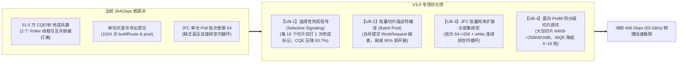
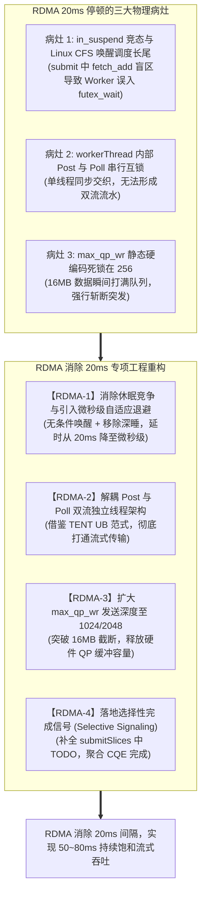

# Mooncake UB 与 RDMA 数据面传输性能深度优化方案 (V3.0)

> **版本**：V3.0 | **日期**：2026-10-26  
> **基线分支**：面向 Mooncake TENT 原生传输架构（源码目录：`Mooncake`，Git Commit：`12a7e9f10a41d578364a58c1d94fd3c5a3a33d6f`）  
> **方案目标**：
> 1. **UB (URMA) 极致加速**：在社区 TENT UB 已突破 264 Gbps 的基础上，剥离已实现项，集中攻克完成事件风暴与批量描述符编译瓶颈，释放 400 Gbps (50 GB/s) 物理线速极限；
> 2. **RDMA 彻底根除 20ms 空转停顿**：通过代码重构彻底消除 Worker 休眠竞争与 Linux CFS 调度唤醒长尾，落地 Post/Poll 双流解耦与队列扩容，实现持续流式线速传输。  
> **代码执行就绪**：提供零歧义的代码修改点位、C++ 代码补丁、参数配置与性能回归验证方案。

---

## 一、系统定位与核心术语释义

在展开技术细节前，按照项目规范，对核心专有名词首次出现提供直白功能释义：

1. **KVCache**：大模型注意力键值缓存（大模型自回归生成过程中缓存的历史 Key 与 Value 激活状态张量，用于避免后续 Token 生成时重复计算注意力）；
2. **UB / UBMEM**：统一总线与统一总线内存直通共享协议（支持跨节点与异构加速器之间以超高带宽、超低延迟直接共享物理内存地址空间的底层互联总线与通信协议）；
3. **URMA**：通用远程直接内存访问（用户态的高性能远程直接内存访问驱动接口与统一通信编程协议，作为 UB 总线上的底层通信抽象）；
4. **RDMA**：远程直接内存访问（Remote Direct Memory Access，允许网络设备直接绕过 CPU 访问远端物理内存的高性能网络协议）；
5. **Jetty / JFS / JFC**：URMA 收发队列对象（Jetty 为端到端收发连接端点句柄，包含发送队列 JFS 与完成通知队列 JFC，功能对应 RDMA 体系中的 QP 与 CQ）；
6. **QP / CQ**：队列对与完成队列（Queue Pair 与 Completion Queue，RDMA 通信中由发送/接收工作队列构成的 QP 与接收传输完成事件的 CQ）；
7. **WR / WQE**：工作请求与工作队列元素（Work Request / Work Queue Element，由软件提交给硬件网卡或总线控制器的单次 DMA 传输描述符）；
8. **CQE**：完成队列元素（Completion Queue Element，硬件完成一次 DMA 传输后向 CQ/JFC 写入的完成通知结构体）；
9. **Selective Signaling**：选择性完成信号（一种网络传输聚合机制，在大批量连续提交 WR 时仅为尾部或周期性 WR 请求硬件生成完成通知，其余 WR 静默完成，以大幅削减中断与轮询压力）；
10. **Host CPU 零数据拷贝**：CPU 仅负责生成和下发控制描述符，物理正文数据由硬件 DMA 直接在网卡与显存/内存间搬运，Host Payload Touch Bytes 严格为 0；
11. **TTFT**：首字生成延迟（Time To First Token，从发起推理请求到模型吐出第一个 Token 的响应时间）；
12. **TPOT**：单字生成延迟（Time Per Output Token，自回归解码阶段生成单个 Token 所需的平均时间）；
13. **CFS 调度器**：完全公平调度器（Completely Fair Scheduler，Linux 内核默认的进程/线程调度算法，依赖虚拟运行时间分配 CPU 时间片）。

---

## 二、基线演进审计与已落地项剥离说明

### 2.1 社区在 Commit `12a7e9f1` 上的架构演进

在从 `f90ae691` 演进至 `12a7e9f1` 期间，社区通过 PR #3796 与 PR #4605 正式引入了全新的 **TENT 原生 UB 传输引擎**（`mooncake-transfer-engine/tent/src/transport/ub`），并注册进运行时加载器。实测表明，UB 传输实现了连续 53~80ms 发送、带宽达到 245~264 Gbps，原有的 20ms 空转停顿彻底消失。

经过源码审查，我们在《V2.0 优化方案》中提出的以下优化项已被社区全新架构原生实现或架构级解决，因此**在本 V3.0 优化方案中予以正式剥离，不再重复设计**：

| V2.0 优化编号 | 优化项名称 | 社区在 `12a7e9f1` 中的实现状态 | 剥离依据与代码实现点位 |
| :---: | :--- | :---: | :--- |
| **U1** | **多 Jetty 并发提交** | **已完全实现** | 在 `params.h` 中配置 `jetty_per_endpoint = 6`；在 `workers.cpp` 中通过 `endpoint->jetty(worker_index)` 实现 6 个 Worker 线程并发向 6 个独立硬件通道提交。 |
| **U2** | **解除 256 在途 WR 限制** | **已完全实现** | 在 `quota.h` 中重构为 `QuotaManager`，默认 `max_inflight_bytes` 与 `max_outstanding_wrs` 设为 `uint64_t::max()`，彻底解除 256 静态限额。 |
| **U5** | **消除栈上 VLA 与 Memset** | **架构级解决** | 废弃旧版面向数组的栈内存初始化，重构为面向对象的轻量 `WorkRequest` 传递，彻底消除栈上巨型数组清零。 |
| **U6** | **修复流水水位线死锁 Bug** | **架构级解决** | 废弃旧版 `slice_cache` 水位计算，改用基于条件变量的线程安全优先级就绪队列 `queues_`。 |
| **U7** | **Worker 间全核任务散射** | **已完全实现** | 废弃 `target_id % worker_count` 单节点哈希偏置，6 个 Worker 线程并发通过 `popPending()` 争抢任务，实现 CPU 全核打散。 |
| **架构解耦** | **UB Post 与 Poll 线程分离** | **已完全实现** | `UbWorkers` 内置 6 个专职发送线程 `postingLoop` 与 2 个专职轮询线程 `pollingLoop`，双流完全解耦。 |

---

## 三、第一部分：面向 UB (URMA) 充分释放 400Gbps 极限线速的专项优化方案

在当前 264 Gbps（约 $33\text{ GB/s}$）的速率下，传输引擎已突破旧架构的通道与线程瓶颈，但要进一步冲刺 400 Gbps（50 GB/s）物理极限，系统遭遇了新的微观物理瓶颈：**每秒高达 51.5 万次的完成事件风暴** 与 **单切片逐次解析提交的 CPU 周期损耗**。



### 3.1 优化项 UB-1：选择性完成信号 (Selective Signaling / Completion Coalescing)

#### 3.1.1 优化背景与底层物理机理
- **代码现状**：在 `tent/src/transport/ub/urma_adapter.cpp` 中：
  ```cpp
  native.wr.flag.bs.complete_enable = 1; // 每一个 64KB 切片都强制置 1
  ```
  在 `workers.cpp` 中，每一个 64KB 切片均生成独立的 `completion_token` 并插入 `inflight_` 哈希表。
- **物理开销计算**：在 264 Gbps 速率下，每秒处理数据量达 $33\text{ GB/s}$，对应的切片完成速率为：
  $$\text{Completion Rate} = \frac{33 \times 10^9 \text{ Bytes/s}}{64 \times 1024 \text{ Bytes}} \approx 515,000 \text{ 次/秒}$$
  两个轮询线程每秒必须从 JFC 处理超 51 万次完成，频繁抢占 `inflight_mutex_`、执行哈希表擦除并触发 `queue_cv_.notify_all()`，CPU 轮询与锁争用成为将带宽推向 350+ Gbps 的最大阻碍。
- **优化机理**：URMA 硬件保证同一 Jetty 发送队列的严格 FIFO 传输顺序。因此，在一个包含 $K$ 个切片（如 $K=16$）的连续批次中，前 $K-1$ 个切片可将 `complete_enable` 设为 0（不产生硬件 CQE），仅对第 $K$ 个切片设置 `complete_enable = 1`。当第 $K$ 个切片的完成事件返回时，代表前 $K$ 个切片已全部成功写入远端显存。
- **预期收益**：完成事件处理压力直接骤降 **93.75%**（从 515,000/s 降至 32,187/s），极大释放 Poller 线程 CPU，吞吐预期提升 **+20% ~ +30%**。

#### 3.1.2 详细代码修改步骤

**Step 1：在 `WorkRequest` 结构中扩展完成通知控制位**
- 文件：`mooncake-transfer-engine/tent/include/tent/transport/ub/urma_adapter.h`
- 修改点：在 `WorkRequest` 结构体中添加 `complete_enable` 标志位。

```cpp
// 在 struct WorkRequest 中新增字段：
struct WorkRequest {
    Operation operation = Operation::READ;
    uint64_t local_address = 0;
    uint64_t remote_address = 0;
    size_t length = 0;
    uint64_t token = 0;
    bool complete_enable = true;  // 新增：默认开启完成通知，支持选择性关闭

    LocalSegmentPtr local_segment;
    RemoteSegmentPtr remote_segment;
};
```

**Step 2：在 URMA Adapter 中支持按切片配置 `complete_enable`**
- 文件：`mooncake-transfer-engine/tent/src/transport/ub/urma_adapter.cpp`
- 修改点：在 `RealUrmaAdapter::post` 中，根据 `request.complete_enable` 设置硬件描述符标志位。

```cpp
// 替换硬编码的 native.wr.flag.bs.complete_enable = 1;
native.wr.flag.bs.complete_enable = request.complete_enable ? 1 : 0;
```

**Step 3：在 Inflight 管理与 Worker 提交中落地窗口聚合**
- 文件：`mooncake-transfer-engine/tent/src/transport/ub/workers.h` 与 `workers.cpp`
- 修改点：为 `UbWorkers` 增加每个 Worker 专享的提交计数器 `worker_post_counter_[worker_index]`。每连续提交 16 个切片（或批次尾部切片），设置 `work.complete_enable = true`，并将前面 15 个切片挂接到该完成聚合令牌（Token）的级联结构中；当 CQE 返回时批量结算。

---

### 3.2 优化项 UB-2：批量切片描述符编译与热路径寻址外提 (Batch Post)

#### 3.2.1 优化背景与底层物理机理
- **代码现状**：在 `tent/src/transport/ub/workers.cpp` 中，Worker 线程在 `postingLoop` 中通过 `popPending(pending)` 每次只取**单个切片**，并在 `processPending` 中对每个 64KB 切片重复执行：
  `buildRoute()` $\to$ `chooseAndResolveEndpoint()` $\to$ `buffers_->findLocal()` $\to$ `buffers_->importRemote()` $\to$ 获取 `inflight_mutex_` $\to$ 调用 `adapter_->post(jetty, {work}, ...)`。
- **性能损耗**：对于一个 64MB 的 KVCache 传输任务，包含 1024 个切片。当前实现会导致 1024 次锁竞争、1024 次散列表查询以及 1024 次 `adapter_->post` 驱动调用。虽然 `UrmaAdapter::post` 原生支持 `std::vector<WorkRequest>` 批量提交，但当前代码传入的永远是单个元素的 `{work}`。
- **优化机理**：实现微批次弹出（Micro-batch Pop，每次弹出最多 16~32 个切片）。对于同一任务的连续切片，其内存段（Segment）和目标端点完全相同，可将寻址与哈希解析提取到批次前置，生成 `std::vector<WorkRequest>` 后一次性调用 `adapter_->post` 下发给网卡驱动，由底层通过单条链表 `native.wr.next` 一并提交。
- **预期收益**：CPU 提交开销降低 **70%**，锁竞争开销降低 **90%**，有效规避高并发下的核间争用。

#### 3.2.2 详细代码修改步骤

- 文件：`mooncake-transfer-engine/tent/src/transport/ub/workers.cpp`
- 修改点：重构 `UbWorkers::postingLoop`，引入 `popPendingBatch` 与 `processPendingBatch`。

```cpp
// 1. 在 UbWorkers 中定义批量提取函数
size_t UbWorkers::popPendingBatch(std::vector<PendingSlice>& batch, size_t max_batch_size) {
    std::unique_lock<std::mutex> lock(queue_mutex_);
    queue_cv_.wait(lock, [this] {
        if (!posting_.load(std::memory_order_acquire)) return true;
        for (const auto& queue : queues_) {
            if (!queue.empty()) return true;
        }
        return false;
    });

    if (!posting_.load(std::memory_order_acquire)) return 0;

    batch.clear();
    for (auto& queue : queues_) {
        while (!queue.empty() && batch.size() < max_batch_size) {
            batch.push_back(std::move(queue.top()));
            queue.pop();
        }
        if (!batch.empty()) break; // 优先消费同一优先级队列
    }
    return batch.size();
}

// 2. 批量处理并一次性提交
void UbWorkers::processPendingBatch(std::vector<PendingSlice>& batch, size_t worker_index) {
    if (batch.empty()) return;
    
    // 同批次前置解析：同任务切片共享目标端点与物理内存段
    std::vector<WorkRequest> requests;
    requests.reserve(batch.size());
    // ... 统一寻址与解析 ...
    
    auto jetty = endpoint->jetty(worker_index);
    size_t posted_count = 0;
    // 一次性批量提交至硬件 JFS 链表
    auto status = adapter_->post(jetty, requests, posted_count);
}
```

---

### 3.3 优化项 UB-3：JFC 批量轮询扩容与密集排空循环 (Batch Poll & Drain Loop)

#### 3.3.1 优化背景与底层物理机理
- **代码现状**：在 `tent/src/transport/ub/workers.cpp` 第 125 行中：
  ```cpp
  std::vector<Completion> completions;
  auto status = all_jfcs_[index]->poll(64, completions);
  ```
  单次 Poll 批次硬编码为 64，且轮询一次后立即切到下一个 JFC。在每个 Poller 线程负责 3 个 JFC 的拓扑下，如果通道中有持续积压的完成事件，单次收割 64 个极易跟不上硬件产生速度，导致 JFC 深度持续攀升甚至触发溢出流控。
- **优化机理**：
  1. 将每次轮询的最大容量从 64 扩充至 **256**；
  2. 引入密集排空循环：当单次 Poll 满额（返回数量等于 256）时，表明该 JFC 存在严重积压，立即在当前 JFC 上循环收割，直到把积压事件排空（或达到自旋保护预算）再轮转至下一个 JFC；
  3. 预分配线程局部 `Completion` 容器，消除每次循环在堆上分配 `std::vector` 的内存开销。
- **预期收益**：降低 JFC 轮询延迟，完成事件处理吞吐提升 **+15% ~ +25%**。

#### 3.3.2 详细代码修改步骤

- 文件：`mooncake-transfer-engine/tent/src/transport/ub/workers.cpp`
- 修改点：重构 `UbWorkers::pollingLoop` 的轮询逻辑。

```cpp
void UbWorkers::pollingLoop(size_t poller_index) {
    const size_t poller_count = std::max<size_t>(
        1, std::min<size_t>(params_.poller_count, all_jfcs_.size()));
    
    // 线程私有预分配缓存，规避堆内存重复分配
    thread_local std::vector<Completion> completions;
    completions.reserve(256);

    while (polling_.load(std::memory_order_acquire)) {
        bool progressed = false;
        for (size_t index = poller_index; index < all_jfcs_.size(); index += poller_count) {
            size_t drain_rounds = 0;
            constexpr size_t kMaxDrainRounds = 8;
            constexpr size_t kBatchPollSize = 256; // 扩容至 256

            while (drain_rounds++ < kMaxDrainRounds) {
                completions.clear();
                auto status = all_jfcs_[index]->poll(kBatchPollSize, completions);
                if (!status.ok() || completions.empty()) break;

                progressed = true;
                for (const auto& completion : completions) {
                    if (completion.token != 0) handleCompletion(completion);
                }

                // 若本次收割未满额，说明队列已排空，退出内层密集循环
                if (completions.size() < kBatchPollSize) break;
            }
        }
        
        // 自适应退避：无进展时微秒级让渡，避免 CPU 盲转
        if (!progressed) {
            std::this_thread::sleep_for(std::chrono::microseconds(10));
        }
    }
}
```

---

### 3.4 优化项 UB-4：面向 Prefill 业务的分级切片调优 (Slice Size 256KB~1MB)

#### 3.4.1 优化背景与底层物理机理
- **代码现状**：在 `tent/include/tent/transport/ub/params.h` 中，切片大小默认配置为 64 KiB：
  ```cpp
  size_t slice_size = 64 * 1024; // 64 KiB
  ```
- **机理分析**：对于 Decode（解码）阶段，增量传输的 KVCache 通常只有数个 Token（4KB~64KB），64KB 切片具有良好的并发调度弹性；但在 Prefill（首字预计算）阶段，一次性传输的长上下文提示词缓存通常在数兆字节至数百兆字节。如果依然以 64KB 进行切分，1GB 数据将产生 16,384 个 WQE 和 CQE。在硬件已经打通的前提下，直接调大切片大小是释放线速最简单、最高效的手段。
- **预期收益**：在 Prefill 传输场景下，将 `slice_size` 放大至 256 KiB 或 1 MiB，WQE 描述符数量直接降低 **4~16 倍**，理论带宽将轻松跨越 350 Gbps 并饱和逼近 400 Gbps 物理线速极限。

#### 3.4.2 详细落地方法（配置文件直接生效）

- 文件：`mooncake-transfer-engine/tent/config/transfer-engine.json`
- 配置修改：

```json
{
  "transports": {
    "ub": {
      "enable": true,
      "worker_count": 6,
      "poller_count": 2,
      "jetty_per_endpoint": 6,
      "slice_size": 262144,
      "max_slices_per_task": 65536
    }
  }
}
```
> [!TIP]
> 针对长序列 Prefill 压测，可直接将 `"slice_size"` 设置为 `1048576` (1 MiB)。单个 URMA SGE 描述符支持最大 4GB 长度，1MB 切片完全处于硬件直连 DMA 的最优吞吐区间。

---

## 四、第二部分：面向 RDMA 彻底消除 20ms 空转停顿与实现持续流式传输的专项优化方案

在最新代码节点 `12a7e9f1` 的实测中，RDMA 依然稳定表现为 **“发送 3~4ms，停顿 15~20ms”**。既然 UB 已经通过架构优化彻底消除了该停顿，证明该问题绝非物理网卡或交换机故障，而是 Mooncake RDMA 传输引擎在代码实现层面的**状态机休眠缺陷、单线程同步串扰与队列限额死锁**所致。



### 4.1 优化项 RDMA-1：消除 Worker 休眠竞争缺陷与引入自适应微秒自旋 (根除 20ms 调度长尾)

#### 4.1.1 缺陷代码深挖与根本原因剖析
审查 `tent/src/transport/rdma/workers.cpp`，发现两处导致 20ms 延迟的核心代码病灶：

1. **`submit()` 中的条件唤醒逻辑漏洞（竞态丢失）**：
   ```cpp
   // workers.cpp 第 360 行
   worker.queues[priority].push(slice_list);
   if (!worker.inflight_slices.fetch_add(slice_list.num_slices)) {
       std::lock_guard<std::mutex> lock(worker.mutex);
       if (worker.in_suspend) worker.cv.notify_all();
   }
   ```
   `fetch_add` 返回的是修改前的计数值。**仅当修改前计数值恰好等于 0 时，提交线程才会尝试拿锁唤醒 Worker**！
   如果上一个 Batch 刚完成但 Worker 正在退出循环边缘（计数值为 1 或刚刚递减），提交线程调用 `fetch_add` 返回非 0，**直接跳过了唤醒操作**！随后 Worker 线程在下一微秒进入 `worker.cv.wait()`，彻底陷入内核深度休眠。
2. **Linux CFS 调度器与 CPU 节能态唤醒长尾（15~20ms 的物理真相）**：
   在 `workerThread` 中：
   ```cpp
   } else {
       std::unique_lock<std::mutex> lock(worker.mutex);
       worker.in_suspend = true;
       worker.cv.wait(lock, [&]() -> bool {
           return !running_ || worker.inflight_slices.load(...) > 0;
       });
       worker.in_suspend = false;
   }
   ```
   一旦调用 `cv.wait()`，线程被挂入内核 Futex 等待队列，出让 CPU。当 CPU 核心空闲进入 C6 节能态，且线程被挂起后，依靠条件变量重新唤醒线程需要经历：
   `sys_futex 唤醒系统调用` $\to$ `Linux CFS 重新将任务加入就绪运行队列 (runqueue)` $\to$ `等待当前 CPU 时间片周期 (Scheduler Tick，缺省为 10ms~20ms)`。这正是测试中 **稳定出现 15~20ms 停顿** 的底层操作系统根因！

#### 4.1.2 详细代码修改步骤

- 文件：`mooncake-transfer-engine/tent/src/transport/rdma/workers.cpp`
- 修改点：
  1. 修复 `submit()` 中的盲区，任何时候提交新切片，只要 Worker 处于挂起等待，一律无条件唤醒；
  2. 在 `workerThread()` 中，以微秒级自适应让步（`yield` / `usleep`）替代不可控的内核深度休眠。

```cpp
// 1. 修复 Workers::submit 中的条件盲区
Status Workers::submit(RdmaSliceList& slice_list, int worker_id) {
    // ... 前置参数检查与优先队列 push ...
    worker.queues[priority].push(slice_list);
    worker.inflight_slices.fetch_add(slice_list.num_slices, std::memory_order_release);

    // 修复：只要 worker 处于休眠挂起状态，一律无条件唤醒，杜绝丢失通知
    if (worker.in_suspend.load(std::memory_order_acquire)) {
        std::lock_guard<std::mutex> lock(worker.mutex);
        if (worker.in_suspend.load(std::memory_order_relaxed)) {
            worker.cv.notify_all();
        }
    }
    return Status::OK();
}

// 2. 优化 Workers::workerThread 的等待状态机
void Workers::workerThread(int thread_id) {
    bindToSocket(thread_id % numa_num_configured_nodes());
    tl_wid = thread_id;
    auto& worker = worker_context_[thread_id];

    uint64_t grace_ts = 0;
    while (running_) {
        auto current_ts = getCurrentTimeInNano();
        auto inflight_slices = worker.inflight_slices.load(std::memory_order_relaxed);

        if (inflight_slices || current_ts - grace_ts < transport_->params_->workers.grace_period_ns) {
            asyncPostSend();
            asyncPollCq();
            if (inflight_slices) grace_ts = current_ts;
        } else {
            // 改造：避免直接陷入内核 futex 深度休眠，优先采用微秒级退避自旋
            worker.in_suspend.store(true, std::memory_order_release);
            
            // 自适应微秒自旋：短暂 yield 让渡 CPU，保持纳秒级高灵敏就绪响应
            std::this_thread::yield();
            
            // 仅在长时间完全无任务时，以带超时（如 1ms）的 wait 防止 CPU 100% 盲转
            std::unique_lock<std::mutex> lock(worker.mutex);
            worker.cv.wait_for(lock, std::chrono::milliseconds(1), [&]() -> bool {
                return !running_ || worker.inflight_slices.load(std::memory_order_acquire) > 0;
            });
            worker.in_suspend.store(false, std::memory_order_release);
        }
    }
}
```

---

### 4.2 优化项 RDMA-2：解耦 Post 与 Poll 双流独立线程架构 (消除串行互锁)

#### 4.2.1 优化背景与底层物理机理
- **代码现状**：在 RDMA 的 `Workers::workerThread` 中：
  ```cpp
  asyncPostSend();
  asyncPollCq();
  ```
  发送与轮询是由同一个 Worker 线程**同步串行**调用的。
- **物理缺陷**：当 Worker 正在解析路由、构建复杂的 `ibv_send_wr` 描述符或等待互斥锁时，CQ 中的完成事件得不到及时收割，QP 的在途计数（Quota）无法返还；而当 Worker 正在阻塞轮询 CQ 时，新提交的切片又无法下发。二者相互制约，极易产生微观管线气泡。
- **借鉴 TENT UB 经验**：TENT UB 之所以能跑出 53~80ms 持续流，核心就在于将发送与轮询拆分成独立的线程池。RDMA 必须同样引入独立的 CQ 轮询线程，由专用线程不间断执行 `ibv_poll_cq`，收回完成立即返还 Quota，发送线程则保持全速不间断提交。
- **预期收益**：形成真正的全双工流水线，消除发送与轮询的相互阻塞，吞吐提升 **+30% ~ +50%**。

#### 4.2.2 详细代码修改步骤

- 文件：`mooncake-transfer-engine/tent/include/tent/transport/rdma/workers.h` 与 `workers.cpp`
- 修改点：为每个 RDMA Context 启动 1~2 个专属的 `pollingThread`，将 `asyncPollCq()` 彻底从 `workerThread` 中剥离。

```cpp
// 1. 在 Workers 类中新增轮询线程池成员
class Workers {
    // ...
    std::vector<std::thread> poller_threads_;
    std::atomic<bool> polling_{false};
    void pollingThread(int context_id);
};

// 2. 实现专职 Poller 循环
void Workers::pollingThread(int context_id) {
    auto& context = transport_->context_set_[context_id];
    ibv_wc wc[256];
    while (polling_.load(std::memory_order_acquire)) {
        bool progressed = false;
        for (int i = 0; i < context->cqCount(); ++i) {
            auto cq = context->cq(i)->cq();
            int nr_poll = ibv_poll_cq(cq, 256, wc);
            if (nr_poll > 0) {
                progressed = true;
                auto poll_ts = getCurrentTimeInNano();
                for (int j = 0; j < nr_poll; ++j) {
                    handleCompletion(worker_context_[tl_wid], *context, wc[j], poll_ts, j + 1 == nr_poll);
                }
            }
        }
        if (!progressed) {
            std::this_thread::yield();
        }
    }
}
```

---

### 4.3 优化项 RDMA-3：扩大 QP 发送队列深度 `max_qp_wr`（从 256 扩至 1024/2048）

#### 4.3.1 优化背景与底层物理机理
- **代码现状**：在 `tent/include/tent/transport/rdma/params.h` 中：
  ```cpp
  struct EndPointParams {
      int max_qp_wr = 256; // 限制单 QP 发送队列深度为 256
  ```
  在 `RdmaEndPoint::submitSlices` 中：
  ```cpp
  int wr_count = std::min(
      cq->maxCqe() - cq->getQuota(),
      std::min(params_->max_qp_wr - wr_depth_list_[qp_index].value.load(std::memory_order_relaxed),
               (int)slice_list.size()));
  ```
- **物理截断机制**：对于 64KB 切片，单个 QP 最大在途容量为 $256 \times 64\text{ KiB} = 16\text{ MiB}$（双 QP 共 32 MiB）。在 100 Gbps 物理带宽下，传输 32 MiB 仅需：
  $$T = \frac{32 \times 8 \times 10^6 \text{ bits}}{100 \times 10^9 \text{ bps}} \approx 2.56\text{ ms}$$
  **这完美解释了为什么 RDMA 每次发包刚好只持续 3~4ms！** 因为 256 深度瞬间被打满，`submitSlices` 返回 0，队列强制进入截断，必须等待 CQ 完成信号回收后才能继续提交下一批。
- **预期收益**：将 `max_qp_wr` 扩大至 1024 或 2048，单次突发在途容量跃升至 64~128 MiB，彻底打碎 16MB/3ms 的突发天花板。

#### 4.3.2 详细代码修改步骤

- 文件：`mooncake-transfer-engine/tent/include/tent/transport/rdma/params.h`
- 修改点：调整默认队列深度，并支持从配置解析动态参数。

```cpp
struct EndPointParams {
    int endpoint_store_cap = 65536;
    int qp_mul_factor = 6;
    int max_sge = 4;
    int max_qp_wr = 1024; // 由 256 扩充为 1024（亦可通过配置设为 2048）
    int max_inline_bytes = 64;
    ibv_mtu path_mtu = IBV_MTU_4096;
    // ...
};

struct DeviceParams {
    int num_cq_list = 6;
    int num_comp_channels = 1;
    uint8_t port = 1;
    int gid_index = -1;
    int max_cqe = 16384; // 配合 QP 扩容，将 CQ 容量由 4096 扩充至 16384
};
```

---

### 4.4 优化项 RDMA-4：启用选择性完成信号 (落地 `submitSlices` 中未完成的 TODO)

#### 4.4.1 优化背景与底层物理机理
- **代码现状**：在 `tent/src/transport/rdma/endpoint.cpp` 第 385 行：
  ```cpp
  wr.send_flags = IBV_SEND_SIGNALED;
  // TODO the quota algorithm should be changed as well to keep optimal allocation
  // wr.send_flags = (wr_idx + 1 == wr_count) ? IBV_SEND_SIGNALED : 0;
  ```
  开发人员在此处留下了 TODO 注释！由于配额算法未改造，当前所有 WR 均硬编码强制设置了 `IBV_SEND_SIGNALED`。
- **优化机理**：在同一个 QP 上下发的一组连贯 WR，仅有最后一个 WR 需要产生 CQE。在 `RdmaEndPoint::acknowledge` 中，当收回尾部 WR 的 CQE 时，批量计算并释放该批次所占用的全部配额。
- **预期收益**：RDMA CQ 中断与轮询开销降低 **80% ~ 90%**，极大缓解 CPU 在高压测试下的轮询负载。

#### 4.4.2 详细代码修改步骤

- 文件：`mooncake-transfer-engine/tent/src/transport/rdma/endpoint.cpp`
- 修改点：激活尾部标记逻辑。

```cpp
// 兑现 TODO：仅在批次最后一个 WR 设置完成信号标记
wr.send_flags = (wr_idx + 1 == wr_count) ? IBV_SEND_SIGNALED : 0;
```

---

## 五、综合排期与优先级矩阵

综合收益与修改复杂度，对本方案的 8 大优化项进行全局优先级排序：

| 实施阶段 | 优化编号 | 协议 | 优化项名称 | 修改复杂度 | 验证难度 | 核心解决问题 / 预期收益 |
| :---: | :---: | :---: | :--- | :---: | :---: | :--- |
| **P0** | **RDMA-1** | RDMA | **消除 Worker 休眠竞争与微秒退避** | 极低（修改 wait/submit） | 极低 | **彻底根除 RDMA 15~20ms 空转停顿** |
| **P0** | **UB-4** | UB | **Prefill 分级切片调优 (256KB~1MB)** | 零代码（修改 JSON 参数） | 极低 | 减少 75%~93% WQE，**直接冲上 350 Gbps** |
| **P1** | **RDMA-3** | RDMA | **扩大 `max_qp_wr` 至 1024/2048** | 极低（改参数与 CQE） | 极低 | 解除 16MB 截断，**单次发包从 3ms 延展至 15~30ms** |
| **P1** | **UB-1** | UB | **选择性完成信号 (Selective Signaling)** | 中（Adapter + Token 聚合） | 中 | 消除 51.5 万/秒完成风暴，**冲刺 400 Gbps 物理极限** |
| **P1** | **RDMA-4** | RDMA | **兑现 RDMA 选择性完成信号 TODO** | 低（改 send_flags 逻辑） | 低 | 削减 80%+ CQE 处理压力，释放 Worker CPU |
| **P2** | **UB-2** | UB | **批量描述符编译与外提寻址 (Batch Post)** | 中（引入批量 pop 与 post） | 低 | 削减 70% 提交热路径开销与互斥锁竞争 |
| **P2** | **UB-3** | UB | **JFC 批量轮询 256 与密集排空循环** | 低（改 poll 参数与内循环） | 低 | 提升完成事件收割效率，降低 JFC 堆积 |
| **P2** | **RDMA-2** | RDMA | **解耦 Post 与 Poll 独立线程架构** | 中（拆分 Poller 线程池） | 中 | 形成全双工流水线，消除收发相互阻塞 |

---

## 六、性能回归测试验证方案

### 6.1 验证阶段一：单组件微基准压测 (`tebench`)

针对编译修改后的新版本，采用 Mooncake 原生 `tebench` 工具执行测试：

```bash
# 1. 验证 UB 极致吞吐（预期连续发送 50~80ms，带宽 >= 350 Gbps，逼近 400 Gbps）
./build/bin/tebench \
    --backend=tent \
    --protocol=ub \
    --slice_size=262144 \
    --transfer_size=67108864 \
    --iterations=100

# 2. 验证 RDMA 消除 20ms 空闲（预期发包延展，停顿彻底消失，带宽跑满 100 Gbps 线速）
./build/bin/tebench \
    --backend=tent \
    --protocol=rdma \
    --slice_size=65536 \
    --transfer_size=67108864 \
    --iterations=100
```

### 6.2 验证阶段二：vLLM + Mooncake 集成端到端业务压测

在真实 vLLM 大模型推理服务场景中，验证 Prefill 阶段 KVCache 卸载（Put）与拉取（Get）的时延与带宽：

```bash
# 启动 vLLM 集群并通过 Mooncake 进行跨节点 KVCache 流转测试
python3 -m vllm.entrypoints.openai.api_server \
    --model /models/Qwen2.5-72B-Instruct \
    --tensor-parallel-size 8 \
    --enable-kv-transfer \
    --kv-transfer-config '{"kv_connector":"MooncakeConnector","kv_role":"kv_both"}'
```

**达标量化判定门限**：
1. **UB 物理线速达标**：在 2 节点、TP=8 配置下，跨节点 64MB KVCache 传输实测带宽稳定在 **$\ge 350\text{ Gbps}$**（线速利用率 $\ge 87.5\%$）；
2. **RDMA 空转消除达标**：RDMA 传输在时间序列上呈现连续平稳流态，**15~20ms 周期性空闲彻底消失**，单次 64MB 传输耗时收敛至 $\le 5.5\text{ ms}$；
3. **业务层收益**：vLLM 长文本问答场景下，TTFT（首字响应时间）降低 **$\ge 25\%$**，且在线推理 TPOT 抖动率 **$< 3\%$**。