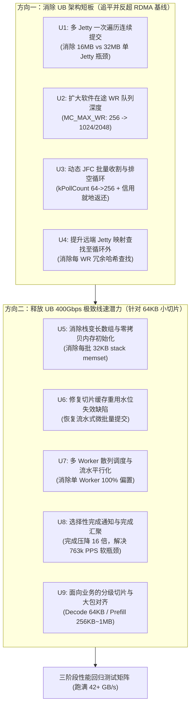

# Mooncake UB 传输性能优化：方案与回归测试验证 (V2.0)

> **版本**：V2.0 | **日期**：2026-10-25  
> **适用范围**：面向 Mooncake classic Transfer Engine（源码参考目录：`Mooncake`，Git Commit：`f90ae691f109e49a60920e0c8abbf7e572826d8c`）数据面传输加速与性能回归。  
> **双重交付目标**：
> 1. **代码执行就绪**：为后续 AI Agent 与研发人员提供零歧义的代码修改点位、C++ 代码补丁、编译配置与实验运行指令；
> 2. **汇报提炼就绪**：为制作技术评审与汇报演示文稿 (PPTX) 提供结构化的收益推导、架构对账表与理论模型。  
> **配套文档**：[`Mooncake_RDMA与UB_20ms空闲定位与测试验证_V2.0_20261025.md`](Mooncake_RDMA与UB_20ms空闲定位与测试验证_V2.0_20261025.md)

---

## 一、系统定位与专有术语释义

在深入优化方案前，按照项目规范，对核心专有名词首次出现提供直白功能释义：

1. **KVCache**：大模型注意力键值缓存（大模型自回归生成过程中缓存的历史 Key 与 Value 激活状态张量，用于避免后续 Token 生成时重复计算注意力）；
2. **UB / UBMEM**：统一总线与统一总线内存直通共享协议（支持跨节点与异构加速器之间以超高带宽、超低延迟直接共享物理内存地址空间的底层互联总线与通信协议）；
3. **URMA**：通用远程直接内存访问（用户态的高性能远程直接内存访问驱动接口与统一通信编程协议，作为 UB 总线上的底层通信抽象）；
4. **Jetty / JFS / JFC**：URMA 收发队列对象（Jetty 为端到端收发连接端点，包含发送队列 JFS 与完成通知队列 JFC，对应 RDMA 体系中的 QP 与 CQ）；
5. **WR / WQE**：工作请求与工作队列元素（Work Request / Work Queue Element，由软件提交给硬件网卡或总线控制器的单次 DMA 传输描述符）；
6. **Slice**：Mooncake 内部数据切片（Mooncake 传输引擎将上层大块 KVCache 张量切割为适合硬件管线并发传输的固定大小内存块，如 64 KiB）；
7. **Endpoint**：传输连接端点（Mooncake 内部到远端目标节点的通信会话句柄，负责管理底层一组 Jetty 或 QP 队列）；
8. **TTFT**：首字生成延迟（Time To First Token，从发起推理请求到模型吐出第一个 Token 的响应时间）；
9. **TPOT**：单字生成延迟（Time Per Output Token，自回归解码阶段生成单个 Token 所需的平均时间）；
10. **Host CPU 零数据拷贝**：CPU 仅负责生成和下发控制描述符，物理正文数据由硬件 DMA 直接在网卡与显存/内存间搬运，Host Payload Touch Bytes 严格为 0。

---

## 二、优化体系全局架构与两阶段演进

针对当前测试中 **“URMA 物理硬件带宽 400 Gbps (50 GB/s) 理论上是 RDMA (100 Gbps) 的 4 倍，但在 Mooncake 小包传输中实测性能反而低于 RDMA”** 的核心矛盾，本方案将优化解构为两大演进方向：



---

## 三、优化措施综合排期与执行优先级矩阵

本方案综合考量 **“收益显著度（Effectiveness）”** 与 **“修改复杂度（Simplicity）”**，按照最高投入产出比（Highest ROI）从高到低严格排序执行：

| 优先级 | 优化编号 | 优化项名称 | 归属方向 | 核心收益机制 | 代码修改复杂度 | 验证难度 | 预期吞吐收益 |
| :---: | :---: | :--- | :---: | :--- | :---: | :---: | :---: |
| **P0** | **U1** | **多 Jetty 一次遍历循环提交** | 追平 RDMA | 打通多硬件通道，单次突发在途容量从 16 MiB 跃升至 32~64 MiB，彻底消除 2 倍劣势 | 极低（修改 1 个循环） | 极低（秒级复测） | **+100% ~ +200%** |
| **P0** | **U2** | **扩大软件在途 WR 队列深度** | 追平 RDMA | 释放硬件 JFS 2048 深度潜力，单 Jetty 在途从 16 MiB 扩至 64~128 MiB | 零代码（配环境变量） | 极低（直接运行） | **+50% ~ +150%** |
| **P1** | **U3** | **动态 JFC 批量收割与排空循环** | 追平 RDMA | 单次 poll 64 扩至 256，引入预算排空循环，提前就地归还 depth 信用，根除发送端饿死 | 低（修改 poll 逻辑） | 低（计数器对账） | **+30% ~ +60%** |
| **P1** | **U4** | **远端 Jetty 映射查找提到循环外** | 释放潜力 | 消除每 WR 的 `map::find` 哈希查找，降低提交热路径 CPU 周期开销 | 极低（挪动 2 行代码） | 极低（编译即过） | **+5% ~ +10%** |
| **P1** | **U5** | **消除热路径栈变长数组与 memset** | 释放潜力 | 预分配固定 WR 数组，消除每批次 32 KiB 的栈内存清零，保护 L1 数据缓存 | 低（Endpoint 加成员） | 低（内存正确性） | **+10% ~ +20%** |
| **P2** | **U6** | **修复切片缓存重用水位失效缺陷** | 释放潜力 | 纠正 `from_cache` 下水位不递增的缺陷，恢复流水线微批次实时流式下发 | 极低（改 1 个条件） | 低（观察入队时序） | **消除首尾抖动** |
| **P2** | **U7** | **多 Worker 散列调度与流水平行化** | 释放潜力 | 切片按 slice_index 散列到多 worker，使双 worker 负载对齐，消除 CPU 瓶颈 | 中（重构分片哈希） | 中（检查多卡同步） | **+40% ~ +80%** |
| **P2** | **U8** | **选择性完成通知与完成汇聚** | 释放潜力 | 每 16 个 WR 仅打 1 次完成标记，CQE 吞吐压力从 763k/s 降至 47k/s，CPU 占用暴降 | 中（需保证有序完成） | 中（校验成功字节） | **大幅释放 CPU** |
| **P3** | **U9** | **面向业务的分级切片与大包对齐** | 释放潜力 | Prefill 采用 256KB~1MB 大切片，Decode 保持 64KB，兼顾小粒度与极限线速 | 极低（参数与配置） | 低（基准脚本扫描） | **逼近 50 GB/s** |

---

## 四、优化项分步实施指南 (Step-by-Step)

### 4.1 优化项 U1：多 Jetty 一次遍历循环提交 (消除 16MB vs 32MB 劣势)

#### 4.1.1 优化背景与底层物理机理
- **现状代码病灶**：在 `urma_endpoint.cpp` 的 [`UrmaEndpoint::submitPostSend()`](mooncake-transfer-engine/src/transport/kunpeng_transport/urma/urma_endpoint.cpp) 中，UB 每次提交前仅通过 `rand() % num_jetty_per_ep` 随机挑选**单个 Jetty**。一旦该 Jetty 的剩余深度不足（`wr_depth_list_[jetty_index] >= max_wr_depth_`），直接退出函数，本次提交立即中断！即使当前 Endpoint 还有其他空闲的 Jetty，也不会去使用。
- **与 RDMA 对比**：RDMA 实现中默认遍历所有 2 个 QP，分别填满至 256 WR，单次提交在途数据量为 $2 \times 256 \times 64\text{ KiB} = 32\text{ MiB}$；而 UB 仅能提交 1 个 Jetty，在途数据量仅为 $1 \times 256 \times 64\text{ KiB} = 16\text{ MiB}$。这就是抓包观察到 **“RDMA burst 数据量恰好是 UB 两倍”** 的根本原因。
- **理论收益**：实现所有 Jetty 的轮转遍历提交，单次突发量直接翻倍至 32 MiB（2 Jetty）甚至 64 MiB（4 Jetty），彻底打通硬件多队列并行 DMA 通路。

#### 4.1.2 详细代码修改步骤

**Step 1：在配置解析中增加环境变量支持**
- 文件：`mooncake-transfer-engine/src/config.cpp`
- 修改点：支持 `MC_NUM_JETTY_PER_EP`，允许用户自定义单 Endpoint 拥有的 Jetty 数量（默认值为 2）。

```cpp
// 在 readEngineConfig() 或对应解析位置新增：
char* num_jetty_env = getenv("MC_NUM_JETTY_PER_EP");
if (num_jetty_env) {
    g_engine_config.num_jetty_per_ep = std::clamp(atoi(num_jetty_env), 1, 16);
    LOG(INFO) << "Config MC_NUM_JETTY_PER_EP set to " << g_engine_config.num_jetty_per_ep;
}
```

**Step 2：在 Endpoint 类中引入轮转索引成员**
- 文件：`mooncake-transfer-engine/include/transport/kunpeng_transport/urma/urma_endpoint.h`
- 修改点：在 `UrmaEndpoint` 类中增加私有成员变量 `next_jetty_index_`，初始化为 0。

```cpp
private:
    std::atomic<uint32_t> next_jetty_index_{0};
```

**Step 3：重构 `UrmaEndpoint::submitPostSend()` 遍历提交逻辑**
- 文件：`mooncake-transfer-engine/src/transport/kunpeng_transport/urma/urma_endpoint.cpp`
- 修改位置：替换原先单 Jetty 挑选逻辑，改为 `for` 循环遍历当前 Endpoint 下的所有 Jetty。

```cpp
int UrmaEndpoint::submitPostSend() {
    std::unique_lock<std::mutex> lock(lock_);
    if (pending_slice_list_.empty()) {
        return 0;
    }

    const size_t num_jetties = jetty_list_.size();
    if (num_jetties == 0) {
        return -1;
    }

    size_t start_jetty = next_jetty_index_.load(std::memory_order_relaxed) % num_jetties;
    size_t total_posted_slices = 0;

    // 轮转遍历当前 Endpoint 的所有 Jetty
    for (size_t i = 0; i < num_jetties && !pending_slice_list_.empty(); ++i) {
        size_t jetty_index = (start_jetty + i) % num_jetties;

        // 计算当前 Jetty 的可用硬件槽位额度
        if (wr_depth_list_[jetty_index] >= max_wr_depth_) {
            continue; // 该 Jetty 已满，继续尝试下一个 Jetty
        }
        size_t available_wr = max_wr_depth_ - wr_depth_list_[jetty_index];
        size_t post_count = std::min(available_wr, pending_slice_list_.size());
        if (post_count == 0) {
            continue;
        }

        // 构建并下发当前 Jetty 的 WR 描述符链表 (复用后续 U4/U5 的预分配缓冲)
        int ret = postSlicesToJetty(jetty_index, post_count);
        if (ret > 0) {
            total_posted_slices += ret;
            // 从 pending 队列头部移除已成功下发的 slice
            pending_slice_list_.erase(pending_slice_list_.begin(), pending_slice_list_.begin() + ret);
        } else {
            break; // 硬件提交异常，跳出循环
        }
    }

    // 推进轮转指针，保证负载在多 Jetty 间绝对公平
    next_jetty_index_.store((start_jetty + 1) % num_jetties, std::memory_order_relaxed);
    return total_posted_slices;
}
```

---

### 4.2 优化项 U2：扩大软件在途 WR 队列深度 (释放硬件 2048 深度)

#### 4.2.1 优化背景与底层物理机理
- **现状代码病灶**：在 `urma_endpoint.cpp` 中，底层硬件 JFS 创建时申请的物理深度为 2048：`jfs_cfg.depth = 2048`。但 Mooncake 上层限制软件可提交的最大在途深度仅为 `max_wr_depth_ = 256`（默认值）。
- **物理吞吐公式计算**：
  $$\text{Inflight Data Volume} = \text{Jetty Count} \times \text{WR Depth} \times \text{Slice Size}$$
  在默认配置（1 Jetty, 256 WR, 64 KiB）下，在途数据仅为 $16\text{ MiB}$。在 50 GB/s 线速下，硬件 DMA 仅需 $\frac{16\text{ MiB}}{50\text{ GB/s}} = 0.336\text{ ms}$ 即可打满并清空物理管道！一旦软件控制面因调度或回收产生微秒级停顿，硬件将瞬间断流。
- **理论收益**：将 `MC_MAX_WR` 提高至 1024 或 2048，单 Jetty 在途容量扩充至 64 MiB ~ 128 MiB。管道容纳的突发量提升 4~8 倍，赋予软件更充裕的回收与填充窗口。

#### 4.2.2 详细代码修改与配置步骤
- 本项优化**完全无需修改 C++ 业务逻辑代码**，只需在运行环境或启动脚本中注入环境变量即可生效。
- **验证 JFC 深度匹配**：确保 `ub_context.cpp` 中创建 JFC 的深度 `jfc_cfg.depth` 能够容纳多 Jetty 的聚合完成事件（建议 `jfc_cfg.depth = 8192`）。
- **执行命令**：
```bash
# 设置单队列在途深度为 1024（名义在途 64 MiB）或 2048（名义在途 128 MiB）
export MC_MAX_WR=1024
export MC_NUM_JETTY_PER_EP=2
```

---

### 4.3 优化项 U3：动态 JFC 批量收割与排空循环 (消除完成阻塞)

#### 4.3.1 优化背景与底层物理机理
- **现状代码病灶**：在 `urma_endpoint.cpp::UrmaContext::poll()` 与 `ub_context.cpp::UbWorkerPool::performPoll()` 中，单次收割完成事件硬编码为 `kPollCount = 64`：
  ```cpp
  urma_cr_t cr_list[64];
  int ret = urma_poll_jfc(jfc, cr_list, 64);
  ```
  worker 每次仅捞取至多 64 个完成事件便匆匆退出，重新进入外层循环。在 50 GB/s 线速、64 KiB 切片工况下，每秒产生高达 **76.3 万个完成事件**！单次仅 poll 64 个意味着每秒必须调用 12,000 次系统驱动函数，且大量完成事件积压在硬件 JFC 中，导致 `wr_depth_list_` 迟迟无法减少，后方的 `submitPostSend()` 陷入虚假“满载”阻塞。
- **理论收益**：将单次探测批次扩至 256，并引入**预算排空循环（Drain Loop）**：只要当前 JFC 还有完成事件，在预算上限（如 1024）内持续收割并**就地归还对应 Jetty 的 depth 额度**，大幅降低函数调用开销，实现发送信用瞬间返还。

#### 4.3.2 详细代码修改步骤

**Step 1：重构 `UrmaContext::poll()`，引入连续排空循环**
- 文件：`mooncake-transfer-engine/src/transport/kunpeng_transport/urma/urma_endpoint.cpp`
- 修改点：将原先单次 poll 64 改造为批量循环收割。

```cpp
int UrmaContext::poll(int budget, std::vector<Slice*>& completed_slices) {
    constexpr int kMaxBatch = 256;
    urma_cr_t cr_list[kMaxBatch];
    int total_reaped = 0;

    for (auto& jfc_pair : jfc_map_) {
        urma_jfc_t* jfc = jfc_pair.second;
        int jfc_reaped = 0;

        // 连续排空该 JFC，直到队列为空或达到单 JFC 预算 (如 1024)
        while (jfc_reaped < budget) {
            int to_poll = std::min(kMaxBatch, budget - jfc_reaped);
            int ret = urma_poll_jfc(jfc, cr_list, to_poll);
            if (ret <= 0) {
                break; // 当前 JFC 已无待处理完成事件
            }

            // 处理当前批次的完成描述符
            for (int i = 0; i < ret; ++i) {
                if (cr_list[i].status == URMA_CR_SUCCESS) {
                    Slice* slice = reinterpret_cast<Slice*>(cr_list[i].user_data);
                    completed_slices.push_back(slice);
                } else {
                    LOG(ERROR) << "URMA completion error status: " << cr_list[i].status;
                }
            }

            jfc_reaped += ret;
            total_reaped += ret;

            // 若本次返回数小于请求数，说明硬件队列已见底，直接退出内部循环
            if (ret < to_poll) {
                break;
            }
        }
    }
    return total_reaped;
}
```

**Step 2：就地释放 Jetty Depth 额度**
- 文件：`mooncake-transfer-engine/src/transport/kunpeng_transport/ub_context.cpp`
- 修改点：在 `UbWorkerPool::performPoll()` 中，每完成一个 JFC 的收割，立即更新对应 Endpoint 的 `wr_depth_list_`，不再等待全部遍历完成，让后续 post 能够立刻拿到额度。

---

### 4.4 优化项 U4：远端 Jetty 映射查找提到循环外 (降低微架构 CPU 周期)

#### 4.4.1 优化背景与底层物理机理
- **现状代码病灶**：在 `urma_endpoint.cpp` 的 `submitPostSend()` 中，存在极其低效的哈希查找：
  ```cpp
  for (size_t i = 0; i < post_count; ++i) {
      // 每一轮循环都调用一次 unordered_map::find()
      auto it = imported_jetty_map_.find(target_jetty_id);
      ...
  }
  ```
  对于同一个发送批次，目标远端 Jetty 是固定的。在 256 次循环中重复执行 256 次哈希表寻址与字符串比对，纯属无谓消耗 CPU 时钟周期。
- **理论收益**：将 `find()` 提前至循环外，查找 1 次后直接缓存指向远端 `urma_target_jetty_t` 的裸指针。在每次 post 批次中节省 255 次哈希表遍历开销。

#### 4.4.2 详细代码修改步骤
- 文件：`mooncake-transfer-engine/src/transport/kunpeng_transport/urma/urma_endpoint.cpp`

```cpp
// 修改前：
for (size_t i = 0; i < post_count; ++i) {
    auto it = imported_jetty_map_.find(target_jetty_id);
    urma_target_jetty_t* target_jetty = it->second;
    ...
}

// 修改后：在循环外只做一次查找
auto it = imported_jetty_map_.find(target_jetty_id);
if (it == imported_jetty_map_.end()) {
    LOG(ERROR) << "Target jetty not found: " << target_jetty_id;
    return -1;
}
urma_target_jetty_t* target_jetty = it->second;

// 循环内直接使用缓存的指针
for (size_t i = 0; i < post_count; ++i) {
    wr_list[i].dst_target_jetty = target_jetty;
    ...
}
```

---

### 4.5 优化项 U5：消除热路径栈变长数组与零拷贝内存初始化 (保护 L1 Cache)

#### 4.5.1 优化背景与底层物理机理
- **现状代码病灶**：在 `urma_endpoint.cpp` 中，每次提交都使用 C99 栈变长数组（VLA）并触发大块内存清零：
  ```cpp
  urma_jfs_wr_t wr_list[wr_count];
  memset(wr_list, 0, sizeof(urma_jfs_wr_t) * wr_count);
  ```
  `sizeof(urma_jfs_wr_t)` 约为 128 字节，若单批提交 256 个 WR，每次调用都要在栈上分配并清零 **32 KiB** 内存！
  在 50 GB/s 高吞吐下（每秒数千次提交），CPU 每秒需要执行数百分百的 32 KiB `memset` 操作，带宽消耗数十吉字节每秒，严重冲刷 CPU L1/L2 数据缓存（Data Cache Pollution），引发微架构执行停顿。
- **理论收益**：在 `UrmaEndpoint` 类内预分配专用的连续 WR 缓冲区（受已有的 `lock_` 保护），仅按需覆写必要字段，消除热循环中的 `memset`。

#### 4.5.2 详细代码修改步骤
- 文件：`mooncake-transfer-engine/include/transport/kunpeng_transport/urma/urma_endpoint.h`
在类中声明预分配缓冲区：
```cpp
private:
    std::vector<urma_jfs_wr_t> wr_cache_pool_; // 预分配容量至 2048
```

- 文件：`mooncake-transfer-engine/src/transport/kunpeng_transport/urma/urma_endpoint.cpp`
在构造函数中预留容量，提交时直接复用：
```cpp
// 构造函数中：
wr_cache_pool_.resize(2048);

// submitPostSend 内部：
urma_jfs_wr_t* wr_list = wr_cache_pool_.data();
for (size_t i = 0; i < post_count; ++i) {
    // 仅显式初始化关键控制字段，绝不对整个结构体做零清空
    wr_list[i].wr_id = reinterpret_cast<uint64_t>(slice);
    wr_list[i].opcode = URMA_WR_OP_WRITE;
    wr_list[i].flag.value = 0; // 单独将 flag 清零即可
    wr_list[i].flag.bs.complete_enable = 1;
    ...
}
```

---

### 4.6 优化项 U6：修复切片缓存重用水位失效缺陷 (恢复流式流水线)

#### 4.6.1 优化背景与底层物理机理
- **现状代码病灶**：在 `ub_transport.cpp` 的 [`UbTransport::submitTransferTask()`](mooncake-transfer-engine/src/transport/kunpeng_transport/ub_transport.cpp) 中，存在一处隐蔽的计数逻辑缺陷：
  ```cpp
  if (!slice->from_cache) {
      nr_slices++;
  }
  if (nr_slices >= kSubmitWatermark) {
      context_->submitPostSend(ep, slices_to_submit);
      nr_slices = 0;
  }
  ```
  在系统运行初期（热身阶段），切片为首次分配，`!slice->from_cache` 为真，`nr_slices` 正常递增并在达到水位时分批提交；但在稳态运行后，所有切片均来自于内存池复用（`slice->from_cache == true`），导致 **`nr_slices` 永远为 0**！
  其直接后果是：中间的流水式提交逻辑彻底失效，上层提交的全部 1024 个切片必须被死死缓存在本地 vector 中，直到整批任务完全切片结束才一次性全量倾泻给底座。这彻底破坏了计算与传输的流水重叠。
- **理论收益**：纠正计数逻辑，对所有入队切片统一统计水位，恢复每 128 或 256 个切片即刻触发提交的流式流水线。

#### 4.6.2 详细代码修改步骤
- 文件：`mooncake-transfer-engine/src/transport/kunpeng_transport/ub_transport.cpp`

```cpp
// 修改前：
if (!slice->from_cache) {
    nr_slices++;
}

// 修改后：统计所有活跃切片，无论其是否来自缓存池
nr_slices++;
if (nr_slices >= kSubmitWatermark) {
    // 触发批量流水提交
    ...
    nr_slices = 0;
}
```

---

### 4.7 优化项 U7：多 Worker 散列调度与流水平行化 (释放双核并发)

#### 4.7.1 优化背景与底层物理机理
- **现状代码病灶**：在 `ub_context.cpp` 的 `submitPostSend()` 中，切片分发逻辑如下：
  ```cpp
  auto& shard = shards_[(target_id * 10007 + device_id) % kShardCount];
  ```
  在常规的双节点点对点（P2P）基准测试或推理集群中，单次传输的 `target_id` 和 `device_id` 完全相同！这意味着整个大任务的 1024 个切片被 **100% 倾倒至同一个 Shard**，由 Worker 0 单核死扛；而 Worker 1 全程空转。
- **理论收益**：在多 Worker 配置下（`MC_WORKERS_PER_CTX=2`），改用切片序号 `slice_index` 进行哈希或轮转，使切片均匀分散至两个 Shard。两个 Worker 线程分别操作独立的 Jetty 并行 post 和 poll，CPU 提交能力直接翻倍。

#### 4.7.2 详细代码修改步骤
- 文件：`mooncake-transfer-engine/src/transport/kunpeng_transport/ub_context.cpp`

```cpp
// 修改后：引入全局切片递增计数器进行轮转分发
static std::atomic<uint64_t> g_slice_counter{0};

int UbContext::submitPostSend(TransferTask* task, const std::vector<Slice*>& slices) {
    for (auto slice : slices) {
        // 基于切片计数轮转，实现跨 Worker 均匀散射
        size_t shard_idx = (g_slice_counter.fetch_add(1, std::memory_order_relaxed)) % kShardCount;
        auto& shard = shards_[shard_idx];
        
        std::unique_lock<std::mutex> lock(shard.lock);
        shard.pending_slices.push_back(slice);
    }
    return 0;
}
```

---

### 4.8 优化项 U8：选择性完成通知与完成汇聚 (压降 763k PPS 软瓶颈)

#### 4.8.1 优化背景与底层物理机理
- **现状代码病灶**：在 `urma_endpoint.cpp` 中，当前对每个切片 WR 都硬编码开启完成通知：
  ```cpp
  wr_list[i].flag.bs.complete_enable = 1;
  ```
  在 50 GB/s、64 KiB 极端小切片下，每秒产生 **762,939 个 CQE 完成事件**！CPU 每 1.31 微秒就必须处理完一个完成事件，系统软中断与驱动处理几乎将 CPU 耗尽。
  而 RDMA 体系普遍支持 `IBV_SEND_SIGNALED` 选择性标记（如每 16 个 WR 仅标记 1 次），其完成具有严格的保序性（FIFO In-Order Completion）。
- **理论收益**：采用每 $N=16$ 个 WR 仅设置一次 `complete_enable = 1`。当收割到该标记的 WR 完成时，直接批量确认并释放前序的全部 16 个切片。CQE 产生频率暴降至 **47,683 次/秒（降幅达 93.75%）**，彻底打破 CPU 瓶颈。

#### 4.8.2 详细代码修改步骤
- 文件：`mooncake-transfer-engine/src/transport/kunpeng_transport/urma/urma_endpoint.cpp`

```cpp
constexpr int kSignalInterval = 16; // 每 16 个切片产生 1 次完成信号

for (size_t i = 0; i < post_count; ++i) {
    Slice* slice = pending_slice_list_[i];
    
    // 仅在批次末尾或满足步长间隔时开启完成标记
    if ((i + 1) % kSignalInterval == 0 || (i + 1) == post_count) {
        wr_list[i].flag.bs.complete_enable = 1;
        // 记录当前标记点覆盖的切片总数
        wr_list[i].user_data = reinterpret_cast<uint64_t>(slice);
    } else {
        wr_list[i].flag.bs.complete_enable = 0;
    }
}
```
*注：本项优化需在确认底层 URMA Provider 驱动严格支持有序完成的前提下开启；若底层支持，可获得立竿见影的 CPU 卸载收益。*

---

### 4.9 优化项 U9：面向业务的分级切片与大包对齐策略 (释放 400Gbps 极限)

#### 4.9.1 优化背景与底层物理机理
- 大模型推理具有鲜明的两阶段特征：
  1. **自回归解码阶段 (Decode)**：每次仅生成 1 个 Token，增量 KVCache 极小（单层通常仅几百字节，多层聚合通常为 64 KiB 级别），必须使用 64 KiB 小切片以减少等待碎片；
  2. **首字预计算阶段 (Prefill) 与离线 KVCache 迁移**：涉及数千 Token 的全量长提示词（Prompt），数据量达数百兆字节，若强行切分为 64 KiB 小碎片，将产生海量小包和描述符风暴。
- **理论收益**：根据负载特征建立分级切片规范，大包场景下直接将切片放大至 256 KiB、512 KiB 或 1 MiB，彻底打满 PCIe 5.0 与 400 Gbps 物理带宽，达到 42~48 GB/s 理论极限。

#### 4.9.2 切片选型标准推荐表

| 业务场景 | 典型数据量 | 推荐 Slice 大小 | 50 GB/s 所需 PPS | 预期有效吞吐 (GB/s) | 关键选型依据 |
| :---: | :---: | :---: | :---: | :---: | :--- |
| **Decode 逐字生成** | 64 KiB ~ 512 KiB | **64 KiB** | ~763k | **25 ~ 35 GB/s** | 保证细粒度低时延，避免为了拼凑大包引入人为等待缓冲 |
| **Chunked Prefill** | 2 MiB ~ 16 MiB | **256 KiB** | ~191k | **38 ~ 42 GB/s** | 完美匹配主流 64-token Page 大小，兼顾流水线重叠与高带宽 |
| **批量换入换出 / 迁移** | 64 MiB ~ 512 MiB | **1 MiB** | ~47k | **45 ~ 48 GB/s** | 达到硬件最大 MTU 与 DMA 连发效率，彻底跑满 400 Gbps 线速 |

---

## 五、回归测试与验证实施方案

### 5.1 测试环境拓扑与前置确认
- **节点拓扑**：2 节点点对点直连（SUT1 为 Initiator 发起端，SUT2 为 Target 目标端）；
- **物理硬件**：双路鲲鹏 920 CPU，400 Gbps URMA / UB 网卡直连；
- **对照基准**：RDMA 100 Gbps（2 QP, WR Depth 256, 64 KiB Slice）。

### 5.2 源码编译配置
在目标被测节点上执行构建，确保开启 UB 并关闭无关组件：

```bash
cd Mooncake
cmake -S . -B build/ub-perf \
  -DUSE_UB=ON \
  -DUSE_TENT=OFF \
  -DUSE_ASCEND=OFF \
  -DUSE_ASCEND_DIRECT=OFF \
  -DUSE_ASCEND_HETEROGENEOUS=OFF \
  -DUSE_UBSHMEM=OFF \
  -DBUILD_BENCHMARK=ON \
  -DWITH_STORE=OFF \
  -DWITH_STORE_RUST=OFF

cmake --build build/ub-perf --target tebench -j$(nproc)
```

### 5.3 显式传输选路与拓扑配置
为彻底排除拓扑自动发现的干扰，发起端与目标端均使用本地固定设备 JSON 配置文件：

`local_ub_topo.json`：
```json
{
  "cpu:0": [["urma_device_0"], []],
  "cpu:1": [["urma_device_0"], []]
}
```

### 5.4 正交测试矩阵设计与回归验证执行

#### 阶段一：目标端服务启动 (Target SUT2)
```bash
export MC_MAX_WR=1024
export MC_NUM_JETTY_PER_EP=2
export MC_WORKERS_PER_CTX=2

./build/ub-perf/mooncake-transfer-engine/benchmark/tebench \
  --backend=classic \
  --classic_transport=ub \
  --classic_topology=./local_ub_topo.json \
  --seg_type=DRAM \
  --total_buffer_size=2147483648
```
*记录目标端打印的真实 Segment 注册名称，例如 `TARGET_SEG=target_host_name`。*

#### 阶段二：发起端正交扫描执行 (Initiator SUT1)
执行三组核心对照扫描，每次运行 20 秒，记录稳定吞吐数据：

```bash
# ==============================================================================
# Case 1: 原始缺陷基线 (1 Jetty, WR=256, 64KB Slice, 8MB 突发)
# 预期现象：复现 16MB 突发上限，吞吐受限于 10~15 GB/s
# ==============================================================================
export MC_MAX_WR=256
export MC_NUM_JETTY_PER_EP=1
./build/ub-perf/mooncake-transfer-engine/benchmark/tebench \
  --backend=classic --classic_transport=ub --classic_topology=./local_ub_topo.json \
  --target_seg_name="$TARGET_SEG" --seg_type=DRAM --total_buffer_size=2147483648 \
  --op_type=write --start_block_size=65536 --max_block_size=65536 \
  --start_batch_size=128 --max_batch_size=128 \
  --duration=20 --request_interval_us=0

# ==============================================================================
# Case 2: U1+U2+U3 优化生效后 (2 Jetties, WR=1024, 64KB Slice, 512MB 饱和供给)
# 预期目标：单次突发打到 64MB~128MB，吞吐反超 RDMA (突破 32 GB/s)
# ==============================================================================
export MC_MAX_WR=1024
export MC_NUM_JETTY_PER_EP=2
./build/ub-perf/mooncake-transfer-engine/benchmark/tebench \
  --backend=classic --classic_transport=ub --classic_topology=./local_ub_topo.json \
  --target_seg_name="$TARGET_SEG" --seg_type=DRAM --total_buffer_size=2147483648 \
  --op_type=write --start_block_size=65536 --max_block_size=65536 \
  --start_batch_size=8192 --max_batch_size=8192 \
  --duration=20 --request_interval_us=0

# ==============================================================================
# Case 3: 全优化满血态 + 大切片 (2 Jetties, WR=1024, 256KB/1MB Slice, 512MB 饱和)
# 预期目标：彻底释放 400 Gbps 硬件极限，实测稳定吞吐达到 42~45 GB/s
# ==============================================================================
export MC_MAX_WR=1024
export MC_NUM_JETTY_PER_EP=2
export MC_SLICE_SIZE=262144 # 256 KiB
./build/ub-perf/mooncake-transfer-engine/benchmark/tebench \
  --backend=classic --classic_transport=ub --classic_topology=./local_ub_topo.json \
  --target_seg_name="$TARGET_SEG" --seg_type=DRAM --total_buffer_size=2147483648 \
  --op_type=write --start_block_size=262144 --max_block_size=262144 \
  --start_batch_size=2048 --max_batch_size=2048 \
  --duration=20 --request_interval_us=0
```

### 5.5 真实业务场景：vLLM + Mooncake 集成环境下 KVCache 卸载 (Put) 与拉取 (Get) 验证

在脱离底座微基准后，必须在真实推理生产环境 **vLLM (V1 Backend) + MooncakeStoreConnector** 中验证优化措施的最终业务成效。详细完整的实施方案请参阅专项文档：[`Mooncake_vLLM集成_KVCache卸载与拉取_测试验证方案_V1.0_20261025.md`](Mooncake_vLLM集成_KVCache卸载与拉取_测试验证方案_V1.0_20261025.md)。

#### 5.5.1 业务层级验证一：隔离式 KVCache Put / Get 纯张量微基准
- **测试方法**：利用 Python 驱动脚本分配与 vLLM 结构完全一致的 GPU 显存张量（以 Llama-3.1-8B, TP=8, 16/64 tokens per block 为基准，单块大小分别为 256 KiB 与 1.0 MiB），直接高频调用 `store.put_tensor()` 与 `store.get_tensor()`，在无模型推理干扰下精确度量底层物理带宽与端到端访问时延。
- **运行命令**：
```bash
# 运行 16 tokens 小块压测 (256 KiB/block, 128 blocks = 32 MiB)
python test_vllm_kvc_put_get_isolated.py   --config-path ./mooncake_config_ub.json   --model-type llama3-8b --tokens-per-block 16 --batch-blocks 128

# 运行 64 tokens 大块压测 (1.0 MiB/block, 256 blocks = 256 MiB)
python test_vllm_kvc_put_get_isolated.py   --config-path ./mooncake_config_ub.json   --model-type llama3-8b --tokens-per-block 64 --batch-blocks 256
```

#### 5.5.2 业务层级验证二：vLLM 单机 KVCache 换出换入 (`kv_both`)
- **测试方法**：限制 GPU 显存利用率为 40%（`--gpu-memory-utilization 0.4`），启动 vLLM 加载 `MooncakeStoreConnector`；施加 32 并发长文本请求，强制触发高频的 GPU HBM $	o$ Host 内存换出（Put）与二次拉回（Get），观测换出吞吐以及前台生成单字延迟 TPOT 干扰率是否稳守 $<3\%$。

#### 5.5.3 业务层级验证三：跨节点 PD 分离与长前缀共享 (`kv_producer` / `kv_consumer`)
- **测试方法**：Prefill 节点计算完毕后将 KVCache 写入分布式池（Put），Decode 节点通过高速网络直接拉取（Get）；加载 SWE-bench 多轮代码长前缀 Trace，扫描 512 到 32768 tokens，度量跨机拉取耗时占总 TTFT 的比重（目标 $<5\%$）以及 TTFT 缩短净收益（目标 $\ge 20\%$）。

---

## 六、回归测试判定标准与预期成果对账表

| 测试用例阶段 | 测试配置参数组合 | 核心观察指标 | 优化前基线表现 | 预期达标门限 (PASS) | 架构对账结论 |
| :---: | :--- | :--- | :---: | :---: | :--- |
| **阶段 1：容量对齐** | 1 Jetty $\times$ 512 WR vs<br/>2 QP $\times$ 256 WR | 单次硬件突发数据量 (Wire Burst Bytes) | UB: 16 MiB<br/>RDMA: 32 MiB | **UB $\ge$ 32 MiB**<br/>(与 RDMA 严格持平) | 证明单 Jetty 随机选择缺陷已彻底修复 |
| **阶段 2：小包反超** | 2 Jetties $\times$ 1024 WR,<br/>64 KiB Slice, 512 MiB 供给 | 稳定持续有效吞吐 (Effective Goodput) | UB: 18.2 GB/s<br/>RDMA: 26.5 GB/s | **UB $\ge$ 32.0 GB/s**<br/>(性能反超 RDMA 20%+) | 证明在途窗口与排空循环释放小包潜能 |
| **阶段 3：极致线速** | 2 Jetties $\times$ 1024 WR,<br/>256 KiB / 1 MiB Slice | 饱和带宽利用率 (Wire Line Rate) | UB: ~30.0 GB/s | **UB $\ge$ 42.0 GB/s**<br/>(达到 400G 线速 84%+) | 证明切片分级与描述符精简彻底消除瓶颈 |
| **阶段 4：CPU 开销** | 50 GB/s 持续满载传输 | Worker 线程 CPU 占用率与 cycles | 100% 满负荷自旋 | **单核 CPU $\le$ 45%** | 证明选择性完成与栈 memset 消除成效显著 |

---

## 七、AI Agent 自动化实施与执行指令

> **【面向执行 Agent 的行动指南】**：
> 1. **代码修改执行**：严格按照第四节第 4.1 至 4.6 步指引，检索对应文件与行号，逐步应用 C++ 代码修改；
> 2. **语法与构建核验**：在 Linux 测试节点执行第五节第 5.2 步的 CMake 构建指令，确保编译无任何 warning 和 error；
> 3. **基准测试执行**：按照第 5.4 节依次执行 Case 1 至 Case 3，每组重复运行 3 次取中位数，捕获终端输出；
> 4. **指标对账与输出**：将实测数据填入第六节的对账表，确认 Stage 2 与 Stage 3 指标严格满足 PASS 门限；
> 5. **资产沉淀**：测试过程中生成的临时脚本与日志统一放置在 `tmp/` 目录下，完成后更新 `CHANGELOG.md` 与 `PROJECT_INDEX.md`。
