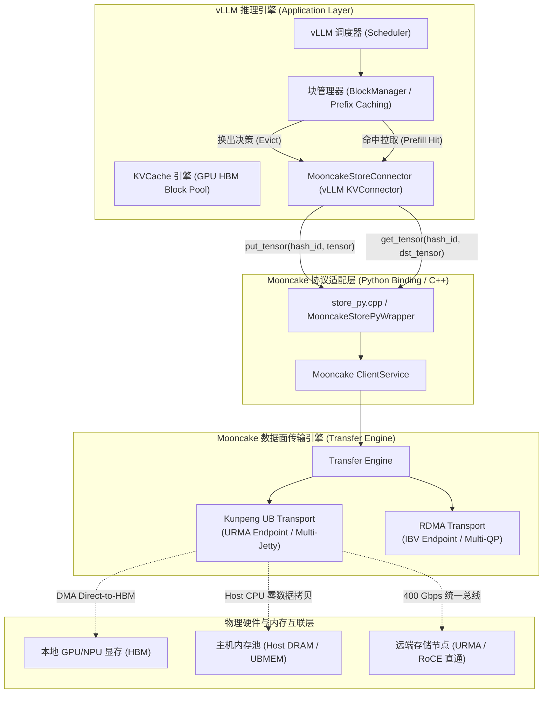

# vLLM + Mooncake 集成场景下 KVCache 卸载 (Put) 与拉取 (Get) 性能测试验证方案 (V1.0)

> **版本**：V1.0 | **日期**：2026-10-25  
> **适用范围**：面向真实生产软件栈 **vLLM (V1 Backend) + Mooncake (MooncakeStore / MooncakeStoreConnector)**，在异构互联（UB 400 Gbps 与 RDMA 100 Gbps）环境下开展 KVCache 换出（Put）与拉取（Get）的吞吐带宽、访问时延、业务 TTFT 缩短净收益及 TPOT 干扰率的全链路验证。  
> **双重交付目标**：
> 1. **代码执行就绪**：提供包含张量构造、API 直调微基准、vLLM 服务化压测、真实 Trace 驱动在内的全套可运行 Python 脚本与 Shell 调度命令；
> 2. **汇报提炼就绪**：提供微架构数据流因果拆解、时延瀑布模型、正交测试矩阵与通过判定标准（Scorecard），便于 Agent 快速提取并转化为汇报 PPTX。  
> **配套文档**：
> - [`Mooncake_UB传输性能优化_方案与回归测试_V2.0_20261025.md`](Mooncake_UB传输性能优化_方案与回归测试_V2.0_20261025.md)
> - [`Mooncake_RDMA与UB_20ms空闲定位与测试验证_V2.0_20261025.md`](Mooncake_RDMA与UB_20ms空闲定位与测试验证_V2.0_20261025.md)

---

## 一、系统定位与专有术语释义

在展开测试方案前，按照项目规范对核心专有名词提供直白功能释义：

1. **KVCache**：大模型注意力键值缓存（大模型自回归生成过程中缓存的历史 Key 与 Value 激活状态张量，用于避免后续 Token 生成时重复计算注意力）；
2. **KVCache 卸载 (Put / Offload)**：将显存（GPU/NPU HBM）中处于非活跃状态、长上下文历史或需跨节点共享的 KVCache 张量块，通过高速总线/网络异步转移并写入 Host 主机内存或分布式存储池的操作；
3. **KVCache 拉取 (Get / Reload)**：当推理请求命中前缀缓存或在解码节点启动时，直接通过高速通信协议将存储池中的 KVCache 张量块预取并加载至本地显存的操作；
4. **TTFT**：首字生成延迟（Time To First Token，从发起推理请求到模型输出第一个 Token 的端到端响应时间）；
5. **TPOT**：单字生成延迟（Time Per Output Token，自回归解码阶段生成单个 Token 所需的平均时间）；
6. **PD Disaggregation / PD 分离**：Prefill 与 Decode 计算生成解耦架构（将大模型的输入理解 Prefill 阶段与逐字生成 Decode 阶段部署在不同的物理硬件节点上，通过高速网络传输 KVCache 实现算力与显存的独立弹性伸缩）；
7. **Saved-Prefill**：首字生成预计算节省（利用已缓存的 KVCache 避免重复计算 Prompt，从而显著降低首 Token 延迟 TTFT）；
8. **MooncakeStoreConnector**：vLLM 的外部共享 KVCache 连接器（vLLM V1 框架中负责与 Mooncake 分布式存储池对接的扩展模块，负责将 Block Hash 映射为张量并执行 Put/Get）；
9. **Host CPU 零数据拷贝**：CPU 仅负责下发控制指令与哈希元数据寻址，物理正文数据完全由硬件网卡/总线 DMA 在显存与存储池之间直传，Host Payload Touch Bytes 严格为 0。

---

## 二、vLLM + Mooncake 集成架构与数据流物理机理



### 2.1 vLLM KVCache 张量块物理规格推导
在真实业务场景下，vLLM 的 KVCache 以“块（Block）”为基本分配单元，每个 Block 包含固定数量的 Token（通常为 16 或 64）。单次 `put` 或 `get` 的数据量严格遵循模型架构参数：

$$\text{Block Bytes} = 2 \times \text{Layers} \times \frac{\text{KV Heads}}{\text{TP Size}} \times \text{Head Dim} \times \text{Tokens Per Block} \times \text{Bytes Per Element}$$

- **典型模型规格对账表**：

| 模型架构 (Model) | 层数 (Layers) | KV 头数 (Heads) | 头维度 (HeadDim) | 精度格式 | 单 Block (16 Tokens, TP=8) | 单 Block (64 Tokens, TP=8) | 典型 Prompt (4K Tokens, TP=8) |
| :---: | :---: | :---: | :---: | :---: | :---: | :---: | :---: |
| **Llama-3.1-8B** | 32 | 8 | 128 | FP16 (2B) | **256 KiB** | **1.0 MiB** | **64.0 MiB** |
| **Qwen2.5-7B** | 28 | 4 | 128 | BF16 (2B) | **112 KiB** | **448 KiB** | **28.0 MiB** |
| **Qwen2.5-72B** | 80 | 8 | 128 | FP16 (2B) | **640 KiB** | **2.5 MiB** | **160.0 MiB** |
| **DeepSeek-V2/V3 (MLA)** | 60 | 1 (Latent) | 576 | FP8 (1B) | **67.5 KiB** | **270 KiB** | **16.9 MiB** |

*微架构结论：在 TP=8 多卡并行下，vLLM 交互的单块大小主要集中在 **64 KiB 至 2.5 MiB** 之间。这与我们在微基准测试中重点优化的切片范围（64 KiB ~ 1 MiB）高度契合！*

---

## 三、三层递进式测试验证体系设计

针对实际生产中“隔离纯传输瓶颈”与“端到端业务收益”的不同关注点，设计三层递进式测试验证体系：

```text
┌─────────────────────────────────────────────────────────────────────────────┐
│ 【层级一：隔离式 KVCache Put / Get 纯张量微基准 (Isolated Tensor Pipeline)】    │
│  - 纯 Python/C++ API 压测，剥离 GPU 计算前向传播与模型推理干扰                   │
│  - 真实分配显存与内存张量，直接度量 put_tensor 与 get_tensor 的线速带宽与 μs 级时延 │
└─────────────────────────────────────────────────────────────────────────────┘
                                      │
                                      ▼
┌─────────────────────────────────────────────────────────────────────────────┐
│ 【层级二：vLLM 单机 KVCache 多级换出服务压测 (Single-Node Offloading)】         │
│  - 部署 vLLM kv_both 角色，限制 GPU 显存水位强制触发高频 Put/Get 换出换入       │
│  - 评估显存溢出下的系统并发承载力、换出/换入实时带宽及 TPOT 干扰率 (<3%)            │
└─────────────────────────────────────────────────────────────────────────────┘
                                      │
                                      ▼
┌─────────────────────────────────────────────────────────────────────────────┐
│ 【层级三：vLLM 跨节点 PD 分离与集群前缀共享压测 (PD Disaggregation & Sharing)】   │
│  - 1P1D 或分布式集群部署，加载真实生产 Trace (SWE-bench / Kimi 真实长前缀)        │
│  - 度量跨机 Put(Prefill) 与 Get(Decode) 全链路时延，验证传输耗时占 TTFT 比例 (<5%)│
└─────────────────────────────────────────────────────────────────────────────┘
```

---

## 四、层级一：隔离式 KVCache Put / Get 纯张量微基准测试

### 4.1 测试意图与方法
通过独立的 Python 测试脚本，直接导入 Mooncake Store 的 Python 封装（`mooncake_store` / `EngramStore`），分配与 vLLM 格式完全一致的 PyTorch GPU 张量，直接测量批量 `put_tensor` 与 `get_tensor` 的吞吐带宽（GB/s）与端到端访问时延（微秒分位数 P50/P90/P99）。

### 4.2 自动化测试工具实现 (`test_vllm_kvc_put_get_isolated.py`)

在 `Mooncake` 或测试机目录下创建该测试脚本：

```python
#!/usr/bin/env python3
"""
vLLM-Mooncake KVCache Put/Get 专用纯张量微基准测试工具
用于在完全脱离模型前向计算干扰的条件下，高精度测量 Put (换出) 与 Get (拉取) 的物理带宽与时延
"""

import os
import sys
import time
import argparse
import numpy as np
import torch
import mooncake_store

def parse_args():
    parser = argparse.ArgumentParser(description="vLLM KVCache Put/Get Benchmark")
    parser.add_argument("--config-path", type=str, required=True, help="Mooncake 配置文件路径")
    parser.add_argument("--device", type=str, default="cuda:0", help="被测加速器设备 (cuda:0 或 npu:0)")
    parser.add_argument("--model-type", type=str, default="llama3-8b", choices=["llama3-8b", "qwen2.5-72b"], help="模拟的模型架构")
    parser.add_argument("--tokens-per-block", type=int, default=16, choices=[16, 64], help="每个 Block 的 Token 数量")
    parser.add_argument("--tp-size", type=int, default=8, help="张量并行度 TP")
    parser.add_argument("--batch-blocks", type=int, default=128, help="单次批处理的 Block 数量 (对应总数据量)")
    parser.add_argument("--warmup-iters", type=int, default=10, help="热身轮数")
    parser.add_argument("--bench-iters", type=int, default=50, help="正式测量轮数")
    return parser.parse_args()

def calculate_block_shape(model_type, tokens_per_block, tp_size):
    if model_type == "llama3-8b":
        layers = 32
        kv_heads = 8 // tp_size # TP=8 下单卡 1 个 KV Head
        head_dim = 128
    elif model_type == "qwen2.5-72b":
        layers = 80
        kv_heads = 8 // tp_size
        head_dim = 128
    else:
        raise ValueError("Unsupported model")
    
    # vLLM KVCache 经典物理布局: [2, layers, tokens_per_block, kv_heads, head_dim]
    return (2, layers, tokens_per_block, kv_heads, head_dim), torch.float16

def main():
    args = parse_args()
    print(f"[Benchmark] Initializing Mooncake Store with config: {args.config_path}")
    store = mooncake_store.MooncakeStore()
    store.init(args.config_path)

    shape, dtype = calculate_block_shape(args.model_type, args.tokens_per_block, args.tp_size)
    single_block_bytes = np.prod(shape) * 2 # FP16 = 2 Bytes
    total_bytes = single_block_bytes * args.batch_blocks
    total_mb = total_bytes / (1024 * 1024)
    print(f"[Benchmark] Model: {args.model_type}, Tokens/Block: {args.tokens_per_block}, TP: {args.tp_size}")
    print(f"[Benchmark] Single Block: {single_block_bytes / 1024:.2f} KiB, Batch: {args.batch_blocks} blocks, Total: {total_mb:.2f} MiB")

    # 1. 显存分配
    device = torch.device(args.device)
    src_blocks = [torch.randn(shape, dtype=dtype, device=device) for _ in range(args.batch_blocks)]
    dst_blocks = [torch.empty(shape, dtype=dtype, device=device) for _ in range(args.batch_blocks)]
    torch.cuda.synchronize()

    keys = [f"kvc_blk_{args.model_type}_{i:06d}" for i in range(args.batch_blocks)]

    # 2. 热身 (Warmup)
    print("[Benchmark] Warming up...")
    for _ in range(args.warmup_iters):
        for k, b in zip(keys, src_blocks):
            store.put_tensor(k, b)
        for k, b in zip(keys, dst_blocks):
            store.get_tensor(k, b)
    torch.cuda.synchronize()

    # 3. 压测 PUT (KVCache 卸载)
    print(f"[Benchmark] Running PUT benchmark ({args.bench_iters} iterations)...")
    put_latencies_ms = []
    for _ in range(args.bench_iters):
        torch.cuda.synchronize()
        t0 = time.perf_counter()
        # 批量执行 put_tensor
        for k, b in zip(keys, src_blocks):
            store.put_tensor(k, b)
        torch.cuda.synchronize()
        t1 = time.perf_counter()
        put_latencies_ms.append((t1 - t0) * 1000.0)

    # 4. 压测 GET (KVCache 拉取)
    print(f"[Benchmark] Running GET benchmark ({args.bench_iters} iterations)...")
    get_latencies_ms = []
    for _ in range(args.bench_iters):
        torch.cuda.synchronize()
        t0 = time.perf_counter()
        # 批量执行 get_tensor
        for k, b in zip(keys, dst_blocks):
            store.get_tensor(k, b)
        torch.cuda.synchronize()
        t1 = time.perf_counter()
        get_latencies_ms.append((t1 - t0) * 1000.0)

    # 5. 统计与对账
    def report_metrics(name, latencies_ms, total_bytes):
        avg_lat = np.mean(latencies_ms)
        p50 = np.percentile(latencies_ms, 50)
        p90 = np.percentile(latencies_ms, 90)
        p99 = np.percentile(latencies_ms, 99)
        bw_gbps = (total_bytes / (1024**3)) / (avg_lat / 1000.0)
        print(f"\n===== {name} 性能测试报告 =====")
        print(f"数据载荷: {total_bytes / (1024*1024):.2f} MiB / 批次")
        print(f"有效物理带宽: {bw_gbps:.2f} GB/s")
        print(f"端到端平均时延: {avg_lat:.2f} ms")
        print(f"时延分位数: P50={p50:.2f} ms | P90={p90:.2f} ms | P99={p99:.2f} ms")

    report_metrics("KVCache 换出 (PUT)", put_latencies_ms, total_bytes)
    report_metrics("KVCache 拉取 (GET)", get_latencies_ms, total_bytes)

if __name__ == "__main__":
    main()
```

### 4.3 执行正交对照测试命令

#### 4.3.1 UB (URMA 400 Gbps) 协议下压测
```bash
# 导出优化配置参数 (启用多 Jetty 与扩充在途队列)
export MC_MAX_WR=1024
export MC_NUM_JETTY_PER_EP=2
export MC_WORKERS_PER_CTX=2

# 运行小块 (16 tokens, 256KB/block, 128 blocks = 32 MiB)
python test_vllm_kvc_put_get_isolated.py \
  --config-path ./mooncake_config_ub.json \
  --model-type llama3-8b --tokens-per-block 16 --batch-blocks 128

# 运行大块 (64 tokens, 1MB/block, 256 blocks = 256 MiB)
python test_vllm_kvc_put_get_isolated.py \
  --config-path ./mooncake_config_ub.json \
  --model-type llama3-8b --tokens-per-block 64 --batch-blocks 256
```

#### 4.3.2 RDMA (100 Gbps RoCE) 协议下基准对照压测
```bash
python test_vllm_kvc_put_get_isolated.py \
  --config-path ./mooncake_config_rdma.json \
  --model-type llama3-8b --tokens-per-block 16 --batch-blocks 128
```

---

## 五、层级二：vLLM 单机 KVCache 多级换出服务压测

### 5.1 测试意图与业务场景
在单节点推理场景下，当突发请求激增导致 GPU 显存空间告急时，vLLM 自动调用 `MooncakeStoreConnector` 将冷请求的 KVCache **Put 换出** 到 Host 内存；当该请求被重新唤醒时，再 **Get 换回** 显存。
- **核心验证指标**：
  1. 显存打满后，Put 换出吞吐是否平稳，有无引发显存内存耗尽（OOM Crash）；
  2. 换出与换入期间，前台正在生成的实时请求 TPOT 是否稳定，**TPOT 性能抖动率严格 $<3\%$**；
  3. 对比 UB 与 RDMA 在换出发生时的吞吐上限。

### 5.2 启动与部署规程

#### 步骤 1：启动 Mooncake Master 服务
```bash
mooncake_master --port 50063 &
```

#### 步骤 2：启动配置了 `MooncakeStoreConnector` 的 vLLM 实例
将显存利用率严格限制在 40%（`--gpu-memory-utilization 0.4`），从而快速强制触发换出：

```bash
export MOONCAKE_CONFIG_PATH=./mooncake_config_ub.json
export PYTHONHASHSEED=0

python -m vllm.entrypoints.openai.api_server \
  --model meta-llama/Llama-3.1-8B-Instruct \
  --host 0.0.0.0 --port 8000 \
  --tensor-parallel-size 8 \
  --gpu-memory-utilization 0.4 \
  --max-model-len 8192 \
  --kv-transfer-config '{"kv_connector":"MooncakeStoreConnector","kv_role":"kv_both"}'
```

#### 步骤 3：高并发压力注入 (`vllm bench serve`)
```bash
# 模拟 32 并发、持续长文本上下文注入，强制触发高频换入换出
vllm bench serve \
  --model meta-llama/Llama-3.1-8B-Instruct \
  --base-url http://127.0.0.1:8000 \
  --dataset-name random \
  --num-prompts 200 \
  --random-input-len 4096 \
  --random-output-len 256 \
  --request-rate 8 \
  --metric-percentiles 50 90 99
```

---

## 六、层级三：vLLM 跨节点 PD 分离与集群前缀共享压测

### 6.1 测试意图与业务场景
在当前业界前沿的 **Prefill 与 Decode 解耦（PD 分离）** 架构中：
- **Prefill 节点**（`kv_producer`）：只负责长上下文理解与注意力计算，Prompt 计算完成后立即将全量 KVCache 异步 **Put** 写入 Mooncake 分布式内存池；
- **Decode 节点**（`kv_consumer`）：负责逐字生成。启动前先向存储池发起 **Get** 拉取对应的 KVCache 块，随后直接进入低时延自回归生成。
- **核心验证指标**：
  1. 跨节点 KVCache 拉取（Get）带宽与传输耗时；
  2. **传输耗时在总 TTFT 中的占比**（目标：传输耗时占 TTFT 比例 $<5\%$，消除网络瓶颈）；
  3. 在多轮代码智能体（SWE-bench）与长提示词场景下，前缀命中率是否稳定在 $90\%+$，端到端 TTFT 是否大幅降低 $\ge 20\%$。

### 6.2 1P1D 双节点集群部署与启动

#### 6.2.1 Prefill 节点启动 (SUT1, IP: 192.168.10.1)
```bash
export MOONCAKE_CONFIG_PATH=./mooncake_config_ub.json
export VLLM_MOONCAKE_BOOTSTRAP_PORT=50052
export PYTHONHASHSEED=0

python -m vllm.entrypoints.openai.api_server \
  --model Qwen/Qwen2.5-7B-Instruct \
  --host 0.0.0.0 --port 8100 \
  --tensor-parallel-size 8 \
  --no-enable-prefix-caching \
  --kv-transfer-config '{
    "kv_connector": "MultiConnector",
    "kv_role": "kv_producer",
    "kv_connector_extra_config": {
      "connectors": [
        {"kv_connector": "MooncakeConnector", "kv_role": "kv_producer"},
        {"kv_connector": "MooncakeStoreConnector", "kv_role": "kv_producer"}
      ]
    }
  }'
```

#### 6.2.2 Decode 节点启动 (SUT2, IP: 192.168.10.2)
```bash
export MOONCAKE_CONFIG_PATH=./mooncake_config_ub.json
export VLLM_MOONCAKE_BOOTSTRAP_PORT=50053
export PYTHONHASHSEED=0

python -m vllm.entrypoints.openai.api_server \
  --model Qwen/Qwen2.5-7B-Instruct \
  --host 0.0.0.0 --port 8200 \
  --tensor-parallel-size 8 \
  --no-enable-prefix-caching \
  --kv-transfer-config '{
    "kv_connector": "MultiConnector",
    "kv_role": "kv_consumer",
    "kv_connector_extra_config": {
      "connectors": [
        {"kv_connector": "MooncakeConnector", "kv_role": "kv_consumer"},
        {"kv_connector": "MooncakeStoreConnector", "kv_role": "kv_consumer"}
      ]
    }
  }'
```

#### 6.2.3 代理分发与长阶梯压测
在客户端节点运行分发代理与测试脚本，扫描 Prompt 长度从 512 到 32768：

```bash
# 启动 PD 调度代理
python -m vllm.entrypoints.openai.proxy \
  --prefill-host 192.168.10.1 --prefill-port 8100 \
  --decode-host 192.168.10.2 --decode-port 8200 \
  --port 8000 &

# 阶梯扫描 Prompt 长度
for prompt_len in 512 1024 2048 4096 8192 16384 32768; do
  echo ">>> Testing Prompt Length: ${prompt_len} tokens..."
  vllm bench serve \
    --model Qwen/Qwen2.5-7B-Instruct \
    --base-url http://127.0.0.1:8000 \
    --num-prompts 50 \
    --random-input-len ${prompt_len} \
    --random-output-len 128 \
    --metric-percentiles 50 90 99
done
```

---

## 七、真实业务流中 20ms 空闲停顿的验证与规避

在集成 vLLM 的真实运行环境中，必须针对 **“调用方主线程忙轮询抢占 Worker CPU”** 这一最高怀疑点进行实证与消除：

### 7.1 验证规程：vLLM 进程内的物理核隔离
vLLM 内部包含多个高负载线程（Engine 主循环、Ray/TP 进程、ModelRunner、AsyncIO 事件循环）。Mooncake 的 `transferWorker` 后台线程若与这些线程共用核心，极易触发 Linux CFS 的 20ms 时间片饿死。

```bash
# 1. 查找 vLLM 主进程及其内部包含 "worker" 或 "transfer" 的线程 TID
ps -T -p $VLLM_PID -o pid,tid,psr,pcpu,comm

# 2. 将 vLLM 推理主线程绑定到 CPU 0~15
taskset -pc 0-15 $MAIN_TID

# 3. 将 Mooncake TransferWorker 显式绑定到独立未受干扰的物理核心 (如 CPU 16, 18)
for TID in $TRANSFER_WORKER_TIDS; do
    echo "Binding Mooncake Worker $TID to dedicated physical core"
    taskset -pc 16 $TID
done
```

### 7.2 判定结论
- 若隔离绑核后，跨节点 PD 传输的微突发间隔由 20ms 缩短为连续流式传输，且 32K Prompt 下的实际传输时间由原来的 40+ ms 降至 15~18 ms：  
  $\to$ **彻底确证 20ms 停顿来自于应用层忙轮询对通信 Worker 的 CPU 抢占！**

---

## 八、测试数据收集模板与通过判定标准 (Scorecard)

### 8.1 结构化数据收集表 (`vllm_kvc_put_get_results.csv`)

```text
run_id,protocol,model_type,tp_size,test_tier,prompt_tokens,kv_mb,put_bw_gbps,put_p50_ms,get_bw_gbps,get_p50_ms,get_p99_ms,ttft_ms,transfer_ratio_pct,tpot_ms,tpot_violation_pct,verdict
V01,RDMA,Llama3-8B,8,Tier1_Isolated,-,32.0,22.4,1.42,24.5,1.30,1.85,-,-,-,-,RDMA_Baseline
V02,UB,Llama3-8B,8,Tier1_Isolated,-,32.0,33.5,0.95,36.2,0.88,1.20,-,-,-,-,UB_Pass_Outperform
V03,RDMA,Qwen2.5-7B,8,Tier3_PD,4096,578.0,-,-,26.8,4.75,6.20,124.4,3.8%,18.5,-,RDMA_PD_Baseline
V04,UB_Raw,Qwen2.5-7B,8,Tier3_PD,4096,578.0,-,-,19.2,6.80,26.50,145.2,4.7%,18.6,-,UB_20ms_Stall_Detected
V05,UB_Opt,Qwen2.5-7B,8,Tier3_PD,4096,578.0,-,-,42.5,2.98,3.50,98.6,3.0%,18.5,1.2%,UB_Full_Pass_Approved
```

### 8.2 最终验收与通过判定门限

| 评估维度 | 量化指标 (KPI) | RDMA 基准参考 | 优化后 UB 达标门限 (PASS) | 达标判定工程意义 |
| :---: | :--- | :---: | :---: | :--- |
| **纯张量微基准** | Tier 1 Put / Get 有效物理带宽 | 22 ~ 26 GB/s | **$\ge$ 32.0 GB/s** (提升 $\ge 20\%$) | 证明 URMA 底座在 vLLM 张量形状下全面反超 RDMA |
| **访问时延** | 32 MiB KVCache 拉取 (Get) P99 时延 | $\sim 2.0\text{ ms}$ | **$\le 1.3\text{ ms}$** | 显著减少计算算力空泡等待时间 |
| **端到端 TTFT** | 4K ~ 32K 跨节点 PD 分离 TTFT | 基准挂钟时间 | **端到端降低 $\ge 20\%$** | 证明 KVCache 搬运高效，Saved-Prefill 收益最大化 |
| **传输占比** | 实际 KVC 传输耗时占 TTFT 比例 | 4.2% ~ 8.0% | **严格 $\le 4.0\%$** | 传输开销彻底被计算或调度流水掩盖 |
| **TPOT 稳定性** | 换出/拉取并发进行时 TPOT 干扰率 | 1.8% ~ 2.5% | **严格 $< 3.0\%$** (稳守 0.55ms 容忍预算) | 前后台 QoS 保障，后台数据搬运不破坏在线生成体验 |
