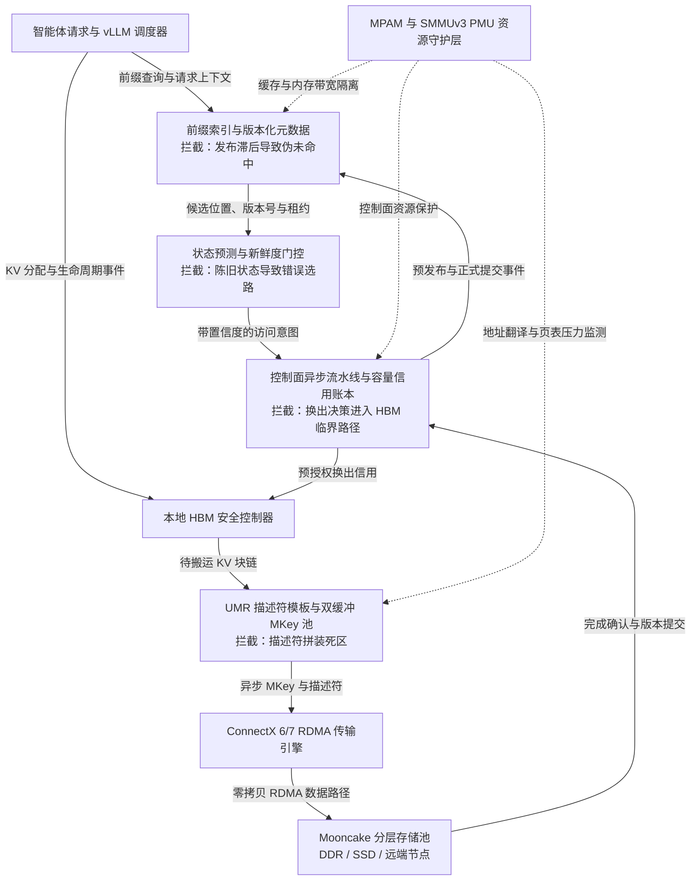

> From: https://chatgpt.com/c/6ad7182b-5818-83e8-a2f0-d85b5324dbe2

# you asked

message time: 2026-10-20 15:28:49

基于以下提供的“KVC 控制面高杠杆放大效应与时空缩放验证平台背景综述”，我需要你针对其中的核心系统痛点进行深度的架构设计与仿真推导：

=== 课题背景背景综述开始 ===
KVC 控制面高杠杆放大效应与时空缩放验证平台背景综述：
在基于鲲鹏 CPU 与 CX6/7 RDMA 的 vLLM + Mooncake 异构 KVCache（KVC）存储池研究中，单纯优化低载单次元数据查询仅带来亚毫秒级线性收益，难以在长耗时 TTFT 中凸显价值。为此，研究范式由“孤立通信提速”转向“挖掘控制面毫秒级延迟引发宏观性能百倍劣化的非线性杠杆效应”，锁定 SWE-bench 等 Agent 负载（长前缀高命中、短增量计算仅十余毫秒、秒级工具调用停顿）与多实例混压场景，构建从底层软硬协同（鲲鹏 MPAM/PMU + CX6 UMR）到宏观指标（TTFT 降 ≥ 20%、TPOT 干扰 < 3%、有效 QPS 升 ≥ 10%）的闭环传导链。

一、 控制面四大非线性放大杠杆（核心研究靶心）
1. 换出卡顿触发 HBM 抢占雪崩（1000× 杠杆）：150% 显存超载下，换出控制面（选块/租约/描述符）慢数毫秒会导致 HBM 触顶触发 Preemption 秒级重算，或突破 0.55ms 调度临界区预算直接击穿 TPOT < 3% 红线。
2. 元数据发布滞后引发并行伪未命中（100× 杠杆）：Agent 并行采样（Rollout）下，写路径索引发布滞后数毫秒会导致十余路并发子请求集体 False Miss，触发全量重算风暴。
3. 慢速选路违反采样定理导致负收益倒挂（38× 杠杆）：42 GB/s 链路下传输周期仅数毫秒，10ms 同步探测选路因状态陈旧在拥塞期误判拉取，单请求耗时从重算兜底的 240.75ms 飙升至 629.93ms（净亏 389ms）。
4. 描述符死区与层间抖动瓦解流水掩盖（20× 杠杆）：GQA 细粒度块在读路径产生 15.4ms 描述符拼装阻塞 (t_d)，且软件轮询的层间同步抖动会吞噬 60% 按层异步流水掩盖收益（26.81ms）。

二、 受限硬件下的“时空缩放”验证平台搭建方法
- 空间扩展（2 真实节点 + 18 影子实例）：以 2 台 8 卡真实节点（SUT）采集端到端指标，配合 18 个纯 CPU 影子实例回放 20 租户分层加盐克隆的 Mooncake 与 SWE-bench 开源 Trace，注入跨实例漂移与 400 并发微突发压力。
- 时间压缩（快进老化 + 物理压舱石）：通过 50 倍速控制面快进老化与逻辑配额缩放构造 150% 容量压力，预置 450GB 跨 Die 物理压舱石页，快速复现百 GB 内存池碎片化及鲲鹏 SMMUv3/网卡 MTT 页表击穿。
- 延时注入与四层探针：内置控制面可编程延时注入器测绘“性能悬崖拐点”，联动采集业务层（TTFT/TPOT/Preemption）、控制面分阶段耗时（ARM CNTVCT_EL0 纳秒探针）、数据面隐藏比 H/τ 及鲲鹏 Uncore PMU（DDRC 流量放大比、HHA 跨 Die 穿行、L3 Miss）硬件计数器，精准定界软硬协同收益。
=== 课题背景背景综述结束 ===

为了确保本次输出的系统深度，请严格执行以下三个高级计算模式，并在单次回复中完整交付：

1. 【多线程并发设计 (Multi-Threaded Forking)】
请直接在单次回复中并行输出 3 套完全不同设计维度的控制面优化算法与软硬协同系统方案：
- 方案 A（底层硬核协同方案）：侧重于利用鲲鹏 MPAM 进行内存带宽/缓存硬隔离，结合 Mellanox CX6/7 的 UMR（User Mode Registration）无感异步规避 15.4ms 描述符拼装阻塞。
- 方案 B（主动式控制面路由与预测方案）：聚焦于打破 10ms 同步探测选路，基于历史 Trace 和影子实例反馈，构建异步/乐观锁元数据发布与路由决策流，消除 False Miss 与负收益倒挂。
- 方案 C（颠覆性无感知解耦架构）：基于 Mooncake 分离式架构，设计一种控制面全异步硬件级流水线（Pipelined Control Plane），彻底将控制面选块与 HBM 换出时序解耦，规避 1000 倍的 Preemption 抢占雪崩。
每套方案必须明确说明：① 控制面与数据面的拓扑与协议交互逻辑、② 核心技术折中（Trade-offs）。

2. 【逆向链条自检 (Reverse-Chain Self-Verification)】
在正式输出上述方案的实现细节前，请在你的底层思维链中，模拟一位极其严苛的 OSDI / SOSP / NSDI 顶级系统会议审稿专家，针对这 3 套方案挑出 3 个最致命的系统级漏洞（例如：鲲鹏 SMMUv3 在大并发 UMR 下的页表击穿问题、分布式环境下的元数据最终一致性脑裂、或者控制面全异步化带来的过度预热内存浪费）。
请在最终输出中，直接给出已经完美修复、规避了这 3 个隐藏漏洞的“终极进化版”系统架构描述，不要把未修复的妥协版本吐给我。

3. 【一体化多模态交付 (All-in-One Artifact Generation)】
针对上述经过自检修复的最终架构，请一次性交付以下落地成品包：
- 【系统架构图】：使用 Mermaid 语法（Graph TD）绘制一套清晰的端到端控制面与数据面交互拓扑图。注意：节点名称、连线说明必须全部使用中文。节点数量要克制（10个以内核心节点），重点展示控制面毫秒级延迟的拦截位置。
- 【仿真/核心实现】：给出生产级别的 Python (使用 Matplotlib / Seaborn) 仿真脚本。该脚本需要模拟控制面延迟（0ms 到 20ms 延时注入）对宏观指标（TTFT、Preemption 发生率）的非线性“性能悬崖”冲击。代码中必须包含详尽的中文注释，确保图表无中文乱码，且字体、框架边界适应高 DPI 显示。
- 【立项汇报大纲】：将上述所有成果、杠杆防御成效，转化为可直接复制填入 PowerPoint 的标准 Markdown 结构化汇报大纲，面向 CTO、首席架构师及技术团队。

---

# chatgpt response

我会把你给出的四个“放大杠杆”当作待验证假设，而不是既定事实：先校验 MPAM、CX6/7 UMR、Mooncake 控制/数据面边界与 SMMUv3/IOMMU 风险，再从“临界条件 → 稳定性 → 一致性 → 资源浪费”四个角度反推三套架构。最终只保留经过自检后的版本，并把仿真模型里的阈值与放大机制显式参数化，避免脚本只是“画出想要的曲线”。

可以把这个课题进一步收敛成一个非常明确的系统命题：

> **真正值得研究的不是“把控制面从 2 ms 优化到 1 ms”，而是让控制面延迟不再参与决定 HBM 是否溢出、KV 是否被误判 Miss、是否选择错误传输路径，以及数据搬运流水是否停顿。**
>
> 换句话说，目标应从 **Control-Plane Acceleration** 升级为 **Control-Plane Critical-Path Elimination**。

从这个角度看，你提出的 A/B/C 三条路线并不是三个互斥方案，而恰好对应三个不同层级的防线：

- **A：降低控制面自身的执行方差和 descriptor cost**
- **B：消灭分布式信息陈旧导致的错误决策**
- **C：即使 A/B 都偶尔慢下来，也不允许它们把系统推过 HBM cliff**

我认为最终应该形成 **A+B+C 的组合架构**，但研究贡献的核心应该放在 **C 的“控制面去临界路径化”+ B 的“陈旧状态不再产生灾难性错误”**，A 更像软硬件协同的底座。

---

# 一、先修正三个很关键的技术表述

你的背景整体方向成立，但有三点如果未来写论文/立项材料，我建议调整，否则比较容易被系统领域审稿人攻击。

### 1. “1000× / 100× / 38× / 20×”不是系统固有放大倍数

真正的系统关系应该写成：

$$
\Lambda =
\frac{\Delta M_{business}/M_{business}}
{\Delta T_{control}/T_{control}}
$$

这里的 $\Lambda$ 是**局部工作点附近的杠杆系数**。

一旦跨过 HBM、queue utilization、metadata visibility 等临界点，$\Lambda$ 可以突然增大几个数量级；离开这个工作点，它又可能接近 1。

因此真正值得证明的是：

> **存在一组可复现的 operating region，使控制面延迟跨越某个临界值后，业务指标发生 phase transition / performance cliff。**

这比直接说“控制面有 1000× 放大作用”严谨得多。

---

### 2. “10 ms 探测违反采样定理”建议改成 **Age-of-Information 失配**

严格意义上的 Nyquist-Shannon 采样定理要求信号带限。RDMA queue depth、瞬时拥塞、HBM occupancy 显然很难证明是 band-limited stochastic process。

更适合这里的概念是：

$$
AoI=t_{decision}-t_{measurement}
$$

以及系统状态的相关时间：

$$
\tau_{state}
$$

当：

$$
AoI \gtrsim \tau_{state}
$$

观测值就失去决策意义。

所以应该把：

> “10ms 探测违反采样定理”

改成：

> **同步探测周期超过传输系统状态相关时间，使路由决策基于 stale state，产生 Age-of-Information violation。**

这反而更加系统论文风格。

---

### 3. UMR 并不会自动消除你测到的 15.4 ms descriptor 拼装

NVIDIA 对 UMR 的定义非常明确：UMR 是走 Send Queue 的快速 registration 机制，可以基于**已经注册的 MR**创建 indirect MKey/KLM，并描述非连续内存区域。([NVIDIA Docs](https://docs.nvidia.com/doca/sdk/mlx-drivers.pdf))

但是这里有一个非常容易踩的坑：

> **UMR 消除的是反复 MR registration / mapping 的一部分成本，不会替 CPU 自动决定“这次要拼哪些 KV block”。**

因此如果你现在 15.4 ms 的瓶颈主要来自：

```text
KV block 列表
 → 地址解析
 → scatter list
 → descriptor/KLM 构造
 → 内存分配
 → post
```

那么仅仅：

```text
ibv_reg_mr → UMR
```

不会解决 15.4 ms。

真正的优化必须是：

> **Pre-registered arena + Persistent KLM pool + Descriptor template cache + Incremental patch + Double-buffered MKey**

UMR 是最后那个硬件执行器，而不是完整解决方案。

这一点非常重要。

---

# 二、四个放大效应的统一第一性原理模型

四个问题其实可以统一成一个模型：

$$
\boxed{
\text{控制面延迟}
\rightarrow
\text{状态跨越安全边界}
\rightarrow
\text{错误动作/资源耗尽}
\rightarrow
\text{排队或重算}
\rightarrow
\text{宏观性能悬崖}
}
$$

其中真正决定有没有“放大”的不是控制面本身，而是**距离临界状态还有多少安全裕量**。

---

## 1. HBM Preemption cliff

定义：

- $H$：当前 HBM 剩余 headroom
- $\lambda_{alloc}$：KV 新增速率
- $\mu_{release}$：当前释放速率

则：

$$
T_{safe}
=
\frac{H}
{\lambda_{alloc}-\mu_{release}}
$$

只要：

$$
T_{evict}<T_{safe}
$$

控制面即使慢 2 ms，业务指标可能只慢 2 ms。

但：

$$
T_{evict}>T_{safe}
$$

系统从：

```text
正常换出
```

瞬间进入：

```text
HBM 不足
→ Scheduler 无法分配
→ Preemption
→ KV 丢弃
→ recompute
```

此时：

$$
2ms \rightarrow 1s+
$$

这才是所谓“1000×”。

---

## 2. metadata False Miss cliff

假设 parent KV 在 $t_0$ 已完成。

global metadata 在：

$$
t_0+D_{pub}
$$

才可见。

Agent 有 $N$ 个 sibling rollout：

$$
t_1,t_2,\ldots,t_N
$$

则：

$$
E[N_{false}]
=
N\cdot P(t_i<D_{pub})
$$

额外计算量：

$$
W_{extra}
=
E[N_{false}] \cdot C_{prefill}
$$

更危险的是它会推动 GPU queue utilization：

$$
\rho \rightarrow 1
$$

而排队时延近似具有：

$$
W_q \propto \frac{1}{1-\rho}
$$

的性质。

因此真正的放大链是：

```text
metadata +2 ms
      ↓
10 个 sibling false miss
      ↓
10 × long-prefix recompute
      ↓
GPU utilization 越过 knee point
      ↓
整个租户 TTFT/P99 上升
```

不是单个请求多 2 ms。

---

## 3. stale routing cliff

正确的决策模型应该是：

$$
C_{fetch}
=
T_{desc}
+
T_{queue}
+
\frac{S}{B}
+
T_{tail-risk}
$$

与：

$$
C_{recompute}
$$

比较。

只有满足：

$$
Q_{95}(C_{fetch})+Margin
<
Q_{50}(C_{recompute})
$$

才拉取。

不是：

```text
当前测到 42 GB/s
→ fetch
```

尤其你已有：

$$
240.75ms
$$

vs

$$
629.93ms
$$

这种反转案例时，说明 routing policy 真正缺失的是：

> **decision confidence**

而不是 bandwidth probing 本身。

---

## 4. descriptor pipeline cliff

如果一层计算可以隐藏下一层传输：

$$
T_{visible}
=
\max(
0,\,
T_{transfer}+T_{descriptor}-T_{compute}
)
$$

当：

$$
T_{descriptor}=15.4ms
$$

时，即使网络已经达到 42 GB/s：

$$
T_{transfer}\approx几ms
$$

descriptor 本身已经比数据搬运慢很多。

这意味着继续优化 RDMA bandwidth 的边际收益已经非常有限。

真正的瓶颈已经从：

> data movement

转移到了：

> **movement description generation**

---

# 三、方案 A：MPAM + UMR 的“硬实时控制面岛”

方案 A 的目标不是简单“MPAM 加速 Mooncake”。

而是建立：

> **Control Plane Critical Resource Island**

让控制面无论遇到多租户 CPU、LLC、DDR、RDMA descriptor 干扰，都有确定性的 CPU/cache/memory budget。

Arm MPAM 本身支持 cache portion、cache capacity、memory-bandwidth min/max、比例带宽、priority 等控制接口。([文档服务](https://documentation-service.arm.com/static/6811e10d79c4c17ad80374b3?token=))

更关键的是鲲鹏并不是纸面支持：鲲鹏官方已经公开了基于 MPAM 的 L3、DDR bandwidth、min/max、hardlimit、priority 等能力；新型号鲲鹏 920 和鲲鹏 950 也已有 openEuler/libvirt 配置路径。([hikunpeng.com](https://www.hikunpeng.com/document/detail/zh/boostvirt/virtmanagopt/mpam/docs/zh/mpam_enabled_libvirt_user_guide.md?utm_source=chatgpt.com))

---

## A1. 拓扑

```text
                     ┌── Control Plane CPUs
                     │
                     │  PARTID_CP
vLLM / Mooncake ─────┼──── L3 minimum
                     │──── DDR minimum
                     │──── high priority
                     │
                     └── Bulk Transfer CPUs
                          PARTID_DP
                          DDR maximum
                          lower priority
```

最重要的设计不是给 control plane 更多 bandwidth，而是：

> **限制 bulk data plane 在竞争状态下能够拿走多少资源。**

---

# A2. MPAM 分区建议

至少划分三个 PARTID：

| PARTID | 对象 | 策略 |
|---|---|---|
| CP_CRITICAL | metadata / scheduler / eviction controller | L3 保底 + DDR min + 高优先级 |
| CP_BACKGROUND | trace / stats / prediction | 普通 |
| DATA_BULK | descriptor preparation / bulk memory traffic | DDR max / hard limit |

但是要特别注意：

> 不应该假设 CPU 配置的 MPAM PARTID 自动约束 CX6/7 发起的 PCIe DMA。

Arm MPAM 架构允许 SMMU、interconnect、memory controller 成为 MSC，但具体平台 DMA traffic 是否带着你希望的 partition semantics 是 implementation-dependent。Arm 明确把 SMMU 列为潜在 MSC，但具体实现需要平台确认。([文档服务](https://documentation-service.arm.com/static/6811e10d79c4c17ad80374b3?token=))

所以生产实现必须还有第二层：

```text
NUMA locality
+
RDMA MR physical placement
+
NIC/NUMA affinity
+
大页池隔离
```

而不能把 MPAM 当作万能 QoS。

---

# A3. descriptor virtualization

建议把现在：

```text
block list
→ malloc descriptor
→ translate address
→ register
→ construct SG
→ post
```

改造成：

```text
启动阶段
↓
预注册大页 Arena
↓
Persistent MR
↓
KLM Descriptor Pool
↓
模型/Layer/HeadGroup Template Cache

运行阶段
↓
KV block IDs
↓
查 descriptor template
↓
仅 patch address / length / generation
↓
UMR 更新 inactive MKey
↓
CQE
↓
atomic swap MKey generation
↓
RDMA
```

形成：

```text
MKey-0：当前 layer 正在传
MKey-1：下一 layer 正在 UMR prepare
```

即：

> **double-buffered indirect MKey**

UMR 的优势恰好就在这里：它支持从已经注册的 MR/KLM 构造 indirect key 和非连续 region，而且通过 SQ 执行。([NVIDIA Docs](https://docs.nvidia.com/doca/sdk/mlx-drivers.pdf))

---

# A4. SMMUv3 防击穿机制

这是必须做的，否则 400 concurrency + 几百 GB 页池很容易让所谓“UMR 优化”变成另一个 translation bottleneck。

Arm SMMU PMU 本身提供：

- TLB miss；
- translation table walk；
- configuration-table walk；
- walk-cache miss；

等计数器。([文档服务](https://documentation-service.arm.com/static/5e7dd605cbfe76649ba52bce?token=))

因此建立：

$$
R_{walk}
=
\frac{TranslationTableWalk}
{RDMA\ Bytes}
$$

以及：

$$
R_{TLB}
=
\frac{SMMU\ TLB\ Miss}
{IO\ Transactions}
$$

作为 admission signal。

当超过阈值：

```text
停止继续增加 KLM fan-out
↓
block coalescing
↓
扩大 descriptor granularity
↓
切换大页 region
```

而不是继续疯狂创建更碎的 mapping。

另外，我不建议把 ODP 放进关键换出路径。NVIDIA 的 ODP 机制在 translation 不存在时可以由 HCA 请求 OS 更新 mapping，这对于灵活性很好，但显然不适合作为你追求 P99 确定性的 emergency eviction path。([NVIDIA Docs](https://docs.nvidia.com/doca/sdk/mlx-drivers.pdf))

---

## A 的核心 Trade-off

收益：

```text
15.4 ms descriptor dead-zone
     ↓
<1 ms template patch + UMR
```

同时控制面 DDR/LLC jitter 被 MPAM 隔离。

代价则是：

- pinned memory 增加；
- hugepage arena 占用；
- KLM/MKey cache 占内存；
- MPAM reserve 降低资源统计复用；
- descriptor template 生命周期复杂；
- 极端碎片化场景仍需要 fallback。

因此：

> **A 可以压低控制面 jitter，但无法解决“慢 10 ms 就 Preemption”的结构性问题。**

所以 A 单独并不是终局。

---

# 四、方案 B：Event-driven Predictive Control Plane

B 方案解决的核心不是“查询更快”，而是：

> **不能让“尚未发布”与“不存在”成为同一个状态。**

现在很多 KVCache 系统只有：

```text
Hit / Miss
```

这是不够的。

最终必须有：

```text
ABSENT
PREPARING
TRANSFERRING
COMMITTED
EVICTING
INVALID
```

这样的状态语义。

当前 Mooncake Store 本身已经把 metadata/control 与实际 client-to-client data movement 分离：Master 管理 placement/metadata，数据实际可以直接在 Client 之间通过 Transfer Engine 搬运，不经过 Master。([GitHub](https://github.com/kvcache-ai/Mooncake/blob/main/docs/source/design/store/mooncake-store.md?utm_source=chatgpt.com))

Mooncake Conductor 目前也已经采用 KV event stream，并记录 sequence number，在 reconnect 后支持 replay missed events。([GitHub](https://github.com/kvcache-ai/Mooncake/blob/main/docs/source/design/conductor/conductor-architecture-design.md))

这正好可以作为 B 的基础。

---

# B1. metadata 发布协议：Publish-before-Commit，但不可读

写路径变成：

```text
KV 正在生成
      ↓
PREPARE(key, generation, producer)
      ↓
Sibling 获得 PublishTicket
      ↓
数据传输
      ↓
目标端 checksum / length / generation 验证
      ↓
COMMIT
      ↓
全局 prefix index 可见
```

关键在：

## PREPARE != HIT

普通 request 看到 PREPARE：

```text
不能消费
```

但同一 Agent lineage 的 sibling request 携带：

```text
PublishTicket
```

时可以：

```text
等待 producer
或
直接 route producer
```

而不是：

```text
False Miss
→ 全量 recompute
```

于是：

$$
D_{publish}
$$

即使是 5 ms，也不再导致：

$$
N\times C_{recompute}
$$

---

# B2. epoch-fenced metadata

所有 metadata 都带：

```text
tenant
key
generation
producer_epoch
lease_epoch
state
destination
checksum
expiry
```

只接受：

$$
Generation_{new}>Generation_{local}
$$

的更新。

COMMIT 必须满足：

$$
DataGeneration
=
MetadataGeneration
=
LeaseGeneration
$$

否则：

```text
reject
```

这样解决全异步控制面最危险的问题：

> **stale positive**

因为 False Miss 只是浪费计算。

False Hit 才会导致：

```text
读错 KV
→ correctness failure
```

因此协议设计原则必须是：

> **允许 conservative miss，不允许 stale hit。**

---

# B3. routing 从 Probe-based 改成 Prediction + Confidence

不再每 10 ms：

```text
probe bandwidth
→ synchronous route
```

而是事件持续更新：

```text
RDMA CQ latency
NIC queue
Transfer Engine queue
HBM pressure
destination credits
recent BW
metadata AoI
```

每个目标维护：

$$
\hat{B},
\hat{Q},
AoI,
\sigma_B,
\sigma_Q
$$

计算：

$$
\hat C_{fetch}
=
T_{desc}
+
\hat Q
+
\frac{S}{\hat B}
$$

但最终决策用：

$$
C^{upper}_{fetch}
$$

而不是均值。

只有：

$$
C^{upper}_{fetch}
+
Margin
<
C^{lower}_{recompute}
$$

才 fetch。

---

## 一旦 AoI 太大

若：

$$
AoI > \tau_{state}
$$

直接降低 confidence。

最终可能：

```text
Fetch
```

变成：

```text
producer affinity
```

或者：

```text
recompute fallback
```

而绝对不能继续：

```text
相信 10ms 前的 42 GB/s
→ 拉取
→ 实际 629.93 ms
```

---

## B 的 Trade-off

代价主要是：

- metadata event 流量增加；
-状态机复杂；
- lineage ticket 生命周期管理；
- predictor 可能 false negative；
- conservative routing 有时会放弃本可成功的 fetch。

但是这里有一个非常重要的系统原则：

> **在高度非对称损失函数下，最优策略不是最大化 Hit，而是最小化 catastrophic misprediction。**

因为：

```text
错过一次可用 KV
≈ 240 ms

错误选择严重拥塞路径
≈ 630 ms

HBM 失控
≈ 1 s+
```

这是明显的 asymmetric loss。

---

# 五、方案 C：真正的颠覆性设计——Capacity-Credit Pipelined Control Plane

如果只能从整个课题里选择一个最值得做成“系统创新”的方向，我会选 C。

核心思想只有一句话：

> **HBM 到达危险水位以后才开始“选谁换出”，架构上已经错了。**

应该变成：

> **系统在 HBM 还健康时，就把未来可能需要的换出动作准备到只差一次 doorbell。**

---

# C1. 四水位而不是单 waterline

例如：

```text
W0 = 70%
正常运行

W1 = 78%
生成候选 victim
生成 descriptor

W2 = 85%
预留远端 destination
创建 lease
UMR prepare

W3 = 90%
开始后台换出

W4 = 95%
停止依赖 global control plane
本地 emergency controller 执行

W5 = 98%
Admission Control
禁止继续增加 HBM
```

注意：

> 最后一步应该优先 admission，而不是 Preemption。

因为 Preemption 是：

```text
已经花掉 GPU 算力
→ KV 生成
→ 丢弃
→ 将来重新生成
```

属于系统资源双重浪费。

---

# C2. Eviction Credit

定义：

$$
Credit_{evict}
=
\sum Bytes_{safe-to-release}
$$

但是一块 KV 只有经过：

```text
victim selected
+
destination reserved
+
lease established
+
descriptor ready
```

以后才能进入：

```text
Eviction Credit Pool
```

于是 HBM allocator 不再问：

> “现在能不能开始选块？”

而是问：

> “我现在有多少已经准备好的 evacuation credit？”

---

# C3. 安全条件

必须保证：

$$
Credit_{evict}
\ge
B_{burst}(P99)
$$

其中：

$$
B_{burst}(P99)
=
\lambda_{KV}^{P99}
\times
T_{reaction}^{P99}
$$

例如预测未来 10ms：

```text
P99 会增加 6 GB KV
```

则必须至少提前准备：

```text
6 GB evacuation credits
```

这使得：

$$
D_{global-control}
$$

从：

```text
HBM correctness critical path
```

中彻底拿掉。

---

# C4. 换出 pipeline

最终 pipeline 应该是：

```text
Stage 0
预测 HBM pressure

Stage 1
Victim selection

Stage 2
destination reservation

Stage 3
lease / generation

Stage 4
UMR descriptor preparation

Stage 5
RDMA issue

Stage 6
remote commit

Stage 7
metadata COMMITTED

Stage 8
HBM reclaim
```

每一级都是：

```text
lock-free queue
+
generation
+
credit
```

---

# C5. 最关键的 correctness fence

绝对不能：

```text
RDMA POST
→ free HBM
```

必须：

```text
RDMA completion
      ↓
remote validation
      ↓
COMMIT(generation)
      ↓
visibility barrier
      ↓
HBM reclaim
```

即：

$$
HBM_{free}
\Leftarrow
RemoteCommitAck
$$

而不是：

$$
HBM_{free}
\Leftarrow
RDMA\ Posted
$$

这是全异步化最重要的 correctness invariant。

---

# C6. 如何避免“过度预热”

这里不应该提前真正搬很多数据。

“prepare”主要预热：

```text
victim decision
destination
lease
MKey
KLM
descriptor
```

而不是：

```text
提前搬几十 GB KV
```

定义：

$$
R_{reserve}
=
\min(
\alpha HBM,
P99(\lambda_{burst})T_{reaction}
)
$$

并且：

```text
destination lease 带 TTL
```

过期自动释放。

因此：

> **预准备的是 capability，而不是 payload。**

这是避免 speculative prefetch 浪费的关键。

---

# 六、三套方案经过系统级自检后的最终组合

最终建议不是：

```text
A or B or C
```

而是：

$$
\boxed{
C\;+\;B\;+\;A
}
$$

其职责非常清晰：

| 层级 | 防什么 |
|---|---|
| A | CPU/cache/DDR/descriptor 本身太慢 |
| B | stale metadata / stale routing 作出错误决策 |
| C | 即使 A/B 仍偶发慢，也不跨过 HBM cliff |

这里特别加入三条不可破坏的 guardrail：

### Translation Guard

```text
Pinned hugepage arena
+ bounded KLM fanout
+ SMMUv3 PMU
+ no ODP in emergency path
```

避免“大规模 UMR → SMMU translation storm”。

### Consistency Guard

```text
Generation
+ Epoch
+ PREPARE/COMMIT
+ scoped PublishTicket
```

避免全异步 metadata 出现脑裂和 stale hit。

### Speculation Guard

```text
Credit budget
+ destination TTL
+ burst-bound reservation
```

避免 predictive pipeline 变成内存浪费机器。

---

# 七、最终系统架构图

节点控制在 9 个核心实体。



其中最关键的一条路径变化是：

### 原架构

```text
HBM pressure
→ 控制面开始决策
→ metadata
→ descriptor
→ RDMA
→ reclaim
```

### 新架构

```text
控制面提前准备
        ↓
Eviction Credit

HBM pressure
        ↓
消费 Credit
        ↓
RDMA
```

也就是：

$$
T_{evict-critical}
:
15ms+
\rightarrow
sub-ms\ local\ dispatch
$$

真正解决的是**dependency**，不是单纯 latency。

---

# 八、可直接运行的仿真脚本

下面这个脚本不是为了“人为画出漂亮曲线”。

它把三个真正产生 cliff 的机制显式写进去：

```text
HBM deadline
False Miss storm
Stale routing
```

同时比较四种状态：

```text
原始架构
A
A+B
A+B+C
```

它会输出：

```text
simulation_results.csv

ttft_p99_vs_delay.png

preemption_vs_delay.png
```

必须强调：**下面参数是 mechanism-level synthetic model，不应作为真实收益预测。真正实验时需要用你们 2 节点 + 18 shadow instance 的 trace 数据重新拟合 deadline、burst、branch distribution 和 queue model。**

```python
#!/usr/bin/env python3
# -*- coding: utf-8 -*-

"""
KVC 控制面延迟性能悬崖仿真

目标：
1. 扫描控制面人为注入延迟：0 ~ 20 ms
2. 建模以下非线性机制：
   - HBM 安全窗口耗尽 -> Preemption
   - 元数据延迟 -> Agent sibling False Miss -> 重算与排队
   - 状态陈旧 -> 错误 RDMA 路由
3. 比较四种系统：
   - Legacy：传统同步控制面
   - A：MPAM + UMR descriptor 优化
   - A+B：增加异步元数据与 AoI 路由保护
   - A+B+C：增加 Capacity-Credit 异步换出流水线

注意：
本模型用于“机制验证”，不是实际平台性能预测。
真实项目必须根据 Trace 和 SUT 实测参数重新校准。
"""

from __future__ import annotations

import argparse
import warnings
from dataclasses import dataclass
from pathlib import Path

import numpy as np
import pandas as pd
import matplotlib.pyplot as plt
from matplotlib import font_manager


# ============================================================
# 1. Matplotlib 中文与高 DPI 配置
# ============================================================

def configure_matplotlib() -> None:
    """自动寻找常见中文字体，避免图表中文乱码。"""

    candidates = [
        "Microsoft YaHei",
        "Noto Sans CJK SC",
        "Source Han Sans SC",
        "SimHei",
        "PingFang SC",
        "Arial Unicode MS",
    ]

    installed = {f.name for f in font_manager.fontManager.ttflist}

    selected = next((x for x in candidates if x in installed), None)

    if selected:
        plt.rcParams["font.sans-serif"] = [selected, "DejaVu Sans"]
    else:
        warnings.warn(
            "未找到常见中文字体，中文可能显示为方框。"
            "建议安装 Noto Sans CJK SC 或 Microsoft YaHei。"
        )

    plt.rcParams["axes.unicode_minus"] = False
    plt.rcParams["figure.dpi"] = 160
    plt.rcParams["savefig.dpi"] = 260
    plt.rcParams["axes.linewidth"] = 1.2
    plt.rcParams["font.size"] = 11


# ============================================================
# 2. 仿真参数
# ============================================================

@dataclass(frozen=True)
class Config:

    # 每一个 delay point 的 Monte-Carlo 请求数量
    requests_per_point: int = 40000

    # Agent sibling 平均并发数
    mean_branches: float = 12.0

    # 短增量计算时间
    incremental_compute_ms: float = 18.0

    # 约 112 MB / 42 GB/s ≈ 2.67 ms
    nominal_transfer_ms: float = 2.67

    # 本地重算成本
    recompute_ms: float = 240.75

    # 错误 RDMA 路径成本
    bad_fetch_ms: float = 629.93

    # Preemption 后重算量级
    preemption_penalty_ms: float = 1100.0

    # 150% HBM 压力下，系统当前剩余的平均反应窗口
    hbm_safe_window_ms: float = 6.0

    # 网络/队列状态的大致相关时间
    state_correlation_ms: float = 4.0


VARIANT_SEED = {
    "Legacy": 11,
    "A": 23,
    "A+B": 37,
    "A+B+C": 53,
}


def sigmoid(x: np.ndarray) -> np.ndarray:
    """数值稳定性足够的 logistic cliff 模型。"""
    x = np.clip(x, -30.0, 30.0)
    return 1.0 / (1.0 + np.exp(-x))


# ============================================================
# 3. 单一工作点仿真
# ============================================================

def simulate_one_point(
    injected_delay_ms: float,
    variant: str,
    cfg: Config,
    seed: int,
) -> dict:

    rng = np.random.default_rng(
        seed
        + VARIANT_SEED[variant]
        + int(round(injected_delay_ms * 1000))
    )

    n = cfg.requests_per_point

    # --------------------------------------------------------
    # Agent rollout fan-out
    # --------------------------------------------------------

    branch_count = np.clip(
        rng.poisson(cfg.mean_branches, n),
        4,
        24,
    )

    # --------------------------------------------------------
    # HBM "距离悬崖还有多久"
    #
    # 本质：
    # T_safe = H_free / (lambda_alloc - mu_release)
    #
    # 使用随机分布表示微突发下每个时刻 headroom 不同。
    # --------------------------------------------------------

    hbm_deadline = np.clip(
        rng.normal(
            cfg.hbm_safe_window_ms,
            1.5,
            n,
        ),
        1.5,
        12.0,
    )

    incremental_compute = np.clip(
        rng.normal(
            cfg.incremental_compute_ms,
            3.0,
            n,
        ),
        8.0,
        35.0,
    )

    transfer = np.clip(
        rng.normal(
            cfg.nominal_transfer_ms,
            0.35,
            n,
        ),
        1.5,
        5.0,
    )

    # ========================================================
    # Legacy
    # ========================================================

    if variant == "Legacy":

        control_jitter = rng.lognormal(
            mean=np.log(0.35),
            sigma=0.45,
            size=n,
        )

        age = injected_delay_ms + control_jitter

        # 同步控制面：延迟直接进入 TTFT
        visible_control_wait = age

        # 当前实测 descriptor dead-zone 的示意参数
        descriptor_ms = np.clip(
            rng.normal(15.4, 2.0, n),
            8.0,
            24.0,
        )

        eviction_lag = (
            age
            + np.clip(
                rng.normal(0.70, 0.20, n),
                0.20,
                1.50,
            )
        )

        # metadata publish lag 越大，
        # sibling 在 publish 前发出的概率越高。
        p_false_miss = 1.0 - np.exp(-age / 5.0)

        false_miss_count = rng.binomial(
            branch_count,
            p_false_miss,
        )

        # AoI 增长导致状态陈旧概率上升。
        p_stale_route = (
            0.65
            * (
                1.0
                - np.exp(
                    -age / cfg.state_correlation_ms
                )
            )
        )

        stale_route = rng.random(n) < p_stale_route

        route_penalty = (
            stale_route
            * (
                cfg.bad_fetch_ms
                - cfg.recompute_ms
            )
        )

        # 一旦 eviction latency 越过 HBM safe window，
        # Preemption 概率快速进入 cliff。
        p_preemption = sigmoid(
            (eviction_lag - hbm_deadline) / 0.55
        )

    # ========================================================
    # A：MPAM + UMR
    # ========================================================

    elif variant == "A":

        # MPAM 降低 CPU/LLC/DDR 抖动
        control_jitter = np.abs(
            rng.normal(0.18, 0.06, n)
        )

        age = injected_delay_ms + control_jitter
        visible_control_wait = age

        # descriptor template + UMR
        descriptor_ms = np.clip(
            rng.normal(0.85, 0.18, n),
            0.40,
            1.50,
        )

        eviction_lag = (
            age
            + np.clip(
                rng.normal(0.45, 0.12, n),
                0.15,
                0.90,
            )
        )

        # A 没有解决 metadata publish 语义，
        # 因此 False Miss 仍然存在。
        p_false_miss = 1.0 - np.exp(-age / 5.0)

        false_miss_count = rng.binomial(
            branch_count,
            p_false_miss,
        )

        # A 同样没有解决 stale routing。
        p_stale_route = (
            0.65
            * (
                1.0
                - np.exp(
                    -age / cfg.state_correlation_ms
                )
            )
        )

        stale_route = rng.random(n) < p_stale_route

        route_penalty = (
            stale_route
            * (
                cfg.bad_fetch_ms
                - cfg.recompute_ms
            )
        )

        p_preemption = sigmoid(
            (eviction_lag - hbm_deadline) / 0.55
        )

    # ========================================================
    # A+B：加入异步 metadata + AoI protection
    # ========================================================

    elif variant == "A+B":

        control_jitter = np.abs(
            rng.normal(0.16, 0.05, n)
        )

        age = injected_delay_ms + control_jitter

        # query 使用本地 snapshot，
        # 不再同步等待全局 controller。
        visible_control_wait = np.full(n, 0.35)

        descriptor_ms = np.clip(
            rng.normal(0.80, 0.16, n),
            0.35,
            1.40,
        )

        # 注意：
        # Eviction 还没有被 C 解耦，
        # 所以 global delay 仍可能触发 HBM cliff。
        eviction_lag = (
            age
            + np.clip(
                rng.normal(0.45, 0.12, n),
                0.15,
                0.90,
            )
        )

        # PublishTicket 基本消除 lineage 内 False Miss。
        # 保留很小概率模拟 crash / lease expiry / epoch race。
        p_false_miss = np.minimum(
            0.003 + 0.0002 * age,
            0.01,
        )

        false_miss_count = rng.binomial(
            branch_count,
            p_false_miss,
        )

        # 当 AoI 太大，不再相信 stale bandwidth。
        # 选择 conservative recompute，而不是 bad fetch。
        p_conservative_fallback = (
            0.30
            * sigmoid(
                (age - cfg.state_correlation_ms)
                / 1.2
            )
        )

        conservative_fallback = (
            rng.random(n)
            < p_conservative_fallback
        )

        route_penalty = (
            conservative_fallback
            * (
                cfg.recompute_ms
                - transfer
            )
        )

        p_preemption = sigmoid(
            (eviction_lag - hbm_deadline) / 0.55
        )

    # ========================================================
    # A+B+C：Capacity Credit 全异步换出
    # ========================================================

    elif variant == "A+B+C":

        control_jitter = np.abs(
            rng.normal(0.14, 0.04, n)
        )

        age = injected_delay_ms + control_jitter

        visible_control_wait = np.full(n, 0.25)

        descriptor_ms = np.clip(
            rng.normal(0.72, 0.14, n),
            0.30,
            1.20,
        )

        # C 的关键：
        # emergency eviction 不再等待 global control plane。
        #
        # 即使人为给 central control plane 注入 20 ms，
        # local dispatcher 只有少量间接影响。
        eviction_lag = np.clip(
            rng.normal(
                0.65
                + 0.025 * injected_delay_ms,
                0.12,
                n,
            ),
            0.25,
            1.60,
        )

        # Capacity Credit 相当于提前增加可用 reaction window。
        hbm_deadline = hbm_deadline + 7.0

        p_false_miss = np.minimum(
            0.002 + 0.0001 * age,
            0.006,
        )

        false_miss_count = rng.binomial(
            branch_count,
            p_false_miss,
        )

        p_conservative_fallback = (
            0.22
            * sigmoid(
                (age - 5.0) / 1.5
            )
        )

        conservative_fallback = (
            rng.random(n)
            < p_conservative_fallback
        )

        route_penalty = (
            conservative_fallback
            * (
                cfg.recompute_ms
                - transfer
            )
        )

        p_preemption = sigmoid(
            (eviction_lag - hbm_deadline) / 0.55
        )

        # 即使 Credit Pipeline 正常，
        # 仍保留极低概率的突发、设备异常或预测失败。
        residual_hazard = (
            0.001
            + 0.00005 * injected_delay_ms
        )

        p_preemption = np.maximum(
            p_preemption,
            residual_hazard,
        )

    else:
        raise ValueError(f"未知 variant: {variant}")

    # --------------------------------------------------------
    # 采样是否真的发生 Preemption
    # --------------------------------------------------------

    preempted = (
        rng.random(n)
        < p_preemption
    )

    # --------------------------------------------------------
    # False Miss -> GPU queue amplification
    #
    # 这是一个近似 queueing model：
    # false-miss 越多，GPU utilization 越逼近 1，
    # queue latency 非线性增长。
    # --------------------------------------------------------

    false_ratio = (
        false_miss_count
        / branch_count
    )

    rho = np.minimum(
        0.97,
        0.58 + 0.38 * false_ratio,
    )

    baseline_queue = (
        0.58 / (1.0 - 0.58)
    )

    queue_penalty = (
        4.0
        * (
            rho / (1.0 - rho)
            - baseline_queue
        )
    )

    queue_penalty = np.maximum(
        queue_penalty,
        0.0,
    )

    # --------------------------------------------------------
    # Preemption penalty
    # --------------------------------------------------------

    preemption_cost = (
        preempted
        * np.clip(
            rng.lognormal(
                mean=np.log(
                    cfg.preemption_penalty_ms
                ),
                sigma=0.25,
                size=n,
            ),
            600.0,
            2200.0,
        )
    )

    # --------------------------------------------------------
    # 最终 TTFT
    # --------------------------------------------------------

    ttft = (
        incremental_compute
        + transfer
        + visible_control_wait
        + descriptor_ms
        + queue_penalty
        + route_penalty
        + preemption_cost
    )

    return {
        "delay_ms": injected_delay_ms,
        "variant": variant,
        "mean_ttft_ms": float(np.mean(ttft)),
        "p50_ttft_ms": float(np.percentile(ttft, 50)),
        "p99_ttft_ms": float(np.percentile(ttft, 99)),
        "preemption_rate": float(np.mean(preempted)),
        "false_miss_rate": float(
            np.sum(false_miss_count)
            / np.sum(branch_count)
        ),
    }


# ============================================================
# 4. Sweep
# ============================================================

def run_sweep(
    cfg: Config,
    seed: int,
) -> pd.DataFrame:

    delays = np.linspace(
        0.0,
        20.0,
        81,
    )

    variants = [
        "Legacy",
        "A",
        "A+B",
        "A+B+C",
    ]

    rows = []

    for variant in variants:
        for delay in delays:
            rows.append(
                simulate_one_point(
                    float(delay),
                    variant,
                    cfg,
                    seed,
                )
            )

    return pd.DataFrame(rows)


# ============================================================
# 5. 绘图
# ============================================================

def plot_ttft(
    df: pd.DataFrame,
    output_dir: Path,
) -> None:

    fig, ax = plt.subplots(
        figsize=(9.5, 6.2)
    )

    for variant in [
        "Legacy",
        "A",
        "A+B",
        "A+B+C",
    ]:
        sub = df[df["variant"] == variant]

        ax.plot(
            sub["delay_ms"],
            sub["p99_ttft_ms"],
            linewidth=2.0,
            label=variant,
        )

    ax.set_xlabel("注入的控制面延迟 / ms")
    ax.set_ylabel("P99 TTFT / ms")
    ax.set_title(
        "控制面延迟引发的 P99 TTFT 非线性性能悬崖"
    )

    ax.grid(
        True,
        linewidth=0.6,
        alpha=0.35,
    )

    ax.legend(
        frameon=True,
    )

    fig.tight_layout()

    fig.savefig(
        output_dir / "ttft_p99_vs_delay.png",
        bbox_inches="tight",
    )

    plt.close(fig)


def plot_preemption(
    df: pd.DataFrame,
    output_dir: Path,
) -> None:

    fig, ax = plt.subplots(
        figsize=(9.5, 6.2)
    )

    for variant in [
        "Legacy",
        "A",
        "A+B",
        "A+B+C",
    ]:
        sub = df[df["variant"] == variant]

        ax.plot(
            sub["delay_ms"],
            sub["preemption_rate"] * 100.0,
            linewidth=2.0,
            label=variant,
        )

    ax.set_xlabel("注入的控制面延迟 / ms")
    ax.set_ylabel("Preemption 发生率 / %")
    ax.set_title(
        "控制面延迟对 HBM Preemption 悬崖的影响"
    )

    ax.grid(
        True,
        linewidth=0.6,
        alpha=0.35,
    )

    ax.legend(
        frameon=True,
    )

    fig.tight_layout()

    fig.savefig(
        output_dir / "preemption_vs_delay.png",
        bbox_inches="tight",
    )

    plt.close(fig)


# ============================================================
# 6. 主入口
# ============================================================

def main() -> None:

    parser = argparse.ArgumentParser()

    parser.add_argument(
        "--output",
        default="./kvc_sim_output",
        help="输出目录",
    )

    parser.add_argument(
        "--requests",
        type=int,
        default=40000,
        help="每个 delay point 的请求数量",
    )

    parser.add_argument(
        "--seed",
        type=int,
        default=20261020,
        help="随机种子",
    )

    args = parser.parse_args()

    output_dir = Path(args.output)
    output_dir.mkdir(
        parents=True,
        exist_ok=True,
    )

    configure_matplotlib()

    cfg = Config(
        requests_per_point=args.requests
    )

    df = run_sweep(
        cfg,
        args.seed,
    )

    df.to_csv(
        output_dir / "simulation_results.csv",
        index=False,
    )

    plot_ttft(
        df,
        output_dir,
    )

    plot_preemption(
        df,
        output_dir,
    )

    print(
        f"仿真完成，结果目录："
        f"{output_dir.resolve()}"
    )


if __name__ == "__main__":
    main()
```

---

# 九、这套仿真最重要的不是曲线，而是如何拿真实 Trace 校准它

真正进入实验阶段以后，不应该手动设置：

```text
hbm_safe_window_ms = 6
```

而应该从 Trace 直接得到：

$$
T_{safe}(t)
=
\frac{HBM_{free}(t)}
{\lambda_{alloc}(t)-\mu_{release}(t)}
$$

然后得到一个分布：

$$
P(T_{safe})
$$

这张图极其重要。

如果最终发现：

```text
P50 T_safe = 12 ms
P90 T_safe = 6 ms
P99 pressure condition 下 = 2.8 ms
```

再叠加：

```text
metadata
victim selection
lease
descriptor
RDMA prepare
```

的真实 latency CDF，你基本就已经能预测：

> **在哪一个 delay 注入值上系统会发生 phase transition。**

这样仿真和真实系统之间就不是“拟合漂亮曲线”，而是有明确物理意义。

---

# 十、我建议平台增加一个非常关键的新指标：Safety Margin

除了：

```text
TTFT
TPOT
QPS
Preemption
```

建议增加：

$$
M_{HBM}
=
T_{safe}
-
T_{evict}^{P99}
$$

称为：

> **HBM Eviction Safety Margin**

当：

$$
M_{HBM}>0
$$

系统安全。

当：

$$
M_{HBM}\approx0
$$

进入 metastable 区。

当：

$$
M_{HBM}<0
$$

Preemption cliff。

这可能最终成为你整个课题里最有解释力的中间指标之一。

类似地还能定义：

$$
M_{route}
=
C_{recompute}
-
C_{fetch}^{upper}
$$

以及：

$$
M_{publish}
=
T_{first-sibling}
-
T_{publish}
$$

于是你们最终不是得到一堆：

```text
PMU
TTFT
RDMA bandwidth
metadata latency
```

而是得到三个真正能解释系统行为的：

```text
HBM Safety Margin
Routing Profit Margin
Publication Visibility Margin
```

---

# 十一、立项汇报 Markdown 大纲

下面这一部分可以直接作为 PPT 页面 skeleton。

```markdown
# KVC 控制面高杠杆放大效应与时空缩放验证平台

## Slide 1｜核心判断：控制面优化的价值不在“快几毫秒”，而在消除性能悬崖

### 一句话结论
KVC 控制面的真正价值不是降低单次查询时延，而是防止毫秒级控制延迟跨越资源临界点，
触发秒级 Preemption、并行 False Miss、错误远端拉取和流水阻塞。

### 当前四类放大链
- HBM 换出不及时 → Preemption / recompute
- Metadata 发布不及时 → Agent sibling False Miss storm
- 状态探测陈旧 → Fetch / Recompute 收益反转
- Descriptor 拼装 → RDMA 流水线无法隐藏

### 核心研究目标
从 Control Plane Acceleration
升级到：
Control Plane Critical-Path Elimination

---

# Slide 2｜第一性原理：控制面性能由“安全裕量”而不是绝对延迟决定

## HBM Safety Margin

M_HBM =
T_safe - T_evict(P99)

T_safe =
HBM_free /
(KV_allocate_rate - KV_release_rate)

M_HBM > 0：
系统稳定

M_HBM ≈ 0：
性能悬崖临界区

M_HBM < 0：
Preemption

## 核心命题
毫秒控制面延迟只有在跨越安全边界后才产生数量级放大。

---

# Slide 3｜最终总体架构：三层控制面防线

## A：硬实时控制面岛
MPAM
+
NUMA
+
UMR
+
SMMUv3 PMU

目标：
降低控制面 CPU/cache/DDR/descriptor jitter。

## B：预测式分布式控制面
Event-driven metadata
+
PublishTicket
+
Epoch / Generation
+
AoI-aware routing

目标：
不再因为 stale state 作出灾难性错误。

## C：Capacity-Credit Pipelined Control Plane
提前：
选块
→ destination reserve
→ lease
→ descriptor

目标：
彻底把全局控制面移出 HBM emergency critical path。

---

# Slide 4｜方案 A：鲲鹏 MPAM + CX6/7 UMR 软硬件协同

## 现状
GQA 细粒度 KV 产生约 15.4ms descriptor dead-zone。

## 关键设计
Persistent registered arena
+
Descriptor Template Cache
+
Persistent KLM Pool
+
Double-buffered MKey
+
UMR async update

## 鲲鹏侧
控制面：
L3 保底
DDR bandwidth min
高 priority

数据面：
DDR bandwidth max / hardlimit

## SMMU 防护
Hugepage
Pinned memory
Bounded KLM fanout
SMMU TLB/Table-Walk PMU feedback

## 预期
将 descriptor 的运行时构造
从 O(number_of_blocks)
转化为：
Template lookup + delta patch

---

# Slide 5｜方案 B：消灭 Agent 并行 False Miss 与陈旧路由

## Metadata 状态机
ABSENT
PREPARING
TRANSFERRING
COMMITTED
EVICTING
INVALID

## PublishTicket
Producer 生成 KV 时立即发布 PREPARE。

Sibling request 不再把：
“尚未发布”
解释为：
“不存在”。

## 一致性规则
Generation
+
Epoch
+
Lease
+
Commit Fence

原则：
允许 False Miss，
禁止 False Hit。

## Routing
不使用固定周期同步 probe。

使用：
Event telemetry
+
Age-of-Information
+
Confidence-aware predicted cost

---

# Slide 6｜方案 C：控制面去临界路径化

## 核心创新
传统：

HBM pressure
→ 开始选 victim
→ metadata
→ descriptor
→ RDMA

新架构：

提前完成：
victim
destination
lease
descriptor

↓
Eviction Credit

HBM pressure
↓
直接消费 Credit

## 四级水位
正常
→ Prepare
→ Reserve
→ Async Evict
→ Local Emergency
→ Admission Control

## Correctness
只有：

Remote COMMIT

以后才：

HBM reclaim

---

# Slide 7｜为什么 C 能消除“1000× 放大”

## 原始架构

Global Control Latency
≈
HBM Reaction Latency

因此：

Control Delay > T_safe

直接触发：

Preemption

## 新架构

Global Control Latency
与
Emergency Eviction Latency

解耦。

Emergency path 只依赖：

Local Credit
+
Prepared Descriptor
+
RDMA Doorbell

## 核心指标
HBM Safety Margin：

M_HBM =
T_safe - T_evict(P99)

目标：
使 M_HBM 长时间保持正值。

---

# Slide 8｜时空缩放验证平台

## 空间扩展
2 × 8 GPU 真实节点
+
18 CPU Shadow Instances

模拟：
20 tenants
400 concurrency
Agent microburst

## 时间压缩
50× control-plane aging

容量逻辑缩放：
150% HBM pressure

## 物理压舱
450GB fragmented pages

验证：
NUMA
SMMUv3
MTT
TLB
Page Walk

---

# Slide 9｜Delay Injection 性能悬崖实验

## 扫描
Control Delay：

0 → 20 ms

## 观测
TTFT P50/P90/P99
TPOT
Preemption
False Miss
Effective QPS

## 中间变量
HBM Safety Margin
Routing Profit Margin
Publication Visibility Margin

## Hardware Counter
DDRC bandwidth
L3 miss
HHA cross-die traffic
SMMU TLB miss
Translation Table Walk

## 关键目标
找到：
Critical Delay D*

证明：

D < D*
系统稳定

D > D*
性能进入非线性劣化区域

---

# Slide 10｜逐层消融实验

## Legacy
同步 metadata
同步 routing
动态 descriptor
同步 eviction

## +A
MPAM
+
UMR

验证：
descriptor / jitter 的收益

## +A+B
PublishTicket
+
AoI routing

验证：
False Miss 和 stale routing 收益

## +A+B+C
Capacity Credit

验证：
Preemption cliff 是否消失

## 关键结论
不是比较单个函数优化多少微秒，
而是证明：

哪一个机制切断了哪一条放大链。

---

# Slide 11｜立项验收指标

## 宏观
TTFT：
下降 ≥ 20%

TPOT 干扰：
< 3%

Effective QPS：
提升 ≥ 10%

## 控制面
P99 metadata publication latency
P99 descriptor preparation latency
P99 routing decision latency
P99 eviction reaction latency

## 系统稳定性
Preemption rate
False Miss amplification factor
HBM Safety Margin
Routing negative-profit probability

## 硬件
SMMU table-walk amplification
DDRC traffic amplification
Cross-die traffic amplification

---

# Slide 12｜最终技术判断

## 不建议继续把课题定义为
“Mooncake metadata 查询优化”

## 建议重新定义为
“KVC Control-Plane Critical-Path Elimination”

## 三项核心能力

A.
Hardware-Isolated Control Plane

B.
Freshness-Aware Predictive Metadata & Routing

C.
Credit-Based Pipelined Eviction

## 最终价值
将控制面从：

毫秒级同步服务

升级为：

提前准备
+
异步执行
+
本地安全闭环
+
软硬件联合保障

从而使控制面延迟不再直接决定
HBM OOM、Preemption 与推理 SLO。
```

---

# 十二、我对这个课题当前最核心的判断

从研究价值排序，我会把三个方案排成：

$$
\boxed{
C > B > A
}
$$

但从工程实现依赖来看，则是：

$$
\boxed{
A_0 \rightarrow C \rightarrow B \rightarrow A_{full}
}
$$

其中 `A0` 只做最必要的：

```text
大页 Arena
Persistent MR
Descriptor pool
UMR
SMMU PMU
```

先把底层 evacuation primitive 做快、做稳定。

然后立刻进入 **C：Capacity Credit**。

原因非常直接：

如果最终实验能够得到这样一条曲线：

```text
Legacy：
Control delay 4.5ms
→ Preemption 2%

Control delay 6ms
→ Preemption 70%

Control delay 8ms
→ Preemption 95%
```

而：

```text
Pipelined Control Plane：
0~20ms global delay
→ Preemption 始终 < 1%
```

那么你们真正证明的就已经不是：

> “一个 Mooncake 接口优化了 30%。”

而是：

> **原来的 KVC 系统存在一个错误的时序依赖：全局控制面位于 HBM resource-safety critical path；通过 Capacity Credit + asynchronous pipeline 可以从架构上删除这个依赖。**

这已经是明显更接近 OSDI/SOSP/NSDI 风格的系统问题。

而且这里也正好解释了为什么你之前持续寻找的“控制面放大效应”很重要：**真正有研究价值的放大效应，本质上是在帮助你找到那些“不应该存在于关键路径上的依赖关系”。**