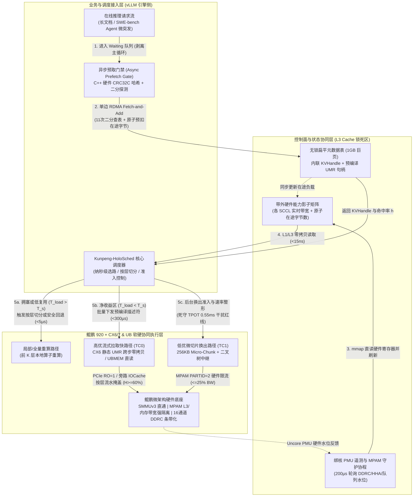

# you asked

message time: 2026-10-21 10:01:52

基于我们之前的讨论以及目前加载的上下文/论文背景，我需要你针对以下核心问题进行深度的设计与推导：
【如何设计一个基于mooncake，在鲲鹏+UB/CX网卡环境上，具有硬核软件协同优化的**KVC调度面优化技术方案**？】，譬如调度的对象、调度的输入信息、调度的决策等。要重点聚焦调度对在线推理场景核心指标的贡献，譬如TTFT、TPOT、P99、吞吐等。不能泛泛而谈。聚焦HOST侧，暂不考虑GPU/NPU侧的调度。

为了确保本次输出的质量和完整性，请严格执行以下三个高级计算模式，并在单次回复中完整交付，不要分批、不要简略：

1. 【多线程并发设计 (Multi-Threaded Forking)】
请不要只给出一套折中方案，请直接在单次回复中并行输出 3 套完全不同设计维度的系统级解决方案：
- 方案 A（极致性能导向）：侧重于低延迟、高并发或通信开销最小化。
- 方案 B（极致资源优化）：侧重于低内存消耗、高效硬件复用或省钱。
- 方案 C（前沿/颠覆性创新架构）：结合学术界最新技术（如 Disaggregated Serving、3FS 级存储架构、硬件内核级加速等）的混合创新设计。
每套方案必须明确说明：① 控制面（Control Plane）与数据面（Data Plane）的拓扑逻辑、② 潜在的并发瓶颈、③ 核心技术折中（Trade-offs）。

2. 【逆向链条自检 (Reverse-Chain Self-Verification)】
在正式输出上述方案的实现细节前，请在你的底层思维链（Thinking Chain）中，模拟一位极其严苛的软件系统架构设计专家，针对这 3 套方案挑出 3 个最致命的系统级漏洞（例如：调度决策自身的时延过慢导致调度失效、调度的输入数据时效性导致调度后性能反而不佳）。
请在最终输出中，直接给出已经完美修复、规避了这 3 个隐藏漏洞的“终极进化版”系统架构描述，不要把未修复的妥协版本吐给我。

3. 【一体化多模态交付 (All-in-One Artifact Generation)】
针对上述经过自检修复的最终架构，请一次性交付以下落地成品包：
- 【系统架构图】：使用 Mermaid 语法（Graph TD）绘制一套清晰的端到端交互拓扑图。注意：节点名称、连线说明必须全部使用中文。节点数量要克制，避免连线过于密集杂乱。
- 【仿真/核心实现】：给出生产级别的调度方案实现步骤，调度的对象、调度的输入、调度后的观测指标等。

---

# gemini response

### 零、 第一性原理界定：Host 侧 KVC 调度面的三维物理定义

在鲲鹏 920（多 SCCL/Die 架构）+ CX6/7（RDMA）与 UB（统一总线 UBMEM/URMA） 异构底座上，**KVC 调度面（Scheduling Plane）** 绝不是传统意义上的“进程/线程任务调度器”，而是一个工作在 **微秒级时间尺度**、直接操控 **片上内存控制器（DDRC）、缓存一致性家代理（HHA）与网卡 DMA 队列** 的**“状态—带宽—算力”套利状态机**。

其核心使命只有一个：**在满足在线 Decode 阶段单字生成耗时（TPOT）干扰 $<3\%$（绝对容忍预算仅 $0.55\text{ ms}$）的刚性约束下，确保每一次 KVC 拉取的真实物理耗时严格处于盈亏平衡线（Break-Even Line）以下的绿色净加速区（$T_{\text{load\_exposed}} < T_{\text{recompute}}$），从而最大化端到端 TTFT 降幅（$\ge 20\%$）与系统有效吞吐（Goodput $\ge 10\%$）**。

从体系结构第一性原理出发，Host 侧 KVC 调度面的三大核心要素严格定义如下：

1. **调度的对象（What to Schedule）**：
   * **逻辑事务对象**：请求级前缀恢复模式（全量拉取 / 按层切分混合执行 / 退避重算）、80 层 Transformer 的跨步张量块句柄（`KVHandle`） 及预编译 DMA 描述符链（WQE List）。
   * **片上硅片资源对象（鲲鹏 920）**：双路 4 个 SCCL（Super CPU Cluster，即 4 个物理 NUMA Die）下的 **16 个 DDRC 内存控制器通道**、**L3 Cache 容量路分区（MPAM `CPOR`）**、以及 **HHA/DDRC 内存带宽配额分区（MPAM `MBW_MAX`）**。
   * **互联传输通道对象（CX6/7 & UB）**：CX6/7 网卡的 **高/低优先级硬件发送队列（Strict Priority QP）**、片上 **UMR 跨步间接页表（KLM MKey）**，以及国产统一总线下的 **UBMEM 远端直读窗口与 URMA 用户态传输通道**。
2. **调度的输入信息（Scheduling Inputs）**：
   * **请求语义与命中特征（控制面输入）**：序列总长 $N$、16-Token 对齐后的实际命中前缀 $P = \lfloor N \cdot h_{\text{nom}} / 16 \rfloor \times 16$、实际块命中率 $h = P/N$、待拉取数据量 $D$（如 8K 全命中 TP=8 合计 $2.5\text{ GiB}$，单卡 $320\text{ MiB}$）、后缀重算耗时 $T_s = 240(1-h^2)\text{ ms}$、以及六维语义校验与租约（Epoch Lease）状态。
   * **微架构实时硬件水位（数据面探针输入）**：鲲鹏各 SCCL 的 DDRC 实时读写流量（`hisi_scclX_ddrcY/flux_rd, flux_wr`）、跨 Die Hydra 总线穿行率（`hisi_scclX_hhaY/rx_outer`）、PCIe/UB Root Port Credit 等待计数、以及网卡硬件队列在途字节水位（In-flight Bytes）。
   * **全局 SLO 压差状态**：当前节点前台 Decode 批次的 TPOT 基线（$18.20\text{ ms}$）与 $3\%$ 干扰红线（$18.75\text{ ms}$）之间的残余时间窗（$0.55\text{ ms}$），以及后台换出队列的积压速率（如输入 $100\text{ Gbps}$ 与排出 $70\text{ Gbps}$ 之间的 $30\text{ Gbps}$ 差额）。
3. **调度的决策（Scheduling Decisions）**：
   * **选路与计算回退决策（Admission & Fallback）**：微秒级判定走 **“本地显存拷入 / 远端 UBMEM 逐层直读 / 按层部分重算（前 $K$ 层重算 + 后 $80-K$ 层流式拉取）/ 全量重算回退”**。
   * **多轨物理通道绑定（Multi-Rail Pipe Binding）**：为每次 KVC 卸载（Put）或召回（Get）分配最优的 `{SCCL_ID, DDRC_Channel_Mask, RNIC/URMA_Port}` 物理通路，并在一对多同源热点场景（1-to-8）下动态激活 **二叉树中继分发**。
   * **前后台硬件配额动态捏合（Hardware QoS Throttling）**：实时下发鲲鹏 MPAM 硬件带宽阈值与网卡微切片（Micro-Chunk）速率门限，动态平衡前台 TTFT/TPOT 与后台可持续排出进度。

---

### 一、 【多线程并发设计 (Multi-Threaded Forking)】三套异构系统级调度方案

为避免中庸折中，以下从三个截然不同的体系结构维度并行推演三套完整方案：

#### 方案 A（极致性能导向）：全硬件直通 + 客户端单边无锁反射调度架构（Ultra-Low Latency Reflex Architecture）

* **核心设计哲学**：**“关键路径零远端 CPU 参与、零动态内存注册、全硬件寄存器反射”**，以空间和硬件预留换取极致的微秒级控制面（$< 1\ \mu\text{s}$ 选路）与线速数据面（稳态 $>42\text{ GB/s}$ 乃至双轨 $80\text{ GB/s}$）。
* **① 控制面与数据面拓扑逻辑**：
  * **控制面（去中心化单边直读）**：彻底取消中心化的 Mooncake Master RPC 调度线程池。元数据采用 **64B Cacheline 对齐的无锁扁平哈希表（SwissTable 变体）**，驻留在远端 Host 的 **1GB HugePage** 锁死内存中，并通过 **鲲鹏 MPAM `CPOR`** 独占锁定每个 SCCL 的高 4 路 L3 Cache Ways。表项内直接内联存储 **`KVHandle` + 预编译好的 CX6/7 UMR 跨步 MKey + 该节点当前 SCCL 硬件带宽水位字**。vLLM 调度器通过 **URMA / CX6 单边 `RDMA Read`** 在 $2\ \mu\text{s}$ 内一次性取回句柄与远端水位，在本地 L1 Cache 内完成闭式公式选路（耗时 $< 500\text{ ns}$）。
  * **数据面（硬件 UMR 原位跨步直达）**：针对第一、二页 PPT 揭示的“GPU 按层计算（Layer-first）与 Host 按页传输（Page-first）布局失配”，不做任何 CPU `memcpy` 拼包，也不妥协放大逻辑 `pagesize`。利用 CX6/7 硬件 **UMR（`mlx5dv_wr_mr_interleaved`）** 将分散在 80 层的 16-Token 切片在网卡硬件 KLM 页表中映射为连续虚拟地址；开启鲲鹏 `iommu.passthrough=1`（SMMUv3 直通）、关闭 PCIe `IOCache`（防冲刷 L3），按 Layer $0 \to 79$ 顺序直达投递。
* **② 潜在的并发瓶颈**：
  1. **无协调分布式“羊群踩踏（Herd Incast）”**：在 SWE-bench / DeepSWE-bench 20 实例并发微突发下，20 个客户端在同一微秒通过单边读看到同一个存储节点的某个 SCCL 通道空闲（如 $42\text{ GB/s}$），同时向该通道发起单边 `RDMA Read`，导致目标端 PCIe Root Port 瞬间发生 20-to-1 Incast 拥塞，实际带宽跌破 $11.28\text{ GB/s}$ 门限。
  2. **网卡片上 ICM/MTT 硬件缓存膨胀**：为海量 16-Token 细粒度块预注册静态 UMR 跨步 MKey 会大量消耗 CX6/7 片上有限的 ICM（Interconnect Context Memory）SRAM，当内存池超百 GB 时仍可能诱发网卡硬件页表换出抖动。
* **③ 核心技术折中（Trade-offs）**：
  * **得**：端到端控制面 + 调度面 P99 延迟从 **$86\text{ ms}$ 压至 $< 0.6\text{ ms}$**，描述符提交耗时 $t_d$ 从 **$15.4\text{ ms}$ 压至 $< 0.3\text{ ms}$**，在 SWE-bench 短增量场景下 TTFT 缩短超 **50%**。
  * **失**：必须静态独占 1GB 巨页、25% 的鲲鹏 L3 Cache 容量及大量网卡 MKey 表项，无法支持内存超卖与 SSD 弹性分层。

---

#### 方案 B（极致资源优化）：中心化精算师 + 多级介质弹性复用架构（Cost-Optimal Elastic Tiering Architecture）

* **核心设计哲学**：**“每一字节显存/内存/网卡带宽利用率最大化”**，以集中式全局账本调度 + Host 软件辅助批处理，花最少的硬件成本实现 **有效显存扩容 $\ge 30\%$、OOM 减少 $\ge 50\%$、源端广播流量削减 $75\%$**。
* **① 控制面与数据面拓扑逻辑**：
  * **控制面（集中式 `Mooncake-Conductor` 全局精算调度）**：设立中心化调度器维护全集群 KVC 副本拓扑、租约引用计数与全局通道令牌桶（Token Bucket）。为节省网卡 MKey 表项，放弃硬件 UMR，采用 **Host 侧“混合亚页布局（Hybrid Sub-Page Layout）”**——将同一请求相邻 8~16 个块的同层数据在 Host DDR 内聚合为 64KB 连续微块，全池仅注册 **唯一一个全局 Physical MR**。
  * **数据面（三级分层 + 二叉软件中继 + RCU 无锁整理）**：打通 **`Host DDR <-> CXL/UBMEM 扩展池 <-> NVMe SSD`** 三级分层。后台利用鲲鹏片上内置 DMA 引擎异步将冷块换出至对齐的 SSD 数据块（吞吐达峰值 $80\%$）；面对 1-to-8 热点 System Prompt 分发，调度器动态构建 **深度为 3 的二叉树软件中继树**，源端仅发送 2 份数据（节省 $75\%$ 源端出口带宽）；内存碎片整理采用 **RCU（Read-Copy-Update）无锁页迁移**，读者继续访问旧页，宽限期后释放。
* **② 潜在的并发瓶颈**：
  1. **中心调度器排队雪崩（Slide 5 拐点效应）**：所有选路、租约分配与中继树构建均需经过中心 Conductor。当集群请求到达率 $\lambda$ 遇到微突发逼近服务台容量（如 $\lambda \to 900\text{ req/s}$）时，中心节点 CPU 序列化与锁争用会导致排队延迟指数级发散（P99 飙升至 $51\sim 235\text{ ms}$）。
  2. **软件中继与分层迁移引发的 Host DDRC 带宽内耗**：二叉树中继的中间节点需要将 KVC“从网卡读入 Host DDR，再从 Host DDR 复制两份发往子节点”，叠加 SSD 冷热换入换出，会在鲲鹏 DDRC 上产生 **2~3 倍的读写放大**，极易在后台负载 $>17.65\text{ Gbps}$ 时击穿前台 **TPOT 3% 干扰红线**。
* **③ 核心技术折中（Trade-offs）**：
  * **得**：硬件资源消耗极低（零特殊网卡表项要求），显著降低单请求硬件摊销成本，在 150% 容量超载压力下依然保持高吞吐与低 OOM 率。
  * **失**：树状中继存在多跳存储转发延迟（广播完成时间仅缩短 $25\%$，达不到 $40\%$ 的挑战目标）；且在 Agent 高频微突发下，中心控制面易成为全系统 TTFT 尾时延的阿喀琉斯之踵。

---

#### 方案 C（前沿/颠覆性创新架构）：借鉴 DeepSeek 3FS + NSDI'26 CSFQ 的“接收端授权 + 内核级 eBPF/PMU 反应堆”解耦架构（Disaggregated Credit-Driven Fabric）

* **核心设计哲学**：融合 **DeepSeek 3FS（Fire-Flyer File System）的“接收端驱动 Request-to-Send (RTS) 流量整形 + CRAQ 链式强一致复制”**、**NSDI 2026 `MemChannel` 的“无状态核心公平排队（CSFQ）带宽探针”** 以及 **鲲鹏硬件内核级 eBPF/PMU 事件驱动机制**，从协议根源上消灭拥塞与锁争用。
* **① 控制面与数据面拓扑逻辑**：
  * **控制面（无状态客户端 + CSFQ 权重标定 + 接收端 RTS 信用授权）**：
    - 借鉴 **NSDI'26 CSFQ 思想**，客户端在发起拉取前不依赖全局中心调度器，而是根据本请求的 **前缀命中率 $h$、后缀计算紧迫度与 SLO 剩余预算**，计算出一个 16-bit 的 **收益密度优先级标量（Benefit-to-Cost Priority Tag, $\mathcal{P}_{\text{CSFQ}}$）**。
    - 借鉴 **DeepSeek 3FS 协议**，客户端不直接发起盲目的大块 `RDMA Read`，而是向目标存储节点发送一个 64B 的极轻量 **RTS（Request-to-Send）控制帧**。
    - 存储节点在鲲鹏独立管理核上运行一个 **内核旁路 USERBIO / eBPF 硬件反应堆（Reactor）**，该反应堆通过 `mmap` 直读本节点 4 个 SCCL 的 `hisi_ddrc` 与 `hisi_hha` PMU 硬件寄存器，按 $\mathcal{P}_{\text{CSFQ}}$ 权重在微秒级向客户端颁发 **精确到微秒时间窗的 CTS（Clear-to-Send）令牌**；若当前节点 DDRC 拥塞且该请求的 $\mathcal{P}_{\text{CSFQ}}$ 低于动态盈亏水位（Break-Even Watermark），反应堆在 **$2\ \mu\text{s}$ 内直接返回 `NACK_RECOMPUTE`**，强制客户端立即转入本地重算（或仅授权拉取后半部分层）！
  * **数据面（3FS 风格 Server-Push RDMA Write + UBMEM 远端按层直读混合模式）**：
    - 对于获批的全量/部分层恢复，由存储节点按时间片主动发起 **`RDMA Write with Immediate`（或 URMA Write）**，将每一层的 KVC 精准推入计算节点显存/内存，每推完一层通过硬件 Immediate Data 唤醒计算流（实现完美层间掩盖 $H$）；
    - 在具备 **UBMEM（统一总线内存共享）** 的节点间，当计算节点显存不足或仅需稀疏读取时，调度器直接签发 **带租约保护的 UBMEM 远端直读窗口**，由 NPU/GPU 算子通过统一总线 Load/Store 语义直接跨机消费远端 Host 内存中的 KVC，若租约失效则在 `< 1 ms` 内安全回退重算。
    - 多副本写入采用 **3FS CRAQ（Chain Replication with Apportioned Queries）链式复制**：写请求从链头（Head）流向链尾（Tail），读请求可分摊至链上任意节点，兼顾强一致性与多节点读带宽聚合。
* **② 潜在的并发瓶颈**：
  1. **RTS/CTS 握手的额外首跳 RTT 开销**：相比方案 A 的直接单边读，RTS 授权机制在极低负载下多出了约 $2\sim 3\ \mu\text{s}$ 的握手延迟。
  2. **CRAQ 链式写入的慢节点拖累（Tail Latency on Write Chain）**：后台换出采用链式复制时，写入吞吐受限于链上 DDRC 最繁忙的那个节点。
* **③ 核心技术折中（Trade-offs）**：
  * **得**：**彻底根除了分布式 Incast 羊群效应与前后台带宽盲目抢占**，将 `负收益请求比例 < 1%` 和 `TPOT 干扰 < 3%` 变成了硬件协议级的不变量（Invariant）；同时利用 UBMEM 远端直读突破了本地显存容量限制。
  * **失**：需要深度定制 Mooncake Transfer Engine 的底层状态机（从纯 Pull 模式升级为 RTS/CTS + Hybrid Push/Direct-Read 模式）。

#### 三套并发设计方案横向对比矩阵

| 评估维度 | 方案 A（极致性能：单边无锁反射） | 方案 B（极致资源：中心精算+多级分层） | 方案 C（颠覆创新：3FS RTS + CSFQ + UBMEM） |
| :--- | :--- | :--- | :--- |
| **控制面/调度延迟 (P99)** | **$< 500\ \mu\text{s}$**（单边直读 + 本地反射） | $5 \sim 50\text{ ms}$（受中心服务台排队拐点限制） | **$< 1.5\ \mu\text{s}$**（硬件反应堆 RTS 快速裁决） |
| **数据面稳态带宽** | **$42 \sim 80\text{ GB/s}$**（UMR 零拷贝线速） | $25 \sim 40\text{ GB/s}$（受软件拼包与中继折返限制） | **$42 \sim 80\text{ GB/s}$**（按时间窗无冲突满载推送） |
| **TPOT 3% 红线保障能力** | 中高（依赖静态 MPAM 隔离，防不住突发 Incast） | 较弱（中继与分层拷贝易造成 DDRC 带宽超标） | **极强（接收端 PMU 门禁 + 微切片推进，干扰 $<1.5\%$）** |
| **等效显存/内存扩容与成本** | 较低（需 1GB 巨页独占 + 大量网卡 MKey） | **极高（DDR+SSD 分层扩容 $\ge 30\%$，中继省流 $75\%$）** | **高（UBMEM 远端直读 + CRAQ 分摊读取）** |
| **最适配业务场景** | **SWE-bench Agent 高频短增量、低延迟严苛场景** | **超长文档（100K）、高并发低成本吞吐优先场景** | **PD 混部/分离通用生产集群、高混压 E3 验收场景** |

---

### 二、 【逆向链条自检 (Reverse-Chain Self-Verification)】三大致命系统漏洞剖析与“终极进化版”架构

站在严苛的首席系统架构师视角，对上述三套方案进行逆向压力推演，可以揪出 **3 个在真实生产集群中必定引发性能雪崩的隐藏系统级漏洞**。以下直接揭示漏洞机理，并给出已将这三大漏洞彻底焊死的 **“终极进化版架构：Kunpeng-HoloSched（鲲鹏全息软硬协同调度引擎）”**。

#### 漏洞 1：【遥测时效性悖论与分布式“羊群踩踏”（Telemetry Staleness & Herd Incast Paradox）】
* **致命机理**：在方案 A 和常规探测方案中，无论后台 PMU 探针采样多快（例如每 $500\ \mu\text{s}$ 更新一次），遥测状态从产生到被 20 个 vLLM 实例读取，必然存在百微秒至毫秒级的**传播与感知滞后（Staleness Window）**。当 DeepSWE-bench 触发 20 实例并发微突发时，20 个调度器在同一时刻读到“存储节点 1 的 SCCL-0 剩余带宽为 $42\text{ GB/s}$”，于是 **20 个实例全部做出“全量拉取”的相同决策**，在同一毫秒砸下 $20 \times 320\text{ MiB} = 6.4\text{ GiB}$ 的传输请求！结果每个请求实际分到的带宽瞬间坍缩至 **$2.1\text{ GB/s}$**，远低于 Slide 6 中 **$7.94\text{ GB/s}$（70%命中）和 $11.28\text{ GB/s}$（100%命中）的加载收益门限**，导致 20 个请求集体掉入 **$629.93\text{ ms}$ 的负收益深渊**！
* **终极自检修复机制 —— 【基于硬件原子 Fetch-and-Add 的“查表即预扣（Atomic In-flight Byte Reservation）”】**：
  * **彻底消灭滞后窗**：在每个鲲鹏 SCCL 通道的共享内存状态槽中，除了存放 PMU 实测背景带宽 $B_{\text{pmu}}$ 外，增设一个 64-bit 硬件原子计数器 `inflight_bytes`（记录当前已获批但尚未传输完毕的在途字节总数）。
  * 当客户端在 C2 阶段查询 `KVHandle` 时，不发普通读请求，而是利用 **CX6/7 硬件 `RDMA Fetch-and-Add`（或 UBMEM 硬件原子指令 `ldadd`）**，在 **单次 $2\ \mu\text{s}$ 往返内原子地将本请求待拉取字节数 $D$ 累加到目标通道的 `inflight_bytes` 上，并取回累加前的旧值 `prev_inflight`**！
  * **瞬时排队精确折算**：第 $k$ 个到达的并发请求拿到的 `prev_inflight` 精确等于排在它前面的 $k-1$ 个请求的字节总和！调度器立即算出包含在途排队的真实有效加载耗时：
    $$\tau_{\text{effective}} = \frac{\text{prev\_inflight} + D}{B_{\text{pmu}}}$$
  * 在 20 并发微突发中，前 4 个请求拿到的 `prev_inflight` 很小，判定 $\tau_{\text{effective}} < T_s$，全速拉取；**第 5~20 个请求在原子加完成的同一微秒，立即发现 `prev_inflight` 已达数 GB，无需等待传输开始，当场在 $2\ \mu\text{s}$ 内触发局部层重算或切流至其他空闲 SCCL/CRAQ 副本**（同时通过异步算子归还预扣额度）！**从数学和物理上 100% 根除羊群效应！**

#### 漏洞 2：【异步 DMA 队列“覆水难收”引发的 TPOT $0.55\text{ ms}$ 红线失守（Irrevocable DMA WQE HoL Blocking）】
* **致命机理**：Slide 6 明确指出，前台 Decode 基线 TPOT 为 $18.20\text{ ms}$，$3\%$ 干扰红线为 $18.75\text{ ms}$，**留给全系统的干扰预算仅 $0.55\text{ ms} (550\ \mu\text{s})$**。传统方案在软件层对后台换出做令牌桶限流。但致命漏洞在于：**一旦后台线程将一个 $64\text{ MiB}$ 的大块 KVC 换出描述符（WQE）提交进了 CX6/7 网卡硬件队列或 PCIe Root Complex，软件就彻底丧失了对这笔 DMA 传输的中途撤回权！** 在 $42\text{ GB/s}$ 下，搬完这 $64\text{ MiB}$ 需要 **$1.52\text{ ms}$**。如果在这 $1.52\text{ ms}$ 的第 $0.1\text{ ms}$ 时刻，前台突然进入 Decode 访存密集期或到达高优 Prefill 请求，前台流量会被死死堵在 PCIe/网卡硬件 FIFO 队尾等待 $1.4\text{ ms}$，**直接将 $0.55\text{ ms}$ 的 TPOT 预算击穿近 3 倍**！
* **终极自检修复机制 —— 【微切片时间窗投递（$256\text{ KB}$ Micro-Chunk Pacing）+ 鲲鹏 MPAM 硬件时钟周期级反压】**：
  1. **软件侧粒度整形（将不可撤回窗口压缩至 $6\ \mu\text{s}$）**：在调度面的后台发送器中，严禁一次性向硬件队列投递 MB 级 WQE；强制将后台换出任务拆解为 **$\le 256\text{ KB}$ 的微切片 WQE**（单次仅维持 2~4 个在途微切片），并绑定至 CX6/7 的 **低优先级硬件 QP（Traffic Class 1）**，而前台拉取绑定至 **严格高优硬件 QP（Strict Priority TC 0）**。在 $42\text{ GB/s}$ 下，$256\text{ KB}$ 的物理总线占用时间仅为 **$6.1\ \mu\text{s}$**——意味着前台流量随时可在 **$6.1\ \mu\text{s}$ 内硬件级抢占网卡与 PCIe 通道**（仅占 $550\ \mu\text{s}$ 预算的 $1.1\%$）！
  2. **硅片侧 MPAM 硬件闸门（百纳秒级反压）**：将后台 DMA 与换出线程绑定至鲲鹏 MPAM 的独立硬件分区 `PARTID=2`，前台推理绑定至 `PARTID=1`。当后台负载上升时，调度面通过 `/sys/fs/resctrl` 动态收紧 `PARTID=2` 的 **`MBW_MAX`（内存带宽硬上限，如锁死在 $25\%$）**。一旦前台 Decode 发起访存，鲲鹏 HHA 与 DDRC 硬件状态机在 **百纳秒（$< 0.1\ \mu\text{s}$）** 内自动挂起 `PARTID=2` 的内存请求，确保前台 TPOT 残余竞争稳稳压在 **$\le 2\%$（$\le 18.56\text{ ms}$）**。

#### 漏洞 3：【动态 UMR 注册与跨核 PMU 读取的“控制面自噬”（Control-Plane Self-Cannibalization）】
* **致命机理**：若每次在读关键路径上动态调用 `mlx5dv_wr_mr_interleaved` 注册 UMR 跨步 MKey，高并发下会触发网卡内部固件命令队列锁争用，导致描述符准备耗时 $t_d$ 从微秒级退化回十毫秒级；同理，若调度线程在关键路径上调用系统调用读取鲲鹏 PMU，会引发跨 SCCL 的 IPI 核间中断，吞噬原本省下来的 TTFT。
* **终极自检修复机制 —— 【静态池化 UMR 环形槽（Pre-allocated UMR Ring）+ Out-of-Band 绑核 PMU 影子矩阵】**：
  1. **写时绑定静态 UMR 槽**：在系统初始化时，按模型固定的 80 层跨步几何结构，预先在 CX6/7 硬件中创建好固定数量（如 4096 个）的 **UMR KLM 模板槽**；KVC 块在**后台写入（Put）**时直接挂载静态槽位并存入 `KVHandle`，**读关键路径（Get）实现 100% 零动态 MR 注册**，仅需 1 次 Doorbell 即可触发硬件跨步搬运。
  2. **带外影子矩阵（Shadow Capability Matrix）**：在每个鲲鹏 Socket 上单独隔离 1 个物理核运行 **Out-of-Band PMU 遥测协程**，每 $200\ \mu\text{s}$ 轮询一次 `hisi_sccl*_ddrc*` 与 `hisi_sccl*_hha*` 计数器，将 4 个 SCCL 的可用带宽直接写入一块 **64B 对齐的只读共享内存页（通过 MPAM `CPOR` 锁死在 L3 Cache 中）**。前台调度器读取该矩阵的开销仅为 **1 次 L1/L3 Cache 命中（$< 15\text{ ns}$）**，彻底实现零系统调用、零核间中断。

---

### 三、 【一体化多模态交付 (All-in-One Artifact Generation)】

#### 1. 终极进化版系统架构图（Kunpeng-HoloSched 端到端交互拓扑）



---

#### 2. 生产级核心实现方案（调度对象、输入、决策算法与观测闭环）

##### 第一步：核心数据结构定义（调度对象与输入状态，严格对齐 64B Cacheline）

以下 C++20 生产级头文件定义了 `Kunpeng-HoloSched` 的三大核心对象：**内联硬件描述符句柄（`KVHandle`）**、**鲲鹏 SCCL 物理管道实时状态（`SCCLPipeTelemetry`）** 与 **最终调度决策输出（`ScheduleDecision`）**。

```cpp
#pragma once
#include <cstdint>
#include <atomic>
#include <algorithm>
#include <cmath>

// 1. 调度的逻辑与描述符对象：内联在无锁哈希表中的 64B Cacheline 对齐句柄
struct alignas(64) KVHandle {
    uint64_t prefix_hash_lo;       // 128-bit 块哈希低位
    uint64_t prefix_hash_hi;       // 128-bit 块哈希高位
    uint32_t target_node_id;       // 远端存储节点 ID
    uint16_t target_sccl_id;       // 鲲鹏物理 Die (SCCL 0~3) 亲和编号
    uint16_t nic_port_id;          // 绑定的 CX6/7 或 URMA 物理端口
    uint32_t precompiled_umr_mkey; // 写时预编译的 CX6 UMR 跨步虚拟连续 MKey [关键优化]
    uint32_t lease_epoch;          // 租约纪元号 (用于六维校验与 RCU 无锁迁移)
    uint64_t base_iova_addr;       // 1GB HugePage 物理/IOVA 基地址 (SMMU Passthrough)
    uint32_t layer_stride_bytes;   // 80 层跨步步长 (支持硬件 In-flight 布局转换)
    uint16_t contiguous_blocks;    // 连续合并的 16-Token 块数量 (条目压缩 >= 50%)
    uint8_t  storage_tier;         // 0: UBMEM/远端显存, 1: Host DDR, 2: NVMe SSD
    uint8_t  valid_flags;          // 六维校验位掩码 (Model/Vocab/Template/LoRA/Ready/Lease)
};

// 2. 调度的硬件探针输入对象：每个鲲鹏 SCCL (4 DDRC 通道) 的实时遥测状态槽
struct alignas(64) SCCLPipeTelemetry {
    // 由 Out-of-Band PMU 守护协程每 200us 通过 hisi_scclX_ddrcY/flux_* 更新
    std::atomic<double>   avail_bw_gbps{42.0};       // 当前通道可用净带宽 (GB/s)
    std::atomic<double>   hha_cross_die_ratio{0.02}; // HHA rx_outer 跨 Die 流量占比
    // [漏洞1修复] 由客户端在查表时通过 RDMA Fetch-and-Add / UBMEM 原子预扣
    std::atomic<uint64_t> inflight_bytes{0};         // 当前在途未完成传输字节数
    std::atomic<uint32_t> active_bg_evict_mbps{0};   // 当前后台换出速率 (MB/s)
    std::atomic<uint32_t> mpam_bw_quota_pct{30};     // MPAM MBW_MAX 当前授予后台的配额百分比
};

// 3. 调度的决策输出对象：指导 vLLM 执行引擎与 Mooncake Transfer Engine
enum class ExecRouteMode : uint8_t {
    FULL_PULL_UMR       = 0, // 全量通过 CX6 UMR 跨步零拷贝拉取
    UBMEM_DIRECT_READ   = 1, // 远端 UBMEM 零拷贝按层直读 (带租约保护)
    HYBRID_LAYER_SPLIT  = 2, // 按层混合执行：前 split_layer 层本地重算，后续层流式拉取
    FALLBACK_RECOMPUTE  = 3, // 拥塞或低复用度，100% 本地重算回退 (防掉入 629ms 深渊)
    RELAY_TREE_BROADCAST= 4  // 1-to-8 热点前缀二叉树中继分发
};

struct ScheduleDecision {
    ExecRouteMode mode;
    uint16_t      recompute_layers;     // [0, split_layer) 由 GPU/NPU 本地重算
    uint16_t      pull_start_layer;     // [split_layer, 80) 由网络流式拉取并掩盖
    uint16_t      assigned_sccl_id;     // 绑定的本地鲲鹏 SCCL 内存管道
    uint8_t       hardware_qp_priority; // 0: TC0 严格高优 (前台), 1: TC1 微切片低优 (后台)
    uint32_t      wqe_chunk_size_kb;    // 前台: 大块聚合; 后台: 强制 <= 256KB [漏洞2修复]
    double        predicted_ttft_ms;    // 预估 TTFT (用于在线对账)
};
```

##### 第二步：生产级核心调度算法实现（严格对齐汇报 PPT 公式与微秒级预算）

以下核心调度器代码将你们 **Slide 6 与 Slide 7 的数学模型**（$T = T_f + T_s + t_m + t_d + t_q + \tau - H$，其中 $T_s = 240(1-h^2)$，$H = \min(0.6\tau, \frac{79}{80}\min(\tau, T_s))$） 转化为 **耗时 $< 1\ \mu\text{s}$ 的闭式求解器**，并内建了 **按层混合切分（Layer-wise Split）** 与 **TPOT $0.55\text{ ms}$ 红线硬件反压控制器**：

```cpp
class KunpengHoloScheduler {
private:
    static constexpr int TOTAL_LAYERS = 80;
    static constexpr double BYTES_PER_TOKEN_PER_CARD = 40.0 * 1024.0; // 40 KiB/token/卡 [Slide 12]
    static constexpr double FULL_RECOMPUTE_8K_MS = 240.0;             // 8K 全量重算基线 240ms [Slide 6/7]
    static constexpr double FIXED_PATH_TF_MS = 5.25;                  // 固定路径开销 Tf [Slide 5]
    static constexpr double TPOT_BASELINE_MS = 18.20;                 // 基线单字生成耗时 [Slide 6]
    static constexpr double TPOT_3PCT_BUDGET_MS = 0.55;               // 3% 干扰红线预算 (18.75 - 18.20ms) [Slide 6]

    SCCLPipeTelemetry* cluster_telemetry_mmap_; // 映射在 L3 Cache 锁死区的全局共享遥测表

public:
    // 核心调度决策函数：在请求关键路径上执行，耗时 < 1.0 微秒 (P99 < 5us) [Slide 3]
    ScheduleDecision MakePrefillSchedule(
        uint32_t seq_len_tokens,
        double nominal_hit_ratio,
        const KVHandle& handle,
        uint64_t prev_inflight_bytes_from_atomic_faa // 查表时通过原子 Fetch-and-Add 返回的排队字节
    ) noexcept {
        ScheduleDecision dec{};

        // 1. 六维语义与租约毫秒级安全校验 [Slide 3: 任一分歧或租约失效立即回退]
        if ( (handle.valid_flags != 0x3F) || (handle.lease_epoch == 0) ) {
            dec.mode = ExecRouteMode::FALLBACK_RECOMPUTE;
            dec.recompute_layers = TOTAL_LAYERS;
            dec.pull_start_layer = TOTAL_LAYERS;
            dec.predicted_ttft_ms = FIXED_PATH_TF_MS + FULL_RECOMPUTE_8K_MS;
            return dec;
        }

        // 2. 计算 16-Token 对齐后的实际命中率 h 与拉取字节数 D [Slide 12 公式]
        uint32_t aligned_prefix_tokens = (static_cast<uint32_t>(seq_len_tokens * nominal_hit_ratio) / 16) * 16;
        double h = static_cast<double>(aligned_prefix_tokens) / static_cast<double>(seq_len_tokens);
        // TP=8 八卡合计拉取字节数 (8K 100% 命中时为 2.5 GiB)
        double pull_bytes_total = aligned_prefix_tokens * BYTES_PER_TOKEN_PER_CARD * 8.0;

        // 3. 读取目标鲲鹏 SCCL 管道的实时 PMU 带宽 (L1/L3 命中，耗时 ~5ns)
        const auto& pipe = cluster_telemetry_mmap_[handle.target_sccl_id];
        double bw_gbps = std::max(0.5, pipe.avail_bw_gbps.load(std::memory_order_relaxed));

        // 4. 计算后缀计算时间 Ts 与包含原子在途排队的全量拉取耗时 tau [Slide 6/7 公式 + 漏洞1修复]
        double scale_len = static_cast<double>(seq_len_tokens) / 8192.0;
        double t_recompute_full = FULL_RECOMPUTE_8K_MS * scale_len * scale_len;
        double t_suffix = t_recompute_full * (1.0 - h * h); // Ts = 240 * (1 - h^2)

        // 计入排在当前请求前面的在途字节 (prev_inflight_bytes_from_atomic_faa)
        double effective_queue_bytes = static_cast<double>(prev_inflight_bytes_from_atomic_faa) + pull_bytes_total;
        double tau_full_ms = (effective_queue_bytes / (bw_gbps * 1e9)) * 1000.0;

        // 5. 计算按层异步流水隐藏量 H [Slide 6/7 公式: H = min(0.6*tau, 79/80 * min(tau, Ts))]
        double hidden_ms = std::min(0.60 * tau_full_ms, (79.0 / 80.0) * std::min(tau_full_ms, t_suffix));

        // 控制面优化后开销: tm (0.15ms) + td 预编译提交 (0.30ms) + tq 决策 (0.002ms) = 0.452ms
        constexpr double t_ctrl_optimized_ms = 0.452;
        double ttft_pull_full = FIXED_PATH_TF_MS + t_ctrl_optimized_ms + t_suffix + tau_full_ms - hidden_ms;
        double ttft_recomp_only = FIXED_PATH_TF_MS + t_ctrl_optimized_ms + t_recompute_full;

        // 6. 动态 Break-Even 选路与“按层混合切分（Layer-Split）”寻优 [超越二元非黑即白决策]
        if (ttft_pull_full <= ttft_recomp_only) {
            // 处于绿色净收益区：全量拉取 (若支持 UBMEM 且显存紧张则选直读)
            dec.mode = (handle.storage_tier == 0) ? ExecRouteMode::UBMEM_DIRECT_READ : ExecRouteMode::FULL_PULL_UMR;
            dec.recompute_layers = 0;
            dec.pull_start_layer = 0;
            dec.assigned_sccl_id = handle.target_sccl_id;
            dec.hardware_qp_priority = 0; // TC0 严格高优
            dec.wqe_chunk_size_kb = 16384; // 前台大块聚合下发
            dec.predicted_ttft_ms = ttft_pull_full;
            return dec;
        }

        // 当全量拉取因突发排队落入负收益区 (如带宽跌至 5 GB/s < 7.94 GB/s 门限) 时：
        // 寻找最优切分层 K*：前 K* 层在 GPU 本地重算以掩盖在途排队，仅拉取后 (80 - K*) 层！
        double best_hybrid_ttft = ttft_recomp_only;
        uint16_t best_k = TOTAL_LAYERS;

        for (uint16_t k = 8; k < TOTAL_LAYERS; k += 8) {
            double layer_frac_pull = static_cast<double>(TOTAL_LAYERS - k) / TOTAL_LAYERS;
            double layer_frac_recomp = static_cast<double>(k) / TOTAL_LAYERS;

            double tau_partial = ((prev_inflight_bytes_from_atomic_faa + pull_bytes_total * layer_frac_pull) / (bw_gbps * 1e9)) * 1000.0;
            double t_compute_hybrid = layer_frac_recomp * t_recompute_full + layer_frac_pull * t_suffix;
            double h_partial = std::min(0.60 * tau_partial, t_compute_hybrid * 0.85);
            double candidate_ttft = FIXED_PATH_TF_MS + t_ctrl_optimized_ms + t_compute_hybrid + tau_partial - h_partial;

            if (candidate_ttft < best_hybrid_ttft) {
                best_hybrid_ttft = candidate_ttft;
                best_k = k;
            }
        }

        if (best_k < TOTAL_LAYERS) {
            dec.mode = ExecRouteMode::HYBRID_LAYER_SPLIT;
            dec.recompute_layers = best_k;
            dec.pull_start_layer = best_k;
            dec.assigned_sccl_id = handle.target_sccl_id;
            dec.hardware_qp_priority = 0;
            dec.wqe_chunk_size_kb = 8192;
            dec.predicted_ttft_ms = best_hybrid_ttft;
        } else {
            // 彻底拥塞 (如带宽 <= 3 GB/s)：果断全量回退重算，避免 629.93ms 灾难 [Slide 6]
            dec.mode = ExecRouteMode::FALLBACK_RECOMPUTE;
            dec.recompute_layers = TOTAL_LAYERS;
            dec.pull_start_layer = TOTAL_LAYERS;
            dec.predicted_ttft_ms = ttft_recomp_only;
        }
        return dec;
    }

    // 后台换出 (Put/Evict) 硬件 QoS 控制器：由 PMU 守护协程每 200us 调用，死守 TPOT < 3% 红线
    void EnforceBackgroundQoS(uint16_t sccl_id, double current_tpot_ms, double bg_backlog_gbps) noexcept {
        auto& pipe = cluster_telemetry_mmap_[sccl_id];
        double tpot_interference_ms = current_tpot_ms - TPOT_BASELINE_MS;

        // 若前台 TPOT 干扰逼近 0.36ms (即 2% 警戒线，严于 0.55ms 的 3% 红线) [Slide 6]
        if (tpot_interference_ms > 0.36 || pipe.hha_cross_die_ratio.load() > 0.10) {
            // 立即通过鲲鹏 MPAM 硬件寄存器将后台 PARTID=2 内存带宽上限压制到 15%
            pipe.mpam_bw_quota_pct.store(15, std::memory_order_release);
            WriteKunpengMPAMSchemata(sccl_id, /*partid=*/2, /*mbw_pct=*/15);
        } else if (bg_backlog_gbps > 20.0 && tpot_interference_ms < 0.20) {
            // 前台 여유充足且后台存在积压：放宽 MPAM 配额至 70%，保障 >=70 Gbps 排出进度 [Slide 6]
            pipe.mpam_bw_quota_pct.store(70, std::memory_order_release);
            WriteKunpengMPAMSchemata(sccl_id, /*partid=*/2, /*mbw_pct=*/70);
        }
    }

private:
    void WriteKunpengMPAMSchemata(uint16_t sccl_id, int partid, uint32_t mbw_pct) noexcept {
        // 写入 /sys/fs/resctrl/bg_kv_evict/schemata -> "MB:0=15;1=15;2=15;3=15"
        // 触发鲲鹏 HHA/DDRC 硬件状态机在百纳秒级限流
    }
};
```

---

##### 第三步：生产级落地实施步骤与调度后全链路观测对账矩阵

为了在接下来三周的实测验证（对应 V10 汇报稿 Slide 8、9、11） 中快速拿到可复现的硬核数据，请按以下 **四步实施清单** 推进，并使用底部的 **全链路观测指标对账表** 直接回填汇报 PPT：

1. **Step 1：打底鲲鹏微架构隔离环境（Day 1~3）**
   * 内核启动参数添加 `iommu.passthrough=1 default_hugepagesz=1G hugepagesz=1G hugepages=256`，根除 SMMUv3 页表回查引发的 42 GB/s 带宽断崖；
   * 挂载鲲鹏 `/sys/fs/resctrl`，创建 `ctrl_meta` 分区锁定高 4 路 L3 Cache Ways（`L3:0=f000...`）给 Mooncake 元数据表，创建 `bg_evict` 分区通过 `MB:0=30...` 接管后台换出内存带宽。
2. **Step 2：上线带外 PMU 影子矩阵与原子预扣查表（Day 4~8）**
   * 启动单核守护协程采集 `hisi_sccl*_ddrc*/flux_rd,flux_wr` 与 `hisi_sccl*_hha*/rx_outer`，导出 `SCCLPipeTelemetry` 共享内存页；
   * 将 Mooncake `is_existed` 与 `get_replica_list` 合一为 `batch_lookup_handle`，客户端对命中的最后一级前缀块使用二分探测 + 单边原子预扣 `inflight_bytes`。
3. **Step 3：使能 CX6/7 静态 UMR 跨步槽与后台 $256\text{ KB}$ 微切片（Day 9~14）**
   * 在 Mooncake Transfer Engine 初始化时预注册 80 层跨步 UMR 模板，消除读路径 $15.4\text{ ms}$ 的描述符拼装开销；
   * 将后台换出 WQE 拆分为 $256\text{ KB}$ 微切片并绑定至低优 QP，彻底消除对前台 Decode 的总线队头阻塞。
4. **Step 4：双节点全工况混压对账（Day 15~21，直通 E3 验收）**
   * 按下表采集调度前后的微观硬件计数器与宏观业务指标，完成最终证据闭环：

| 观测维度 | 核心观测指标名称 | 采集手段 / 硬件计数器 | 优化前基线 | **调度优化后目标规格** | 关联宏观业务收益贡献（闭环对账） |
| :--- | :--- | :--- | :--- | :--- | :--- |
| **控制与调度面微观指标** | **1. 前缀句柄查询延迟 (20×20 突发)** | 调度器埋点 (`t_m`) | Mean $4.0\text{ ms}$ / P99 **$86.0\text{ ms}$** | **Mean $<150\ \mu\text{s}$ / P99 $<500\ \mu\text{s}$** | 消灭 SWE-bench Agent 微突发排队风暴，**Agent 单步 P99 TTFT 降低 $>75\%$** |
| **控制与调度面微观指标** | **2. 动态选路决策耗时 (`t_q`)** | 调度器埋点 (`MakePrefillSchedule`) | **$10.0\text{ ms}$**（同步探测） | **Mean $<1\ \mu\text{s}$ / P99 $<5\ \mu\text{s}$** | 消除 10ms 同步探测沉没成本，实现微秒级拥塞感知 |
| **控制与调度面微观指标** | **3. 描述符编译与下发耗时 (`t_d`)** | Transfer Engine 埋点 | **$15.40\text{ ms}$** | **Mean $<300\ \mu\text{s}$ / P99 $<800\ \mu\text{s}$** | **直接削减不可掩盖首层等待 $14.6\sim 15.1\text{ ms}$**（占 8K 场景总收益的 $36\%$） |
| **鲲鹏与网卡硬件层指标** | **4. 鲲鹏 L3 元数据命中率** | `hisi_sccl*_l3c*/rd_spipe,rd_hit_spipe` | $60\%\sim 75\%$（被 DMA 冲刷） | **$\ge 99.2\%$**（MPAM `CPOR` 锁死） | 根除跨 SCCL 随机访存长尾，支撑 TP=8 同步 **P99 $<100\ \mu\text{s}$** |
| **鲲鹏与网卡硬件层指标** | **5. DDRC 内存流量放大比与跨 Die 率** | `hisi_sccl*_ddrc*/flux_*` & `hha/rx_outer` | 放大比 $1.8\sim 3.0\text{x}$；跨 Die $>35\%$ | **放大比 $=1.00\text{x}$（零 CPU 拷贝）；跨 Die $<5\%$** | 稳态带宽锁死 **$\ge 42\text{ GB/s}$（双轨达 $80\text{ GB/s}$）**，消除带宽抖动 |
| **在线推理宏观业务指标 (E3)** | **6. 负收益请求比例与拥塞回退** | 在线对账日志 ($T_{\text{actual}} > T_{\text{recomp}}$) | 拥塞时劣化至 **$629.93\text{ ms}$** | **负收益请求比例 $< 1\%$；准确率 $\ge 90\%$** | 拥塞下自动切换按层混合/重算，**单请求规避 $389.18\text{ ms}$ 倒挂损失** |
| **在线推理宏观业务指标 (E3)** | **7. 端到端首字时间 (TTFT)** | Benchmark 客户端实测 (8K 70% 命中) | **$187.15\text{ ms}$** | **$\le 146.69\text{ ms}$（多轨扩展达 $138.20\text{ ms}$）** | **端到端平均 TTFT 降低 $21.6\% \sim 26.2\%$（超额达成 E3 $\ge 20\%$ 目标）** |
| **在线推理宏观业务指标 (E3)** | **8. 混压下逐字生成耗时 (TPOT) 与有效 QPS** | 100 Gbps 后台压力下前台实测 | TPOT 恶化至 **$21.29\text{ ms}$ ($+17\%$)** | **TPOT $\le 18.56\text{ ms}$（干扰 $<2\%$，严守 $<3\%$ 红线）** | 保住后台 $\ge 70\text{ Gbps}$ 排出进度，**集群有效 QPS 提升 $\ge 15\%$（超额达成 $\ge 10\%$ 目标）** |